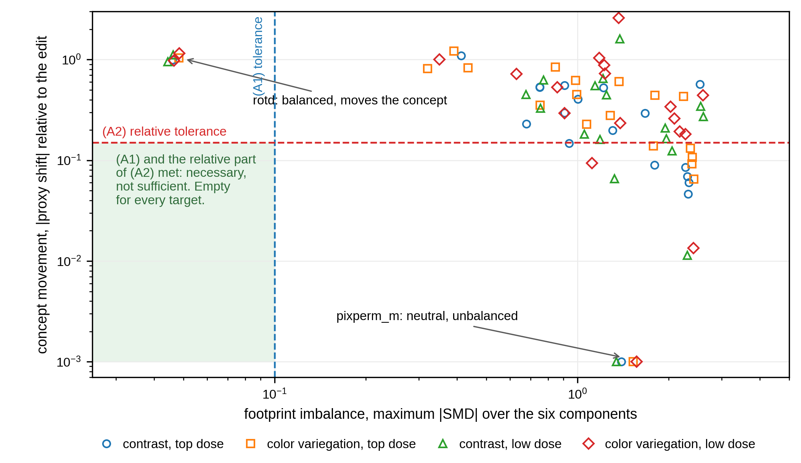

# An Identification Ladder for Causal Auditing of Skin-Lesion Classifiers: Performed Artifact Edits and Concept Components

**Quang Toan Dao**¹·² (dqtoan@ioit.ac.vn), **Viet Anh Nguyen**¹ (anhnv@ioit.ac.vn)

¹ Institute of Information Technology, Vietnam Academy of Science and Technology, Ha Noi, Viet Nam

² Graduate University of Science and Technology, Vietnam Academy of Science and Technology, Ha Noi, Viet Nam

## Abstract

Perturbation tests and concept attributions of skin-lesion classifiers are often read causally without a named estimand. We ask which causal claims a perturbation audit can support. We organize the audit as an identification ladder: every claim has an estimand, each step names one condition, and a claim stops at the first unestablished one. For performed hair and ruler overlays, an equivalence and minimum-effect interval rule gives verdicts at a stated error rate. For concept edits, an additive working form makes a placebo correction target a footprint-relative concept component. Classical estimability shows that an edit library identifies it only through a route, a chain of footprint-sharing edits that ends in a latently neutral control. Footprints can exclude, but never certify, such a route before any model output is read. We audited six checkpoints on 183 held-out ISIC-2024 images from 100 patients. All 18 model-by-subgroup cells exceeded every invariance tolerance below 0.042 probability units, jointly and one-sided at nominal 95%. This holds for a superpopulation exchangeable with the audited patients, given the realized overlays and benign draw; transfer to real artifacts is untested. At four concept targets, none of 19 candidate controls passed model-free screens, and the library holds no exact route, so no placebo correction was certified; this is not a zero effect. A pre-specified falsification test on selection-fold images nominally flagged inconsistent candidate routes; its band undercovered, so the flags carry no controlled error rate; one survived post hoc recalibration. On real images, the procedure has so far only refused.

**Index Terms:** Causal inference, concept attribution, dermatology, equivalence testing, explainable artificial intelligence, identification, medical image analysis, shortcut learning.

## I. Introduction

Deep classifiers can match dermatologists in classifying skin-lesion images [1]. Hair, rulers and surgical markings in such images can carry label information [2], [3], and a model trained for accuracy can exploit them [4]. An auditor therefore asks how the prediction would change if an artifact were added, or a concept such as color variegation were changed, with the lesion otherwise fixed.

Existing shortcut and concept studies leave two gaps. On the artifact side, a change in score is not a verdict of invariance at a stated error rate, and carrying a synthetic overlay's response to a real artifact is a further condition. On the concept side, a placebo-corrected score recovers the concept component only if the placebo matches the concept edit in everything the classifier responds to except the concept. Neither the causal concept effect [5] nor identifiability results for representations [6] say when a finite library of performed edits can recover that component. Without a valid control, the subtraction still returns a number, and nothing marks it as uncertified.

We ask which causal claims a perturbation audit of a trained classifier can support, and where each claim stops. Our answer is an identification ladder, which applies causal roadmaps [7] with explicit stopping rules. It is not the ladder of causation [8], which ranks kinds of causal query; it orders the estimands of one audit. For concepts, the response to an edit is a footprint term plus a concept term. The edit library then forms a two-way layout, to which the classical connectivity condition for estimability applies [9], and the placebo contrast is its shortest route. We make three contributions.

1. **An identification ladder for classifier audits.** Every claim, in both audit tiers, gets an estimand, a status for each condition and the condition at which it stops (Fig. 1 and Table 3).
2. **An artifact decision rule with a stated error rate.** Equivalence and minimum-effect tests [10] and max-statistic bands [11], [12] are inherited; the audit reports their verdicts as a frontier of tolerances. All 18 model-by-subgroup cells exceed every tolerance below 0.042 probability units on a simultaneous bound (Section IV-A). The rule also accepts on a dose ladder, and its marginal verdicts repeat on a second cohort [13].
3. **A procedure that refuses uncertified placebo corrections, with a falsification test of candidate routes.** It inherits classical estimability for two-way layouts [9] and is an audit decision protocol, not a new theorem or estimator. Its new part is a design consequence: the component a placebo correction targets is identified only through a route, a chain of footprint-sharing edits that ends in a latently neutral control (condition N). A control library is therefore a route problem, not a matching problem. On real images it has so far been shown only to refuse, as the three screens do, but with a stated reason and scope (Table 3). Positive recovery is shown on a simulated response, and a pre-specified test on selection-fold images gives nominal flags.

The artifact tier and the concept effect rest on one assumed causal graph. The concept component rests on one edit library, one footprint and the additive working form, and the route test on one constructed control design.

## II. Related Work

A causal audit must separate evidence that a classifier responds to an image change from evidence about the effect of the intended artifact or concept. Shortcut studies motivate it (Section II-A), and concept-attribution methods show which quantities an explanation may represent (Section II-B). Together they frame our question: what can a finite library of image edits identify, and under which conditions? Section II-C supplies the tools for answering it and for saying where an audit must stop.

### A. Shortcut reliance in skin-lesion classifiers

When the same nevi were imaged after skin marking, a network's specificity fell from 84.1 to 45.8%, and cropping the marks restored it [14]. Occlusion and bias tests show the same reliance, which debiasing did not remove [2], [3]. Inpainting color-chart patches [15], unlearning artifacts [16], invariance objectives [17] and counterfactual invariance [18] target it, and dermatologist-reviewed generative counterfactuals reveal it [19].

### B. Concept attribution and identifiability

Concept activation vectors and concept extraction measure sensitivity along directions in activation space [20], [21], and concept bottleneck models route predictions through annotated concepts [22]. The causal concept effect is the prediction change under a concept intervention [5]. Identifiability work asks when concepts can be recovered from a representation [6], [23], [24] or a causal model is realized inside a network [25], whereas we study a model's output. Benchmarks with human-written counterfactuals [26] supply interventional evidence that a pixel-edit library lacks; we ask what can be identified without it. Counterfactual language models [27] and causal proxy models [28] approximate counterfactuals for language models, and an approximation is not a certified intervention.

### C. Causal and statistical foundations

In a two-way additive layout, a contrast between levels of one factor is estimable exactly when those levels are connected in the design's incidence graph [9], and connectedness has a classical test [29]. When it fails, partial identification reports the set of values the data allow [30]; Consequence 2 below and Statement 2 in Supplementary Section S15 are bounds of this kind. Equivalence and minimum-effect tests decide whether an effect lies inside or outside a margin [10], [31]. Our placebo borrows the logic of a negative control [32], but it is neutral for the concept, not for the outcome. Our cycle test borrows the logic of an overidentification test [33]: disagreement among routes shows that a shared condition fails, while agreement validates none. Indirect comparisons through a common comparator [34] and loop-inconsistency checks in treatment networks [35] share this structure of paths and redundant comparisons. Estimability, equivalence testing and consistency checks are inherited; our part is to turn their conditions into audit decisions for a finite edit library and to derive what follows for its design.

Together, these studies distinguish sensitivity, concept attribution and causal effects, but they do not establish what a finite edit library identifies (Supplementary Section S11). The method below assigns each audit claim a target, the conditions it needs, and a stopping rule.

## III. Method

The audit is organized around the gap between a measured response and a causal reading that needs further conditions. Section III-A defines the predictor, targets and identification ladder, so that each decision refers to a stated claim. Section III-B decides whether performed artifact edits exceed an invariance tolerance, and Section III-C whether an edit library can isolate a concept component or support a concept-intervention claim. Section III-D fixes the images, checkpoints and sources of variation.

### A. Causal structure, audit targets and the identification ladder

**Variables and graph.** $Z$ denotes measured confounders: age, sex, anatomical site, acquisition site and skin tone. Skin tone enters only through colorimetric fields of the dataset's metadata [36], a proxy rather than a clinical rating, and no analysis adjusts for $Z$. $\mathit{Dis}$ is the latent disease state and $C$ the clinical appearance, of which we measure contrast, color variegation and size and edit the first two. $X$ is the image, $U$ the artifacts and $Y$ the recorded label (Fig. 1(a)). The graph has no directed path from $U$ to $Y$, but $U \leftarrow Z \to Y$ lets an artifact carry label information. This exclusion is assumed; the metadata do not record how a label was confirmed, so no verified count of such labels exists (Supplementary Sections S8 and S16). Fig. 1(a) also omits a clinical-suspicion mechanism, $H$, drawn in Supplementary Section S16; estimating performed-edit responses needs no adjustment for it.

**The audited predictor.** The classifier $f$, which maps an image to the malignant-class probability, is a checkpoint together with a fixed inference protocol $P$: preprocessing, numerical precision and the composition and order of each batch. Through floating-point order, a score can depend on the other inputs in its batch, a numerical form of interference. Every target, response and C1a is therefore defined for $P$ with its fixed batches, and each equation uses one protocol and one image set (Supplementary Sections S4 and S20).

**Fig. 1.** The assumed causal graph (a) and the identification ladder (b). T0 is a sampling condition, assumed and untested. Untested N means assumed, not settled.

**Two artifact targets.** Let $T_A$ be an edit operator indexed by artifact type and dose $A$, $\pi$ a distribution over operators and $Q$ one over images. The performed-edit target is

$$
\theta^{\mathrm{edit}}(Q,\pi) = \Big( \mathbb{E}[\Delta f],\ \mathbb{E}\lvert\Delta f\rvert \Big), \qquad \Delta f = f\big(T_A(X)\big) - f(X), \quad X \sim Q,\ A \sim \pi. \tag{1}
$$

The intervention target $\theta^{\mathrm{do}}(Q,\nu)$ replaces $T_A(X)$ by $X_{\mathrm{do}(U = u \oplus V)}$, the image the lesion would have produced had a real artifact $V \sim \nu$ been added to the artifact $U = u$ it shows. Here $\pi$ is uniform over the four held-out operators as realized by the seeded generator, so $\theta^{\mathrm{edit}}$ is conditional on that realization (Supplementary Section S4). Every artifact number estimates $\theta^{\mathrm{edit}}$, which needs only sampling inference. Three targets are kept apart. The finite mean over the audited images, given the overlays, is known exactly once every response is observed. The intervals target $Q_S$, a working superpopulation of patient clusters exchangeable with the audit patients, each keeping its selected images. An average over the overlay generator is a different, wider target, which this audit does not estimate.

> **T0 (sampling).** $Q$ is the image distribution of the population the audit speaks for, and each component of $\theta^{\mathrm{edit}}$ averages over images. T0 holds when the audited patients are exchangeable with the patients of $Q$ and each patient's images enter by the audit's selection rule. Then $\theta^{\mathrm{edit}}(Q,\pi) = \theta^{\mathrm{edit}}(Q_S,\pi)$.

T0 is assumed and untested, like T1; it is a sampling condition, not a causal one, and valid intervals are a further requirement (Supplementary Section S2). The design fixes the malignant share at 83 of 183 images, about 45%. T0 therefore fails for any $Q$ with another case mix unless the all-images cell is reweighted. The malignant and benign cells need only exchangeability within the subgroup.

> **T1 (edit-to-intervention transfer).** For $Q$-almost every image $x$, with its artifact $u$, the following holds. Given $X = x$, the prediction on the edited image, $f(T_A(x))$ with $A \sim \pi$, has the same distribution as the prediction on the intervened image, $f(X_{\mathrm{do}(U = u \oplus V)})$ with $V \sim \nu$.

T1 conditions on the factual image, so it carries both components of (1). It is sufficient, not necessary, and untested: neither cohort has paired images with and without a real artifact. The graph implies that $\mathrm{do}(U)$ leaves $Y$ unchanged, not $f(X)$, so the requirement is imposed on the classifier, a form of counterfactual invariance [18]. The requirement is normative: an artifact's label information reflects how images were collected (Supplementary Section S16).

> **Definition 1 (identification ladder).** A ladder is a finite sequence of estimands, or working forms of one, from a quantity estimated on the audited inputs to a causal target, with one named condition on each transition. Each condition is *granted* as a working form, *settled by evidence*, or *assumed and untested*. A rung is climbed only when its condition is granted or settled in the affirmative. A claim that needs an assumed condition is stated only as conditional on it, never as certified. A *gating* condition, such as C0, selects a branch. Only a working form can be granted. A latent fact such as condition N cannot. Evidence that bears on such a fact without settling it, or a design that does not arrange it, leaves every claim that needs it conditional. A design condition, such as C2, is settled by inspecting the design. Evidence against a conjunction that does not say which part fails rejects only the conjunction.

The artifact side has two transitions, and the concept side three chains, toward $h^\ast$, $\theta^C$ and $\theta^C_{\mathrm{sh}}$:

$$
\theta^{\mathrm{edit}}(Q_S,\pi) \xrightarrow{\ \mathrm{T0}\ } \theta^{\mathrm{edit}}(Q,\pi) \xrightarrow{\ \mathrm{T1}\ } \theta^{\mathrm{do}}(Q,\nu), \tag{2}
$$

$$
\begin{aligned}
&R(e) \xrightarrow{\ \mathrm{C1a}\ } g + h + q \xrightarrow{\ \mathrm{C1b}\ } g + h \xrightarrow{\ \mathrm{C2},\ \mathrm{N}\ } h^\ast, \qquad g + h + q \xrightarrow{\ \text{exact control},\ \mathrm{N}\ } \tau(M^\ast) \xrightarrow{\ \mathrm{C1b}\ } h^\ast,\\
&R(e^\ast) \xrightarrow{\ \mathrm{C3}\ } \theta^{C}, \qquad R(e^\ast) \xrightarrow{\ \mathrm{C3a},\ \text{off-target C3b}\ } \theta^{C}_{\mathrm{sh}}.
\end{aligned} \tag{3}
$$

$R(e)$ is the mean response to a performed edit $e$, and $e^\ast$ is the concept edit. C1a splits it into a footprint term $g$, a concept term $h$ and an interaction $q$; C1b sets $q = 0$. C2 asks whether the library's footprints offer a route from the concept edit to an edit designated concept-neutral, and N that the latent concept changes along the route be those intended: zero for the closing control, and equal across each concept link. Together they give a route of $\mathcal G_0$ (Statement 1), which recovers $h^\ast$. C3 makes $R(e^\ast)$ the concept effect $\theta^C$, which differs from $h^\ast$ by the footprint term, and C3a with off-target C3b the shift target $\theta^C_{\mathrm{sh}}$ of Section III-C. C0 gates C2, and C4, a proxy-to-latent distance bound, serves only approximate routes (Supplementary Tables S45 and S46).

### B. The artifact criterion and its error rate

**Overlays.** The hair generator composites thin, alpha-blended curved strands, and the ruler generator a thin dark band with graduation marks in the frame's lower quarter (Supplementary Section S8 and Fig. S2(a) to (f)). $\nu$ is unobserved, so the overlays are stress tests, not samples from a known artifact distribution. The *held-out* operators, hair at three doses and the ruler, carry the verdicts. Train-coupled operators feed an invariance penalty and carry no verdict.

**The criterion.** Exact invariance cannot be tested, so the requirement becomes a tolerance on both components of (1):

$$
\big\lvert \mathbb{E}[\Delta f] \big\rvert \le \varepsilon_s \quad \text{and} \quad \mathbb{E}\lvert \Delta f \rvert \le \varepsilon_m. \tag{4}
$$

We set $\varepsilon_s = \varepsilon_m = 0.05$ on the probability scale. Since $\lvert \mathbb{E}[\Delta f] \rvert \le \mathbb{E}\lvert \Delta f \rvert$, the magnitude decides each cell, and the signed component shows direction and cancellation. Concept-tier responses use the clipped logit

$$
\ell_\eta(p) = \log \frac{\tilde p}{1-\tilde p}, \qquad \tilde p = \min\{\max(p,\eta),\, 1-\eta\}, \quad \eta = 10^{-6}. \tag{5}
$$

A shift of 0.05 is a displacement on a scale trained with 20 negatives per positive, not a change in deployment risk. It was chosen after effect sizes had been seen (Supplementary Section S17), so it is an operating point with no clinical anchor, and we report the frontier of tolerances.

**The decision rule.** A component *exceeds tolerance* when its 95% patient-clustered percentile bootstrap interval lies wholly outside the band, is *within tolerance* when it lies wholly inside, and is *indeterminate* otherwise. A cell exceeds when one component exceeds. By interval inclusion this returns the decision of two one-sided tests [10], [31], here to first order; an exceedance is the minimum-effect decision. A within-tolerance verdict and a magnitude exceedance therefore have a nominal level of approximately $\alpha = 0.025$. Eighteen cells, six checkpoints by three subgroups, share a max-statistic patient bootstrap [11], [12] over all 36 components, with 20,000 resamples. It targets nominal joint coverage for $\theta^{\mathrm{edit}}(Q_S, \pi)$ and does not resample the benign draw. In every stored band the magnitude decides every cell (Supplementary Section S2).

### C. The concept tier: from a performed edit to a concept effect

**The target.** Let $X_i(c, v)$ be the image lesion $i$ would have produced had the target concept been set to $C^t = c$ and the others to $C^{-t} = v$, with everything else factual. With $c_i^{-t}$ the factual non-target values,

$$
\theta^{C}(c_1, c_0) = \frac{1}{\lvert \mathcal S \rvert} \sum_{i \in \mathcal S} \Big[ \ell_\eta\big(f(X_i(c_1, c_i^{-t}))\big) - \ell_\eta\big(f(X_i(c_0, c_i^{-t}))\big) \Big], \tag{6}
$$

a finite-set average over the fixed image set $\mathcal S$; we define no population effect. $C$ is latent and cannot be set, so the closest performed operation is a pixel edit.

**Concept edits and the library.** Let $s$ be the mean color over a border ring whose width is 15% of the image side, $w = \min\{1, \lVert X - s \rVert / 0.22\}$ a per-pixel soft lesion mask and $\mu$ the $w$-weighted mean lesion color. The concept edits amplify the image's own deviation from a reference,

$$
X' = \mathrm{clip}_{[0,1]}\big( X + \beta\, w \odot (X - s) \big) \ \ \text{(contrast)}, \qquad X' = \mathrm{clip}_{[0,1]}\big( X + \beta\, w \odot (X - \mu) \big) \ \ \text{(color variegation)}, \tag{7}
$$

at gains, or doses, $\beta \in \{0.3, 0.6, 1.0\}$. A concept target is one concept edit at the lowest or highest dose. Each edit also moves the other concept: on the selection-fold images of Section IV-B, that concept's CIELAB measure changes by medians of 16 to 78% across the four targets. The library holds 88 edits, 19 candidate controls per target in five families (Supplementary Section S5 and Fig. S2(g) to (l)). The library, footprints, proxies and screens read no model output, so their verdicts hold for all checkpoints. An edit acts on the image, so it cannot change the lesion's $C$. With $\psi(x)$ the unobserved concept values an image displays, $\psi_t$ its target component, and rendering consistency $\psi(X_i(c, v)) = (c, v)$ assumed, the concept change of edit $e$ is $\Delta C_i(e) = \psi(e(X_i)) - \psi(X_i)$. Pixel proxies $\Delta\hat C$ track it. Only C3 links an edited image to an intervention on $C$.

**C1, the additive working form.** On $\mathcal S$, the mean response $R(e) = \lvert\mathcal S\rvert^{-1} \sum_{i \in \mathcal S} [\ell_\eta(f(e(X_i))) - \ell_\eta(f(X_i))]$ is written as

$$
R(e) = g\big(M(e)\big) + h\big(\Delta C(e)\big) + q\big(M(e), \Delta C(e)\big). \tag{8}
$$

The *footprint* $M(e)$ holds six descriptors of the change (Supplementary Section S5), and $M(e)$ and $\Delta C(e) = (\Delta C_i(e))_{i \in \mathcal S}$ are vectors over $\mathcal S$. Here $g$ is a generic edit sensitivity, $h$ the concept component and $q$ their interaction, with $h(0) = 0$ and $q(m, 0) = 0$. **C1a (factorization)** asks that the response depend on an edit only through $(M(e), \Delta C(e))$, and **C1b (additivity)** that $q = 0$. C1a is a condition on the library: its only restriction is that two edits with the same footprint and the same concept change respond alike, and it can be checked only jointly with N. We read $h^\ast = h(\Delta C^\ast)$, with $\Delta C^\ast = \Delta C(e^\ast)$, as the concept component relative to $M$ and the library. A control with footprint exactly $M^\ast = M(e^\ast)$ and no latent concept change gives the *fixed-footprint contrast* $\tau(M^\ast) = h(\Delta C^\ast) + q(M^\ast, \Delta C^\ast)$, not the effect of setting a concept. Under C1b it equals $h^\ast$. $h^\ast$ would be analogous to holding non-concept attributes fixed if $M$ were sufficient for the edit class and free of concept change. The second condition fails here: CIELAB $\Delta E$ measures the very color change the concept edits make, so part of a concept's response can load on $g$. We grant C1b, the case most favorable to the placebo estimator; no analysis tests it.

**Identification.** Statement 1 is algebraic, for fixed responses on $\mathcal S$ under one protocol, and concerns $h^\ast_{\mathcal S}$; the patient bootstrap gives no interval for it.

> **Assumptions.** (i) The library is the finite set of performed edits, each with a footprint $M(e)$, a latent concept change $\Delta C(e)$ and a mean response $R(e)$ under one protocol. An edit is latently neutral when $\Delta C(e) = 0$; designating it concept-neutral does not make it so. Two library entries that implement the same transformation on the same inputs carry the same $\Delta C$. (ii) C1a and C1b hold. (iii) $g$ and $h$ are arbitrary real functions on the footprints and on the concept changes, together with $0$, that the library realizes, with $h(0) = 0$. A pair $(g, h)$ is *admissible* if it reproduces every $R(e)$, and $h^\ast$ is *identified* when every admissible pair assigns it the same value.

> **C0 (target-change validity).** If the proxy of the concept edit moves, $\Delta\hat{C}(e^\ast) \ne 0$, then the concepts the edited images display change, $\Delta C(e^\ast) \ne 0$.

If C0 fails, $h^\ast = 0$ by the normalization. C0 is assumed and untested.

> **Statement 1 (identification is connectivity).** Let $\mathcal G_0$ be the bipartite graph whose two vertex sets are the distinct footprint values and the distinct concept changes realized by the library together with $0$, with one edge per edit joining $M(e)$ to $\Delta C(e)$. The vertex $0$ is isolated when no edit is latently neutral. Under (i) to (iii), $h^\ast$ is identified if and only if $\Delta C(e^\ast)$ and $0$ lie in one connected component of $\mathcal G_0$. In that case, for any path $\Delta C(e^\ast) = \gamma_0, m_1, \gamma_1, \dots, m_k, \gamma_k = 0$ alternating between concept vertices $\gamma_j$ and footprint vertices $m_j$, with $e_j$ the edge joining $\gamma_{j-1}$ to $m_j$ and $e_j'$ the edge joining $m_j$ to $\gamma_j$,
> $$ h^\ast = \sum_{j=1}^{k} \big[ R(e_j) - R(e_j') \big], \tag{9} $$
> and the value does not depend on the path. If no path exists, the identified set is $\mathbb{R}$.

Statement 1 is the classical estimability condition for a two-way additive layout [9] (proof in Supplementary Section S23). Non-identification needs only the footprint incidence, assumption (i) and C0, while identification needs N, which no footprint shows. The design can therefore exclude a route but cannot certify one.

*Consequence 1.* The shortest path has length two, through a control with the concept edit's footprint and no concept change, and (9) becomes the single-placebo contrast. *Consequence 2.* A cap $\lvert g \rvert, \lvert h \rvert \le B$ gives an interval that covers almost the whole capped range for a small response (Supplementary Section S23). *Consequence 3.* Relaxing C1b cannot turn the negative verdict positive, and with $\lvert q \rvert \le \varepsilon_q$ a route through $2k$ edits recovers $h^\ast$ only up to $(2k-1)\,\varepsilon_q$. *Consequence 4.* Only a representation that is not a refinement of $M$, for example a coarsening, can create the shared vertices a route needs, and it defines a different decomposition.

**Approximate routes and screens.** A footprint-near link is scored by the largest absolute standardized mean difference (SMD) of the six descriptors divided by 0.10, a concept-near link by the relative difference of proxy shifts divided by 0.15, and the bottleneck $\rho$ is a route's largest scored link in the proxy-based diagnostic graph $\mathcal G_a$; a route qualifies when $\rho \le 1$. Statement 2 in Supplementary Section S15 bounds a near route's error by Lipschitz constants of $g$ and $h$, given the first part of N and C4; the data bound $L^g$, which depends on the checkpoint, only from below. Three image-side screens need no model output. **(A1)** requires $\lvert \mathrm{SMD} \rvert \le 0.10$ on each of the six footprint components [37]. **(A2)** requires that the control's relative proxy change is at most 10%, and at most 15% of the concept edit's own average change, averaged over images and the two edited concepts. **(A3) Feasibility** requires a control to match the edit's mean absolute pixel change, measured on the final clipped image, within 2% on at least 95% of images, whether it reaches that strength by construction or after calibration. The cutoffs were not pre-specified, so four threshold schemes are reported (Supplementary Sections S5 and S17, Tables S9 and S47).

**C3.** **C3a** asks that setting $C^t$ be a defined operation with the contrasts of (6) and (10) in its support; it is assumed and untested. **C3b** asks that the unedited and edited images be $X_i(c_0, c_i^{-t})$ and $X_i(c_1, c_i^{-t})$. Under C3a and C3b, $R(e^\ast) = \theta^C(c_1, c_0)$, with no route needed, and under C1 as well, $\theta^C = g(M(e^\ast)) + h^\ast$. The fixed-level part of C3b requires every unedited lesion to show one common latent level $c_0$ and every edited one $c_1$. The edit does not arrange this, it is not verified, and the spread of proxy levels across lesions argues against it. Reaching (6) needs a new intervention class, two edits that set each lesion to $c_0$ and to $c_1$ (Supplementary Section S23). Equation (6) is the concept effect that concept-attribution audits claim [5], so we keep it as the target. The edited images instead define a shift target, which has the form of a modified-treatment-policy target [38], [39],

$$
\theta^{C}_{\mathrm{sh}} = \frac{1}{\lvert \mathcal S \rvert} \sum_{i \in \mathcal S} \Big[ \ell_\eta\big(f(X_i(c_i^{t,\beta}, c_i^{-t}))\big) - \ell_\eta\big(f(X_i)\big) \Big], \tag{10}
$$

where $c_i^{t,\beta} = \psi_t(e^\ast(X_i))$ is the unobserved latent target level that the edited image displays. Edit (7) is an RGB map, and no map of $\psi_t$ is assumed, so no concept-level policy is derived from it. For $\theta^C_{\mathrm{sh}}$, C3b keeps only its off-target part: the edited image must be $X_i(c_i^{t,\beta}, c_i^{-t})$, with the other concepts and everything else factual. Measured on selection-fold images, the off-target changes above are indirect evidence against that part, not a test on $\mathcal S$.

> **Corollary 1.** Assume (i) to (iii), C0, this library, and no further restriction or data. If every footprint vertex that carries two edits carries entries of one transformation, as in this library, no contrast of library responses identifies $h^\ast$. The single placebo contrast identifies $h^\ast$ only when its control lies on a length-two route and N holds.

*Remark.* The footprint is a vector of continuous per-image descriptors, so two edits share a footprint vertex only if their descriptors coincide on every image. A route of $\mathcal G_0$ needs such a vertex joining edits with different concept changes, which in practice only a library designed for it contains. The exact verdict is thus a design check, made before any response is scored.

### D. Data, models and evaluation

**Cohorts.** ISIC-2024 provides 401,059 lesion crops from 3D total-body photography, not dermoscopic images, from 1,042 patients, with 393 malignant labels, a prevalence of 0.098% [36]. Of five patient-disjoint folds, folds 2 to 4 train, fold 1 selects and fold 0 is an unseen audit fold. Both tiers use 183 images from 100 patients of fold 0: every malignant image of the fold (83) and 100 benign images drawn with seed 42. PAD-UFES-20 [13], smartphone clinical images, is a second cohort for the artifact protocol; ERM and Slim, with the EfficientNet-B3 backbone, are retrained on its patient split, giving six cells (Supplementary Section S7). Models see 224 by 224 inputs after a center crop and resize (Supplementary Section S8).

**Models.** Three classifiers share an EfficientNet-B3 backbone [40] and focal loss [41]. ERM (empirical risk minimization) has a linear head, Slim a bottleneck head, and Inv adds risk variance across seven acquisition sites [17] and an artifact-consistency penalty. Checkpoints are saved at the best selection-fold area under the ROC curve (AUROC), for Inv among epochs with both penalties active. This rule was added after the first rule had saved Inv at epoch 1 and its results, including a first route-test run, had been seen, and Inv was retrained. Every primary result uses the retrained checkpoint, except the plan-locked first route-test run, which used the epoch-1 checkpoint. Concept-tier responses use the EfficientNet-B3 trio. A ResNet-50 trio [42] follows the same protocol. Audit-cohort AUROC is 0.856 to 0.893 across the six checkpoints (Supplementary Table S13).

**Inference and reproducibility.** The patient is the resampling unit throughout [43], and exploratory analyses carry no correction across analyses. A verifier checks every stated result against the result files, and each script that writes one, except training, reproduced in a fresh directory to a relative tolerance of $10^{-9}$. This includes both runs of the route test (Supplementary Material, "Reproducing these analyses"). This confirms the pipeline, not the measurement.

The protocol thus separates the estimation of performed-edit responses from the conditions for a causal reading, and it combines tolerance-based artifact decisions, a library-level identification check and a comparison of candidate routes. Section IV applies these checks.

## IV. Results

The results assess how far the evidence supports each claim of the ladder. Section IV-A asks whether responses to performed overlays exceed the tolerances. Section IV-B examines what separating a concept component requires: the design check, route diagnostics and a comparison of candidate routes. Section IV-C shows that an attribution score does not establish the conditions for a causal reading.

### A. Every audited checkpoint exceeds the invariance tolerance under performed overlays

**All eighteen cells exceed jointly below 0.042.** Table 1 reports both components of (1), with 95% patient-clustered percentile confidence intervals (CI) from 4,000 resamples. Every cell exceeds 0.05 on its marginal interval. On the max-statistic band, **every cell exceeds every tolerance below 0.042 probability units**, jointly and one-sided at nominal 95% for $Q_S$, and 17 of the 18 cells exceed 0.05 jointly. These statements hold for the realized overlays and the benign draw from the undersampled fold.

**Checks of the band and of the draw.** In a post hoc double bootstrap with the 100 audit patients as the population [44], [45], the 18 magnitude lower ends that carry this frontier hold jointly in 97.3% of cohorts, although the two-sided band covers jointly in only 85%. On a separate overlay realization, held fixed while the benign images were redrawn 500 times, the band covered the fold-level design targets jointly in 95.4% of draws, and the frontier's central 95% range is 0.032 to 0.066. A post hoc analysis of the whole audit fold on that realization removes the draw of 100 benign images from the frame (all 83 malignant and 4,150 benign images, 50 per malignant image as undersampled with a fixed seed). It gives a frontier of 0.069 for the corresponding working superpopulation of the fold's 199 patients, with all 18 cells exceeding 0.05 jointly (Supplementary Section S2).

**TABLE 1. Mean absolute change in malignant probability under the held-out overlays, $\mathbb{E}\lvert\Delta f\rvert$ [95% CI], then the signed mean $\mathbb{E}[\Delta f]$ and its decision. Supplementary Table S44 gives the signed intervals.**

| Checkpoint | All | Malignant | Benign |
| --- | --- | --- | --- |
| EfficientNet-B3 ERM | 0.373 [0.305, 0.445]; −0.313, exceeds | 0.553 [0.458, 0.631]; −0.523, exceeds | 0.224 [0.193, 0.256]; −0.139, exceeds |
| EfficientNet-B3 Slim | 0.551 [0.491, 0.607]; −0.458, exceeds | 0.769 [0.722, 0.812]; −0.717, exceeds | 0.370 [0.328, 0.414]; −0.243, exceeds |
| EfficientNet-B3 Inv | 0.223 [0.167, 0.277]; −0.135, exceeds | 0.383 [0.307, 0.445]; −0.307, exceeds | 0.091 [0.063, 0.124]; +0.008, within |
| ResNet-50 ERM | 0.215 [0.184, 0.247]; +0.171, exceeds | 0.121 [0.091, 0.161]; +0.053, indet. | 0.293 [0.272, 0.315]; +0.270, exceeds |
| ResNet-50 Slim | 0.143 [0.131, 0.157]; +0.038, indet. | 0.122 [0.105, 0.140]; −0.068, indet. | 0.160 [0.142, 0.180]; +0.125, exceeds |
| ResNet-50 Inv | 0.106 [0.099, 0.114]; +0.061, indet. | 0.085 [0.077, 0.093]; −0.006, within | 0.123 [0.113, 0.132]; +0.116, exceeds |

**The verdicts are stable.** Across seven overlay realizations, 17 or 18 cells exceed 0.05 jointly (Supplementary Section S4). In a post hoc check, overlays restored inside a proxy lesion region, not a segmentation, still exceed 0.05 in 16 of the 18 cells on their marginal intervals, and 12 cells exceed jointly (Supplementary Section S8). For the ResNet-50 invariance model on malignant images, the signed component is −0.006 [−0.024, +0.018] while the magnitude is 0.085 [0.077, 0.093], a cancellation that a signed criterion would miss.

**The criterion can accept.** Hair at six doses and the ruler give 126 cells besides the identity edit; 37 are within tolerance and 19 indeterminate on their marginal intervals (Supplementary Section S3). These are decisions for single operators; they do not make the mixture, or a real ruler, invariant. On PAD-UFES-20, all six cells exceed tolerance on their marginal intervals, at 0.069 to 0.096; no simultaneous band was computed there (Supplementary Section S7).

### B. The library holds no exact route, and candidate routes are tested for consistency

**No control passes the observable screens.** At each target, no candidate control satisfies (A1) to (A3) jointly. No control that passes (A1) also passes (A2) (Fig. 2), under all four threshold schemes (Supplementary Section S5). High-frequency change sets the largest imbalance for 12 to 15 of the 19 controls per target and CIELAB $\Delta E$ for at most two; removed from (A1), $\Delta E$ changes no screen decision (post hoc, Supplementary Section S5). With (A3) measured on the final image (post hoc), rotd fails it at every target, so no control passes (A1) and (A3) together at the highest doses, and only the reversed edit, invdose, does at the lowest. At the highest doses, the best-balanced control matches the footprint at a maximum absolute SMD of 0.05 but moves the concept proxies by 99 to 104% of the edit's shift.

**Fig. 2.** Footprint imbalance against proxy movement for the 19 candidate controls at each of the four concept targets, on logarithmic axes, with proxy movements below $10^{-3}$ drawn at $10^{-3}$. The shaded corner, empty at every target, is necessary but not sufficient for passing, because the 10% part of (A2) and (A3) are not drawn. Top and low dose: highest and lowest gain $\beta$ of (7). rotd, rotated displacement; pixperm_m, permuted lesion pixels.

**The library holds no exact route and lies far from one.** Applied to this library, footprint and cohort, the design check of Section III-C finds coinciding footprints only for duplicate labels of one operator. On the 183 audit images, the footprints of the 88 performed edits coincide for exactly four pairs. On the 83 malignant images that carry the responses, three more pairs coincide. Under (i) and C0, Statement 1 therefore gives an identified set equal to $\mathbb{R}$ at every target, with no model output (Supplementary Section S15). On the 183 audit images, the best route in the proxy-based diagnostic graph $\mathcal G_a$ has bottleneck $\rho$ from 1.17 to 2.13, and the placebo contrast, of length two, 9.6 to 13.3. On this observed set the best route stays above the admissibility threshold at every target. High-dose variegation is closest, at $\rho$ = 1.17; its bottleneck falls to 1 or below in 10.1% of patient resamples (Supplementary Table S27), which shows sensitivity to patient composition, not uncertainty about the verdict on the fixed set. Under C1a, if the concept-neutral controls are latently neutral and $g$ is Lipschitz, two of them force $L^g \ge 1.09$ logits per scored unit for the Inv checkpoint, and 0.74 and 0.92 for ERM and Slim, on the 58 malignant images that the library protocol scores at 0.1 or above. These are requirements, not estimates. The concept edits' mean responses $R(e^\ast)$, which describe the edits and are not concept effects, run from −0.06 to +1.06 logits on the 183 images and from −0.32 to +1.45 on the 83 malignant images under the library protocol (Supplementary Section S15).

**The ladder recovers a known target when its conditions hold.** On a simulated response with a generating concept term of 1.117 logits, a designed length-four route returns it exactly on the structural response $R^0$, and +1.111 with noise. Two other controls that pass (A1) and (A2) miss it: one moves the latent concept, and for the other Statement 1 identifies its own library's component, +1.194, not the generating term (Supplementary Section S14).

**A pre-specified falsification test of candidate routes.** By Consequence 4, a coarser footprint can create shared vertices. $M_{\mathrm{mag}}$ keeps the four descriptors that depend only on the per-pixel change magnitude. On the 78 malignant images of the selection fold, from 54 patients, four controls copy the concept edit's change magnitude at every pixel; they passed the gate G1 on 74 to 78 of the 78 images per target, and a gate match is read as an equal footprint. The design, criteria and decision rule were committed to the public repository before any response to the route-test edits was computed (Supplementary Section S19). The construction already showed median mismatches of up to 69.0% in high-frequency change and 162.4% in CIELAB $\Delta E$ (Supplementary Table S31). Under C1a for $M_{\mathrm{mag}}$ and latent neutrality, every route sum equals $\tau_{\mathrm{mag}}$, the fixed-footprint contrast at $M_{\mathrm{mag}}(e^\ast)$, so differences between controls must vanish. This *cycle test*, a falsification diagnostic, not an identification step, judges the differences on a nominal simultaneous 95% band for the target $Q_R$, built like $Q_S$ from the analyzed fold-1 patients. If the conditions hold on every image set that $Q_R$ generates, each expected difference is zero, so it lies within the 0.5-logit margin, an operational tolerance.

**The flags are nominal.** In the plan-locked first run, on the plan's nominal band, three of twelve model-by-target cells were flagged (Table 2). Reading gate matches as equal footprints, each flag points against C1a for $M_{\mathrm{mag}}$ jointly with the latent neutrality of the two controls; it does not test C1b. A post hoc double bootstrap showed that the band undercovers, so the plan-locked flags are nominal counts, and no rejection of the joint package at a controlled family-wise level is shown. A recalibrated band keeps one *recalibrated flag* in the first run, ERM at the highest contrast dose; a non-independent rerun with the retrained checkpoint flagged three cells, none after recalibration. In an exploratory, post hoc split by backbone-feature range, beyond-range images account for 75 to 92% of the summed differences of the high-dose flags and about half of the lowest-dose Slim flag; within-range differences still run from +0.8 to +1.9 logits, six of seven marginal intervals lying above 0.5. Route sums are descriptive, not estimates of $\tau_{\mathrm{mag}}$ or $h^\ast$ (Supplementary Section S19).

**TABLE 2. Cycle-test verdicts of the plan-locked first run on the plan's nominal simultaneous 95% band, EfficientNet-B3 trio; "disagree" marks a nominal flag. Parentheses: margins in logits (largest still disagreeing, smallest agreeing, rounded conservatively; 0.00 means that no margin gives disagreement). Post hoc recalibration: nominal flags 3 to 1 in the first run (ERM, highest contrast dose) and 3 to 0 in the second. Second run: Supplementary Tables S32 and S36.**

| Target | Images (patients) | ERM | Slim | Inv (epoch-1 checkpoint) |
| --- | --- | --- | --- | --- |
| contrast, lowest dose | 75 (53) | indeterminate (0.39; 2.58) | disagree (0.50; 5.63) | agree (0.00; 0.35) |
| contrast, highest dose | 73 (52) | disagree (1.91; 7.34) | indeterminate (0.00; 9.20) | indeterminate (0.14; 0.63) |
| color variegation, lowest dose | 77 (54) | indeterminate (0.00; 1.74) | indeterminate (0.37; 5.01) | agree (0.00; 0.28) |
| color variegation, highest dose | 76 (54) | indeterminate (0.11; 3.79) | disagree (1.83; 8.70) | indeterminate (0.18; 0.67) |

### C. Descriptive outputs from a CAV variant and single-placebo corrections

A CAV variant that contrasts edited with original images [20] calls 7 of the 12 model-by-concept cells nominally significant. Its Welch test compares 20 directions fitted on overlapping halves of one image set, so its calibration for an inference about patients is not established, and the count of seven is not evidence of significance. Held-out accuracy of 0.68 to 0.87 shows that the directions can carry the edit's footprint (Supplementary Section S12). The variant answers a different question and does not estimate $h^\ast$. On the 57 of 83 malignant audit images that all three EfficientNet-B3 models score at 0.1 or above in per-control batches (58 under the library protocol; Supplementary Section S4), the single-placebo corrected score, averaged over the two concepts, depends on the placebo, and its point estimate changes sign for one model. For Slim it is −0.34 logits under a mirror flip, with intervals covering zero on each concept, and +5.14 under noise (Supplementary Section S18). No placebo passes footprint balance, so these corrections are descriptive and depend on the control.

The performed overlays exceed the tolerances under the stated sampling assumptions. Under the additive working form and C0, the tested library does not identify the footprint-relative concept component, and it lies far from a route in the proxy-based diagnostic graph. Candidate routes give nominal inconsistency flags, and descriptive attribution scores leave the unmet conditions open. Section V weighs these stops.

## V. Discussion

The central question is what these outcomes justify about the classifiers and the procedure. Section V-A separates what the evidence supports from what the ladder adds. Section V-B states the limits set by the sampling design, latent assumptions and numerical protocol. Section V-C draws implications for practice: what to report, what to check before a correction is read, and what a stronger claim needs.

### A. What the audit establishes, and what the procedure adds

The artifact results are consistent in direction with the reliance reported in [2], [3], [14], although they concern performed overlays. Another footprint representation defines another decomposition (Consequence 4), and the trade-off between matching and neutrality in Fig. 2 is observed in this design, relative to the six-descriptor footprint. *Not identified* means the identified set is not a point; *not certified*, that no established condition licenses a number's causal reading. On real images the procedure's decision equals that of the three screens, refusal at every target, but it adds scope and basis (Supplementary Table S48). Each estimand ends with its unmet condition and permitted claim (Table 3). Under this audit's rules N cannot be settled, so any reported route sum would remain conditional on N; this is not an impossibility result for future edit designs.

**TABLE 3. Output of the procedure by estimand (next admissible designs: Supplementary Table S49). "None": no certified causal claim; claims conditional on T1 or C3 remain.**

| Estimand | Status; unmet condition | Permitted claim |
| -------- | ----------------------- | ---------------------- |
| $\theta^{\mathrm{edit}}(Q_S,\pi)$; $\theta^{\mathrm{edit}}(Q,\pi)$ | estimated for $Q_S$; T0 assumed, untested; overlay generator: a separate target | for $Q_S$, given the realized overlays and the benign draw, one-sided at nominal 95%: every cell exceeds every tolerance below 0.042 jointly, 17 of 18 at 0.05; whole-fold superpopulation, other realization, post hoc: below 0.069 |
| $\theta^{\mathrm{do}}(Q,\nu)$ | not reached; T1 untested | none about real artifacts |
| $\tau(M^\ast)$ | not reached; exact footprint match, N | certification withheld |
| $h^\ast$ | not identified (design check); C2 under C0, C1b granted; N for any route | this library cannot fix $h^\ast$; no zero effect is shown |
| $\tau_{\mathrm{mag}}$ | not reached; N not established; gate matches read as equal footprints | nominal flags of inconsistency beyond 0.5 logit in 3 of 12 plan-locked cells; 1 after post hoc recalibration, none in the rerun; no rejection at a controlled level |
| $\theta^C(c_1, c_0)$; $\theta^C_{\mathrm{sh}}$ | not reached; fixed-level C3b not arranged by the edit, unverified; C3a untested; for $\theta^C_{\mathrm{sh}}$, indirect evidence against off-target C3b | none |

### B. Limitations

T1 is untested, so a failure shows sensitivity to performed overlays, not reliance on real hair or worse clinical performance. The motivating studies used dermoscopic images [2], [3], [14], not total-body-photography crops or smartphone images, and the overlays do not establish the prevalence or effects of natural artifacts in this setting. In an independent ImageNet encoder, the main hair overlay moves the normalized feature by 1.17, against 0.95 between two different lesions (Supplementary Table S12); this describes the edit, not real hair. On the 58 malignant images above the library protocol's score floor, paired differences below 0.48 to 1.79 logits, and likely more under patient clustering, are not resolvable, though non-identification does not depend on sample size. The route test's fold also selected the checkpoints, and its plan was not externally registered. Its flags hold on the clipped scale for a fixed inference protocol, image decoding included, with its library versions. Rendering consistency, T0, C0, C3a, C4 and fixed-level C3b are untested. Indirect proxy evidence weighs against off-target C3b, and N is assumed, not settled.

### C. Implications for audit practice

Artifact audits should report both components, since cancellation can hide sensitivity, and the frontier of tolerances. Concept audits should run the screens and the design check of Statement 1 before scoring any response, and design control libraries as routes, not matches. Route sums should be compared before one is reported, joint bands checked under a known null, and each route, graph or bound computed on one image set under one protocol.

An audit should thus report its responses with the conditions that limit their reading. Here the evidence supports sensitivity to performed overlays and a refusal to identify a concept component, not effects of real artifacts or concepts; Section VI states this scope.

## VI. Conclusion

The identification ladder stopped each audit claim at its first unestablished condition. Every model-by-subgroup cell exceeded every tolerance below 0.042 probability units, jointly and one-sided at nominal 95% for $Q_S$, given the realized overlays and benign draw. This applies under the exchangeability that defines $Q_S$ and is not shown for an independently defined clinical population; transfer to real artifacts is untested. Under the additive working form, the concept component relative to the measured footprint is identified exactly when the library's graph connects the concept edit to a latently neutral edit. The tested library holds no such route, which does not show a zero effect. On selection-fold images, with gate matches read as equal footprints, the plan's nominal band flagged route sums differing beyond 0.5 logit in three cells. These are nominal flags, not rejections at a controlled level; after post hoc recalibration one remains in the first run and none in the second.

## Acknowledgment

This work was supported by the Vietnam Academy of Science and Technology under grant NVKN02.03/26-27, "Research on causal machine learning methods combining images and clinical data for diagnosing skin diseases".

## Declarations

*Competing interests.* The authors declare no competing interests.

*Author contributions.* Quang Toan Dao: conceptualization, methodology, software, formal analysis and writing of the original draft. Viet Anh Nguyen: supervision, and review and editing of the manuscript.

*Data availability.* The ISIC-2024 images and metadata [36] are publicly available from the ISIC Archive. Each image carries its contributing institution's license: CC0, CC BY or CC BY-NC. The two images of Supplementary Fig. S2 are released under CC0 (attribution: ACEMID MIA). PAD-UFES-20 [13] is available from its providers. Patient-disjoint partitions, audit cohorts and all image identifiers used are released with the code.

*Code availability.* Code, cached results and the audited checkpoints with their checksums are available at https://github.com/dqtoan87/Causal_Audits_of_SLC_v3; the numbers reported here correspond to commit `7da99b6567e1` (texts: tag `manuscript-2026-11-21b`).

*Ethics statement.* This study used only publicly released, de-identified images and metadata from ISIC-2024 [36] and PAD-UFES-20 [13]. No new data were collected, and no patient was contacted.

## References

[1] A. Esteva, B. Kuprel, R. A. Novoa, J. Ko, S. M. Swetter, H. M. Blau, and S. Thrun, "Dermatologist-level classification of skin cancer with deep neural networks," *Nature*, vol. 542, no. 7639, pp. 115-118, 2017.

[2] A. Bissoto, M. Fornaciali, E. Valle, and S. Avila, "(De)constructing bias on skin lesion datasets," in *Proc. IEEE/CVF Conf. Comput. Vis. Pattern Recognit. Workshops (CVPRW)*, 2019, pp. 2766-2774.

[3] A. Bissoto, E. Valle, and S. Avila, "Debiasing skin lesion datasets and models? Not so fast," in *Proc. IEEE/CVF Conf. Comput. Vis. Pattern Recognit. Workshops (CVPRW)*, 2020, pp. 3192-3201, doi: 10.1109/CVPRW50498.2020.00378.

[4] R. Geirhos, J.-H. Jacobsen, C. Michaelis, R. Zemel, W. Brendel, M. Bethge, and F. A. Wichmann, "Shortcut learning in deep neural networks," *Nature Mach. Intell.*, vol. 2, no. 11, pp. 665-673, 2020.

[5] Y. Goyal, A. Feder, U. Shalit, and B. Kim, "Explaining classifiers with causal concept effect (CaCE)," arXiv:1907.07165, 2019.

[6] T. Leemann, M. Kirchhof, Y. Rong, E. Kasneci, and G. Kasneci, "When are post-hoc conceptual explanations identifiable?," in *Proc. 39th Conf. Uncertainty Artif. Intell. (UAI)*, PMLR, vol. 216, 2023, pp. 1207-1218.

[7] M. L. Petersen and M. J. van der Laan, "Causal models and learning from data: Integrating causal modeling and statistical estimation," *Epidemiology*, vol. 25, no. 3, pp. 418-426, 2014, doi: 10.1097/EDE.0000000000000078.

[8] J. Pearl and D. Mackenzie, *The Book of Why: The New Science of Cause and Effect*. New York, NY, USA: Basic Books, 2018.

[9] S. R. Searle, *Linear Models*. New York, NY, USA: Wiley, 1971.

[10] D. J. Schuirmann, "A comparison of the two one-sided tests procedure and the power approach for assessing the equivalence of average bioavailability," *J. Pharmacokinet. Biopharm.*, vol. 15, no. 6, pp. 657-680, 1987.

[11] P. H. Westfall and S. S. Young, *Resampling-Based Multiple Testing: Examples and Methods for p-Value Adjustment*. New York, NY, USA: Wiley, 1993.

[12] J. P. Romano and M. Wolf, "Exact and approximate stepdown methods for multiple hypothesis testing," *J. Amer. Statist. Assoc.*, vol. 100, no. 469, pp. 94-108, 2005, doi: 10.1198/016214504000000539.

[13] A. G. C. Pacheco, G. R. Lima, A. S. Salomão, B. Krohling, I. P. Biral, G. G. de Angelo, *et al.*, "PAD-UFES-20: A skin lesion dataset composed of patient data and clinical images collected from smartphones," *Data Brief*, vol. 32, p. 106221, 2020.

[14] J. K. Winkler, C. Fink, F. Toberer, A. Enk, T. Deinlein, R. Hofmann-Wellenhof, *et al.*, "Association between surgical skin markings in dermoscopic images and diagnostic performance of a deep learning convolutional neural network for melanoma recognition," *JAMA Dermatol.*, vol. 155, no. 10, pp. 1135-1141, 2019.

[15] M. Nauta, R. Walsh, A. Dubowski, and C. Seifert, "Uncovering and correcting shortcut learning in machine learning models for skin cancer diagnosis," *Diagnostics*, vol. 12, no. 1, p. 40, 2022, doi: 10.3390/diagnostics12010040.

[16] P. Bevan and A. Atapour-Abarghouei, "Skin deep unlearning: Artefact and instrument debiasing in the context of melanoma classification," in *Proc. 39th Int. Conf. Mach. Learn. (ICML)*, PMLR, vol. 162, 2022, pp. 1874-1892.

[17] D. Krueger, E. Caballero, J.-H. Jacobsen, A. Zhang, J. Binas, D. Zhang, R. Le Priol, and A. Courville, "Out-of-distribution generalization via risk extrapolation (REx)," in *Proc. 38th Int. Conf. Mach. Learn. (ICML)*, PMLR, vol. 139, 2021, pp. 5815-5826.

[18] V. Veitch, A. D'Amour, S. Yadlowsky, and J. Eisenstein, "Counterfactual invariance to spurious correlations in text classification," in *Adv. Neural Inf. Process. Syst. (NeurIPS)*, vol. 34, 2021, pp. 16196-16208.

[19] A. J. DeGrave, Z. R. Cai, J. D. Janizek, R. Daneshjou, and S.-I. Lee, "Auditing the inference processes of medical-image classifiers by leveraging generative AI and the expertise of physicians," *Nature Biomed. Eng.*, vol. 9, no. 3, pp. 294-306, 2025, doi: 10.1038/s41551-023-01160-9.

[20] B. Kim, M. Wattenberg, J. Gilmer, C. Cai, J. Wexler, F. Viégas, and R. Sayres, "Interpretability beyond feature attribution: Quantitative testing with concept activation vectors (TCAV)," in *Proc. 35th Int. Conf. Mach. Learn. (ICML)*, PMLR, vol. 80, 2018, pp. 2668-2677.

[21] A. Ghorbani, J. Wexler, J. Y. Zou, and B. Kim, "Towards automatic concept-based explanations," in *Adv. Neural Inf. Process. Syst. (NeurIPS)*, vol. 32, 2019, pp. 9277-9286.

[22] P. W. Koh, T. Nguyen, Y. S. Tang, S. Mussmann, E. Pierson, B. Kim, and P. Liang, "Concept bottleneck models," in *Proc. 37th Int. Conf. Mach. Learn. (ICML)*, PMLR, vol. 119, 2020, pp. 5338-5348.

[23] B. Schölkopf, F. Locatello, S. Bauer, N. R. Ke, N. Kalchbrenner, A. Goyal, and Y. Bengio, "Toward causal representation learning," *Proc. IEEE*, vol. 109, no. 5, pp. 612-634, 2021.

[24] K. Ahuja, D. Mahajan, Y. Wang, and Y. Bengio, "Interventional causal representation learning," in *Proc. 40th Int. Conf. Mach. Learn. (ICML)*, PMLR, vol. 202, 2023, pp. 372-407.

[25] A. Geiger, H. Lu, T. Icard, and C. Potts, "Causal abstractions of neural networks," in *Adv. Neural Inf. Process. Syst. (NeurIPS)*, vol. 34, 2021, pp. 9574-9586.

[26] E. D. Abraham, K. D'Oosterlinck, A. Feder, Y. Gat, A. Geiger, C. Potts, R. Reichart, and Z. Wu, "CEBaB: Estimating the causal effects of real-world concepts on NLP model behavior," in *Adv. Neural Inf. Process. Syst. (NeurIPS)*, vol. 35, 2022.

[27] A. Feder, N. Oved, U. Shalit, and R. Reichart, "CausaLM: Causal model explanation through counterfactual language models," *Comput. Linguist.*, vol. 47, no. 2, pp. 333-386, 2021.

[28] Z. Wu, K. D'Oosterlinck, A. Geiger, A. Zur, and C. Potts, "Causal proxy models for concept-based model explanations," in *Proc. 40th Int. Conf. Mach. Learn. (ICML)*, PMLR, vol. 202, 2023, pp. 37313-37334.

[29] D. L. Weeks and D. R. Williams, "A note on the determination of connectedness in an N-way cross classification," *Technometrics*, vol. 6, no. 3, pp. 319-324, 1964.

[30] C. F. Manski, *Partial Identification of Probability Distributions*. New York, NY, USA: Springer, 2003.

[31] D. Lakens, "Equivalence tests: A practical primer for t tests, correlations, and meta-analyses," *Soc. Psychol. Personal. Sci.*, vol. 8, no. 4, pp. 355-362, 2017, doi: 10.1177/1948550617697177.

[32] M. Lipsitch, E. Tchetgen Tchetgen, and T. Cohen, "Negative controls: A tool for detecting confounding and bias in observational studies," *Epidemiology*, vol. 21, no. 3, pp. 383-388, 2010, doi: 10.1097/EDE.0b013e3181d61eeb.

[33] L. P. Hansen, "Large sample properties of generalized method of moments estimators," *Econometrica*, vol. 50, no. 4, pp. 1029-1054, 1982, doi: 10.2307/1912775.

[34] H. C. Bucher, G. H. Guyatt, L. E. Griffith, and S. D. Walter, "The results of direct and indirect treatment comparisons in meta-analysis of randomized controlled trials," *J. Clin. Epidemiol.*, vol. 50, no. 6, pp. 683-691, 1997.

[35] G. Lu and A. E. Ades, "Assessing evidence inconsistency in mixed treatment comparisons," *J. Amer. Statist. Assoc.*, vol. 101, no. 474, pp. 447-459, 2006.

[36] N. R. Kurtansky, B. M. D'Alessandro, M. C. Gillis, B. Betz-Stablein, S. E. Cerminara, R. Garcia, *et al.*, "The SLICE-3D dataset: 400,000 skin lesion image crops extracted from 3D TBP for skin cancer detection," *Sci. Data*, vol. 11, no. 1, p. 884, 2024.

[37] P. C. Austin, "Balance diagnostics for comparing the distribution of baseline covariates between treatment groups in propensity-score matched samples," *Stat. Med.*, vol. 28, no. 25, pp. 3083-3107, 2009.

[38] S. Haneuse and A. Rotnitzky, "Estimation of the effect of interventions that modify the received treatment," *Stat. Med.*, vol. 32, no. 30, pp. 5260-5277, 2013.

[39] I. Díaz Muñoz and M. van der Laan, "Population intervention causal effects based on stochastic interventions," *Biometrics*, vol. 68, no. 2, pp. 541-549, 2012.

[40] M. Tan and Q. Le, "EfficientNet: Rethinking model scaling for convolutional neural networks," in *Proc. 36th Int. Conf. Mach. Learn. (ICML)*, PMLR, vol. 97, 2019, pp. 6105-6114.

[41] T.-Y. Lin, P. Goyal, R. Girshick, K. He, and P. Dollár, "Focal loss for dense object detection," in *Proc. IEEE Int. Conf. Comput. Vis. (ICCV)*, 2017, pp. 2980-2988.

[42] K. He, X. Zhang, S. Ren, and J. Sun, "Deep residual learning for image recognition," in *Proc. IEEE Conf. Comput. Vis. Pattern Recognit. (CVPR)*, 2016, pp. 770-778.

[43] A. C. Davison and D. V. Hinkley, *Bootstrap Methods and Their Application*. Cambridge, U.K.: Cambridge Univ. Press, 1997.

[44] R. Beran, "Prepivoting to reduce level error of confidence sets," *Biometrika*, vol. 74, no. 3, pp. 457-468, 1987.

[45] P. Hall and M. A. Martin, "On bootstrap resampling and iteration," *Biometrika*, vol. 75, no. 4, pp. 661-671, 1988.

## Biographies

{width=2.2cm}

**QUANG TOAN DAO** is a researcher at the Institute of Information Technology, Vietnam Academy of Science and Technology (VAST). He is currently pursuing the Ph.D. degree at the Graduate University of Science and Technology, VAST, under the supervision of Associate Professor Viet Anh Nguyen. His current research interests include causal machine learning, multimodal deep learning and medical image diagnostics.

{width=2.2cm}

**VIET ANH NGUYEN** is an Associate Professor, the Chairman of the Scientific Council and a senior researcher at the Institute of Information Technology, Vietnam Academy of Science and Technology (VAST). He received the master's degree in information science and systems engineering from Ritsumeikan University, Japan, in 2005, and the Ph.D. degree in computer science from Kyoto University, Japan, in 2012. His research interests include graph neural networks, cybersecurity and advanced artificial intelligence systems for medical diagnostics and national data science ecosystems.
