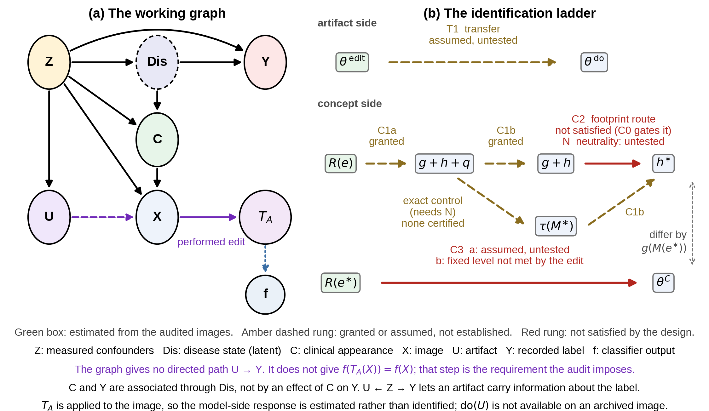

# An Identification Ladder for Causal Auditing of Skin-Lesion Classifiers: Performed Artifact Edits and Concept Components

**Quang Toan Dao**¹·² (dqtoan@ioit.ac.vn), **Viet Anh Nguyen**¹ (anhnv@ioit.ac.vn)

¹ Institute of Information Technology, Vietnam Academy of Science and Technology, Ha Noi, Viet Nam

² Graduate University of Science and Technology, Vietnam Academy of Science and Technology, Ha Noi, Viet Nam

## Abstract

Perturbation tests and concept attributions of skin-lesion classifiers are often read causally without a named estimand. We organize such an audit as an identification ladder: each claim has an estimand and stops at its first unmet condition. Equivalence tests judge performed hair and ruler overlays. For concepts, classical estimability applies: under an additive model, the footprint-relative concept component is identified exactly when the library's graph links the concept edit to a latently neutral one. Footprints can exclude, not certify, such a route. We audited six checkpoints on 183 patient-disjoint ISIC-2024 images from 100 patients. At 0.05, 17 of 18 model-subgroup cells exceeded tolerance jointly; all 18 exceeded every tolerance below 0.042, for the realized overlays and benign draw. Over benign redraws on another overlay realization, the frontier's central range was 0.032 to 0.066. All six PAD-UFES-20 cells exceeded 0.05 marginally. Transfer to real artifacts is untested. At four concept targets, none of 19 controls passed model-free screens. If edits change the displayed concepts, the library identifies no such component; this is not a zero effect. Pre-specified held-out controls matched a coarser footprint numerically. Reading gate matches as equal footprints, the plan's nominal band flagged route sums differing beyond 0.5 logit in three of twelve cells, against factorization jointly with control neutrality, high-dose ones mostly on inputs with extreme backbone features. That band covered jointly near 75%, so the flags carry no controlled error rate; post hoc recalibration kept one, and none of a non-independent rerun's three. No route was certified.

**Index Terms:** Causal inference, concept attribution, dermatology, equivalence testing, explainable artificial intelligence, identification, medical image analysis, shortcut learning.

## I. Introduction

Deep classifiers can match dermatologists in classifying skin-lesion images [1]. Hair, rulers and surgical markings in such images can carry label information [2], [3], and a model trained for accuracy can exploit them [4]. An auditor therefore asks how the prediction would change if an artifact were added, or a concept such as color variegation were changed, with the lesion otherwise fixed. Shortcut studies [5], [6] and concept attribution methods [7], [8], [9] address parts of this question.

Two gaps remain. On the artifact side, a change in score is not a verdict of invariance at a stated error rate, and carrying a synthetic overlay's response to a real artifact is a further condition. On the concept side, a placebo-corrected score recovers the concept component only if the placebo matches the concept edit in everything the classifier responds to except the concept. Neither the causal concept effect [10] nor identifiability results for representations [11] say when a finite library of performed edits can recover that component. Without a valid control, the subtraction still returns a number, and nothing marks it as uncertified.

We ask which causal claims a perturbation audit of a trained classifier can support, and where each claim stops. Our answer is an identification ladder, which applies causal roadmaps [12] with explicit stopping rules. For concepts, the response to an edit is a footprint term plus a concept term. The edit library then forms a two-way layout, to which the classical connectivity condition for estimability applies [13], and the placebo contrast is its shortest route. We make three contributions.

1. **An identification ladder for classifier audits.** It ties every claim to an estimand and names the condition at which the claim stops, for both audit tiers (Fig. 1 and Table 3).
2. **An artifact decision rule with a stated error rate.** Equivalence-type intervals [14] give verdicts and a frontier of tolerances. All 18 model-by-subgroup cells exceed every tolerance below 0.042 probability units on simultaneous intervals, for a working conditional target, the realized overlays and the benign draw. The rule also accepts on a dose ladder and repeats on a second cohort [15].
3. **A procedure that refuses uncertified placebo corrections, with a falsification test of candidate routes.** It is an audit decision protocol, not a new theorem or estimator. The library's footprints can exclude every route before any model output is read, but never certify one, because a route also needs latently neutral controls (condition N). On real images the procedure refuses at every target, as the three screens alone do, but for every contrast of library responses (Table 3). A pre-specified test of candidate routes on held-out images gives nominal flags only, and positive recovery is shown only on a simulated response.

All conclusions hold under one assumed causal graph, one edit library and, for the route test, one constructed control design.

## II. Related Work

### A. Shortcut reliance in skin-lesion classifiers

When the same nevi were imaged after skin marking, a network's specificity fell from 84.1 to 45.8%, and cropping the marks restored it [5]. Occlusion and bias tests show the same reliance, which debiasing did not remove [2], [3]. Invariance objectives [16] and counterfactual invariance [17] target it, and dermatologist-reviewed generative counterfactuals reveal it [6]. None of these designs returns a verdict of invariance at a stated error rate.

### B. Concept attribution and identifiability

Concept activation vectors and concept extraction measure sensitivity along directions in activation space [7], [9], and concept bottleneck models route predictions through annotated concepts [8]. The causal concept effect is the change in prediction under an intervention on the concept [10]. Generated counterfactuals need checks of their own [18]. The methods differ in where the untestable step sits (Supplementary Section S11); our pixel edits move it to a chain of footprint-sharing edits that ends in a latently neutral control. Identifiability work asks when concepts can be recovered from a representation [11], [19], [20] or a causal model is realized inside a network [21], whereas we study a model's output.

### C. Causal and statistical foundations

We claim none of the tools as new. Causal roadmaps separate question, estimand, identification and estimation [12]. In a two-way additive layout, a contrast between levels of one factor is estimable exactly when those levels are connected in the design's incidence graph [13]. Two one-sided tests decide whether an effect lies inside a margin [14], and partial identification reports a set when a point is not identified [22]. Our placebo borrows the logic of a negative control [23], but it is neutral for the concept, not for the outcome. Our cycle test borrows the logic of an overidentification test [24]: disagreement among routes shows that a shared condition fails, while agreement validates none.

## III. Method

### A. Causal structure, audit targets and the identification ladder

**Variables and graph.** $Z$ denotes measured confounders: age, sex, anatomical site, acquisition site and skin tone. Skin tone enters only through colorimetric fields of the dataset's metadata [25], a proxy rather than a clinical rating, and no analysis adjusts for $Z$. $\mathit{Dis}$ is the latent disease state and $C$ the clinical appearance, of which we measure contrast, color variegation and size and edit the first two. $X$ is the image, $U$ the artifacts and $Y$ the recorded label (Fig. 1(a)). The graph has no directed path from $U$ to $Y$, but $U \leftarrow Z \to Y$ lets an artifact carry label information. This exclusion is an assumption, and the metadata do not record how a label was confirmed, so no verified count of such labels exists (Supplementary Sections S8 and S16).

**The audited predictor.** The classifier $f$ is a checkpoint together with a fixed inference protocol $P$: preprocessing, numerical precision and the composition and order of each batch. Every response, and C1a, is conditional on $P$, and each equation uses one protocol and one image set (Supplementary Section S20). The clip level of the logit scale (5) belongs to the concept-tier target, not to $f$.

**Fig. 1.** The assumed causal graph of the audit (a) and the identification ladder built on it (b).

**Two artifact targets.** Let $T_A$ be an edit operator indexed by an artifact type and dose $A$, $\pi$ a distribution over operators and $Q$ a distribution over images. The performed-edit target is

$$
\theta^{\mathrm{edit}}(Q,\pi) = \Big( \mathbb{E}[\Delta f],\ \mathbb{E}\lvert\Delta f\rvert \Big), \qquad \Delta f = f\big(T_A(X)\big) - f(X), \quad X \sim Q,\ A \sim \pi. \tag{1}
$$

The intervention target $\theta^{\mathrm{do}}(Q,\nu)$ replaces $T_A(X)$ by $X_{\mathrm{do}(U = u \oplus V)}$, the image the lesion would have produced had a real artifact $V \sim \nu$ been added to the artifact $u$ it shows. Every artifact number estimates $\theta^{\mathrm{edit}}$, which needs only sampling inference. The intervals resample patients, so they target a working conditional superpopulation $Q_S$ of patient clusters exchangeable with the audit patients. For $Q$ itself, coverage may fall below nominal (Supplementary Section S2). Every artifact result is also conditional on the realized overlays (Supplementary Section S4).

> **T1 (edit-to-intervention transfer).** For $Q$-almost every image $x$, with its artifact $u$, the following holds. Given $X = x$, the prediction on the edited image, $f(T_A(x))$ with $A \sim \pi$, has the same distribution as the prediction on the intervened image, $f(X_{\mathrm{do}(U = u \oplus V)})$ with $V \sim \nu$.

T1 conditions on the factual image, so it carries both components of (1). It is sufficient, not necessary, and untested, because neither cohort has paired images with and without a real artifact. The graph implies that $\mathrm{do}(U)$ leaves $Y$ unchanged, not $f(X)$, so the tested requirement is imposed on the classifier, a form of counterfactual invariance [17].

> **Definition 1 (identification ladder).** A ladder is a finite sequence of estimands from a quantity estimated on the audited inputs to a causal target, with one named condition on each transition. Each condition is *granted* as a working form, *settled by evidence*, or *assumed and untested*. A rung is climbed only when its condition is granted or settled in the affirmative. A claim that needs an assumed condition is stated only as conditional on it, never as certified. A *gating* condition, such as C0, selects a branch. Only a working form can be granted. A latent fact such as condition N cannot, and this audit defines no standard that would settle N. A design condition, such as C2 or the fixed-level part of C3b, is settled by inspecting the design. When evidence rejects a conjunction without saying which part fails, the conjunction is reported as rejected, each part keeps its status, and no rung that needs the conjunction is climbed.

The artifact side has one transition, and the concept side two chains, toward $h^\ast$ and toward $\theta^C$:

$$
\theta^{\mathrm{edit}}(Q,\pi) \xrightarrow{\ \mathrm{T1}\ } \theta^{\mathrm{do}}(Q,\nu), \tag{2}
$$

$$
\begin{aligned}
&R(e) \xrightarrow{\ \mathrm{C1a}\ } g + h + q \xrightarrow{\ \mathrm{C1b}\ } g + h \xrightarrow{\ \mathrm{C2},\ \mathrm{N}\ } h^\ast, \qquad g + h + q \xrightarrow{\ \text{exact control},\ \mathrm{N}\ } \tau(M^\ast) \xrightarrow{\ \mathrm{C1b}\ } h^\ast,\\
&R(e^\ast) \xrightarrow{\ \mathrm{C3}\ } \theta^{C}.
\end{aligned} \tag{3}
$$

$R(e)$ is the mean response to a performed edit $e$, and $e^\ast$ is the concept edit. C1a splits it into a footprint term $g$, a concept term $h$ and an interaction $q$; C1b sets $q = 0$. C2 asks whether the library's footprints offer a route from the concept edit to an edit designated concept-neutral. N asks that the latent concept changes along the route be those intended: zero for the closing control, and equal across each concept link. C2 is settled by inspection; N is latent. Together they give a route of $\mathcal G_0$, which recovers $h^\ast$, the target of a placebo correction under C1b. An exact control, under N, reaches the fixed-footprint contrast $\tau(M^\ast)$ under C1a alone. C3 makes $R(e^\ast)$ the concept effect $\theta^C$, which differs from $h^\ast$ by the footprint term. C0 gates C2, and C4 serves only approximate routes (Supplementary Tables S44 and S45).

### B. The artifact criterion and its error rate

**Overlays.** The hair generator composites thin, alpha-blended curved strands, and the ruler generator a thin dark band with graduation marks in the lower quarter of the frame (Supplementary Section S8 and Fig. S2(a) to (f)). $\nu$ is unobserved, so the overlays are stress tests, not samples from a known artifact distribution. The *held-out* operators, hair at three doses and the ruler, carry the verdicts, with $\pi$ uniform over them. Train-coupled operators feed an invariance penalty and are excluded from the headline claim.

**The criterion.** Exact invariance cannot be tested, so the requirement becomes a tolerance on both components of (1):

$$
\big\lvert \mathbb{E}[\Delta f] \big\rvert \le \varepsilon_s \quad \text{and} \quad \mathbb{E}\lvert \Delta f \rvert \le \varepsilon_m. \tag{4}
$$

We set $\varepsilon_s = \varepsilon_m = 0.05$ on the probability scale, so the magnitude decides each cell, and the signed component shows direction and cancellation. Concept-tier responses use the clipped logit

$$
\ell_\eta(p) = \log \frac{\tilde p}{1-\tilde p}, \qquad \tilde p = \min\{\max(p,\eta),\, 1-\eta\}, \quad \eta = 10^{-6}. \tag{5}
$$

A shift of 0.05 is a displacement on a scale trained under negative undersampling, not a change in deployment risk. It was chosen after effect sizes had been seen (Supplementary Section S17), so it is an operating point, and we report the frontier of tolerances.

**The decision rule.** A component *exceeds tolerance* when its 95% patient-clustered percentile bootstrap interval lies wholly outside the band, is *within tolerance* when it lies wholly inside, and is *indeterminate* otherwise. A cell exceeds when one component exceeds. By interval inclusion this returns the decision of two one-sided tests [14], here to first order. A within-tolerance verdict and a magnitude exceedance therefore have a nominal level of approximately $\alpha = 0.025$. A signed exceedance has a level of at most about 0.05, and no cell decision rests on it. The level attaches to the test at any named tolerance, not to the choice of 0.05. Eighteen cells, six checkpoints by three subgroups (all, malignant and benign images), share a max-statistic patient bootstrap [26], [27] over all 36 components, with 20,000 resamples. It gives nominal joint coverage for $\theta^{\mathrm{edit}}(Q_S, \pi)$ and does not resample the benign draw. In every stored band the magnitude decides every cell (Supplementary Section S2).

### C. The concept tier: from a performed edit to a concept effect

**The target.** Let $X_i(c, v)$ be the image lesion $i$ would have produced had the target concept been set to $C^t = c$ and the others to $C^{-t} = v$, with everything else factual. With $c_i^{-t}$ the factual non-target values,

$$
\theta^{C}(c_1, c_0) = \frac{1}{\lvert \mathcal S \rvert} \sum_{i \in \mathcal S} \Big[ \ell_\eta\big(f(X_i(c_1, c_i^{-t}))\big) - \ell_\eta\big(f(X_i(c_0, c_i^{-t}))\big) \Big], \tag{6}
$$

a finite-set average over the fixed image set $\mathcal S$; we define no population effect. $C$ is latent and cannot be set, so the closest performed operation is a pixel edit.

**Concept edits and the library.** Let $s$ be the mean color over a border ring whose width is 15% of the image side, $w = \min\{1, \lVert X - s \rVert / 0.22\}$ a soft lesion mask and $\mu$ the $w$-weighted mean lesion color. The concept edits amplify the image's own deviation from a reference,

$$
X' = \mathrm{clip}_{[0,1]}\big( X + \beta\, w \odot (X - s) \big) \ \ \text{(contrast)}, \qquad X' = \mathrm{clip}_{[0,1]}\big( X + \beta\, w \odot (X - \mu) \big) \ \ \text{(color variegation)}, \tag{7}
$$

at gains $\beta \in \{0.3, 0.6, 1.0\}$. A concept target is one concept edit at the lowest or the highest gain. Each edit also moves the other concept, whose CIELAB measure changes by medians of 16 to 78% across the four targets. The library holds 88 edits, with 19 candidate controls per target in five families (Supplementary Section S5 and Fig. S2(g) to (l)). The library, footprints, proxies and screens read no model output, so their verdicts hold for all six checkpoints. An edit acts on the image, so it cannot change the lesion's $C$. With $\psi(x)$ the unobserved concept values an image displays, and rendering consistency $\psi(X_i(c, v)) = (c, v)$ assumed, the concept change of edit $e$ is $\Delta C_i(e) = \psi(e(X_i)) - \psi(X_i)$. Pixel proxies $\Delta\hat C$ for contrast, variegation and size track it. Only C3 links an edited image to an intervention on $C$.

**C1, the additive working form.** On $\mathcal S$, the mean response $R(e) = |\mathcal S|^{-1} \sum_{i \in \mathcal S} [\ell_\eta(f(e(X_i))) - \ell_\eta(f(X_i))]$ is written as

$$
R(e) = g\big(M(e)\big) + h\big(\Delta C(e)\big) + q\big(M(e), \Delta C(e)\big). \tag{8}
$$

The *footprint* $M(e)$ holds six descriptors of the change, such as altered-pixel fraction, CIELAB $\Delta E$ and high-frequency change. Here $g$ is a generic edit sensitivity, $h$ the concept component and $q$ their interaction, with $h(0) = 0$ and $q(m, 0) = 0$. **C1a (factorization)** asks that the response depend on an edit only through $(M(e), \Delta C(e))$, and **C1b (additivity)** that $q = 0$. C1a is a condition on the library. On a finite library its only restriction is that two edits with the same footprint and the same concept change respond alike, and it can be checked only jointly with N. We read $h^\ast$ as the concept component relative to $M$ and the library. A control with footprint exactly $M^\ast = M(e^\ast)$ and no latent concept change gives the *fixed-footprint contrast* $\tau(M^\ast) = h(\Delta C^\ast) + q(M^\ast, \Delta C^\ast)$, not the effect of setting a concept. Under C1b it equals $h^\ast$. We grant C1b as the case most favorable to the placebo estimator; no analysis tests it. The route test bears on C1a for its footprint jointly with control neutrality, never on C1b.

**Identification.** Statement 1 is algebraic, for fixed responses on $\mathcal S$ under one protocol, and the patient bootstrap gives no interval for $h^\ast_{\mathcal S}$.

> **Assumptions.** (i) The library is the finite set of performed edits, each with a footprint $M(e)$, a latent concept change $\Delta C(e)$ and a mean response $R(e)$ under one protocol. An edit is latently neutral when $\Delta C(e) = 0$; designating it concept-neutral does not make it so. Two library entries that implement the same transformation on the same inputs carry the same $\Delta C$. (ii) C1a and C1b hold. (iii) $g$ and $h$ are arbitrary real functions on the footprints and on the concept changes, together with $0$, that the library realizes, with $h(0) = 0$. A pair $(g, h)$ is *admissible* if it reproduces every $R(e)$, and $h^\ast = h(\Delta C(e^\ast))$ is *identified* when every admissible pair assigns it the same value.

> **C0 (target-change validity).** If the proxy of the concept edit moves, $\Delta\hat{C}(e^\ast) \ne 0$, then the concepts the edited images display change, $\Delta C(e^\ast) \ne 0$.

If C0 fails, $h^\ast = 0$ by the normalization. C0 is assumed and untested. The manipulation checks establish the antecedent of C0, that the proxy moves, and do not test the implication.

> **Statement 1 (identification is connectivity).** Let $\mathcal G_0$ be the bipartite graph whose two vertex sets are the distinct footprint values and the distinct concept changes realized by the library together with $0$, with one edge per edit joining $M(e)$ to $\Delta C(e)$. The vertex $0$ is isolated when no edit is latently neutral. Under (i) to (iii), $h^\ast$ is identified if and only if $\Delta C(e^\ast)$ and $0$ lie in one connected component of $\mathcal G_0$. In that case, for any path $\Delta C(e^\ast) = \gamma_0, m_1, \gamma_1, \dots, m_k, \gamma_k = 0$ alternating between concept vertices $\gamma_j$ and footprint vertices $m_j$, with $e_j$ the edge joining $\gamma_{j-1}$ to $m_j$ and $e_j'$ the edge joining $m_j$ to $\gamma_j$,
> $$ h^\ast = \sum_{j=1}^{k} \big[ R(e_j) - R(e_j') \big], \tag{9} $$
> and the value does not depend on the path. If no path exists, the identified set is $\mathbb{R}$.

Along a path, $g$ cancels at each shared footprint; without one, shifting $g$ and $h$ oppositely on the component of $\Delta C(e^\ast)$ reproduces every response (proof in Supplementary Section S23). This is the classical estimability condition for a two-way additive layout [13]. Non-identification needs only the footprint incidence, assumption (i) and C0, while identification needs N, which no footprint shows. The design can therefore exclude a route but cannot certify one.

*Consequence 1.* The shortest path has length two, through a control with the concept edit's footprint and no concept change, and (9) becomes the usual placebo contrast. A control library is thus a route problem rather than a matching problem. *Consequence 2.* A cap $\lvert g \rvert, \lvert h \rvert \le B$, illustratively $B = 13.8155$, gives an interval that covers almost the whole capped range for a small response (Supplementary Section S23). *Consequence 3.* Relaxing C1b cannot turn the negative verdict positive, and with $\lvert q \rvert \le \varepsilon_q$ a route through $2k$ edits recovers $h^\ast$ only up to $(2k-1)\,\varepsilon_q$. *Consequence 4.* Only a representation that is not a refinement of $M$, for example a coarsening, can create the shared vertices a route needs, and it defines a different decomposition.

**Approximate routes and screens.** Supplementary Section S15 scores how far a library is from a route. A footprint-near link is scored by the largest absolute standardized mean difference (SMD) of the six descriptors divided by 0.10, a concept-near link by the relative difference of proxy shifts divided by 0.15, and the bottleneck $\rho$ is a route's largest scored link. Its Statement 2 bounds a near route under Lipschitz $g$ and $h$ and a latently neutral last edit, the first part of N. Its concept links need C4, not the second part of N. The data bound $L^g$, the Lipschitz constant of $g$, only from below. Three image-side screens need no model output. **(A1)** requires $\lvert \mathrm{SMD} \rvert \le 0.10$ on each of the six footprint components [28]. **(A2)** requires that the control's relative proxy change is at most 10%, and at most 15% of the concept edit's own average change, averaged over images and the two edited concepts. **(A3) Feasibility** requires a calibrated control to match the edit's mean absolute pixel change within 2% on at least 95% of images; uncalibrated controls are scored as not applicable, which does not count as passing. (A3) is not the overlap condition of observational causal inference, and passing (A2) does not make a control latently neutral. The cutoffs were not pre-specified, so four threshold schemes are reported (Supplementary Sections S5 and S17, Table S46).

**C3.** **C3a** asks that setting $C^t$ be a defined operation with the contrasts of (6) in its support; it is assumed and untested. **C3b** asks that the unedited and edited images be $X_i(c_0, c_i^{-t})$ and $X_i(c_1, c_i^{-t})$. Under C3a and C3b, $R(e^\ast) = \theta^C(c_1, c_0)$, with no route needed, and under C1 as well, $\theta^C = g(M(e^\ast)) + h^\ast$. Equation (6) fixes two common levels, but (7) scales each lesion's own level. The fixed-level part of C3b therefore fails by design for any contrast of an edited with an unedited image. Reaching (6) needs a new intervention class, two edits that set each lesion to $c_0$ and to $c_1$ (Supplementary Section S23). The off-target part is untested, and the off-target changes above raise concern.

> **Corollary 1.** Assume (i) to (iii), C0, this library, and no further restriction or data. If every footprint vertex that carries two edits carries entries of one transformation, as in this library, no contrast of library responses identifies $h^\ast$. The single placebo contrast identifies $h^\ast$ only when its control lies on a length-two route and N holds. A claim about $\theta^C$ needs C3a and C3b, and then rests on $R(e^\ast)$, not on a route. With the current edit, C3b fails by design, so $\theta^C$ is reached through neither chain.

### D. Data, models and evaluation

**Cohorts.** ISIC-2024 provides 401,059 tiles from 1,042 patients, with 393 malignant labels, a prevalence of 0.098% [25]. Its binary label codes the 114 tiles with an indeterminate diagnosis as not malignant; none is among the 183 audit images. Of five patient-disjoint folds, folds 2 to 4 train, fold 1 selects and fold 0 is an unseen audit fold. Both tiers use 183 images from 100 patients of fold 0: every malignant image of the fold (83) and 100 benign images drawn with seed 42. PAD-UFES-20 [15] is a second cohort for the artifact protocol (Supplementary Section S7).

**Models.** Three classifiers share an EfficientNet-B3 backbone [29] and focal loss [30]. ERM, trained by empirical risk minimization, has a linear head, Slim a bottleneck head, and Inv adds risk variance across seven acquisition sites [16] and an artifact-consistency penalty. Checkpoints are saved at the best selection-fold area under the ROC curve (AUROC), for Inv among epochs with both penalties active. This rule was added after the first rule had saved Inv at epoch 1 and its results, including a first run of the route test, had been seen; Inv was then retrained. Every primary result uses the retrained checkpoint, except the plan-locked first run of the route test. A ResNet-50 trio [31] follows the same protocol. Selection-fold AUROC is 0.90, 0.89 and 0.87 for the EfficientNet-B3 trio, and 0.87, 0.88 and 0.89 for the ResNet-50 trio (Supplementary Section S8).

**Inference and reproducibility.** The patient is the resampling unit throughout [32], and exploratory analyses carry no correction across analyses. A verifier checks the results stated in the main text, each copy of them, and the supplementary numbers they rest on against the result files. The verifier also reads the manuscript and supplement, which the repository does not hold. Each script that writes a reported result, except training, reproduced in a fresh directory to a relative tolerance of $10^{-9}$. This includes both runs of the route test, whose files need the pinned package versions (Supplementary Material, "Reproducing these analyses"). This confirms the pipeline, not the measurement. A separate pipeline gives the same cell decision in 17 of 18 cells; for this comparison only the stored results can be checked (Supplementary Section S13).

## IV. Results

### A. Every audited checkpoint exceeds the invariance tolerance under performed overlays

A hair overlay that alters 2.4% of pixels lowers the mean malignant score on malignant images from 0.733 to 0.070 (EfficientNet-B3 ERM), 0.859 to 0.170 (Slim) and 0.501 to 0.046 (Inv).

**All eighteen cells exceed jointly below 0.042.** Table 1 reports both components of (1), with 95% patient-clustered percentile confidence intervals (CI) from 4,000 resamples of the 100 patients, or of the 44 and 75 patients behind the malignant and benign rows. Audit-cohort AUROC is 0.856 to 0.893. Every cell exceeds 0.05 on its marginal interval. The max-statistic band uses a critical value of 3.12 standard errors, against 1.96 for a single normal interval. On it, **every cell exceeds every tolerance below 0.042 probability units**, jointly at nominal 95% for $Q_S$, and 17 of the 18 cells exceed 0.05 jointly. In a post hoc double bootstrap [33], [34], the 18 magnitude lower ends that carry this frontier hold jointly in 97.3% of cohorts, although the two-sided band covers jointly in only 85% (Supplementary Section S2). These statements hold for the realized overlays and benign draw. On a separate overlay realization, held fixed while the benign images were redrawn 500 times, the frontier's central 95% range is 0.032 to 0.066.

**TABLE 1. Mean absolute change in malignant probability under the held-out overlays, E|Δf| [95% CI], then the signed mean E[Δf] and its decision, on the audit cohort. Every magnitude interval lies above 0.05, so every cell exceeds tolerance. Supplementary Table S43 gives the signed intervals.**

| Checkpoint | All | Malignant | Benign |
| --- | --- | --- | --- |
| EfficientNet-B3 ERM | 0.373 [0.305, 0.445]; −0.313, exceeds | 0.553 [0.458, 0.631]; −0.523, exceeds | 0.224 [0.193, 0.256]; −0.139, exceeds |
| EfficientNet-B3 Slim | 0.551 [0.491, 0.607]; −0.458, exceeds | 0.769 [0.722, 0.812]; −0.717, exceeds | 0.370 [0.328, 0.414]; −0.243, exceeds |
| EfficientNet-B3 Inv | 0.223 [0.167, 0.277]; −0.135, exceeds | 0.383 [0.307, 0.445]; −0.307, exceeds | 0.091 [0.063, 0.124]; +0.008, within |
| ResNet-50 ERM | 0.215 [0.184, 0.247]; +0.171, exceeds | 0.121 [0.091, 0.161]; +0.053, indet. | 0.293 [0.272, 0.315]; +0.270, exceeds |
| ResNet-50 Slim | 0.143 [0.131, 0.157]; +0.038, indet. | 0.122 [0.105, 0.140]; −0.068, indet. | 0.160 [0.142, 0.180]; +0.125, exceeds |
| ResNet-50 Inv | 0.106 [0.099, 0.114]; +0.061, indet. | 0.085 [0.077, 0.093]; −0.006, within | 0.123 [0.113, 0.132]; +0.116, exceeds |

**The verdicts are stable, and the criterion can accept.** Across seven overlay realizations, 17 or 18 cells exceed 0.05 jointly (Supplementary Section S4). Overlays restored inside a proxy lesion region, not a segmentation, still exceed 0.05 in 16 of the 18 cells on their marginal intervals, and 12 cells exceed jointly, so the response persists outside the proxy region (Supplementary Section S8). For the ResNet-50 invariance model on malignant images, the signed component is −0.006 [−0.024, +0.018] while the magnitude is 0.085 [0.077, 0.093], a cancellation that a signed criterion would miss. Of 126 non-identity dose cells, 37 are within tolerance and 19 indeterminate (Supplementary Section S3). These are decisions for single operators; they do not make the four-operator mixture, or a real ruler, invariant. With one seed per objective, the invariance checkpoints describe the checkpoints, not the effect of the penalties. On PAD-UFES-20, all six cells exceed tolerance on their marginal intervals, at 0.069 to 0.096; no simultaneous band was computed there (Supplementary Section S7). These results say nothing about $\theta^{\mathrm{do}}$, because T1 is untested, and nothing about clinical performance.

### B. The audit library is disconnected, and candidate routes are tested for consistency

**No control passes the observable screens.** At each of the four targets, none of the 19 candidate controls satisfies (A1) to (A3) jointly. No control that passes (A1) also passes (A2), under all four threshold schemes (Supplementary Section S5). A screen failure withholds certification; it does not show that no latently neutral control exists. In Fig. 2, the shaded corner is necessary but not sufficient for passing, because the absolute (A2) threshold and (A3) are not drawn, and it is empty at every target. The best-balanced control matches the footprint at a maximum absolute SMD of 0.05 but moves the concept proxies by 99% of the concept edit's own shift. The most neutral control moves them by less than 0.1% at an SMD of 1.40.

**Fig. 2.** Footprint imbalance against proxy movement for the 19 candidate controls at each of the four concept targets, on logarithmic axes, with proxy movements below $10^{-3}$ drawn at $10^{-3}$. rotd, rotated displacement; pixperm_m, permuted lesion pixels.

**The exact graph is disconnected at every target, for this library, footprint and cohort.** On the 183 audit images, the footprints of the 88 performed edits coincide for exactly four pairs, each one operator under two labels. On the 83 malignant images that carry the responses, three more pairs coincide, again one control under two labels. Under assumption (i), no footprint vertex of $\mathcal G_0$ joins two concept vertices. Under C0, Statement 1 therefore gives an identified set equal to $\mathbb{R}$ at every target, with no tolerance and no model output (Supplementary Section S15). The best route in $\mathcal G_a$ has bottleneck $\rho$ from 1.17 to 2.13, and 9.6 to 13.3 for length two. If the concept-neutral controls are latently neutral and $g$ is Lipschitz, two of them force $L^g \ge 1.09$ logits per scored unit on the 58 malignant images scored under the library protocol. These are requirements, not estimates.

**The ladder recovers a known target when its conditions hold.** On a simulated response with a generating concept term of 1.117 logits, a designed length-four route returns the target exactly on the structural response $R^0$, and +1.111 with noise. Two single controls that pass (A1) and (A2) still miss: one moves the latent concept, which no screen sees, and for the other Statement 1 identifies its own library's component, +1.194, not the generating term. Paired with the valid control, it breaks C1a, which comparing the two routes detects only at a margin of zero. Agreement therefore certifies nothing. The simulation checks the logic of the ladder, not natural images (Supplementary Section S14).

**A pre-specified test of candidate routes.** By Consequence 4, a coarser footprint can create shared vertices. We tested one on the 78 malignant images of the selection fold, from 54 patients, with a design, criteria and decision rule committed to the public repository before any response to an edit of these images was computed (Supplementary Section S19). $M_{\mathrm{mag}}$ keeps the four descriptors that depend only on the per-pixel change magnitude. Four controls copy the concept edit's change magnitude at every pixel and move the target proxy by at most 1% of the edit's shift (Supplementary Fig. S2(m) to (r)). They passed this gate, G1, on 74 to 78 of the 78 images per target, with mismatch at most $6.4 \times 10^{-7}$ relative, and one pixel on one image. The analysis reads a gate match as an equal footprint. A control closes a route only if it is also latently neutral, which is not shown. Under C1a for $M_{\mathrm{mag}}$ and latent neutrality, every route sum $S_a = R(e^\ast) - R(a)$ equals $\tau_{\mathrm{mag}}$, so the differences $\Delta_{ab} = R(b) - R(a)$ must vanish. This *cycle test*, a falsification diagnostic, not an identification step, judges four pre-specified differences per cell on a simultaneous 95% band over all 48, for the target $Q_R$. The 0.5-logit margin is a practical threshold, not an identification condition. An exact reading on bit-exact image sets fails in every cell, but it has no p-value and says nothing about size.

**The plan's nominal band flags three of twelve cells in each run.** The first run, with the epoch-1 Inv checkpoint, is the plan-locked analysis. The second run reapplied the unchanged plan after that checkpoint was retrained, once the first run's results had been seen, so it is not independent. In the first run, the flags are ERM at the highest contrast dose, by +4.63 [+1.91, +7.34] logits, Slim at the highest variegation dose, by +5.27 [+1.83, +8.70], and Slim at the lowest contrast dose, by +1.99 [+0.50, +3.47] (Table 2). The second run flags ERM and Inv at the highest contrast dose and Slim at the highest variegation dose. Reading gate matches as equal footprints, each flag points against a joint package of C1a for $M_{\mathrm{mag}}$, the latent neutrality of the two controls and a negligible response to the gate mismatch, without saying which part fails; it does not test C1b. At the high doses, seven of the eight controls fail the independent CIELAB check G2 on most images.

**TABLE 2. Cycle-test verdicts on held-out images for the EfficientNet-B3 trio, by concept target, in the plan-locked first run and the non-independent second run.**

| Target | Images (patients), first / second run | ERM | Slim | Inv |
| --- | --- | --- | --- | --- |
| contrast, lowest dose | 75 (53) / 45 (32) | indeterminate (0.39; 2.58) / indeterminate | disagree (0.50; 5.63) / indeterminate | agree (0.00; 0.35) / indeterminate |
| contrast, highest dose | 73 (52) / 44 (32) | disagree (1.91; 7.34) / disagree | indeterminate (0.00; 9.20) / indeterminate | indeterminate (0.14; 0.63) / disagree |
| color variegation, lowest dose | 77 (54) / 47 (33) | indeterminate (0.00; 1.74) / indeterminate | indeterminate (0.37; 5.01) / indeterminate | agree (0.00; 0.28) / indeterminate |
| color variegation, highest dose | 76 (54) / 46 (32) | indeterminate (0.11; 3.79) / indeterminate | disagree (1.83; 8.70) / disagree | indeterminate (0.18; 0.67) / indeterminate |

**The flags are nominal.** A post hoc double bootstrap [33], [34] finds that the band covers all 48 population values jointly in 77.7% of cohorts in the first run and 73.2% in the second, not 95%. Widened to restore 95% joint coverage, it keeps one *recalibrated flag* in the first run, ERM at the highest contrast dose, and none in the second. The plan-locked flags are nominal counts, and no rejection of the joint package at a controlled family-wise level is shown. ERM at the highest contrast dose stays flagged in both runs under each one-at-a-time variant of seed, left-out patient, clip, precision and batch context. The variants do not include the versions of the libraries that decode the images. At the high doses, 75 to 92% of each flag's summed difference comes from images whose pooled backbone feature a control drives beyond ten times its median norm, so these flags arise mostly where the classifier extrapolates. Route sums are descriptive, not estimates of $\tau_{\mathrm{mag}}$ or $h^\ast$ (Supplementary Section S19).

**Where the concept rungs stop.** Under C0, this library does not satisfy C2 at any target, so $h^\ast$ is not identified; if C0 failed, $h^\ast$ would be zero by the normalization. Non-identification is not a zero effect. N is not established, so no route sum is certified. $\theta^C$ is not reached, because the fixed-level part of C3b fails.

### C. What two common practices return on the same cells

TCAV [7] calls 7 of the 12 model-by-concept cells nominally significant. Its Welch test treats 20 directions fitted on overlapping halves of the same images as independent, so its p-values are not calibrated. The count of seven is therefore what the implementation reports, not evidence of significance. Held-out accuracy of 0.68 to 0.87 shows that the directions can carry the edit's footprint (Supplementary Section S12). The usual placebo subtraction, on the 57 of 83 malignant audit images that all three EfficientNet-B3 models score at 0.1 or above, changes sign with the placebo. For Slim it is −0.34 logits under a mirror flip and +5.14 under noise (Supplementary Section S18). No placebo passes footprint balance, so these corrections are descriptive and a function of the control chosen.

## V. Discussion

### A. What the audit establishes, and what the procedure adds

The artifact verdict needs no identification assumption. The concept conclusion is negative and conditional. Relative to the measured footprint, under the additive working form and C0, the identified set from this library is the whole real line. *Not identified* means the identified set is not a point; *not certified* means no established condition licenses a number's causal reading. On real images the procedure's decision equals that of the screens (A1) to (A3) applied together, refusal at every target. It adds scope and basis (Supplementary Table S47): the footprints exclude every contrast of library responses before any model output is read, and each estimand ends with its unmet condition and permitted claim (Table 3). The decision itself changes only in simulation, so on real images the procedure is a one-sided audit. Under its rules N cannot be settled, so any reported route sum would remain conditional on N; this is not an impossibility result for future edit designs. The artifact results agree with reported reliance on acquisition artifacts [2], [3], [5]. A placebo-corrected score is a footprint-relative concept component only if its control lies on a length-two route, N holds and there is no interaction; it differs from the concept effect by the footprint term $g(M(e^\ast))$.

**TABLE 3. The output of the procedure, by estimand. Supplementary Table S48 adds the next admissible design for each row.**

| Estimand | Status; unmet condition | Permitted claim |
| --- | --- | --- |
| $\theta^{\mathrm{edit}}(Q,\pi)$ | estimated; coverage for $Q$ not shown | for $Q_S$, given the realized overlays and the benign draw: every cell exceeds every tolerance below 0.042 jointly, 17 of 18 at 0.05 |
| $\theta^{\mathrm{do}}(Q,\nu)$ | not reached; T1 untested | none about real artifacts |
| $\tau(M^\ast)$ | not reached; exact footprint match, N | certification withheld |
| $h^\ast$ | not identified; C2 (under C0, C1b granted), N for any route | this library cannot fix $h^\ast$; no zero effect is shown |
| $\tau_{\mathrm{mag}}$ | not reached; N not established; with C1a for $M_{\mathrm{mag}}$ and the gate reading, nominally flagged | nominal flags of inconsistency beyond 0.5 logit in 3 of 12 plan-locked cells; 1 under a post hoc recalibrated band, none in the second run; no rejection at a controlled level |
| $\theta^C(c_1, c_0)$ | not reached; fixed-level part of C3b fails by design; C3a untested | none |

### B. Limitations and future directions

The exclusion of a path from $U$ to $Y$ is assumed. In ISIC-2024, 1,068 tiles, among them the 83 malignant audit images, only carry a detailed diagnosis entry, a diagnosis-specificity proxy (Supplementary Section S8). T1 is untested, so a failure shows sensitivity to performed overlays, not reliance on real hair. The 0.05 operating point was chosen after effect sizes were seen and has no clinical anchor. The route test's fold also selected the checkpoints, and its plan was committed to the authors' repository, not to an external registry. Its flags are nominal. They hold on the clipped scale for a fixed inference protocol, image decoding included. Rendering consistency, C0, C3a, the off-target part of C3b and C4 are untested, and N is assumed, not settled. Paired acquisitions with and without real artifacts would test T1.

## VI. Conclusion

Our identification ladder stops each audit claim at its first unestablished condition. Every model-by-subgroup cell exceeded every invariance tolerance below 0.042 probability units under performed overlays, for a working conditional target, the realized overlays and the benign draw; 17 of 18 did so at 0.05. Transfer to real artifacts is untested. Under the additive working form, the concept component relative to the measured footprint is identified exactly when the library's graph connects the concept edit to a latently neutral edit. The tested library has no such route, which does not show a zero effect. On held-out images, with gate matches read as equal footprints, the plan's nominal band flagged route sums differing beyond 0.5 logit in three cells. These are nominal flags, not rejections at a controlled level; a post hoc recalibrated band kept one, and none of a non-independent rerun's three. No route was certified. An edit library can exclude a placebo correction before any model output is read, but cannot certify one, and candidate routes can be shown inconsistent, never certified by agreement.

## Acknowledgment

This work was supported by the Vietnam Academy of Science and Technology under grant NVKN02.03/26-27, "Research on causal machine learning methods combining images and clinical data for diagnosing skin diseases".

## Declarations

*Competing interests.* The authors declare no competing interests.

*Author contributions.* Quang Toan Dao: conceptualization, methodology, software, formal analysis and writing of the original draft. Viet Anh Nguyen: supervision, and review and editing of the manuscript.

*Data availability.* The ISIC-2024 images and metadata [25] are publicly available from the ISIC Archive. Each image carries the license its contributing institution set: CC0, CC BY or CC BY-NC. The two images of Supplementary Fig. S2 are released under CC0 (attribution: ACEMID MIA). PAD-UFES-20 [15] is publicly available from its providers. The raw images are not redistributed. The patient-disjoint partitions, the audit cohorts and every image identifier the analyses use are released with the code.

*Code availability.* Code, cached results and the audited checkpoints with their checksums are available at https://github.com/dqtoan87/Causal_Audits_of_SLC_v2; the numbers reported here correspond to commit `6b282278da41`.

*Ethics statement.* This study used only publicly released, de-identified images and metadata from ISIC-2024 [25] and PAD-UFES-20 [15]. No new data were collected, and no patient was contacted. The dataset providers describe how the data were collected and how consent was obtained.

## References

[1] A. Esteva, B. Kuprel, R. A. Novoa, J. Ko, S. M. Swetter, H. M. Blau, and S. Thrun, "Dermatologist-level classification of skin cancer with deep neural networks," *Nature*, vol. 542, no. 7639, pp. 115-118, 2017.

[2] A. Bissoto, M. Fornaciali, E. Valle, and S. Avila, "(De)constructing bias on skin lesion datasets," in *Proc. IEEE/CVF Conf. Comput. Vis. Pattern Recognit. Workshops (CVPRW)*, 2019, pp. 2766-2774.

[3] A. Bissoto, E. Valle, and S. Avila, "Debiasing skin lesion datasets and models? Not so fast," in *Proc. IEEE/CVF Conf. Comput. Vis. Pattern Recognit. Workshops (CVPRW)*, 2020, pp. 3192-3201, doi: 10.1109/CVPRW50498.2020.00378.

[4] R. Geirhos, J.-H. Jacobsen, C. Michaelis, R. Zemel, W. Brendel, M. Bethge, and F. A. Wichmann, "Shortcut learning in deep neural networks," *Nature Mach. Intell.*, vol. 2, no. 11, pp. 665-673, 2020.

[5] J. K. Winkler, C. Fink, F. Toberer, A. Enk, T. Deinlein, R. Hofmann-Wellenhof, *et al.*, "Association between surgical skin markings in dermoscopic images and diagnostic performance of a deep learning convolutional neural network for melanoma recognition," *JAMA Dermatol.*, vol. 155, no. 10, pp. 1135-1141, 2019.

[6] A. J. DeGrave, Z. R. Cai, J. D. Janizek, R. Daneshjou, and S.-I. Lee, "Auditing the inference processes of medical-image classifiers by leveraging generative AI and the expertise of physicians," *Nature Biomed. Eng.*, vol. 9, no. 3, pp. 294-306, 2025, doi: 10.1038/s41551-023-01160-9.

[7] B. Kim, M. Wattenberg, J. Gilmer, C. Cai, J. Wexler, F. Viégas, and R. Sayres, "Interpretability beyond feature attribution: Quantitative testing with concept activation vectors (TCAV)," in *Proc. 35th Int. Conf. Mach. Learn. (ICML)*, PMLR, vol. 80, 2018, pp. 2668-2677.

[8] P. W. Koh, T. Nguyen, Y. S. Tang, S. Mussmann, E. Pierson, B. Kim, and P. Liang, "Concept bottleneck models," in *Proc. 37th Int. Conf. Mach. Learn. (ICML)*, PMLR, vol. 119, 2020, pp. 5338-5348.

[9] A. Ghorbani, J. Wexler, J. Y. Zou, and B. Kim, "Towards automatic concept-based explanations," in *Adv. Neural Inf. Process. Syst. (NeurIPS)*, vol. 32, 2019, pp. 9277-9286.

[10] Y. Goyal, A. Feder, U. Shalit, and B. Kim, "Explaining classifiers with causal concept effect (CaCE)," arXiv:1907.07165, 2019.

[11] T. Leemann, M. Kirchhof, Y. Rong, E. Kasneci, and G. Kasneci, "When are post-hoc conceptual explanations identifiable?," in *Proc. 39th Conf. Uncertainty Artif. Intell. (UAI)*, PMLR, vol. 216, 2023, pp. 1207-1218.

[12] M. L. Petersen and M. J. van der Laan, "Causal models and learning from data: Integrating causal modeling and statistical estimation," *Epidemiology*, vol. 25, no. 3, pp. 418-426, 2014, doi: 10.1097/EDE.0000000000000078.

[13] S. R. Searle, *Linear Models*. New York, NY, USA: Wiley, 1971.

[14] D. J. Schuirmann, "A comparison of the two one-sided tests procedure and the power approach for assessing the equivalence of average bioavailability," *J. Pharmacokinet. Biopharm.*, vol. 15, no. 6, pp. 657-680, 1987.

[15] A. G. C. Pacheco, G. R. Lima, A. S. Salomão, B. Krohling, I. P. Biral, G. G. de Angelo, *et al.*, "PAD-UFES-20: A skin lesion dataset composed of patient data and clinical images collected from smartphones," *Data Brief*, vol. 32, p. 106221, 2020.

[16] D. Krueger, E. Caballero, J.-H. Jacobsen, A. Zhang, J. Binas, D. Zhang, R. Le Priol, and A. Courville, "Out-of-distribution generalization via risk extrapolation (REx)," in *Proc. 38th Int. Conf. Mach. Learn. (ICML)*, PMLR, vol. 139, 2021, pp. 5815-5826.

[17] V. Veitch, A. D'Amour, S. Yadlowsky, and J. Eisenstein, "Counterfactual invariance to spurious correlations in text classification," in *Adv. Neural Inf. Process. Syst. (NeurIPS)*, vol. 34, 2021, pp. 16196-16208.

[18] M. Monteiro, F. D. S. Ribeiro, N. Pawlowski, D. C. Castro, and B. Glocker, "Measuring axiomatic soundness of counterfactual image models," in *Proc. Int. Conf. Learn. Represent. (ICLR)*, 2023.

[19] B. Schölkopf, F. Locatello, S. Bauer, N. R. Ke, N. Kalchbrenner, A. Goyal, and Y. Bengio, "Toward causal representation learning," *Proc. IEEE*, vol. 109, no. 5, pp. 612-634, 2021.

[20] K. Ahuja, D. Mahajan, Y. Wang, and Y. Bengio, "Interventional causal representation learning," in *Proc. 40th Int. Conf. Mach. Learn. (ICML)*, PMLR, vol. 202, 2023, pp. 372-407.

[21] A. Geiger, H. Lu, T. Icard, and C. Potts, "Causal abstractions of neural networks," in *Adv. Neural Inf. Process. Syst. (NeurIPS)*, vol. 34, 2021, pp. 9574-9586.

[22] C. F. Manski, *Partial Identification of Probability Distributions*. New York, NY, USA: Springer, 2003.

[23] M. Lipsitch, E. Tchetgen Tchetgen, and T. Cohen, "Negative controls: A tool for detecting confounding and bias in observational studies," *Epidemiology*, vol. 21, no. 3, pp. 383-388, 2010, doi: 10.1097/EDE.0b013e3181d61eeb.

[24] L. P. Hansen, "Large sample properties of generalized method of moments estimators," *Econometrica*, vol. 50, no. 4, pp. 1029-1054, 1982, doi: 10.2307/1912775.

[25] N. R. Kurtansky, B. M. D'Alessandro, M. C. Gillis, B. Betz-Stablein, S. E. Cerminara, R. Garcia, *et al.*, "The SLICE-3D dataset: 400,000 skin lesion image crops extracted from 3D TBP for skin cancer detection," *Sci. Data*, vol. 11, no. 1, p. 884, 2024.

[26] P. H. Westfall and S. S. Young, *Resampling-Based Multiple Testing: Examples and Methods for p-Value Adjustment*. New York, NY, USA: Wiley, 1993.

[27] J. P. Romano and M. Wolf, "Exact and approximate stepdown methods for multiple hypothesis testing," *J. Amer. Statist. Assoc.*, vol. 100, no. 469, pp. 94-108, 2005, doi: 10.1198/016214504000000539.

[28] P. C. Austin, "Balance diagnostics for comparing the distribution of baseline covariates between treatment groups in propensity-score matched samples," *Stat. Med.*, vol. 28, no. 25, pp. 3083-3107, 2009.

[29] M. Tan and Q. Le, "EfficientNet: Rethinking model scaling for convolutional neural networks," in *Proc. 36th Int. Conf. Mach. Learn. (ICML)*, PMLR, vol. 97, 2019, pp. 6105-6114.

[30] T.-Y. Lin, P. Goyal, R. Girshick, K. He, and P. Dollár, "Focal loss for dense object detection," in *Proc. IEEE Int. Conf. Comput. Vis. (ICCV)*, 2017, pp. 2980-2988.

[31] K. He, X. Zhang, S. Ren, and J. Sun, "Deep residual learning for image recognition," in *Proc. IEEE Conf. Comput. Vis. Pattern Recognit. (CVPR)*, 2016, pp. 770-778.

[32] A. C. Davison and D. V. Hinkley, *Bootstrap Methods and Their Application*. Cambridge, U.K.: Cambridge Univ. Press, 1997.

[33] R. Beran, "Prepivoting to reduce level error of confidence sets," *Biometrika*, vol. 74, no. 3, pp. 457-468, 1987.

[34] P. Hall and M. A. Martin, "On bootstrap resampling and iteration," *Biometrika*, vol. 75, no. 4, pp. 661-671, 1988.

## Biographies

{width=2.5cm}

**QUANG TOAN DAO** is a researcher at the Institute of Information Technology, Vietnam Academy of Science and Technology (VAST). He is currently pursuing the Ph.D. degree at the Graduate University of Science and Technology, VAST, under the supervision of Associate Professor Viet Anh Nguyen. His current research interests include causal machine learning, multimodal deep learning and medical image diagnostics.

{width=2.5cm}

**VIET ANH NGUYEN** is an Associate Professor, the Chairman of the Scientific Council and a senior researcher at the Institute of Information Technology, Vietnam Academy of Science and Technology (VAST). He received the master's degree in information science and systems engineering from Ritsumeikan University, Japan, in 2005, and the Ph.D. degree in computer science from Kyoto University, Japan, in 2012. His research interests include graph neural networks, cybersecurity and advanced artificial intelligence systems for medical diagnostics and national data science ecosystems.
