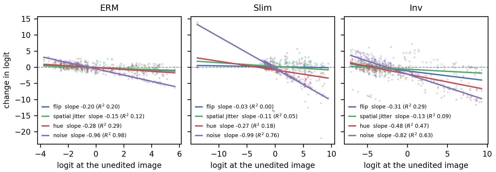
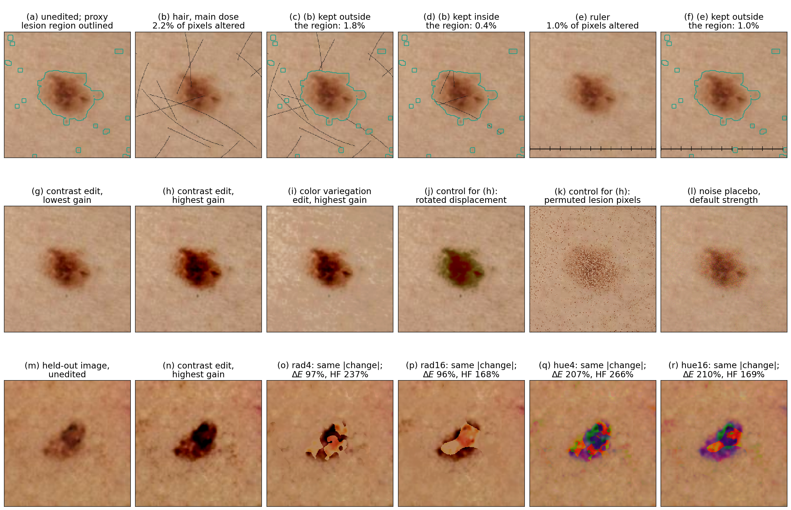

# Supplementary Material

**An Identification Ladder for Causal Auditing of Skin-Lesion Classifiers: Performed Artifact Edits and Concept Components**

Quang Toan Dao, Viet Anh Nguyen

This document accompanies the main article. Every number below is produced by a script named in the section that reports it, and each section names the result file the number is read from. Its sections are numbered S1 to S24, its tables S1 to S49 and its figures S1 and S2, and the main text cites them by these labels. Citations in square brackets use the numbering of the main text; references cited only here are labelled [S1] onward. All are listed at the end.

**Correspondence with the main text.** Each row names the main-text location a section supports and, where one exists, the main-text claim that rests on it.

| Section | Content | Main text | Claim it supports |
| --- | --- | --- | --- |
| S1 | notation and the model-side targets | supplement only | the estimands of the ladder |
| S2 | decision rule, error rate, simultaneous coverage | III-B, IV-A | every tolerance below 0.042, below 0.069 on the whole audit fold (post hoc, another overlay realization), nominal 95% joint coverage over 36 components, under patient exchangeability and given the selected images; under a known population the band covers jointly in 85%, its magnitude lower ends in 97.3% |
| S3 | tolerance sweep and dose ladder | IV-A | 37 of 126 non-identity dose cells within tolerance |
| S4 | overlay realizations, saturation, numerical reproducibility | III-B, IV-A | stability of the artifact verdict |
| S5 | the control library in full | IV-B | none of 19 controls passes the screens |
| S6 | control versus control, diagnostic (L) | supplement only | neutral controls with unmatched footprints disagree |
| S7 | the artifact criterion on the second cohort | IV-A | the decision held on PAD-UFES-20 |
| S8 | data, models, training and artifact operators | III-B, III-D, IV-A | the six audited checkpoints; label coding and provenance of the audit images; overlays kept outside a proxy lesion region, including a comparison matched in altered pixels |
| S9 | shrinkage regressions, bias term, bracketing | supplement only | footprint-balanced controls do not span the concept edit's shrinkage coefficients |
| S10 | audit protocol specification | supplement only | every fixed choice of the audit, with the step that reads a model output |
| S11 | where each concept method places its causal assumption | II | the comparison with existing methods |
| S12 | concept activation vectors on the same cells | IV-C | the method reports nominal significance in 7 of 12 cells, from p-values that are not calibrated |
| S13 | variation of the artifact magnitude across fits | supplement only | the magnitude varies across fits while the verdict holds |
| S14 | the ladder on a response with a known concept component | IV-B | on the structural response, the valid regime and a designed route return the target exactly; with noise, within 0.8% and within 0.6%; two accepted controls that share a footprint disagree, which exposes a failure of C1a that the screens pass |
| S15 | the two graphs, distances and smoothness | III-C, IV-B | the exact graph joins no concept edit to a neutral one, on the 183 audit images and on the 83 malignant images where responses are scored; duplicate labels of one operator return identical responses under one protocol; the best route's worst link is 1.17 to 2.13 times its tolerance; the smoothness a near route would need, on one image set and one protocol |
| S16 | expanded graph with verification and selection | III-A | scope of the assumed graph |
| S17 | which design choices read a model output | III-B, III-D | the library and screens read no model output |
| S18 | sensitivity of the corrected concept score to the placebo | IV-C | the corrected score depends on the placebo; its point estimate changes sign for one model |
| S19 | pre-specified route test on held-out images | IV-B | controls matched to a coarser footprint to numerical precision. In the plan-locked run, reading gate matches as equal footprints, the plan's nominal band flags 3 of 12 cells against factorization through it jointly with control neutrality; a non-independent rerun also flags 3; the flags are nominal, not 5%-level rejections, because under a known null the band covers jointly near 75%; a post hoc recalibrated band keeps 1 cell, none in the rerun; batch context and precision act mainly through inputs with features far outside their usual range; exploratory reanalyses are reported separately |
| S20 | image set and protocol of each quantity | III-A, III-C, IV-B | every equation that combines footprints and responses uses one image set and one protocol |
| S21 | performed edits, artifact criterion and artifact results: notes | III-B, IV-A | the full form of Table 1 (Table S43) and the artifact passages the main text condenses |
| S22 | the identification ladder: full definition and tables | III-A | Definition 1, the rungs (Table S44) and the conditions with their status and evidence (Table S45) |
| S23 | the concept tier: derivations and proof | III-C | the proof of Statement 1, Consequences 1 to 4 with the bounded interval (S4), the screens (Table S46) and C3 |
| S24 | the concept-tier results and the procedure: notes and tables | IV-B, IV-C, V | the worked audit, Table S47 and the output by estimand with the next admissible design (Table S48) |

---

## S1. Notation and the model-side targets

Table S1 collects the notation the main text uses, with the section that introduces each entry. The capitals *Z*, *Dis*, *C*, *X*, *U* and *Y* are variables in the graph of Fig. 1; the other symbols are quantities the analysis constructs, while standard operators are left out: *E* is expectation, *p* a probability and *R*² a coefficient of determination. Table S2 then sets the two model-side targets beside each other. Abbreviations used in this document: AUROC, area under the receiver operating characteristic curve; bf16 and fp32, 16-bit brain floating point and 32-bit floating point; CAV, concept activation vector; CI, confidence interval; ERM, empirical risk minimization; ReLU, rectified linear unit; SD, standard deviation; SMD, standardized mean difference.

**TABLE S1. Notation.**

| Symbol | Meaning | Introduced |
| --- | --- | --- |
| *Z*, *C*, *X*, *U*, *Y* | measured confounders, latent lesion concepts, image, acquisition artifacts, recorded malignant label | III-A |
| *Dis* | latent disease state of the lesion, a common cause of *C* and *Y* | III-A |
| *f*, *P* | audited classifier: a checkpoint with a fixed inference protocol *P* (preprocessing, precision, batch composition and order), image to malignant-class probability | III-A |
| $T_A$, *π*, *Q* | edit operator indexed by artifact type and dose, the mixture over operators, the image distribution | III-A |
| $u \oplus V$ | the artifact *u* an image already shows, with a real artifact at level *V* added; the incremental intervention of $\theta^{\mathrm{do}}$ | III-A |
| $\theta^{\mathrm{edit}}(Q, \pi)$ | signed and magnitude pair for the edit we perform, the quantity every artifact number reports | III-A |
| $\theta^{\mathrm{do}}(Q, \nu)$ | the same pair under do(*U*), which the transfer condition would carry it to and which we do not estimate | III-A |
| $\ell_\eta$, *η* | clipped logit and its clip level | III-B |
| $\varepsilon_s$, $\varepsilon_m$ | signed and magnitude tolerances | III-B |
| $\theta^{C}$ | controlled concept contrast on the clipped logit scale, averaged over the fixed image set $\mathcal S$ with equal weights; the concept edit's mean response on $\mathcal S$ would equal it under C3 | III-C |
| $\theta^{C}_{\mathrm{sh}}$, $c_i^{t,\beta}$ | shift concept effect of (10), the target that edit (7) matches; the target level the edited image displays, lesion $i$'s own level rescaled by (7) | III-C |
| *ψ* | the concept values an image displays, an idealized reading that is not observed | III-C |
| *M*, $\Delta C$ | six-component footprint, computed per image over the audit cohort (formulas in S5); change of *ψ* under an edit | III-C |
| *g*, *h*, *q* | generic edit sensitivity, concept component, their interaction, with *h*(0) = 0 and *q*(*m*, 0) = 0 | III-C |
| $e^\ast$, $M^\ast$, $\Delta C^\ast$, $h^\ast$ | the concept edit, its footprint, its concept change and its concept component *h*($\Delta C^\ast$), relative to the footprint *M* and the library and defined on the fixed image set, $h^\ast_{\mathcal S}$ where the set is marked; no population counterpart is defined | III-C |
| *F*, *τ*($M^\ast$) | the response *F*(*m*, *c*) = *g*(*m*) + *h*(*c*) + *q*(*m*, *c*) under C1a, and the fixed-footprint contrast *F*($M^\ast$, $\Delta C^\ast$) − *F*($M^\ast$, 0), equal to $h^\ast$ under C1b | III-C |
| $\tau_{\mathrm{mag}}$ | the same contrast at the concept edit's coarser footprint $M_{\mathrm{mag}}(e^\ast)$, which defines its own decomposition | IV-B |
| C1a, C1b | factorization of the response through (*M*, $\Delta C$), and *q* = 0 | III-C |
| N | latent neutrality: the control that ends a route has $\Delta C$ = 0, and each concept link of a longer route joins edits with equal $\Delta C$; assumed, not settled, and not grantable | III-A, III-C |
| $\Delta\hat C$ | image-derived concept proxy, whose one-directional soundness is C0 | III-C |
| *e*, *R*(*e*), $R_{\mathcal S}(e; P)$ | a performed edit and its mean response; the protocol is written out where it matters | III-A, III-C |
| $R^0$, $\hat R$ | structural response of the simulation before noise, to which Statement 1 applies, and the response with the realized noise | S14 |
| $\mathcal G_0$, $\mathcal G_a$ | exact identification graph, whose concept vertices include 0, and the diagnostic graph of scored links | III-C |
| G1, G2 | route-test gates: magnitude footprint matched to the plan's tolerance with the target proxy moved by at most 1%, and the independent CIELAB check of neutrality | IV-B, S19 |
| diagnostic (L) | comparison of screened, designated concept-neutral controls with unmatched footprints, which, if they are latently neutral, prices the Lipschitz constant $L^g$ | S6 |
| *K*, *S*, *B* | the component holding the target, a route sum, the imposed component bound | S15, S23; *B* also III-C |
| $\delta^{M}$, $\delta^{C}$, $\varepsilon_q$ | footprint and concept link tolerances (0.10 and 0.15), and the interaction envelope | S15; $\varepsilon_q$ also III-C |
| $\tilde d^M$, $\tilde d^C$, *D*, *ρ* | scored footprint and concept mismatches of a route link, in scored units (mismatch divided by its tolerance), their total, the largest | S15; *ρ* also III-C |
| *t*, *ν*, *ḡ* | target concept index ($C^t$, $C^{-t}$), real-artifact level distribution of $\theta^{\mathrm{do}}$, mean footprint term at the concept edit (S14) | III-A, III-C, S14 |
| $L^g$, $L^h$, $\kappa$, $L$ | Lipschitz constants for $g$ and $h$, the proxy-to-latent factor of C4, and $L = \max(L^g, \kappa L^h)$ | S15 |
| $\ell_0$, $\ell^\ast$ | clipped logit at the unedited image, fitted fixed point | S9 |
| $\lambda_e$, $\lambda_c$ | shrinkage coefficients of the concept edit and its control | S9 |
| $b_e$, $b_c$, *b*⁰ | their intercepts, and the generic part of an intercept | S9 |
| $X_i(c, v)$, $c_0$, $c_1$, $c_i^{-t}$ | counterfactual image with the target concept at $c$ and the others at $v$; the two levels of (6); factual non-target values | III-C |
| *s*, *w*, *μ*, *β* | skin reference color, soft lesion mask, mean lesion color, concept-edit gain | III-C |
| $\hat Q_n$ | empirical distribution of the audit cohort | S2 |
| $\mathcal S$, $\mathcal S_t$ | the fixed image set on which footprints, concept changes and mean responses are defined; for the route test, the analyzed set of target $t$ | III-C, S19 |
| $Q_S$, $Q_R$ | working conditional superpopulations: patient clusters exchangeable with the audit patients, each with its selected images; the same built from the analyzed fold-1 patients of the route test. Their intervals target mean responses to fixed operators, not $h^\ast$ | III-A, IV-B |
| PC | placebo-corrected score, the concept edit's response minus a control's | S9 |
| $M_{\mathrm{mag}}$ | coarser footprint of the route test, the four descriptors that depend only on the per-pixel change magnitude | IV-B, S19 |
| $S_a$, $\Delta_{ab}$ | route sum through control $a$, and the difference of the route sums through controls $a$ and $b$ | IV-B, S19 |
| dose 0, dose 2; d0, d2; lowest, highest dose; low, top dose | the lowest ($\beta = 0.3$) and highest ($\beta = 1.0$) gain of (7); dose 1, d1: the middle gain ($\beta = 0.6$) | III-C |
| flag; recalibrated flag; gate reading | a route-test cell that disagrees on the plan's nominal band; one that still disagrees on the post hoc recalibrated band; reading a G1 gate match as an equal footprint | IV-B, S19 |
| $\varepsilon_R$ | largest deviation of a route sum from $\tau_{\mathrm{mag}}$ in the bounded-deviation reading of the cycle test | S19 |

**TABLE S2. The two model-side targets, what makes each available, and what remains assumed.**

| | artifact side | concept side |
| --- | --- | --- |
| Exposure | synthetic overlay, performed | concept edit, performed |
| Unit | image | image |
| Target | $\theta^{\mathrm{edit}}$ = ($\mathbb{E}[\Delta f]$, $\mathbb{E}\lvert\Delta f\rvert$) | the concept component $h^\ast$, relative to the footprint *M* and the library, which a placebo correction targets, the concept effect $\theta^{C}$, and the shift target $\theta^{C}_{\mathrm{sh}}$ that the edit matches |
| Basis | directly estimable, the intervention is performed | Statement 1: $h^\ast$ identified iff $\mathcal G_0$ connects the edit to the vertex 0, that is, to a latently neutral edit; $\theta^{C}$ equals *R*($e^\ast$) under C3; $\theta^{C}_{\mathrm{sh}}$ equals it under C3a and the off-target part of C3b |
| Key assumption | none for the point estimate; patient exchangeability for the intervals | for $h^\ast$: C1a, C1b and C0, with the route (C2) checked rather than assumed, and N for any route that exists; for $\theta^{C}$: C3a and C3b |
| Tested here | dose ladder, identity edit, second cohort, seven overlay realizations, overlays kept outside a proxy lesion region | screen on 19 controls, bottleneck over the whole graph, diagnostic (L), bracketing, cycle test on held-out images |
| Left assumed | transfer of $\theta^{\mathrm{edit}}$ to $\theta^{\mathrm{do}}$ | C3a; the off-target part of C3b, against which proxy evidence weighs. The fixed-level part of C3b is not satisfied by the current edit, which matches only $\theta^{C}_{\mathrm{sh}}$ |

The artifact target needs no causal identification argument, because we perform the intervention; what it needs is the transfer condition of Section III-A before it speaks about a real artifact. The concept row carries two estimands rather than one. Section IV-B reports that, under C0, no route in the library identifies $h^\ast$. The concept effect $\theta^{C}$ would follow from *R*($e^\ast$) under C3, not from $h^\ast$, and under C1 and C3 the two differ by *g*(*M*($e^\ast$)). C3a is untested, and the current edit does not satisfy the fixed-level part of C3b, so a library that supplied a route to $h^\ast$ would still not reach $\theta^{C}$.

---

## S2. The decision rule, its error rate, and simultaneous coverage over the audit cells

*Scripts `c40_simultaneous.py`, `c56_simultaneous36.py`, `c57_stratified_band.py`. Results `c40_simultaneous.json`, `c56_simultaneous36.json`, `c57_stratified_band.json`.*

**The rule stated formally.** Fix one component of $\theta^{\mathrm{edit}}$, write its value *ϑ* and its tolerance *ε*. The two decisions the audit can return are the two hypotheses

$H_0^{\mathrm{eq}}$ : |*ϑ*| ≥ *ε*   against   $H_1^{\mathrm{eq}}$ : |*ϑ*| < *ε*,     and     $H_0^{\mathrm{me}}$ : |*ϑ*| ≤ *ε*   against   $H_1^{\mathrm{me}}$ : |*ϑ*| > *ε*,

the first an equivalence problem and the second its mirror, a minimum-effect problem. For the signed component both edges of the band are active. The magnitude component satisfies *ϑ* ≥ 0, so |*ϑ*| = *ϑ* and each pair reduces to one one-sided test: within tolerance needs *I*₊ < *ε*, and exceedance needs *I*₋ > *ε*. Let [*I*₋, *I*₊] be a 95% patient-clustered bootstrap percentile interval for *ϑ*. The rule is: **within tolerance** if [*I*₋, *I*₊] ⊂ (−*ε*, *ε*), **exceeds tolerance** if [*I*₋, *I*₊] ∩ [−*ε*, *ε*] = ∅, and **indeterminate** otherwise.

Both decisions inherit a level from the interval. By the interval-inclusion principle, declaring within tolerance exactly when a 1 − 2*α* interval falls inside the band is the decision two one-sided tests return at level *α* [10]. The identity is exact for a normal-theory interval and approximate for the percentile bootstrap interval used here. With a 95% interval, the within-tolerance verdict therefore rejects $H_0^{\mathrm{eq}}$ at approximately *α* = 0.025. The exceedance verdict depends on the component. For the magnitude component, the lower end clearing *ε* is a one-sided minimum-effect test of $H_0^{\mathrm{me}}$ at approximately 0.025. For the signed component the interval can clear the band on either side, so the verdict is the union of two one-sided tests. At *ϑ* = *ε* its rejection probability is approximately Φ(−$z_{0.975}$) + Φ(−$z_{0.975}$ − 2*ε*/*se*). This exceeds 0.025 for every finite *ε*/*se*, for example 0.032 at *ε*/*se* = 0.25, and approaches 0.05 as *ε*/*se* shrinks. Its level is therefore at most about 0.05, not 0.025. Indeterminacy is the event that neither null is rejected, and it is reported rather than assigned, which is what separates a three-way rule from a threshold comparison.

Three things this does and does not deliver. The level attaches to the test and not to *ε*, which remains an audit parameter rather than a clinically validated equivalence limit. The percentile bootstrap is first-order accurate under the patient-clustered resampling used throughout, and its validity rests on the patient being the independent unit. The patient-disjoint split makes patients independent of the training data; it does not make the percentile interval exact, and with 44 malignant patients first-order accuracy is a real limit. We do not claim second-order accuracy and we do not use a studentized interval for the marginal intervals. And the level is per component, so a family of eighteen cells needs a joint correction. The 36-component band below covers both components of every cell.

**Where the interval-inclusion equivalence comes from.** The claim is that [*I*₋, *I*₊] ⊂ (−*ε*, *ε*) is the same event as rejecting both one-sided nulls at *α*. Write the interval as *ϑ̂* ± $z_{1-\alpha}$·*se*. Its upper end is below *ε* exactly when (*ϑ̂* − *ε*)/*se* < −$z_{1-\alpha}$, which is rejection of *ϑ* ≥ *ε* at level *α*; its lower end is above −*ε* exactly when (*ϑ̂* + *ε*)/*se* > $z_{1-\alpha}$, which is rejection of *ϑ* ≤ −*ε*. Both hold exactly when the interval lies inside the band, which is Schuirmann's operational identity [10]. A 95% two-sided interval has $z_{1-\alpha}$ at the 97.5th percentile, so *α* = 0.025 per side. The exceedance verdict needs its own statement: [*I*₋, *I*₊] ∩ [−*ε*, *ε*] = ∅ holds exactly when |*ϑ̂*| − *ε* exceeds $z_{1-\alpha}$·*se*. For the magnitude component only the upper side can trigger it, which is the one-sided minimum-effect test at *α* = 0.025. For the signed component either side can, so its size is at most 2*α* = 0.05. In the audit this branch never decides a cell alone. Both components use the same patient resamples, and on each resample the magnitude statistic is at least the absolute signed statistic. For percentile intervals the interval ends keep that order. A signed interval wholly outside the band therefore implies a magnitude interval wholly above *ε*, and every cell exceedance rests on the magnitude branch. We use percentile bootstrap intervals rather than normal ones, so these identities hold for the bootstrap analogue of each test and inherit its first-order accuracy, not an exact level.

**A cell, and the family.** A cell exceeds tolerance when at least one of its two components does, is within tolerance only when both are, and is indeterminate otherwise. The implemented joint claim is made over all 36 components, the eighteen magnitude and the eighteen directional statistics. With equal tolerances the magnitude statistic decides every cell on the percentile intervals. On each resample the absolute signed statistic is at most the magnitude statistic. So the signed interval lies inside plus or minus the upper end of the magnitude interval, and, when the signed interval excludes zero, its end nearest zero is at most the magnitude lower end in absolute value. The cell decision is then the magnitude decision. The simultaneous band is studentized, *θ̂* ± *c*·*ŝe*, so this order is not guaranteed there. We checked it in every band whose intervals are stored: the full, the stratified, the skin-only and the lesion-only band and the seven realization bands of Section S4. In every cell, the lower end of the magnitude interval is at least the larger of the signed lower end and minus the signed upper end, and its upper end is at least the largest absolute signed end. The cell decisions under these bands are therefore the magnitude decisions, and the eighteen magnitude statistics would suffice here. We implemented the 36-component band and keep it as the conservative headline. The eighteen-statistic band was reported after the results were seen and stays secondary. A signed condition would add a constraint only with $\varepsilon_s < \varepsilon_m$.

**The simultaneous construction, stated.** The family is the 36 statistics *ϑ̂*₁ to *ϑ̂*₃₆, two per model by subgroup cell. The eighteen cells are fixed by the design, six checkpoints crossed with three subgroups; no cell was added, dropped or reordered after the values were seen. The statistic is *T*\* = maxᵢ |*ϑ̂*ᵢ\* − *ϑ̂*ᵢ| / *ŝe*ᵢ, with *ŝe*ᵢ the bootstrap standard error of component *i*, fixed across resamples. Shared resamples carry the dependence among cells and between the two components of a cell. For a magnitude statistic only the lower simultaneous limit can establish exceedance, since a magnitude is non-negative; the upper limit enters only a within-tolerance decision. The two-sided critical value is used regardless, which is conservative for that purpose.

Table S43 (Table 1 of the main text in compact form) reports 36 marginal intervals, two per cell. Thirty-six dependent intervals judged at 95% each do not carry 95% simultaneous coverage. We therefore computed a max-statistic patient bootstrap over the whole family [11], [12]. The construction is the following five steps. One, resample the 100 audit patients with replacement 20,000 times, carrying all images of a drawn patient together, so every cell is recomputed on the same resample and the dependence between cells is preserved. Two, studentize each cell on each resample, forming (*θ̂*\* − *θ̂*)/*ŝe*, where *θ̂* is the cell's point estimate on the original sample and *ŝe* its bootstrap standard error. Three, take the maximum absolute studentized deviation over the 36 components of that resample, giving one draw of the max statistic. Four, take the 95th percentile of the 20,000 draws as the critical value *c*₉₅. Five, report the simultaneous interval *θ̂* ± *c*₉₅·*ŝe* for every component, so the 36 intervals have nominal 95% joint coverage under patient exchangeability. The coverage is approximate and refers to the conditional population $Q_S$ of Section III-A, which keeps each patient's selected images. The double bootstrap below checks that coverage where the population is known. The finite-fold check below concerns the benign draw only. This run is separate from the 4,000-replicate run behind Table S43. The two sets of intervals therefore agree to bootstrap noise, not by construction. Across the eighteen cells, the marginal magnitude endpoints differ by at most 0.0044.

On the patient-disjoint audit cohort the critical value over the 36 components rises from 1.96 to 3.12 standard errors. At the 0.05 operating point, 17 of the 18 cells still exceed jointly. The exception is the EfficientNet-B3 Inv model on benign images. Its simultaneous magnitude interval is [0.042, 0.139], which contains the tolerance, so the cell is indeterminate under the band. The smallest simultaneous lower bound of a magnitude statistic is 0.0422, so every cell exceeds every tolerance below 0.042 jointly, at nominal 95% under patient exchangeability and given the selected images. Read from this band, the directional component exceeds in 11 cells, is within tolerance in 1 and is indeterminate in 6. The one within-tolerance cell is the ResNet-50 invariance model on malignant images, with simultaneous interval [−0.040, +0.029]. Section IV-A states the headline from this band. The marginal bound of 0.0627 is a per-cell statement and is reported as such. The band does not depend on the tolerance, so the statement holds jointly over all tolerances below 0.042. Only the 0.05 operating point was chosen after effect sizes were seen, and the frontier does not use it.

**The conditional target.** Two steps of the audit design are random: which patients enter the audit fold, and which benign images are drawn. The patient bootstrap reproduces the first step only. It resamples the 100 audit patients and keeps each patient's selected images. A patient drawn twice enters with those images twice, which keeps the image weighting. Its target is therefore the working conditional superpopulation $Q_S$ of Section III-A, not $Q$. The benign images were drawn across the whole fold, not patient by patient, so treating each patient's images as an independent cluster is an approximation added for inference. Without that approximation, $\theta^{\mathrm{edit}}(\hat{Q}_n, \pi)$ is a fixed quantity of the 183 images, and the intervals become a sensitivity analysis to patient composition. A bootstrap for $Q$ itself would have to reproduce the fold-wide benign draw and the image weighting, and its coverage would still need checking.

**Size of the band under a known population.** *Script `c85_artifact_band_calibration.py`. Results `c85_artifact_band_calibration.json` and `c85_artifact_vectors.npz`.* This analysis was chosen after the results were seen. It recomputes the per-image shifts exactly as the band above does and treats the 100 audit patients as the population, so each component's population value is its estimate on them. It then reruns the band construction on 2,000 cohorts resampled from that population, each drawn patient relabeled as a new cluster, with 20,000 inner resamples [37], [38]. On the original sample it reproduces the critical value 3.12 and the frontier 0.0422. The 36 intervals covered all population values jointly in 85% of cohorts, not 95%, while each component's own interval covered in at least 97.6%. The frontier statement uses only the lower ends of the 18 magnitude intervals, and those lower ends lay jointly below their population values in 97.3% of cohorts. The one-sided statement that every cell exceeds every tolerance below 0.042 is therefore conservative under this population. Two-sided statements on the band, such as its signed decisions, are not at their nominal level. Widening every half-width by a factor of 1.24 restores 95% two-sided joint coverage; that band puts the frontier at 0.030 and still has 17 of the 18 cells exceeding 0.05. The check is approximate at this sample size, uses the same patients, and does not resample the benign draw or the overlays.

**Coverage over repeated benign draws, a finite-fold design check.** *Script `c60_design_coverage.py`. Result `c60_design_coverage.json`.* The audit fold holds 4,233 images: the 83 malignant images and a frame of 4,150 benign images from 198 patients. We scored every image of the fold with the six checkpoints and the four held-out overlays. Each image's overlay is seeded by its position in the fold, so this realization differs from the reported one. It is held fixed across all draws, so the analysis varies the benign draw alone. The design target of each component is defined on the fold. For the malignant subgroup it is the mean over the 83 malignant images, which every draw contains, so those components are covered trivially. For the benign subgroup it is the mean over the whole benign frame. For all images it mixes the two at the design ratio of 83 to 100. We then redrew the 100 benign images 500 times, uniformly and without replacement, as the design does. On each draw we ran the 36-component max-statistic band with 2,000 patient resamples.

The band covered all 36 design targets jointly in 95.4% of draws, with a Monte Carlo standard error of 0.9 percentage points. No single component was covered in fewer than 98.8% of draws. The critical value ranged from 2.99 to 3.23, with a median of 3.08. The frontier had a median of 0.0470, a central 95% range of 0.032 to 0.066, and a minimum of 0.0279, so every cell exceeded every tolerance below 0.027 in every draw. These are empirical percentiles over the 500 draws, not a confidence interval. At the 0.05 operating point all eighteen cells exceeded jointly in 38.2% of draws. Three limits apply. The simulation keeps the fold's patients fixed, so it says nothing about the first design step. It uses one overlay realization, so it does not combine overlay and benign-draw variation. And its targets are those of this fold, not of a clinical population.

**The whole audit fold, a post hoc sensitivity analysis.** *Script `c89_fullfold_artifact.py`. Plan `c89_plan.json`, fixed before the run. Result `c89_fullfold_band.json`.* This analysis was chosen after the band above and the redraw check had been seen, and it does not replace them. It removes the benign draw: the artifact tier is rerun on every image of the audit fold, the 83 malignant and 4,150 benign images from 199 patients, with patients resampled as above. Overlays follow the position-seeded realization of the redraw check, so the 183 cohort images carry other overlays than in Table 1 of the main text, and batches of 32 follow the fold order. The all-images cell mixes the subgroups at the design ratio of 83 to 100 in every resample. The fold means of both subgroups reproduce the 24 design targets of the redraw check exactly. The 36-component band, from 20,000 resamples, has a critical value of 3.06, against 3.12 for the band above. Every cell then exceeds every tolerance below 0.069, and all 18 exceed 0.05 jointly and marginally; the directional decisions are 12, 1 and 5. The binding cell is no longer EfficientNet-B3 Inv on benign images, whose simultaneous interval narrows from [0.042, 0.140] to [0.077, 0.095]. It is ResNet-50 ERM on malignant images, whose 83 images the cohort already holds in full. Two secondary analyses fixed in the plan agree. With the all-images cell weighted by image, the frontier is again 0.069. With Table 1's overlays and batches kept on the 183 cohort images, it is 0.065, so the overlay realization and batch context account for about 0.005 of the rise. Both give 18 of 18. The interval targets the fold-level design quantity and remains conditional on the overlay realization and on this fold's patients. The whole fold thus supports a higher frontier than the audit cohort's 0.042; single cohorts of the design can fall lower, as the redraw range above shows.

**Secondary: resampling within patient strata.** The audit cohort holds every malignant image of the audit fold and a random draw of 100 benign images. Its design therefore has two random steps: which patients enter the audit fold, and which benign images are drawn. The patient bootstrap reproduces the first step and holds the second fixed, so every interval in this paper is conditional on the images selected within each patient and covers $\theta^{\mathrm{edit}}(Q_S,\pi)$ of Section III-A. The bootstrap also lets the malignant share of the resampled images vary. The observed share is 45%, and over the plain resamples its central 95% range is 34 to 57%. We therefore repeated the 36-component band with patients resampled within two strata: the 44 patients with a malignant audit image and the 56 without one. Nineteen patients hold both labels, with 57 images between them, so this patient-level stratification does not stratify images. It narrows the range of the malignant share to 36 to 55% but does not fix it. The critical value is 3.12 under both schemes, and the smallest simultaneous lower bound of a magnitude statistic is 0.0417 against 0.0422. Seventeen of the eighteen cells still exceed, and the EfficientNet-B3 Inv benign cell is again the exception. The directional decisions are again 11, 1 and 6. The smallest marginal lower bound is 0.063, against 0.0627 under the plain scheme. The joint count and the cell decisions are therefore insensitive to this change of resampling scheme, and the frontier moves from 0.0422 to 0.0417. The plain bootstrap treats all 100 patients as exchangeable; the stratified one needs exchangeability only within each stratum. Neither reproduces the benign draw.

**Secondary: the eighteen magnitude statistics.** The same construction over the magnitude statistics alone, on the same resamples, gives a critical value of 2.96. The smallest simultaneous lower bound is then 0.0447, and the three smallest are 0.0447, 0.0674 and 0.0737, so this band would put the frontier at 0.044. The family was chosen after the results were seen, which is why it is secondary. The joint verdict of every cell is the same under both bands.

On the nine EfficientNet-B3 cells of the cached-prediction run of Table S4 the critical value is 2.68 standard errors. Eight of the nine still exceed. The exception is again Inv on benign images, whose simultaneous lower bound is 0.049.

---

## S3. Sensitivity of the artifact verdict to the tolerance and to the overlay dose

*Scripts `c32_absdp_patient_ci.py`, `c30_disjoint_audit.py`, `c40_simultaneous.py`, `c56_simultaneous36.py`. Results `c32_absdp_patient_ci.json`, `c30_disjoint_audit.json`, `c40_simultaneous.json`, `c56_simultaneous36.json`.*

Section III-B of the main text sets the audit tolerance at 0.05 on the probability scale. That value was fixed after we had seen the effect sizes. It is an audit tolerance, not a clinically validated equivalence margin. We therefore show where the verdict survives a change of the number.

We use the three-way interval rule rather than a comparison of point estimates. A cell exceeds tolerance when its 95% interval on the magnitude component lies wholly above the margin, is within tolerance when the interval lies wholly below, and is otherwise indeterminate. Section III-B gives the error rate each of those two decisions carries; what varies below is the margin, not the rule. Because |$\mathbb{E}[\Delta f]$| ≤ $\mathbb{E}\lvert\Delta f\rvert$ on every resample, a cell whose magnitude is within tolerance has its signed component within tolerance too, and a cell whose magnitude exceeds already exceeds. Tables S3 to S5 are therefore read on the magnitude component.

**On the patient-disjoint audit cohort of Table S43.** All eighteen cells exceed the tolerance at the reported value. The smallest marginal interval lower bound among them is 0.0627 and the smallest simultaneous one over the 36 components is 0.0422, so the marginal claim stands at any tolerance strictly below 0.0627 and the joint claim of Section S2 at any tolerance below 0.042. Raising the margin above the reported value degrades the verdict gradually rather than at a cliff, which Table S3 records: the count of cells still exceeding marginally falls from eighteen to fourteen at 0.10, to ten at 0.15 and to seven at 0.20, while cells begin to pass only from 0.10 upward. Because no cell is accepted here, whether the criterion can accept at all is settled by the dose ladder below rather than by any audited model at these doses.

**TABLE S3. Marginal verdict counts over the eighteen model by subgroup cells of the patient-disjoint audit cohort, by probability margin, under the three-way interval rule.**

| Probability margin | exceeds tolerance | within tolerance | indeterminate |
| --- | ---: | ---: | ---: |
| 0.025 | 18 / 18 | 0 | 0 |
| **0.05 (reported)** | **18 / 18** | **0** | **0** |
| 0.10 | 14 / 18 | 1 | 3 |
| 0.15 | 10 / 18 | 5 | 3 |
| 0.20 | 7 / 18 | 8 | 3 |

**On the EfficientNet-B3 cells.** The same criterion applied to the three EfficientNet-B3 checkpoints, scored from the cached predictions of `c19_preds.npz`, whose cell estimates differ from Table S43 by at most 0.008, gives nine model by subgroup cells. Table S4 varies the margin over an order of magnitude. Intervals use 20,000 patient bootstrap resamples.

**TABLE S4. Verdict counts over the nine EfficientNet-B3 model by subgroup cells, by probability margin, under the three-way interval rule.**

| Probability margin | exceeds tolerance | within tolerance | indeterminate |
| --- | ---: | ---: | ---: |
| 0.01 | 9 / 9 | 0 | 0 |
| 0.025 | 9 / 9 | 0 | 0 |
| **0.05 (reported)** | **9 / 9** | **0** | **0** |
| 0.1 | 8 / 9 | 0 | 1 |

Every cell exceeds the tolerance at the three margins up to the reported one. At 0.1, eight cells exceed and Inv on benign images is indeterminate. The smallest mean absolute artifact shift of the nine is Inv on benign images at 0.091 with interval [0.063, 0.124], and the largest is Slim on malignant images at 0.762 with interval [0.707, 0.808], fifteen times the reported margin. The smallest interval lower bound in the family is 0.0629, so every cell would still exceed the tolerance at any margin strictly below 0.062, about one and a quarter times the one we set.

Two readings follow. For the nine EfficientNet-B3 cells of Table S4, the verdict does not depend on the specific tolerance we chose, over the fivefold range from 0.01 to 0.05. It is not margin-free, and we report the value at which the first cell would stop being settled rather than claiming the choice is immaterial.

---

### Calibration of the criterion against overlay dose

*Script `c42_positive_control.py`. Result `c42_positive_control.json`.*

A criterion that rejects every model it is shown proves nothing about the models. It may simply be a rule that accepts nothing. Section IV-A reports that all eighteen cells exceed tolerance at the audited doses, so the question has to be settled directly.

The overlay generator takes a strand count and an opacity, so the dose can be lowered below the three levels used in the main text. We added three lighter doses and re-ran the same three-way interval rule, the same tolerance and the same frozen audit cohort. Table S5 gives the verdict on all images for each model over the hair doses (the ruler and identity cells enter the counts below), together with the dose at which each model first exceeds. WT is within tolerance, ind is indeterminate, EX is exceeds tolerance. The last column is the smallest tested percentage of altered pixels at which the model exceeds.

**TABLE S5. Verdict on all images by overlay dose, at the 0.05 probability tolerance.**

| Model | 0.16% | 0.34% | 0.52% | 1.02% | 2.37% | 4.06% | first exceedance |
| --- | ---: | ---: | ---: | ---: | ---: | ---: | --- |
| EfficientNet-B3 ERM | WT | ind | EX | EX | EX | EX | 0.52 |
| EfficientNet-B3 Slim | WT | EX | EX | EX | EX | EX | 0.34 |
| EfficientNet-B3 Inv | WT | WT | ind | EX | EX | EX | 1.02 |
| ResNet-50 ERM | WT | WT | ind | EX | EX | EX | 1.02 |
| ResNet-50 Slim | WT | WT | ind | EX | EX | EX | 1.02 |
| ResNet-50 Inv | WT | WT | WT | ind | EX | EX | 2.37 |

Three properties follow. Every model accepts the smallest tested dose, so the criterion accepts real models at some tested dose and not only the identity edit, which returns exactly zero by construction. Acceptance is observed at grid points and we do not interpolate between them, so this is a statement about the doses tested rather than about a continuous region. Every row is monotone in its decisions, with no verdict reverting from exceedance back to within tolerance as dose rises, which constrains the sequence of decisions and not the shape of the underlying response. And the first-rejection dose is itself informative, running from 0.34% of altered pixels for EfficientNet-B3 Slim to 2.37% for the ResNet-50 invariance model, spanning four of the six grid steps, a separation the binary verdict at a single dose cannot express.

Across the full grid of six models, eight edits and three subgroups, 55 of 144 cells fall within tolerance and 19 are indeterminate. The 55 include the 18 identity cells, which return zero by construction and check only the implementation. Among the 126 cells with a nonzero edit, 37 fall within tolerance. The criterion is therefore not a test that can only fail. Of the 37, 30 occur at the three lightest hair doses and 7 under the ruler edit, which alters 1.05% of pixels; among the latter, the ResNet-50 Inv model is within tolerance under the ruler in all three subgroups. They show that the rule can accept a weak perturbation. Some model by subgroup cells are within tolerance for the ruler operator taken alone. The results do not establish invariance under the audited mixture, or across all audited doses, and they say nothing about real rulers, since T1 is untested.

---

## S4. Realization of the intervention, saturation and numerical reproducibility

*Scripts `c19_saturation_mde.py`, `c20_numerical_repro.py`, `c38_shrinkage_sensitivity.py`, `c50_overlay_seed.py`. Results `c19_saturation_mde.json`, `c20_numerical_repro.json`, `c38_shrinkage_sensitivity.json`, `c50_overlay_seed.json`.*

The clipped logit bounds every prediction at ±13.8 by construction, so every effect lies within ±27.63. For the three EfficientNet-B3 models, 16.3% of the image by edit by model predictions sit at that bound. The concentration matters more than the total.

Saturation is confined to the two additive artifacts. Pooled over the three EfficientNet-B3 models, the fraction of predictions at the bound is 54.6% for the light hair edit, 87.1% for the main hair edit, 88.7% for the heavy hair edit and 55.2% for the ruler edit. The four remaining artifact edits barely reach it at all: 0.2% for vignette and 0.4% for patch, photometric jitter and the identity edit, where the saturating predictions are baselines already at the bound rather than anything the edit produced. For the concept edits and the neutral controls saturation is at most 2.0%.

Two consequences follow. The clipped-logit artifact magnitudes are closer to a measure of how far each model's baseline sat from the bound than to a graded response, which is why the verdict in the main text is read on the probability scale where no bound operates. The shrinkage regressions of Table S13 are not driven by the bound, since at most 2.0% of the neutral-edit predictions they are fitted on sit at the bound, pooled over the three models, and at most 8 of 183 in any one fit. Refitting after dropping every observation at the bound leaves seven of the twelve cells unchanged, because nothing is dropped there, and moves the other five by 7 to 84%. Four of the five move away from zero rather than toward it, so removing the bounded points does not weaken the relation.

**Precision of the audit cohort.** The cohort holds 183 images from 100 patients, and the patient is the resampling unit, so an interval over all images rests on 100 resampled units, not 183. The malignant subgroup draws on 44 patients and the benign subgroup on 75. Images per patient run from 1 to 14 with a median of 1, so no single patient dominates a resample. Two facts bound what this design can resolve. On the model side the smallest interval lower bound across the eighteen cells of Table S43 is 0.0627, which is 1.25 times the tolerance. Every marginal verdict is therefore settled at this sample size, even though the cohort is small. The closest cell, EfficientNet-B3 Inv on benign images, is indeterminate at 0.05 under the joint band of Section S2. On the concept side, the minimum detectable effect on the paired concept-minus-placebo difference runs from 0.48 to 1.79 logits across the model by control pairs. It is taken as 2.8 standard deviations over the square root of the paired sample of 58 images. It ignores the clustering of images within patients, so a patient-clustered version would be larger. Effects smaller than that are not resolvable here, which is one reason the concept tier reports a screen on image-side quantities rather than a verdict on a corrected score. The score floor keeps 58 images here and in the leave-one-family-out fit of Section S6, and 57 in the control comparisons of diagnostic (L) and in Section S18. Each script scores an unedited image in one bf16 batch with its own edits. One image, ISIC_3039686, scores 0.099 to 0.102 under the Inv model, depending on that batch, and 0.096 in full precision, so it falls on either side of 0.1. The full-precision floor keeps the 57-image set. The sets are recorded by image identifier in `c68_floor_sets.json` (script `c68_floor_sets.py`). The choice does not move a conclusion (script `c71_rule_checks.py`). Computed from the cached responses of Section S6, the minimum detectable effect changes by less than 0.03 logits between the 58-image and the 57-image set. Every leave-one-family-out *R*² of Section S6 stays negative on 57 images, for example −1,659.3 instead of −1,631.9 for ERM on the `globrot` family.

**Sensitivity to the random realization of the intervention.** The numerical checks at the end of this section hold the edited images fixed. The overlay operator is itself random, however: strand position, orientation, length and curvature are all drawn, and the ruler row is drawn. Every model-side number in this work is therefore a function of one particular draw, and a cell close to the tolerance could in principle change verdict under another. That is a different and larger source of variation than the arithmetic, so we measure it rather than assume it away.

We re-ran the whole grid on seven independent realizations of the overlay operator, holding the checkpoints, the audit images, the decision rule, the tolerance and the bootstrap fixed. The nominal dose is stable across realizations by construction, since strand count and opacity are fixed: altered-pixel fractions vary by at most 0.06 percentage points on any of the four held-out edits. Table S6 reports the magnitude component. The realization reported throughout the paper is the first of the seven and reproduces Table S43 exactly. The dose ladder of Section S3 draws its own realization, so its values at the main doses differ slightly from Table S43. Spread is the range as a percentage of that value. The lower bound column is the smallest interval lower bound the cell attains over the seven, and is what a verdict would have to cross to change.

**TABLE S6. Magnitude component of the artifact criterion over seven realizations of the overlay operator, on the patient-disjoint audit cohort.**

| Backbone | Model | Subgroup | reported | range over seven | spread (%) | smallest lower bound | cell verdict (marginal intervals) |
| --- | --- | --- | ---: | --- | ---: | ---: | --- |
| EfficientNet-B3 | ERM | all | 0.373 | 0.363 to 0.384 | 5.6 | 0.2992 | exceeds |
|  |  | malignant | 0.553 | 0.544 to 0.577 | 6.0 | 0.4577 | exceeds |
|  |  | benign | 0.224 | 0.211 to 0.228 | 8.0 | 0.1799 | exceeds |
|  | Slim | all | 0.551 | 0.541 to 0.566 | 4.6 | 0.4845 | exceeds |
|  |  | malignant | 0.769 | 0.741 to 0.769 | 3.6 | 0.6848 | exceeds |
|  |  | benign | 0.370 | 0.370 to 0.402 | 8.8 | 0.3280 | exceeds |
|  | Inv | all | 0.223 | 0.218 to 0.234 | 7.2 | 0.1628 | exceeds |
|  |  | malignant | 0.383 | 0.374 to 0.394 | 5.3 | 0.2988 | exceeds |
|  |  | benign | 0.091 | 0.084 to 0.106 | 24.9 | 0.0585 | exceeds |
| ResNet-50 | ERM | all | 0.215 | 0.208 to 0.215 | 3.2 | 0.1758 | exceeds |
|  |  | malignant | 0.121 | 0.118 to 0.128 | 8.8 | 0.0853 | exceeds |
|  |  | benign | 0.293 | 0.277 to 0.293 | 5.7 | 0.2508 | exceeds |
|  | Slim | all | 0.143 | 0.143 to 0.149 | 4.5 | 0.1303 | exceeds |
|  |  | malignant | 0.122 | 0.122 to 0.138 | 12.3 | 0.1045 | exceeds |
|  |  | benign | 0.160 | 0.159 to 0.166 | 4.6 | 0.1393 | exceeds |
|  | Inv | all | 0.106 | 0.103 to 0.107 | 3.7 | 0.0960 | exceeds |
|  |  | malignant | 0.085 | 0.085 to 0.091 | 6.5 | 0.0772 | exceeds |
|  |  | benign | 0.123 | 0.116 to 0.123 | 5.8 | 0.1067 | exceeds |

Three readings follow. The magnitude moves by 3.2 to 24.9% of its reported value across realizations. That is a real source of variation, which the numerical checks at the end of this section do not cover, since those hold the edited images fixed. The patient-clustered interval of a single realization spans 11.7 to 67.7% of the estimate, so the spread across realizations is 0.11 to 0.43 of the interval width, with a median of 0.26. Over these seven realizations, the observed range is smaller than the patient-bootstrap interval width in every cell. That comparison is not a variance decomposition, so it does not show which source dominates. No verdict changes: all eighteen cells exceed the tolerance on all seven realizations. And the reason the verdicts are stable is visible in the last column: the smallest interval lower bound any cell attains over the seven is 0.0585, still 1.17 times the tolerance, so no cell came close enough to the boundary in the seven redraws for its verdict to move.

**The joint band for each realization.** *Script `c75_seed_band.py`. Result `c75_seed_band.json`.* This analysis was added after the main results. It recomputes the 36-component band of Section S2 for each of the seven realizations, with the same construction, resamples and seed. The reported realization reproduces Section S2 exactly. The critical value runs from 3.08 to 3.12. The frontier runs from 0.041 to 0.056. The EfficientNet-B3 Inv benign cell sets it in six realizations, and the ResNet-50 ERM malignant cell in one. At the 0.05 operating point, 17 cells exceed jointly in six realizations and all 18 in one. In every band and every cell, the magnitude interval bounds the signed one, so the magnitude decides every cell. The seven values describe sensitivity to the realization. They are not an interval over the generator.

The last point is the one that transfers. A verdict is robust to the realization exactly when the cell sits far from the tolerance, and nothing about this design guarantees that in general. An audit reporting a cell whose interval straddles the tolerance would need this check before reading a verdict off it, and we would not read one.

**Numerical reproducibility.** Predictions are computed under bf16 autocast, and repeated evaluation of an identical batch is bitwise deterministic. We recomputed the held-out artifact aggregate on the clipped-logit scale under two perturbations of the numerics, for the three EfficientNet-B3 classifiers on the malignant images of the audit cohort that each model scores at 0.1 or above (82, 83 and 58 images). Running in fp32 with the same batching changes it by −2.8 to +2.8% across the three models, and re-evaluating the same edits in flat batches of 32 rather than in one batch per unedited image with all its edits changes it by −0.3 to +0.3%. In absolute terms the largest movement under either perturbation is 0.303 logits. Each perturbation defines another protocol, and so another $f$; it is not noise in the audited one. The check starts from one batch per image, as in the concept pipeline, not from the artifact tier's batches of 32, so it measures how far the numerics move this aggregate, not an error in Table S43. Aggregate conclusions are unaffected, and this is a further reason to read the artifact verdict on the probability scale. That figure describes an aggregate only. A single difference of route sums moves by up to 2.19 logits under the same change of precision (Section S19).

---

## S5. The control library in full

*Scripts `c12_matched_control.py`, `c25_screen_full_sample.py`. Results `c12_matched_control.json`, `c25_screen_full.json`, `c25_screen_mal.json`.*

Section IV-B reports the counts in one sentence. Table S7 reports the library itself, for the contrast edit at the highest dose, on all 183 evaluation images. The screen uses no model output, so it can be evaluated on the whole sample.

**The six footprint components.** Images are 224 by 224 pixels in the unit interval, after the center crop and resize of Section S8. Write $d(p) = \lVert e(x)(p) - x(p) \rVert_2$ for the change at pixel $p$ over the three color channels, and $w$ for the soft lesion mask of Section III-C. The *altered-pixel fraction* is the share of pixels with $d(p) > 0.02$. The *mean absolute change* is the mean of $d(p)$. *CIELAB* $\Delta E$ is the mean CIE76 distance between the edited and the unedited image, after conversion from sRGB with the D65 white point. The *spatial support* is the root-mean-square distance of the pixels from their centroid, both weighted by $d(p)$, divided by the image side. The *lesion coverage* is $\sum_p d(p) w(p) / \sum_p d(p)$. The *high-frequency change* is the mean of $\lvert \mathrm{hf}(e(x))(p) - \mathrm{hf}(x)(p) \rvert$, where $\mathrm{hf}(x)(p)$ is the norm, over the color channels, of $x$ minus its 5 by 5 box blur. The SMD of a component between two edits is the difference of their means over the images, divided by the square root of the mean of their two variances, with the variances computed with one degree of freedom removed. When that denominator vanishes, the SMD is zero if the two means agree and infinite otherwise, so two constant footprints with different values never count as balanced. No pair of library edits and no route-test control reaches that case on any component. The smallest pooled standard deviation is 7.8 × 10⁻⁵ (script `c71_rule_checks.py`).

Balance is the maximum absolute standardized mean difference over the six footprint components. Neutrality is the mean relative change of the two concept proxies, contrast and color variegation, averaged over images. It is given in absolute terms and as a ratio to the same quantity for the concept edit. Feasibility (A3) is the fraction of images at which the control reaches the required intensity. Passing thresholds are 0.10, 0.10 with ratio 0.15, and 0.95 respectively. Controls without a calibration step, `rotd`, `sgnd`, `permd` and the four uncalibrated placebos, are not calibrated to the edit's strength. Their feasibility column reads n/a. They count as not applicable for (A3), and not applicable does not count as passing.

**TABLE S7. The 19 candidate controls, contrast edit at the highest dose, all 183 images.**

| Control | Family | Construction | max \|SMD\| | proxy shift | proxy ratio | feasibility |
| --- | --- | --- | ---: | ---: | ---: | ---: |
| rotd | matched by construction | rotate the edit's own Δ about the gray axis | 0.05 | 0.732 | 0.99 | n/a |
| sgnd | matched by construction | random per-pixel sign flip of Δ | 1.22 | 0.389 | 0.53 | n/a |
| permd | matched by construction | spatial permutation of Δ within the lesion | 2.54 | 0.422 | 0.57 | n/a |
| invdose | antisymmetric dose | the same edit reversed in direction | 0.41 | 0.807 | 1.09 | 1.00 |
| pixperm_m | rearrangement | permute lesion pixel values | 1.40 | 0.000 | 0.00 | 0.96 |
| warp_m | rearrangement | elastic warp within the lesion | 1.00 | 0.298 | 0.40 | 0.57 |
| warp2_m | rearrangement | stronger elastic warp | 0.91 | 0.410 | 0.56 | 0.77 |
| texswap_m | rearrangement | texture swap within the lesion | 2.33 | 0.044 | 0.06 | 0.00 |
| globrot_m | family matched | global color rotation, intensity calibrated | 2.32 | 0.034 | 0.05 | 1.00 |
| hue_m | family matched | hue rotation about the gray axis, calibrated | 2.27 | 0.063 | 0.09 | 0.00 |
| rotax_m | family matched | rotation about an axis perpendicular to the mean deviation, calibrated | 1.67 | 0.217 | 0.29 | 1.00 |
| hybrid_m | family matched | two-knob texture and color blend | 0.91 | 0.218 | 0.30 | 1.00 |
| flip_m | family matched | mirror blend, calibrated | 0.75 | 0.396 | 0.54 | 0.37 |
| jitter_m | family matched | spatial-shift blend, calibrated | 0.68 | 0.169 | 0.23 | 0.02 |
| noise_m | family matched | Gaussian noise in mask, calibrated | 1.31 | 0.146 | 0.20 | 1.00 |
| u:flip | uncalibrated placebo | horizontal flip within mask | 0.75 | 0.391 | 0.53 | n/a |
| u:jitter | uncalibrated placebo | random shift of up to 6 px per axis | 0.94 | 0.109 | 0.15 | n/a |
| u:hue | uncalibrated placebo | hue rotation at default strength | 2.31 | 0.051 | 0.07 | n/a |
| u:noise | uncalibrated placebo | Gaussian noise at default strength | 1.80 | 0.066 | 0.09 | n/a |

**TABLE S8. Control validity screen on all 183 evaluation images.**

| Concept target | controls | pass (A1) balance | pass (A2) neutrality | pass (A3) feasibility, verified / not applicable | **pass all three** |
| --- | ---: | ---: | ---: | ---: | ---: |
| Contrast, highest dose | 19 | 1 | 6 | 6 / 7 | **0** |
| Color variegation, highest dose | 19 | 1 | 6 | 6 / 7 | **0** |
| Contrast, lowest dose | 19 | 2 | 4 | 10 / 7 | **0** |
| Color variegation, lowest dose | 19 | 2 | 3 | 10 / 7 | **0** |

Table S8 counts the 19 candidate controls passing each condition at the main threshold scheme, reading no model output, and the balanced and neutral sets are disjoint for every target. At the highest dose, `rotd` is the only control that passes balance, and its proxy ratios of 0.99 and 1.04 mean it moves the concept proxies about as much as the concept edit does. `pixperm_m` and `globrot_m` are the most neutral, and both fail balance by more than an order of magnitude.

**Robustness to the thresholds.** The neutrality and feasibility tolerances have no external convention, and we cannot document whether they were fixed before the control outcomes were seen. We therefore report the screen under four schemes. Table S9 shows that the conclusion does not turn on them. Ranges span the four concept targets.

**TABLE S9. Sensitivity of the screen to the (A1) to (A3) thresholds, all 183 images.**

| Scheme | balance max \|SMD\| ≤ | neutrality (abs / ratio) ≤ | feasibility ≥ | pass balance | pass neutrality | **valid controls** |
| --- | --- | --- | --- | ---: | ---: | ---: |
| Strict | 0.05 | 5% / 10% | 95% | 1 to 2 | 3 | **0** |
| Main (reported) | 0.10 | 10% / 15% | 95% | 1 to 2 | 3 to 6 | **0** |
| Relaxed | 0.20 | 20% / 30% | 90% | 1 to 2 | 8 to 9 | **0** |
| Very relaxed | 0.30 | 30% / 50% | 85% | 1 to 2 | 10 to 13 | **0** |

Balance is the binding constraint throughout. At most 2 of the 19 controls pass it for any target, even at a tolerance of 0.30, and no control that passes balance is ever neutral. Restricting the screen to the malignant images alone leaves zero valid controls under all four schemes.

**The two proxies separately.** *Script `c72_library_proxy_split.py`. Result `c72_library_proxy_split.json`.* (A2) averages two relative changes, so one proxy can move beyond 10% while the average passes. The script rebuilds the library on all 183 images, records the two proxies separately, and reproduces the averages of Table S7 to 10⁻¹⁵. Replacing the average by the larger of the two proxy changes, against the same denominator, can only shrink the passing set. Under that rule 5, 3, 3 and 3 controls pass (A2) at the four targets of Table S8, against 6, 6, 4 and 3 under the average. No control passes (A1) and the stricter (A2) together, so the verdict is unchanged. Passing either rule shows only that two proxies did not move. Concepts outside them are not checked, and passing says nothing about the latent change $\Delta C$.

**The trade-off is quantitative, and the coefficient is not the evidence.** The Spearman correlation between maximum absolute SMD and absolute proxy ratio runs from −0.51 to −0.82 across the four concept targets, with Fisher-z intervals, using the Fieller-Hartley-Pearson standard error, of [−0.79, −0.04], [−0.83, −0.16], [−0.84, −0.20] and [−0.93, −0.57]. At nineteen controls those are wide, and the weakest only just excludes zero, so we take the sign and its consistency across all four targets rather than any coefficient value. Two further limits apply to the coefficient and not to the pattern. The 19 controls are not independent draws, since several share a construction family and some are deterministic transformations of the same edit. And the quantity is a property of this library rather than an estimate of a population correlation over pixel-space controls at large.

---

## S6. Control versus control, diagnostic (L)

**Diagnostic (L).** Under C1a, two latently neutral controls with nearly the same footprint must respond nearly alike if $g$ is smooth; $q$ plays no role. We compare every pair of calibrated controls that passes the neutrality and feasibility screens on a common target, on the 57 malignant audit images that all three EfficientNet-B3 models score at 0.1 or above, where the pairs' footprints lie 10.3 to 23.0 scored units apart. C1a places no equality on edits whose footprints differ, so the diagnostic neither tests nor rejects C1a. It prices smoothness: if the controls are latently neutral and $g$ is Lipschitz, a disagreement of $\Delta R$ logits at scored distance $\tilde d$, both on one image set under one protocol, forces $L^g \ge \Delta R / \tilde d$ (this section and Section S15).

*Scripts `c34_ctrl_vs_ctrl.py`, `c12_matched_control.py`. Results `c34_ctrl_vs_ctrl.json`, `c12_matched_control.json` (leave-one-family-out fits).*

Diagnostic (L), defined at the start of this section, asks two controls built by different mechanisms, but calibrated toward the same footprint, to produce nearly the same response. The comparison requires two controls that the neutrality screen accepts, that clear feasibility, and that are intensity calibrated to the concept edit's footprint. The four uncalibrated placebos are not eligible on the last requirement. The screens are read on the 83 malignant audit images (`c25_screen_mal.json`), and the comparisons use the 57 of them that all three EfficientNet-B3 models score at 0.1 or above. Three calibrated controls qualify somewhere in the library. The sets used are `{globrot_m, pixperm_m, noise_m}` for contrast and for color variegation at the lowest dose, `{globrot_m, pixperm_m}` for color variegation at the highest dose, and `{globrot_m}` for contrast at the highest dose. As the dose rises, `noise_m` drops out by failing neutrality, with proxy shifts of 20 and 18%, and `pixperm_m` drops out at the contrast highest dose by feasibility, at 92%. `hue_m` passes the neutrality screen only at the contrast highest dose, and `texswap_m` only at the two highest-dose targets. There neither reaches the required intensity on any image, so they never enter.

These sets give 3, 3, 1 and 0 pairs, seven in total, and three models give twenty-one comparisons. The distribution of the disagreement matters more than the count of resolved intervals. The absolute difference between two such controls has a median of 9.47 logits and a range of 2.26 to 14.43. They are calibrated only on the mean absolute change, and on these 57 images their six-descriptor footprints still lie 10.3 to 23.0 scored units apart. Per model the median is 7.80 logits for ERM, 9.47 for Slim and 11.40 for Inv. The direction is systematic: every one of the twenty-one comparisons follows one order, `globrot_m` above `noise_m` above `pixperm_m`. All twenty-one have intervals excluding zero under both the patient and the image bootstrap.

On this library a disagreement has two possible sources: controls that are not latently neutral, or a footprint term that is steep over the distance the pair still spans. The two controls have different footprints, and C1a places an equality only on edits that share a footprint and a concept change, so it constrains neither pair. Both controls carry no concept change, so the interaction term and C1b play no role either. The comparison cannot separate the two sources. We report this descriptively. The pairs are drawn from overlapping construction families and we apply no multiplicity correction across them. The claim we need is only that responses differ across mechanisms at all, not that any particular pair differs. The diagnostic therefore neither tests nor rejects C1a. If the controls are latently neutral and *g* is Lipschitz, it prices how steep *g* must be (Section S15). These comparisons are scored in one batch per image that holds only the needed controls, a protocol of their own. Section S15 repeats them under the library protocol, on the image set of the library responses, for the bound that Statement 2 needs.

A second, descriptive check points the same way. A footprint model fitted on a neutral intensity ladder does not transfer to a held-out control family. The prediction target is the clipped-logit change a control produces on an image, $\Delta\ell$ = $\ell_\eta$(*f*(control(*X*))) − $\ell_\eta$(*f*(*X*)), and the predictors are the six footprint components of Section III-C and the square of the mean absolute change, fitted by least squares within image. The ladder holds 20 control edits from three families, `globrot`, `warp2` and `pixperm`, evaluated on the 58 images that all three models score at 0.1 or above. That is one image more than diagnostic (L) keeps, for the reason Section S4 gives. Leave-one-family-out holds every edit of one family out, fits on the remaining two and predicts the held-out one, so the training and evaluation sets share no edit. The reported *R*² is $1 - \mathrm{SS}_{\mathrm{res}}/\mathrm{SS}_{\mathrm{tot}}$ computed on the held-out family with SS*tot* taken about each image's own mean over that family's edits, so a negative value means the fitted model predicts the held-out responses worse than those image means do. It is negative for every held-out family and model, and worst on the `globrot` family, where it is −1,631.9 for ERM, −66.1 for Slim and −204.4 for the Inv model. The two other held-out families give −6.6 to −1.4. On the held-out family, the root-mean-square prediction error is 8.1 to 35.1 logits and the mean absolute error 6.1 to 23.3. A negative value under leave-one-family-out can also reflect extrapolation beyond the fitted support, so we read it as failure to generalize across these families rather than as a refutation of footprint models in general. The fitted models are parametric, whereas C1a places no form on *g*, so this failure does not test C1a.

---

## S7. The artifact criterion on the second cohort

*Script `c46_padufes_artifact.py`. Results `c46_padufes_artifact.json`, `padufes_split.json`.*

PAD-UFES-20 provides 2,298 clinical smartphone images from 1,373 patients, with a malignant rate of about 47% [13]. It is split three ways by patient and frozen by image identifier, giving 1,367 training
images from 814 patients, 475 selection images from 281 patients and 456 audit images from 278
patients, with 658, 214 and 217 malignant cases. No patient appears in more than one part. Two
classifiers, ERM and Slim with the EfficientNet-B3 backbone, are trained with the objectives, optimizer and schedule of Section S8, with four differences: batch size 32, random 90-degree rotations in addition to horizontal flips, no gradient clipping, and inputs without ImageNet normalization, explained below. They are audited on the fold that no
training or selection step sees. The invariance model is not trained here, because this cohort has no variable that plays the role of acquisition site, which defines the environments of its penalty.

The dose ladder carries over without retuning. The same strand counts and opacities alter 0.17, 0.35,
0.52, 1.02, 2.37 and 4.02% of pixels here, against 0.16, 0.34, 0.52, 1.02, 2.37 and 4.06%
on the primary cohort, and the ruler edit alters 1.05% on both cohorts. The two
audits therefore apply the same nominal dose grid rather than two differently scaled
families, though equal altered-pixel fractions need not mean equal perceptual strength. Table S10 gives the criterion cell by cell and Table S11 the verdict by dose.

The audit fold holds 456 images from 278 patients, of whom 127 contribute the 217 malignant images and 171 the 239 benign ones, so the subgroup intervals rest on 127 and 171 resampling units rather than on the image counts. Table S10 gives the mean absolute probability shift over the four held-out artifact edits on that audit fold, with 95% intervals bootstrapped over patients and judged against the same 0.05 tolerance, and all six cells exceed it on these marginal intervals. No simultaneous band was computed for this cohort, so the claim is cell by cell. Two limits belong with those figures. The scoring path for this cohort is not the one the primary cohort uses, for the reason given below. The magnitudes belong to the checkpoints we release rather than to the protocol, as Section S13 shows across fits on the primary cohort.

**TABLE S10. Artifact criterion on the second cohort.**

| Model | all (456) | malignant (217) | benign (239) |
| --- | --- | --- | --- |
| ERM | 0.0856 [0.0796, 0.0916] | 0.0964 [0.0876, 0.1050] | 0.0757 [0.0684, 0.0833] |
| Slim | 0.0750 [0.0704, 0.0797] | 0.0821 [0.0758, 0.0883] | 0.0686 [0.0630, 0.0745] |

Entries are the mean absolute probability shift under the held-out overlay mixture, with 95% patient-clustered intervals; every cell exceeds the 0.05 tolerance. Mean predicted probability on malignant images is 0.749 and 0.587, so neither model is degenerate.

**Why this cohort has its own scorer.** The primary cohort trains through a loader that applies the
ImageNet mean and standard deviation, so the audit normalizes its inputs the same way. The second
cohort trains through a loader that does not: it passes pixel values in the unit interval straight
to the network. Scoring it through the primary path would therefore evaluate each model on an input
distribution it was never trained on. Preprocessing inconsistent with training shifts the input distribution, which may change both the ranking of scores and the
probabilities themselves. The criterion reads probabilities, so they must be on the scale the models were trained on. This
cohort is therefore scored on the same scale it was trained on, and `c46_padufes_artifact.py`
carries its own scorer for that purpose rather than borrowing the primary one.

**TABLE S11. Verdict by overlay dose on the second cohort, at the 0.05 probability tolerance.** Entries are all/malignant/benign, with WT within tolerance, ind indeterminate and EX exceeds tolerance.

| Model | 0.17% | 0.35% | 0.52% | 1.02% | 2.37% | 4.02% | ruler | identity |
| --- | --- | --- | --- | --- | --- | --- | --- | --- |
| ERM | WT/WT/WT | WT/WT/WT | ind/ind/ind | EX/EX/EX | EX/EX/EX | EX/EX/EX | ind/ind/ind | WT/WT/WT |
| Slim | WT/WT/WT | WT/WT/WT | WT/ind/WT | EX/EX/ind | EX/EX/EX | EX/EX/EX | WT/ind/WT | WT/WT/WT |

Both models accept the identity edit and the two smallest doses and, on all images, exceed from 1.02%
upward. That transition lies within the primary-cohort range, where five of six models
first exceed between 0.34 and 1.02%. The criterion also still discriminates on this cohort:
Slim accepts the ruler edit on all and on benign images while ERM is indeterminate on it. 

The 0.05 tolerance is transferred here as a protocol parameter, not as a prevalence-invariant clinical margin: a probability shift means something different in a cohort where 47% of images carry a malignant label than in one whose models were trained at a resampled prevalence of about 5%, from 0.098% in the source data. What the second cohort is asked to reproduce is therefore the audit decision under a fixed protocol, not the size of an effect. The magnitudes are not comparable across cohorts and we do not compare them. Prevalence is 47% rather than 0.098%, baseline confidence on malignant images sits at 0.749 and 0.587 against 0.501 to 0.859 on the primary cohort, and Section S13 shows the response scales with that confidence. What the second cohort shows is that the same audit protocol, at the same tolerance and on the same
nominal dose grid, produces the same cell-level verdicts, on marginal intervals, in a cohort acquired through a different imaging
route. It does not reproduce the joint frontier of the primary cohort.

---

## S8. Data, models, training configuration and the artifact operators

*Scripts: the training library in `code/lib` (`train_XAI_new_v01.py`, `phase3_invariance_v01.py`), `c8_backbone2_train.py`, `c29_disjoint_train.py`, `c52_overlay_perceptual.py`, `c88_artifact_inv_epoch1.py`. Results `c52_overlay_perceptual.json`, `c88_artifact_inv_epoch1.json`.*

**Cohorts.** Section III-D and Section S7 give the size of each cohort, and Table S49 gives the selection-fold and audit-cohort AUROC of each checkpoint. The concept proxies of the concept tier are computed from pixels, as Section S23 defines them; the vendor lesion fields distributed with the challenge metadata are not used as proxies. The acquisition site defines the seven environments of the invariance penalty below.

**Architectures.** All three EfficientNet-B3 models share the same backbone, whose pooled feature has 1,536 dimensions. ERM applies dropout at 0.3 and a single linear layer to two logits. Slim inserts a bottleneck head, namely a 1,536 to 512 to 256 projection with ReLU and dropout at 0.3, followed by a 256 to 256 to 2 classification head with ReLU and dropout at 0.4. Slim is therefore a deeper and more constrained head rather than a smaller model, and this is the only architectural difference between the objectives. The ResNet-50 trio keeps the same heads on the 2,048-dimensional pooled feature of an ImageNet-pretrained ResNet-50.

**Objectives.** ERM and Slim use class-weighted focal loss with focusing parameter 2, with the positive class weighted by the negative-to-positive ratio of the training fold. Inv has the Slim architecture and differs only in the loss,

$$ \mathcal{L}_{\mathrm{Inv}} = \mathrm{focal} + \gamma_{\mathrm{rex}} \cdot \mathrm{Var}_{\mathrm{env}}[\mathrm{risk}_{\mathrm{env}}] + \gamma_{\mathrm{cf}} \cdot \mathbb{E}\lVert p(x) - p(\mathrm{artifact}(x)) \rVert^2, $$

where *env* indexes the seven acquisition sites as environments, with γ*rex* = 2.0 for the risk-extrapolation penalty [17] and γ*cf* = 0.5 for the artifact-consistency penalty. Both penalties switch on after a three-epoch focal-only warm-up, and gradients are clipped at norm 1.0. Selection keeps the epoch with the best selection AUROC. For Inv, only epochs with both penalties on are eligible, and early stopping counts only those epochs. The EfficientNet-B3 Inv checkpoint was saved at epoch 7 and the ResNet-50 Inv checkpoint at epoch 6. The restriction was added during the study. The first rule admitted the warm-up epochs as well and saved the EfficientNet-B3 Inv checkpoint at epoch 1, before its penalties had acted. That checkpoint was retrained under the restricted rule after its results had been seen, and every analysis that reads it was re-run, including the prediction cache. The ResNet-50 Inv checkpoint is the same under both rules, and the rule does not apply to ERM and Slim. Under the unchanged criterion of Table S43 (`c88_artifact_inv_epoch1.py`), the epoch-1 checkpoint also exceeds tolerance in all three subgroups, with mean absolute shifts of 0.159 [0.144, 0.174], 0.181 [0.156, 0.202] and 0.140 [0.128, 0.153] on all, malignant and benign images, against 0.223, 0.383 and 0.091 for the retrained checkpoint, and an audit-cohort AUROC of 0.884. Section S19 reports the route test with both EfficientNet-B3 Inv checkpoints. The training-time artifact operator composes a radial vignette of random strength, a random brightness and contrast shift, and, on half of each batch, a red square in the top-left corner, one sixth of the frame's side, covering 2.7% of the pixels. The held-out artifacts used in the audit, namely hair and ruler, never appear in training.

**Artifact operators in full.** Each hair strand starts at a uniformly random pixel, takes a uniformly random orientation, runs for a length drawn uniformly from a third of the image width up to the full width, and bends by a curvature drawn uniformly from −0.0025 to 0.0025 in units of inverse pixels, so the strand is a parabolic arc rather than a straight line. Each pixel it touches is alpha blended toward a dark value of 0.10 rather than overwritten. Blending is applied once per strand point, so a pixel that two consecutive points fall on is blended twice; at the heaviest dose a touched pixel is blended 1.04 times on average. The three doses of the main text set strand count and opacity to 6 and 0.40, 14 and 0.60, and 24 and 0.75; the three lighter doses of Section S3 set them to 1 and 0.15, 2 and 0.25, and 3 and 0.35. The ruler is a two-pixel band alpha blended at 0.70 toward black, placed at a row drawn uniformly from the lower quarter of the frame, away from the lesion center, with eight-pixel graduation marks every eighteen pixels. On average, a third of its altered pixels still fall inside the lesion region of the occlusion check below. The identity operator returns an unmodified copy and is used only as an implementation check. For the artifact operators, a pixel counts as altered when some color channel changes by more than 0.02. The footprint of Section S5 instead thresholds the Euclidean norm of the change over the three channels at 0.02. The two rules serve different numbers, and each number names its rule: overlay doses and the occlusion check use the channel rule, the footprint and the route-test gate use the norm rule.

These are geometric and photometric constructions, not samples from a fitted model of real artifacts, and we do not evaluate them against real hair or real rulers in this cohort. The audit cohort carries no artifact annotation, so we cannot select real paired images, and we make no perceptual-realism claim for the overlays.

**How large is the overlay as a change to the image?** Transfer to do(*U*) needs paired real images, which this cohort cannot supply. One part of the question needs no pairing: the size of the intervention on the image itself. We measure it against two scales the cohort provides, the distance between two different lesions and the global photometric edits that alter most of the frame, on two metrics chosen so the answer cannot rest on one; Table S12 reports them. The first is the pooled feature of an ImageNet ResNet-50, independent of every checkpoint audited here, which is the space the learned perceptual metrics approximate. The second is mean CIELAB ΔE76 per pixel, with no network in it. Distances are normalized by the norm of the unedited feature, and the between-lesion scale draws 2,000 random pairs of cohort images and keeps the 1,991 that join two different images. The feature scale uses all 1,991 and the ΔE scale the first 300. Ratios are to the median distance between two different lesions in the same cohort.

**TABLE S12. Size of each edit as a change to the image, on the 183 audit images.** Altered-pixel fractions come from the overlay realization used here and can differ in the second decimal from those of the dose ladder in Section S3.

| Edit | altered pixels (%) | feature distance | ratio | ΔE | ratio |
| --- | ---: | ---: | ---: | ---: | ---: |
| hair, light | 1.02 | 1.055 | 1.11 | 0.22 | 0.012 |
| hair, main | 2.36 | 1.168 | 1.23 | 0.76 | 0.043 |
| hair, heavy | 4.07 | 1.260 | 1.33 | 1.68 | 0.096 |
| ruler | 1.05 | 0.278 | 0.29 | 0.48 | 0.027 |
| vignette (train-coupled) | 67.59 | 0.870 | 0.92 | 9.65 | 0.549 |
| photometric jitter (train-coupled) | 95.60 | 0.152 | 0.16 | 8.62 | 0.491 |
| two different lesions | n/a | 0.950 | 1.00 | 17.56 | 1.000 |

The two scales disagree, and that is the informative part. On color the held-out overlays are negligible: the main hair edit moves an image by 0.76 ΔE against 17.56 between two different lesions, four percent of the natural scale, while photometric jitter moves it by 8.62, about half. On deep features the ordering reverses. The main hair edit moves an image 1.17 in normalized feature distance against 0.95 between two lesions, so a two percent overlay displaces the representation further than swapping the lesion does, and 7.7 times further than a photometric edit that alters 96% of pixels.

Two things follow, and neither is a validation of the overlay. First, for the hair and global photometric edits, the response ordering of the audited classifiers matches the deep-feature ordering and contradicts both the pixel-coverage and the color ordering. The main hair edit moves the malignant logit by up to 13.8 in mean absolute value over the 183 images, while the global photometric edits move it by at most 1.7. That is consistent with the feature-distance ordering and not with the ΔE ordering. This suggests that a thin high-frequency overlay is a large change for ImageNet-type representations. It does not show that other checkpoints would respond alike. Second, this is a further instance of what Section III-C argues about footprints: altered-pixel fraction and color change, two of the six components (A1) matches on, order these edits the opposite way to the quantity that predicts the response.

What this does not do is establish that the synthetic overlay resembles a real artifact. It bounds the size of the intervention on scales internal to this cohort, which is the half of the transfer question answerable without paired images.

**Does the response need the overlay to cover the lesion?** *Scripts `c66_overlay_occlusion.py` and `c70_occlusion_mask_sensitivity.py`. Results `c66_overlay_occlusion.json` and `c70_occlusion_mask_sensitivity.json`.* These checks were added after the main results. A strand starts at a uniformly random pixel, so it can cross the lesion and hide part of its evidence. A model that loses confidence because evidence is hidden is not using the overlay as a shortcut. We therefore split each held-out overlay at a proxy lesion region, the soft mask of Section III-C at *w* ≥ 0.5 widened by 3 pixels. The region is not a segmentation, and the cohort has no manual lesion masks. It covers a median 36% of the frame, with a range of 2 to 100%, and it covers two images entirely. We inspected 16 images chosen across the range of region sizes. For sharply bounded lesions, the region held the whole lesion. For diffuse lesions, it held the darker core but left gaps inside the lesion, and in every image it also took in much pigmented skin away from the lesion. Strands that cross such gaps stay in the skin-only overlay, so the restriction does not remove every lesion pixel. The widened regions below close more of the gaps. On average, the light, main and heavy hair edits alter 1.1, 2.4 and 4.2% of the region's pixels, and 40 to 41% of the pixels they alter lie inside it. The ruler alters 0.8% of the region, and 34% of its altered pixels lie inside. The *skin-only* overlay keeps the realization of Table S43 outside the region and restores every pixel inside it. The *lesion-only* overlay does the reverse. The main hair edit then alters 1.43 and 0.93% of the frame.

Under the skin-only mixture, 16 of the 18 cells still exceed the 0.05 tolerance on their marginal intervals, at 52 to 101% of the full response. The two exceptions are indeterminate: Inv on EfficientNet-B3 benign images, at 0.073 [0.047, 0.102], and Inv on ResNet-50 malignant images, at 0.047 [0.041, 0.055]. On the 36-component band the skin-only frontier is 0.026, and 12 of the 18 cells exceed 0.05 jointly. Under the lesion-only mixture, 17 cells exceed marginally, and the frontier is 0.025. With the full overlays, the script reproduces Table S43 exactly. Overlays that never touch the region still move every EfficientNet-B3 ERM and Slim cell by at least 0.191, nearly four times the tolerance.

**Location and altered pixels.** Restricting an overlay to skin changes where it is and also how much of the image it alters. The fall of the frontier from 0.042 to 0.026 therefore does not measure an occlusion effect. Restricted to skin, the main hair edit alters 1.43% of pixels instead of 2.36%. A comparison matched on altered pixels holds that fraction roughly fixed. The heavy hair overlay restricted to skin alters 2.46% of the frame, and the full main hair overlay 2.36%. The heavy overlay has 24 strands at opacity 0.75 against 14 at 0.60, so it is a different dose, matched in altered pixels only. Across the 18 cells, the skin-only heavy response is 0.77 to 1.41 times the full main response, with a median of 0.99. Under it, every cell exceeds 0.05 on its marginal interval. At about the same altered-pixel fraction, overlays kept outside the region still move the predictions in every cell. The ratio does not measure how much occlusion contributes, because strand density and opacity differ between the two overlays, and no other footprint descriptor was compared. This is one comparison at one region.

**The region.** The threshold and the widening are audit choices, so the second script varies them. With no widening, the region covers a median 13% of the frame, all 18 skin-only cells exceed, and the joint frontier is 0.043. At *w* ≥ 0.7 it covers 15%, and 17 cells exceed. Widening by 7 pixels, or lowering the threshold to 0.3, makes it 62 or 76% of the frame, and 13 or 12 cells exceed. Widening by 15 pixels makes it 91% of the frame, and 10 cells exceed, with a joint frontier of 0.003. A larger region removes more of each overlay. At 91% of the frame, the skin-only main hair edit alters only 0.44% of the frame, less than a fifth of the full overlay. Location and the share of altered pixels therefore change together as the region grows, and no comparison matched in altered pixels exists for the wider regions. The reference region reproduces the first script exactly.

**Preprocessing.** Images are center-cropped to a square, resized to 224 by 224, converted to a tensor on the unit interval and then normalized with the ImageNet channel means and standard deviations. Every analysis of the primary cohort applies that transform through one shared function, so training, selection and audit see identically scaled input; edits are applied before normalization, on the unit interval, so an edit means the same thing everywhere. The two second-cohort classifiers of Section IV-A are trained and audited on unnormalized unit-interval tensors throughout. That is internally consistent within that cohort, and it is one of the reasons its absolute probabilities are not comparable with the primary cohort's.

**Optimization.** AdamW at learning rate 3×10⁻⁴ with weight decay 10⁻⁴, cosine annealing over 15 epochs, early stopping with patience 4 on selection-fold AUROC, batch size 64 and input 224 by 224 under bf16 autocast. The invariance objective uses batch size 24 because its activation memory is larger. The training seed is 42 and splits are patient-grouped and stratified over five folds. Resampling seeds are fixed in each script, so every interval reported here is reproducible from the cached predictions.

**Resampling.** Negatives are undersampled to 20 per positive in training folds and 50 per positive in held-out folds. The latter is why the selection fold holds 3,978 tiles for its 78 positives, a prevalence of 1.96%, and the audit fold 4,233 tiles for its 83. Every predicted probability on the primary cohort is therefore on a resampled scale, enriched about twenty-fold on the held-out folds and about four hundred and sixty-fold on the balanced audit cohort, and none of them should be read as a deployment risk.

**Label coding and provenance.** *Script `c84_label_provenance.py`. Result `c84_label_provenance.json`. This count reads no model output.* Every analysis uses the dataset's binary target. It is 1 for the 393 malignant tiles and 0 for all others, including the 114 tiles whose first-level diagnosis is indeterminate; we keep that coding. The stored frames hold two indeterminate tiles in the training folds, three in the selection fold and one in the audit fold. The 183 audit images and the 78 malignant route-test images hold none. The metadata record no confirmation method. We therefore report a diagnosis-specificity proxy: a full diagnosis entry other than the bare "Benign" label. It classifies label content and does not show that a label was read from a specimen. 1,068 tiles carry such an entry: the 393 malignant, the 114 indeterminate and 561 benign. Among the 183 audit images, all 83 malignant ones carry a detailed diagnosis entry and none of the 100 benign ones does. The provenance argument of Section S16 can therefore apply at most to the 83 malignant audit images, if their labels were read from specimens, and even then it excludes only a path through reading the tile. The label selects the audit images and defines the subgroups; no edit response reads it.

**Inference.** Replicate counts vary with what the interval is used for, and every interval that carries a verdict resamples patients. Descriptive per-edit quantities use 2,000. The criterion cells, the dose ladder and the second cohort use 4,000. The quantities a threshold or a band is read from directly use 20,000: the nine-cell tolerance sweep of Table S4, the control-versus-control comparison, the shrinkage slopes and the max-statistic simultaneous band. The design check of Section S2 uses 2,000 per draw. The route bootstrap of Section S15 uses 5,000.

**TABLE S49. Area under the receiver operating characteristic curve (AUROC) of each audited checkpoint.** Selection fold: the fold that selected the checkpoint. Audit cohort: the 183 images of Section III-D.

| Checkpoint | Selection-fold AUROC | Audit-cohort AUROC |
| --- | --- | --- |
| EfficientNet-B3 ERM | 0.90 | 0.891 |
| EfficientNet-B3 Slim | 0.89 | 0.893 |
| EfficientNet-B3 Inv | 0.87 | 0.856 |
| ResNet-50 ERM | 0.87 | 0.880 |
| ResNet-50 Slim | 0.88 | 0.885 |
| ResNet-50 Inv | 0.89 | 0.864 |

---

## S9. Shrinkage regressions, the bias term and the bracketing test

*Scripts `c13_fullpop.py`, `c38_shrinkage_sensitivity.py`. Results `c13_fullpop.json`, `c38_shrinkage_sensitivity.json`.*

Section IV-C reports one consequence of this descriptive analysis. The regression, the derivation of Equation (S1) below, the estimates and their assumptions are all in this section. Fig. S1 plots the fits and Table S13 gives them per model and per edit, with the fitted fixed point $\ell^\ast$ = $b/\lambda$, the baseline logit at which the edit produces no change. Each point of the figure is one evaluation image, plotted as the model's logit at the unedited image against the change in logit a concept-neutral edit produces, with four neutral edits overlaid and a least-squares line for each. A fixed additive offset would give horizontal lines. The lines slope downward and their slopes differ by edit, which is the quantity that placebo subtraction leaves in the estimate under the shrinkage description, by Equation (S1) below.

**How these are fitted.** Each cell is one model and one neutral edit over the 183 audit images, which come from 100 patients. The slope and intercept are the ordinary least-squares fit of $\Delta\ell$ = −$\lambda\,\ell_0$ + *b*, which ignores the clustering; every slope is negative. Inference does not: the interval for every slope is the 2.5th to 97.5th percentile of 20,000 bootstrap resamples in which the patient is the resampling unit, so all images of a drawn patient enter or leave together and the within-patient correlation is carried into the interval rather than assumed away. Those intervals run from 0.04 to 0.40 wide and exclude zero in ten of the twelve cells; the two exceptions are Slim under flip and under jitter, the two weakest relations in the table. We report the ordinary least-squares point estimate rather than a cluster-weighted one because the target is a description of the response over this image set, and the patient bootstrap is what carries the dependence.

**Fig. S1.** Generic edit sensitivity as confidence-dependent shrinkage, one panel per model.

**TABLE S13. Generic edit sensitivity as confidence-dependent shrinkage, by model and neutral edit.**

| Model | | flip | jitter | hue | noise |
| --- | --- | --- | --- | --- | --- |
| ERM | slope −$\lambda$ (*R*²) | −0.20 (0.20) | −0.15 (0.12) | −0.28 (0.29) | −0.96 (0.98) |
| | fixed point $\ell^\ast$ | −0.30 | −0.96 | −0.53 | −0.55 |
| Slim | slope −$\lambda$ (*R*²) | −0.03 (0.00) | −0.11 (0.05) | −0.27 (0.18) | −0.99 (0.76) |
| | fixed point $\ell^\ast$ | +4.99 | +2.20 | −3.12 | −0.44 |
| Inv | slope −$\lambda$ (*R*²) | −0.31 (0.29) | −0.13 (0.09) | −0.48 (0.47) | −0.82 (0.63) |
| | fixed point $\ell^\ast$ | −3.75 | −4.86 | −4.42 | −2.64 |

A slope of −1 means the edit erases the model's evidence entirely. Fixed points from the weak flip and jitter regressions should be read as a direction rather than a location.

**Deriving the bias term.** Write both responses in the shrinkage form, each edit carrying its own pair,

$\Delta\ell_{\mathrm{edit}} = -\lambda_e\cdot\ell_0 + b_e$,   $\Delta\ell_{\mathrm{control}} = -\lambda_c\cdot\ell_0 + b_c$,

so that each response vanishes at its own fixed point $\ell^\ast$ = $b/\lambda$. Taking the difference in expectation over the audit distribution gives the placebo-corrected score

$$ \mathrm{PC} = (b_e - b_c) + (\lambda_c - \lambda_e)\,\mathbb{E}[\ell_0]. \tag{S1} $$

The second term depends on the slope $\lambda$, which no footprint descriptor records. With an exact footprint match, latent neutrality, C1a and C1b, all of PC would equal $h^\ast$, so a gap in $\lambda$ would be part of the library's $h^\ast$ unless the footprint records it or a second control at the same footprint exposes it (Section S14). The linear form is a description, not a structural law, and no verdict rests on it.

The first term recovers $h^\ast$ only under a decomposition that has to be written out, because it is where (A1) and (A2) enter. Split each intercept into a generic part and a concept part, $b_e$ = $b^0_e$ + $h^\ast$ and $b_c$ = $b^0_c$, where *b*⁰ is the offset an edit of that footprint would produce with no concept change. Then $b_e$ − $b_c$ = $h^\ast$ + ($b^0_e$ − $b^0_c$), which equals $h^\ast$ when the control moves no concept, which (A2) screens, **and** the two generic offsets agree, which (A1) is meant to deliver through the footprint. Neither clause is redundant: a control that is neutral but unbalanced leaves $b^0_e$ − $b^0_c$ in the estimate, and a control that is balanced but not neutral has its own concept term inside $b_c$.

The second term is what the image-side conditions cannot see, since $\lambda$ is a property of the response rather than of the perturbation. If the control matched the concept edit's footprint exactly and were latently neutral, and C1a and C1b held, the whole of PC, the $\lambda$ term included, would equal $h^\ast$. The term is therefore not a bias in itself. It becomes one when one of these conditions fails, for example when $\lambda$ depends on a property of the edit that the footprint does not record. That is the term Table S13 measures for each control and the bracketing analysis at the end of this section tests across control families.

**Two checks on the same relation.** The clipped logit bounds the response, so the slope could in principle be an artifact of the bound. Refitting on the probability scale, where no bound operates, gives a negative slope in all twelve cells. Table S14 reports the ordinary least squares of each neutral edit's probability change on the baseline probability over all 183 images, as a slope with its *R*².

**TABLE S14. Shrinkage on the probability scale.**

| Model | flip | jitter | hue | noise |
| --- | ---: | ---: | ---: | ---: |
| ERM | −0.15 (0.11) | −0.12 (0.07) | −0.26 (0.23) | −0.93 (0.95) |
| Slim | −0.15 (0.08) | −0.10 (0.05) | −0.29 (0.20) | −1.06 (0.91) |
| Inv | −0.32 (0.26) | −0.18 (0.13) | −0.54 (0.46) | −0.90 (0.92) |

The second check asks whether the concept edits themselves follow the form, since the bias formula (S1) needs a coefficient for the concept edit as well as for the control. For ERM and Slim they do. For Inv every concept-edit slope lies within 0.04 of zero, and only one is resolved, a positive slope at the lowest contrast dose. In five of the six model by target series the coefficient $\lambda$ rises with the concept dose, for Inv only from slightly below zero to slightly above it. The exception is Slim under color variegation, resolved at every dose and strongest at the middle one. At the highest dose every one of the six slopes is negative, but only the four of ERM and Slim have a patient-clustered interval excluding zero. At the lowest dose five of the six lie within 0.05 of zero, and three of six are resolved. Table S15 gives the slopes by dose. An asterisk marks a patient-clustered interval excluding zero.

**TABLE S15. Shrinkage of the concept edits on the clipped-logit scale, by concept dose.**

| Model | contrast d0 | contrast d1 | contrast d2 | color_var d0 | color_var d1 | color_var d2 |
| --- | ---: | ---: | ---: | ---: | ---: | ---: |
| ERM | −0.00 | −0.06\* | −0.14\* | +0.01 | −0.02 | −0.08\* |
| Slim | −0.04\* | −0.07\* | −0.11\* | −0.17\* | −0.23\* | −0.14\* |
| Inv | +0.04\* | +0.02 | −0.03 | +0.03 | +0.02 | −0.02 |

The magnitudes matter for Equation (S1), and comparing them needs care. The coefficient $\lambda$ is dimensionless, a change in logits per logit of baseline, but it still grows with the strength of the edit. The concept edit's 0.02 to 0.14 at the audited dose and the 0.03 to 0.99 the four uncalibrated placebos span are therefore not a like-for-like comparison. Those placebos run at their own default strengths and miss the concept edit's footprint by 0.32 to 2.39 standardized mean differences at the two highest-dose targets. A comparison that controls for dose needs controls matched on footprint, and the bracketing analysis at the end of this section shows that the footprint-balanced controls are too few to span the concept edit's coefficients.

**Does the relation hold on patients not used to fit it?** The shrinkage pattern is characterized on the same 183 images whose placebo failure it then explains, so it is worth checking that it is not a feature of that particular set. We split the 100 patients of the audit cohort into two halves of 50 by a seeded random permutation of the patient identifiers, assign every image to the half its patient falls in, and fit the slope separately in each. The halves share no patient by construction, and they hold 90 and 93 images. Both halves lie inside the audit fold, so neither informed classifier training nor checkpoint selection; the disjointness tested here is between the two shrinkage fits and not between the fit and the training data, which is already guaranteed by the frozen split of Section III-D. Table S16 gives both.

**TABLE S16. Shrinkage slopes fitted separately on two disjoint halves of the patients.**

| Model | Edit | patients A | patients B |
| --- | --- | ---: | ---: |
| ERM | flip | −0.21 | −0.19 |
|  | jitter | −0.21 | −0.07 |
|  | hue | −0.31 | −0.25 |
|  | noise | −0.96 | −0.96 |
| Slim | flip | −0.03 | −0.03 |
|  | jitter | −0.06 | −0.14 |
|  | hue | −0.44 | −0.18 |
|  | noise | −1.19 | −0.87 |
| Inv | flip | −0.34 | −0.27 |
|  | jitter | −0.18 | −0.08 |
|  | hue | −0.51 | −0.45 |
|  | noise | −0.85 | −0.78 |

Every one of the twelve slopes is negative in both halves, and the largest disagreement between halves is 0.32. The relation is therefore a property of the response rather than of the particular images, within this cohort. We still label the shrinkage analysis exploratory, since it was not specified before the placebo failure was observed and it has not been reproduced on an independent cohort.

**Does the fitted equation predict out of sample?** The bias formula rests on $\Delta\ell$ = −$\lambda\,\ell_0$ + *b* being a usable description, not just on the slope being negative. We therefore fit $\lambda$ and *b* on the first patient half and evaluate the resulting equation on the second, which shares no patient with it. Table S17 reports the held-out fit and the calibration slope from regressing the observed change on the predicted one, where 1.00 is perfect calibration.

**TABLE S17. Held-out performance of the fitted response equation.**

| Model | Edit | full-sample *R*² | held-out *R*² | calibration slope |
| --- | --- | ---: | ---: | ---: |
| ERM | flip | 0.20 | 0.13 | 0.91 |
|  | jitter | 0.12 | −0.22 | 0.32 |
|  | hue | 0.29 | 0.21 | 0.79 |
|  | noise | 0.98 | 0.97 | 1.00 |
| Slim | flip | 0.00 | 0.00 | 1.14 |
|  | jitter | 0.05 | 0.02 | 2.21 |
|  | hue | 0.18 | −0.11 | 0.40 |
|  | noise | 0.76 | 0.63 | 0.73 |
| Inv | flip | 0.29 | 0.18 | 0.78 |
|  | jitter | 0.09 | −0.03 | 0.45 |
|  | hue | 0.47 | 0.38 | 0.88 |
|  | noise | 0.63 | 0.51 | 0.92 |

The picture is mixed and we report it as such. Where the relation is strongest the equation transfers best. The noise edit reaches held-out *R*² of 0.97, 0.63 and 0.51 for ERM, Slim and Inv, with calibration slopes of 1.00, 0.73 and 0.92. Where the relation is weak it does not: held-out *R*² runs down to −0.22, and calibration slopes range from 0.32 to 2.21 across the twelve cells. The equation is therefore a good description of the strong cells and a poor one of the flat cells, which is the same ordering the in-sample fits show.

What matters for the bias argument is whether the formula predicts the error that placebo subtraction makes. For each concept edit at the audited dose paired with each neutral control, we computed the corrected score the fitted equation predicts on the held-out half and compared it with the observed one. The predicted and observed values share a sign in 23 of 24 pairs, with a median absolute error of 0.12 logits against observed values spanning −0.34 to 2.18. The formula therefore anticipates the direction of the placebo error in most pairs, while its magnitude is only approximate.

**Is the linear form doing the work?** The bias decomposition of Equation (S1) is written for a linear response, so it is fair to ask whether linearity was chosen because it is convenient. We compared three fits of the same quantity by five-fold cross-validation with folds formed over patients, so no image informs a prediction for another image of the same patient. The constant fit is a fixed additive offset, which is exactly what placebo subtraction assumes. The linear fit is the shrinkage form. The spline is a natural cubic spline on five quantile knots of the baseline logit. Table S18 gives the out-of-sample fit of each. Negative values mean the out-of-fold predictions are worse than the overall mean of the responses.

**TABLE S18. Out-of-sample *R*² by functional form, five folds over patients.**

| Model | Edit | constant | linear | spline |
| --- | --- | ---: | ---: | ---: |
| ERM | flip | −0.010 | +0.175 | +0.151 |
|  | jitter | −0.064 | +0.024 | +0.006 |
|  | hue | −0.005 | +0.273 | +0.295 |
|  | noise | −0.058 | +0.978 | +0.978 |
| Slim | flip | −0.001 | −0.003 | −0.014 |
|  | jitter | −0.017 | −0.038 | −0.309 |
|  | hue | −0.019 | +0.165 | +0.184 |
|  | noise | −0.045 | +0.753 | +0.680 |
| Inv | flip | −0.009 | +0.264 | +0.249 |
|  | jitter | −0.027 | +0.036 | +0.030 |
|  | hue | −0.003 | +0.454 | +0.451 |
|  | noise | −0.006 | +0.620 | +0.619 |

The constant fit scores below zero in every one of the twelve cells. That holds by construction, since its out-of-fold prediction is the mean of the other folds, so it is no evidence by itself. The evidence is the comparison. The linear fit beats the constant fit in ten of twelve, so a fixed additive offset does not describe these responses; the exceptions are Slim under flip and under jitter, the two cells whose slopes are not resolved. The spline beats the linear fit in three of twelve, by at most 0.022 and by a median of −0.008, so added flexibility buys nothing systematic. Baseline-state dependence is therefore a property of the response rather than of the model we chose to summarize it, and, where the relation is resolved, the linear form is an adequate summary rather than an imposed one.

---

### Does the control library span the concept edit's response?

*Script `c45_partial_id.py`. Result `c45_bracketing.json`.*

The bias formula (S1) requires the control to match the concept edit's shrinkage
coefficient. That is a property of the response function, so it is checkable: fit the same form to
every control and ask whether the concept edit's coefficients fall inside the range the controls
span. This analysis runs on the 83 malignant evaluation images from 44 patients rather than on all
183, since the concept edits are defined on lesion content and the comparison is between fits of the
same images. A control set that does not span them cannot correct the bias by interpolation.

The test only has power when the control set is large. With one admissible control the minimum and
the maximum coincide, so spanning fails by construction and the result carries no information. We
therefore report three nested sets and their sizes in Table S19. "Edit strength reached" admits every control whose mean absolute pixel change reaches the concept edit's on at least 95% of images, including the three built from the edit's own displacement, which reach it by construction. These sets therefore differ from the (A3) screen of Section S5, which scores those three as not applicable: under that rule the balance set would be empty at the highest doses and would hold `invdose` alone at the lowest. Set membership is read from the screen on the 183 images; the fits use the 83 malignant images. Entries read slope/intercept, each marked yes when the concept edit's value lies inside the range the control set spans.

**TABLE S19. Whether the concept edit's shrinkage coefficient and intercept fall inside the range spanned by the controls, by control set.**

| Concept target | Control set | size | ERM | Slim | Inv |
| --- | --- | ---: | --- | --- | --- |
| contrast, dose 2 | balance, edit strength reached | 1 | no/no | no/no | no/no |
| contrast, dose 2 | edit strength reached | 9 | no/yes | no/no | no/no |
| contrast, dose 2 | whole library | 15 | yes/yes | yes/no | yes/no |
| color_var, dose 2 | balance, edit strength reached | 1 | no/no | no/no | no/no |
| color_var, dose 2 | edit strength reached | 9 | no/yes | yes/no | no/no |
| color_var, dose 2 | whole library | 15 | yes/yes | yes/yes | yes/no |
| contrast, dose 0 | balance, edit strength reached | 2 | yes/no | no/no | no/no |
| contrast, dose 0 | edit strength reached | 13 | yes/yes | yes/no | no/no |
| contrast, dose 0 | whole library | 15 | yes/yes | yes/yes | no/no |
| color_var, dose 0 | balance, edit strength reached | 2 | yes/no | no/no | no/no |
| color_var, dose 0 | edit strength reached | 13 | yes/yes | yes/no | no/no |
| color_var, dose 0 | whole library | 15 | yes/yes | yes/yes | no/no |

Reading the table by set size settles the matter. A cell counts as spanned only when the control
range brackets both the slope and the intercept. With balance and the edit's strength reached the admissible set holds
one or two controls and spanning fails in all twelve cells, which tells us nothing beyond what the
screen already reports. With the edit's strength reached alone the set holds 9 to 13 controls and spanning
succeeds in 2 of twelve. Over the whole library, the 15 constructed controls (the four uncalibrated placebos are excluded), it succeeds in 7 of twelve.

The controls at the two edges of the intercept range are the informative part. Their maximum absolute standardized
mean difference runs from 0.44 to 2.09, against a balance tolerance of 0.10, so they sit between 4.4 and 21 times outside the footprint tolerance. The controls
inside that tolerance bracket the slope in two cells but the intercept in none. The two requirements select different controls,
which is why footprint matching is not the rule that identifies a usable one.

---

## S10. Audit protocol specification

Every fixed choice the audit makes is set out in Table S20, so the degrees of freedom available to
us are visible in one place rather than distributed over the sections that use them. Apart from quoted
reference values (selection AUROCs, the band's critical value and frontier, label counts and compute times),
each entry is a setting, and the section that reports the
corresponding analysis is named alongside it. Percentages of altered pixels are measured over the whole image.

**TABLE S20. Fixed settings of the audit protocol.**

| Item | Setting | Where used |
| --- | --- | --- |
| Primary cohort | ISIC-2024, 401,059 tiles, 1,042 patients. Binary target: 393 malignant; the 114 tiles with an indeterminate diagnosis are coded as not malignant, as distributed, and none is among the 183 audit images. 1,068 tiles carry a detailed diagnosis entry, a diagnosis-specificity proxy (the confirmation method is not recorded), among them the 83 malignant audit images and none of the 100 benign ones | III-D, S8 |
| Split | five patient-disjoint folds; folds 2 to 4 train, fold 1 selects the checkpoint, fold 0 audits; stored once by image identifier in `frozen_split.json` and never rebuilt | III-D |
| Audit sample | 183 images from 100 patients, 83 malignant and 100 benign, listed in `audit_cohort.json` | III-D, S4 |
| Second cohort | PAD-UFES-20, split by patient into 1,367 training, 475 selection and 456 audit images, frozen by image identifier | III-D, S7 |
| Checkpoints | six on the primary cohort: EfficientNet-B3 and ResNet-50, each as ERM, Slim and Inv, trained under one protocol with the same loss for each objective and the same schedule and seed, and saved at the epoch of best selection-fold AUROC, for Inv among the epochs with both penalties on, a restriction added during the study (S8): 0.90, 0.89 and 0.87 for the EfficientNet-B3 trio and 0.87, 0.88 and 0.89 for the ResNet-50 trio; two further ones on the second cohort | III-D, S8 |
| Artifact operators | held out: hair at three strengths and ruler; train coupled: vignette, photometric jitter and patch, used by the invariance penalty and excluded from the headline claim | III-B, S8 |
| Dose grid | 0.16, 0.34, 0.52, 1.02, 2.37 and 4.06% of altered pixels, plus an identity edit; 0.17, 0.35, 0.52, 1.02, 2.37 and 4.02% on the second cohort | S3, S7 |
| Concept-edit operators | lesion-skin contrast and color variegation, each at three gains, 0.3, 0.6 and 1.0; the four concept targets use the lowest and the highest, and the middle gain enters only Table S15 | III-C, S5 |
| Control library | 19 controls in five families, constructed without reading any model output; 88 performed edits in all, counting concept targets, placebos and the neutral ladder | S5, S15 |
| (A1) balance | maximum absolute standardized mean difference over six footprint components ≤ 0.10 | III-C, S5 |
| (A2) neutrality | relative proxy shift, averaged over images and the two edited concepts, ≤ 10% and ≤ 15% of the concept edit's own shift | III-C, S5 |
| (A3) feasibility | a calibrated control matches the concept edit's mean absolute pixel change within 2% on ≥ 95% of images; controls without calibration are not applicable, which does not count as passing | III-C, S5 |
| Identification check | connectivity of $\mathcal G_0$ at exact footprint equality | III-C, S15 |
| Diagnostic distance | bottleneck over all alternating routes in $\mathcal G_a$, each step scored against its own tolerance | III-C, S15 |
| Threshold schemes | four, from strict to very relaxed, reported together rather than selected | S5 |
| Artifact tolerance | 0.05 on the probability scale, applied to both components of $\theta^{\mathrm{edit}}$; audit parameters fixed after seeing the effect sizes, transferred to the second cohort as protocol parameters | III-B, S3, S7 |
| Clipping | $\ell_\eta$ with *η* = 10⁻⁶, so \|$\ell_\eta$\| ≤ 13.8 | III-B, S4 |
| Decision rule | three-way tolerance classification per component; a cell exceeds when either component exceeds and is within tolerance only when both are; the within-tolerance decisions and the magnitude exceedance are one-sided tests at a nominal level of approximately *α* = 0.025, and the signed exceedance is a two-sided union at most about 0.05, which never decides a cell alone (first-order bootstrap approximation) | III-B |
| Inference | patient is the resampling unit for every interval that carries a verdict; 2,000 replicates for descriptive per-edit quantities, 4,000 for the criterion cells, the dose ladder and the second cohort, 20,000 for the nine-cell tolerance sweep, the control comparison, the shrinkage slopes, the max-statistic band and the cycle test, 5,000 for the bootstrap of the route search on the 183 images and of the smoothness floor on the 58 images, 2,000 per draw for the design check | S2, S3, S6, S8, S9, S15 |
| Simultaneous coverage | max-statistic patient bootstrap over all 36 components, 95th percentile of the maximum absolute studentized deviation (critical value 3.12, frontier 0.0422); the eighteen magnitude statistics alone give 2.96 and 0.0447, a secondary analysis | S2 |
| Exploratory analyses | the shrinkage regressions, diagnostic (L), the dose ladder, the bracketing analysis, the occlusion check with its region and altered-pixel checks, and the stricter (A2) rule. The follow-ups of the route test: seeds, leave-one-patient-out subsets, score floor, numerics, clip level and cross pairs. Also the restriction to images passing G2, the reanalysis on bit-exact footprints with its exact-identity and patient checks, distances in an independent feature space, the batch context, the restriction to near-natural images, the six-descriptor screens and the size and power of the band under a known null. The joint band for each overlay realization, and the double bootstrap of the artifact band. The image-set checks of the exact graph and of the smoothness floor, the diagnosis of batch context and precision in both runs, and the split of the route-test differences by feature range. None is corrected across analyses; some use a simultaneous band within their own family | IV-A, IV-B, S3, S6, S8, S9, S19 |
| Inference protocol | ImageNet normalization and bf16 autocast. The artifact tier scores batches of 32 images. The concept library (`c12_matched_control.py`) scores each malignant audit image in one batch with all 88 library edits, and the route test (`c62_route_test.py`) scores each held-out image in one batch with its 24 edited versions, each in a fixed order, so each predictor is indexed by its batch list. Every response in Statement 1 or in a route sum comes from one of these protocols, and the two are never combined (`c81_protocol_checks.py`). The concept side uses the clipped logit at *η* = 10⁻⁶. One image per batch, full precision, mixed batches and other clip levels are sensitivity analyses | S4, S15, S19 |
| Seed | 42 for training and splits; resampling seeds are fixed in each script | III-D, S8 |
| Compute | one accelerator; 2.1 hours to train the six checkpoints; 3.5 hours for every analysis with the released checkpoints, of which the training run of the selection check in Section S13 takes 1.8 hours; about 4 minutes for the artifact criterion and its simultaneous band; the concept screen needs no accelerator | III-D |

---

### Patient-clustered inference

*Scripts `c21_patient_cluster.py`, `c32_absdp_patient_ci.py`, `c26_hair_dose_prob.py`. Results `c21_patient_cluster.json`, `c32_absdp_patient_ci.json`, `c26_hair_dose_prob.json`.*

The 183 evaluation images come from 100 patients. Resampling images would treat correlated observations as independent and understate uncertainty, so every inferential quantity on the model side uses patients as the resampling unit. Point estimates do not depend on the resampling unit; only the intervals do. To see how much the choice matters, we recomputed 42 concept-side quantities, the raw score, the corrected scores under two placebos and the symmetry contrasts, for three models on all and on malignant images, under both resampling units with 2,000 resamples each (`c21_patient_cluster.py`). The patient-clustered interval is between 0.86 and 1.41 times as wide as the image-level one, and the significance call agrees in 39 of the 42. The three disagreements are malignant-image cells whose intervals sit near zero: two symmetry contrasts for ERM lose significance under patient clustering, and the Slim score corrected by the flip placebo gains it.

All intervals reported in the main text use patients as the resampling unit. Descriptive per-edit quantities that appear only in this supplement retain image-level intervals where stated, and we draw no verdict from them.

The dose contrasts between adjacent overlay doses are bootstrapped on the per-image difference between the two rather than as a difference of two separately bootstrapped means. The step from 1.0 to 2.4% of pixels altered gives −0.395 with [−0.482, −0.292] for ERM, 0.000 with [−0.113, +0.147] for Slim and −0.443 with [−0.590, −0.324] for the Inv model. The step from 2.4 to 4.1% gives −0.002 with [−0.079, +0.054], −0.078 with [−0.176, +0.006] and −0.015 with [−0.082, +0.045]. The dose response resolves for ERM and the Inv model at the first step only, and for Slim at neither, whose shift is already near its maximum at the lowest of these doses.

---

## S11. Where the causal assumption sits in each concept-attribution method

*No new computation. This section states, for the alternatives Section II names, which step is assumed rather than tested, so the audit's contribution can be located against them.*

Methods that attribute a prediction to a concept differ less in machinery than in where each places the step it cannot check. Table S21 sets that out. Every row has an untestable step. Read down the last column. The row this paper adds reports its failures through observable screens, a graph and a cycle test, as part of the method. Other methods could add such checks; the column records what they report as usually applied. "Testable from data" means testable without a further model of the classifier or a further generative assumption.

**TABLE S21. Concept-attribution approaches by the step each leaves assumed.**

| Approach | Intervention on the concept | Untestable step | Testable from data | Reports its own failure as part of the method |
| --- | --- | --- | --- | --- |
| Directional derivatives in activation space [20], [21] | none, the concept direction is fitted | that a derivative along a fitted direction answers a causal question | direction accuracy only | no |
| Causal Concept Effect by generated counterfactuals [5] | performed by a generative model | that the generator realizes do(*C*) and holds other factors fixed | generation quality, not intervention validity | no |
| Concept bottleneck [22] | performed on an annotated layer | that the annotated layer is a sufficient mediator between image and label | concept accuracy at the layer | no |
| Causal representation learning [23], [S1], [24] | on recovered latents | that the latents are identified up to the stated equivalence | fit of the assumed generative model | partly, through identifiability conditions |
| Pixel edit with a screened placebo, this work | performed exactly, in pixel space | rendering consistency, C0, C1a and C1b for the six-descriptor footprint, N, C3a, the off-target part of C3b, against which proxy evidence weighs, and, for approximate routes, C4; for (6) the fixed-level part of C3b fails by design, while the shift target (10) matches the edit | (A1) to (A3) on images, diagnostic (L), transfer of the footprint model | yes, and it does here |

Three readings follow. The exactness of an intervention and the validity of its causal reading are different properties. The pixel edit buys the first at the price of the second: we know precisely what was done to the image, not whether it corresponds to setting a concept. The place a method puts its assumption determines whether the assumption can fail visibly; assumptions inside a fitted network cannot without an added check, which is why the alternatives return a number on every cell. And the row for this work lists every open entry rather than one, which is the full accounting. Under C0 and the additive form, Section IV-B settles the placebo question for this library in the negative. It leaves rendering consistency, C0, C1a and C1b for the six-descriptor footprint, N, C3a, the off-target part of C3b and C4 open, and the current edit fails the fixed-level part of C3b by design. The negative result is therefore about the estimator of $h^\ast$ and not about $\theta^{C}$, which a placebo correction would not reach even if it were certified.

---

## S12. What a concept-attribution method returns on the same cells

*Script `c49_tcav.py`. Result `c49_tcav.json`.*

Section IV-B reports that, under C0 and the additive form, the tested placebo estimator does not identify the concept component. The
natural question is what an established concept-attribution method returns on the same checkpoints,
the same two concepts and the same 183 audit images. Table S22 gives the result. We ran testing with concept activation vectors
[20], which measures the directional derivative of the malignant logit along a linear concept
direction in activation space.

**Protocol.** The concept direction is a linear classifier separating the pooled backbone
activations of concept-edited images from those of the originals, at the top concept dose. This
takes the direction from the same edits the concept tier performs. It carries the edits'
footprint as well as their concept change, which is the confound the concept tier is built to separate.
Following the original protocol we train 20 concept directions on
random halves of the images to obtain a distribution of scores rather than a point, compare them
against 20 directions trained on permuted labels, and declare significance by a two-sided Welch
*t*-test at 0.05. The score is the fraction of images whose directional derivative is positive. Accuracy is the share of all edited and unedited activations that a concept direction classifies correctly, averaged over the 20 directions. Half of these activations were used to fit each direction, so we also report accuracy on the other half alone.

**TABLE S22. Testing with concept activation vectors on the audit cohort.**

| Model | Concept | CAV accuracy, all / held-out | score, mean ± SD | null, mean ± SD | *p* | nominally significant |
| --- | --- | ---: | --- | --- | ---: | --- |
| EfficientNet-B3 ERM | lesion-skin contrast | 0.86 / 0.73 | 0.800 ± 0.410 | 0.450 ± 0.510 | 0.022 | yes |
|  | color variegation | 0.86 / 0.71 | 0.850 ± 0.366 | 0.450 ± 0.510 | 0.007 | yes |
| EfficientNet-B3 Slim | lesion-skin contrast | 0.85 / 0.71 | 0.874 ± 0.144 | 0.519 ± 0.449 | 0.003 | yes |
|  | color variegation | 0.86 / 0.73 | 0.839 ± 0.210 | 0.531 ± 0.446 | 0.010 | yes |
| EfficientNet-B3 Inv | lesion-skin contrast | 0.86 / 0.72 | 0.497 ± 0.356 | 0.461 ± 0.421 | 0.773 | no |
|  | color variegation | 0.84 / 0.68 | 0.525 ± 0.326 | 0.471 ± 0.366 | 0.622 | no |
| ResNet-50 ERM | lesion-skin contrast | 0.94 / 0.87 | 0.250 ± 0.444 | 0.550 ± 0.510 | 0.055 | no |
|  | color variegation | 0.93 / 0.85 | 0.150 ± 0.366 | 0.400 ± 0.503 | 0.081 | no |
| ResNet-50 Slim | lesion-skin contrast | 0.93 / 0.87 | 0.999 ± 0.003 | 0.485 ± 0.397 | <0.001 | yes |
|  | color variegation | 0.93 / 0.86 | 0.958 ± 0.115 | 0.593 ± 0.431 | 0.001 | yes |
| ResNet-50 Inv | lesion-skin contrast | 0.87 / 0.78 | 0.695 ± 0.360 | 0.484 ± 0.326 | 0.060 | no |
|  | color variegation | 0.85 / 0.75 | 0.846 ± 0.225 | 0.621 ± 0.378 | 0.030 | yes |

**What comes back.** The method returns a nominally significant directional attribution in 7 of the 12 model by concept cells. There is no correction for the twelve tests, and the directions are drawn from the same patients' images. Mean scores run from 0.15 to 0.999. The concept directions separate edited from unedited activations at 0.84 to 0.94 accuracy, or 0.68 to 0.87 on the activations not used to fit them. Holm [S2] and Benjamini-Hochberg [S3] corrections over the twelve cells would leave 3 and 6 of the 7 (script `c71_rule_checks.py`). Both assume valid per-cell p-values, which these are not (see the limitation below), so neither count is evidence of significance. Nothing in that output flags a problem. On the same
cells, the screen of Section IV-B reports that no control in the tested class licenses the placebo
subtraction. The concept component that the subtraction targets is not identified there, and the
concept effect would need C3 as well.

**The point scores also differ in direction by backbone.** The EfficientNet-B3 baseline scores 0.80
and 0.85 on the two concepts, so its concept direction reads as raising the malignant logit on most
images. The ResNet-50 baseline scores 0.25 and 0.15, so its direction reads as lowering it. Neither
ResNet-50 score is nominally significant (*p* = 0.055 and 0.081), so this is a difference in point
scores, not a significant reversal. It resembles the sign instability that placebo choice produces in
Section IV-C, without any placebo.

**A limitation of the control.** The random-direction null is not
concentrated. Gradients at the pooled feature are strongly aligned across images, so a random
direction has the same sign of inner product on nearly every image and its score falls near 0 or
near 1 rather than near 0.5. The null means sit near 0.5 but the null standard deviations run from
0.33 to 0.51, so this test has low power on this architecture. A wide null does not repair a second problem. The protocol treats the 20 directions, fitted on overlapping halves of the same 183 images, as independent draws, and it is not adjusted for the twelve cells. The count of seven therefore describes what the method reports. It is not a calibrated rate of true attributions.

**What we do and do not conclude.** We do not claim the method is wrong on its own terms. It measures
associational sensitivity along a linear direction, it reports that, and this cohort supplies it. The
point is narrower, and it is the point of the concept tier. That output is not an estimate of the
concept component of the response, and it carries no signal that the component is unidentified here.
A reader who wanted a causal reading of it could not discover the failure from the method itself.

---

## S13. Variation of the measured artifact magnitude across fitted models

*Scripts `c32_absdp_patient_ci.py`, `c30_disjoint_audit.py`, `c35_selection_isolation.py`, `c51_independent_rebuild.py`. Results `c32_absdp_patient_ci.json`, `c30_disjoint_audit.json`, `c35_selection_isolation.json`, `c51_independent_rebuild.json`.*

A reader may ask whether the artifact result is a property of the three checkpoints we happened to audit. We can answer that, and the answer separates the verdict from the number.

Every analysis in this section that reads the EfficientNet-B3 Inv checkpoint was re-run after that checkpoint was retrained (Section S8), including the cross-pipeline comparison. We have nine EfficientNet-B3 models with stored results: three objectives under three training and selection protocols. The protocols are the patient-disjoint refit of Table S43 and two checkpoints from a single fixed-training run, which differ only in whether the selection rule reads the audited fold. The first protocol is audited on 83 malignant images and the other two on 78, so the comparison is descriptive rather than a like-for-like contrast.

**The verdict is stable across every fit we have.** All nine models exceed the reported tolerance on the malignant subset, the smallest at 0.287. That is an observation about a finite set of models rather than a law. The dose ladder of Section S3 shows where it ends. The three patient-disjoint EfficientNet-B3 checkpoints accept an overlay at 0.16% of altered pixels and first exceed at 0.34 to 1.02%, three of the six dose steps. Across all six audited checkpoints, the first exceedance spans four steps. The verdict at a fixed dose is stable here; the dose at which it flips is not.

**The magnitude is not stable.** Across the nine the mean absolute artifact shift on malignant images runs from 0.287 to 0.769, a factor of 2.7. The range splits two ways. Holding the objective fixed and varying the protocol gives factors of 1.4 for ERM, 1.8 for Slim and 1.3 for the invariance model. Holding the protocol fixed and varying the objective gives 2.0, 2.0 and 1.2. In this set the objective-associated range is the larger one under two protocols, the patient-disjoint refit and selection on the audited fold. It is the smaller one when selection never reads that fold. The invariance model has the smallest magnitude under every protocol, and also the lowest baseline confidence.

**Selection on the audited fold inflates the magnitude.** The patient-disjoint design changes two things at once: selection moves off the evaluation fold, and the training set drops from 315 to 232 malignant cases. To separate them we held the training set fixed and varied only the selection rule. All three models were trained on a split without a separate selection fold, in which the audited fold also selects. Training ran for a fixed fifteen epochs with no early stopping, since early stopping also consults the audited fold. From that single run per model we took two checkpoints. The leaky arm takes the epoch with the highest AUROC on the fold that is later audited. The blind arm takes the final epoch, which never reads that fold. The two arms share training data, seed, batch order and evaluation set. The leaky arm saved ERM, Slim and Inv at epochs 2, 3 and 5, and the blind arm at epoch 15. The penalties of Inv switch on at epoch 4, so both Inv checkpoints trained with them, the leaky one for two epochs and the blind one for twelve.

Table S23 gives both arms. The leaky arm reports a larger magnitude than the blind arm in eight of the nine model by subgroup cells, with ratios from 0.82 to 2.39. The single reversal is the invariance model on malignant images. Selecting a checkpoint on the fold that is later audited therefore tends to inflate the measured artifact shift, which is a direct argument for the patient-disjoint protocol the main text uses rather than an incidental observation. All eighteen cells of this experiment exceed the tolerance, so the inflation moves the number without moving the verdict. One seed, one trajectory and two checkpoints per model say nothing about other seeds or other checkpoint rules.

**TABLE S23. Checkpoint-selection leakage with the training set held fixed.**

| Model | Subgroup | leaky $E\lvert \Delta f\rvert$ | blind $E\lvert \Delta f\rvert$ | ratio |
| --- | --- | ---: | ---: | ---: |
| ERM | all | 0.412 | 0.247 | 1.66 |
|  | malignant | 0.584 | 0.410 | 1.43 |
|  | benign | 0.277 | 0.121 | 2.30 |
| Slim | all | 0.348 | 0.259 | 1.34 |
|  | malignant | 0.556 | 0.436 | 1.27 |
|  | benign | 0.185 | 0.121 | 1.53 |
| Inv | all | 0.298 | 0.225 | 1.32 |
|  | malignant | 0.287 | 0.350 | 0.82 |
|  | benign | 0.306 | 0.128 | 2.39 |

**Most of the spread tracks baseline confidence.** Mean predicted probability on malignant images runs from 0.400 to 0.859 across the nine, and its correlation with the measured magnitude is 0.88. That is the relation Section S9 reports for edit responses generally: a model far from its attractor moves further when an edit is applied. The shrinkage pattern that Section S9 fits to the placebo responses is therefore associated with much of the spread (*r* = 0.88 over nine fits that are not independent). Training-set size does not explain it either: on malignant images the 232-case EfficientNet-B3 models of Table S43 span 0.383 to 0.769, and the two 315-case selection arms of Table S23 span 0.287 to 0.584.

**A comparison with an unreleased reimplementation: agreement in 17 of 18 decisions.** The reimplementation is not released, so only its stored results can be checked. Every check above runs on one codebase, so it can catch arithmetic and sampling error but not a misreading of the specification itself. To probe that layer the pipeline was reimplemented from the specification with separate code, deriving its own patient-disjoint split, training its own checkpoints and writing its own estimator. The two audit cohorts that result share 14 images, so the model side is comparable by verdict alone. The agreement below mixes changes of data, checkpoints and code, so it cannot isolate implementation error. Only the trace that follows compares the two codebases on one checkpoint and one set of images. The reimplementation is not part of the public repository, so this comparison can be checked only against its stored result files.

On the model side the two implementations return the same verdict in 17 of the 18 cells. The exception is the ResNet-50 invariance model on benign images, which the reported build classifies as exceeding the tolerance at 0.123 with interval [0.113, 0.132]. The reimplementation's own estimator classifies it as within tolerance, at 0.038. Two diagnostics locate the cause. Running both checkpoints over both audit cohorts separates the model from the sample. The reported checkpoint gives 0.123 on both cohorts. The reimplemented checkpoint, scored by this pipeline, gives 0.045 on its own cohort and 0.043 on ours. Changing the checkpoint therefore moves the estimate by 0.080, and changing the cohort by at most 0.002. And re-running the reimplemented checkpoint on its own cohort over the seven overlay realizations of Section S4 gives 0.043 to 0.051, with the interval straddling the tolerance every time, so under this pipeline that cell is indeterminate rather than passing. The checkpoint accounts for the 0.080 shift above. The remaining gap, 0.038 against 0.043 to 0.051 for the same checkpoint and cohort, is small. It still changes a decision this close to the tolerance, so we traced it in two steps. The first holds the checkpoint, the images and the patient identifiers fixed and compares the two pipelines layer by layer (script `c58_rebuild_trace.py`, result `c58_rebuild_trace.json`). The bootstrap uses the same patient resamples throughout.

- *Overlay definitions.* The reimplementation draws the ruler bright rather than dark, and blends each hair pixel once rather than once per strand point. Changing this pipeline to either reading moves the cell by 0.0003 and 0.0007. Neither explains the gap.
- *Inference code.* The reimplementation's own image loader, model loader and inference function, applied to the same images and the same edits as this pipeline, agree with this pipeline to 0.003 on average on unedited images, and give 0.047 for the cell, indeterminate.
- *Cached predictions.* Re-running the reimplementation's own code on its own checkpoint does not reproduce its cached unedited probabilities: they differ by 0.016 on average and by up to 0.72 on one image, with 4.9% of images above 0.05.

The second step reruns the reimplementation's whole prediction step with its own code only: its image loader, its overlay generator with its own seeds, its model loader and its inference function, on its own six checkpoints (script `c59_rebuild_generator.py`, result `c59_rebuild_generator.json`). This pipeline supplies only the patient bootstrap and the decision rule. The regenerated overlays alter exactly the pixel fractions recorded in the cache, so the overlays are reproduced. Two reruns give identical probabilities, so the inference is deterministic. The cache, however, is not reproduced. For every checkpoint the rerun's unedited probabilities differ from the cached ones by 0.016 to 0.033 on average. The rerun keeps the other 17 decisions. On the disputed cell it gives 0.041 with interval [0.030, 0.052], indeterminate, where the cache gave 0.038, within tolerance.

The trace therefore locates the within-tolerance verdict in the reimplementation's cached predictions, which its own code and checkpoints no longer reproduce. We do not know which state produced that cache. The overlay definitions, the inference code, the rule and the bootstrap are not the source. Rerun from its code, the reimplementation calls the cell indeterminate, as this pipeline does on the same checkpoint. The two implementations then differ on this cell only by checkpoint: the reported checkpoint exceeds, the reimplemented one is indeterminate. The overlay realization still moves the cell between 0.041 and 0.051, so it remains a near-tolerance cell. We report the 17 of 18 agreement as cross-pipeline agreement, not as a full independent confirmation of every number. The reimplementation's cached predictions are therefore not a valid basis for judging this cell. They enter no table of the paper; this section uses them only to locate the disagreement.

The checkpoint difference is an instance of what this section measures rather than a contradiction of it. An independently retrained invariance model reacts about three times less on benign images, and near the tolerance a weaker reaction leaves the criterion unable to decide. The transferable point is the one Section S4 makes. Under this rebuild, every cell far from the tolerance in both pipelines kept its verdict, and the one cell that changed lies near it in the rebuild. An audit that reports a borderline cell owes the reader that check before reading a verdict off it.

The practical consequence is that a reported shortcut magnitude should be read as a property of the audited checkpoint, its baseline confidence and the protocol that produced it. In this set the objective cannot be separated from baseline confidence, because the invariance model is lowest on both under every protocol. The failure classification is more robust. It is unchanged across the nine EfficientNet-B3 fits here. The one disagreement with the reimplementation is a ResNet-50 cell near the tolerance.

## S14. The ladder exercised on a response with a known concept component

*Script `c54_synthetic_scm.py`. Result `c54_synthetic_scm.json`.*

Every concept-side result in the main text is negative and is measured on real images, where the concept component is latent and no ground truth exists. That leaves two questions the image data cannot settle. Does the placebo estimator recover the target when the stated conditions hold, so that the screen is not a rule which only rejects? And is the identified set of Statement 1 what the statement says it is?

This section answers both on a simulated response. No image and no classifier is involved, so the generating concept term, the target here, is known by construction. Each of 400 units carries a baseline logit $\ell_0$, a footprint *M* in six components and a true concept change $\Delta C$. The response is

$$ \Delta\ell = M\cdot\omega - \lambda\,\ell_0 + 1.60\tanh(1.5\,\Delta C) + \xi. $$

The settings are these. The seed is 42. $\ell_0$ is normal with mean 0.40 and standard deviation 1.2. Each footprint component of the concept edit is the absolute value of a normal draw with mean 1.0 and standard deviation 0.18. Its concept change is the absolute value of a normal draw with mean 0.60 and standard deviation 0.12. The weights are *ω* = (0.9, 1.4, 0.5, −0.3, 0.7, 1.1), and the concept edit's shrinkage coefficient is $\lambda$ = 0.22. The proxy reads $\Delta C$ with a multiplicative normal error of mean 1 and standard deviation 0.10. The term *ξ* is normal noise with standard deviation 0.15, drawn independently for each unit and edit. It has mean zero under the simulation's law, but not on the 400 drawn units. Write $R^0(e)$ for the mean structural response of edit $e$, without *ξ*, and $\hat R(e) = R^0(e) + \bar\xi_e$ for its mean response with the realized noise. On every library below except that of Part D, $R^0$ satisfies (8) with *q* = 0 and no residual for some *g* and *h*, so Statement 1 applies to it. Except in R4 and Part D, the generating concept term is the library's $h^\ast$. $\hat R$ does not, because each edit carries its own noise mean $\bar\xi_e$ and the route sums inherit them. Each estimate below is therefore given on both. On $R^0$ its error is the structural bias of the regime; on $\hat R$ it adds the realized noise. A noisy estimate that misses the target by a fraction of a percent is neither a failure of Statement 1 nor a guarantee from it. The concept part is nonlinear, so nothing below assumes a linear *h*. The target is the mean of *h*($\Delta C$) over the 400 units, 1.117 logits. Applying Statement 1 does not mean identifying the target. R1 has a route to a latently neutral control. R2 has no shared footprint. R3 and R5 end at a control that moves the latent concept, so N fails and no route reaches 0: visibly through the proxy in R3, invisibly in R5. R4 gives its control a different shrinkage coefficient $\lambda$, an attribute of the edit that the footprint does not record, and Part D shows when that breaks C1a. R4 and R5 test what the screens miss.

**Five control regimes.** Table S24 reports them. Each regime pairs the same concept edit with one control, runs the observable screen of Section III-C and then the placebo subtraction. Controls meant to satisfy (A1) reproduce the edit's footprint on the same unit, which is what the balanced members of the image-side library do. The target is the generating concept term, 1.117 logits, throughout, and the last column of the table is the absolute error as a percentage of it.

**TABLE S24. The observable screen and the placebo estimator over five control regimes on a response whose concept component is known.**

| Regime | What the control does | (A1) | (A2) | passes observable screens | estimate on $R^0$ | error on $R^0$ (% of target) | estimate on $\hat R$ | error on $\hat R$ | error on $\hat R$ (% of target) |
| --- | --- | :---: | :---: | :---: | ---: | ---: | ---: | ---: | ---: |
| R1 valid | footprint matched, no concept movement, same $\lambda$ | pass | pass | **yes** | +1.117 | 0.0% | +1.126 | +0.009 | 0.8% |
| R2 footprint mismatch | footprint scaled by 1.35, concept untouched | fail | pass | no | −0.399 | 135.7% | −0.401 | −1.518 | 136% |
| R3 concept contamination | footprint matched, control moves the concept by 40% | pass | fail | no | +0.574 | 48.6% | +0.566 | −0.551 | 49% |
| R4 model state | footprint matched, concept neutral, $\lambda$ larger by 0.18 | pass | pass | **yes** | +1.194 | 6.9% | +1.192 | +0.075 | 6.7% |
| R5 proxy blind | footprint matched, proxy reads zero, latent concept moves | pass | pass | **yes** | +0.637 | 42.9% | +0.642 | −0.475 | 42.5% |

Four readings follow, and each answers a question the real data leaves open.

The screen is not a rule that only rejects. R1 is built to satisfy every stated condition. The screen admits the control, and the estimator returns the target exactly on $R^0$ and to 0.8% on $\hat R$, the realized noise at this sample size. The concept tier therefore has a simulated positive control of its logic, though not of image audits, which the artifact tier gets on real images from its dose ladder.

The screen catches the two failures it is built to catch. R2 violates footprint balance and R3 violates proxy neutrality, and the screen rejects each on the condition it violates while leaving the other passing, so the two conditions are separately informative here as well.

The screens are necessary and not sufficient, which R4 and R5 show directly. Both pass (A1) and (A2) and both miss the generating term. R5 is the proxy-versus-latent gap that (A2) is named for: the control moves no proxy and still moves the concept, so N fails, and the estimator loses 42.5% of the target with nothing in the screen to signal it. R4 is the model-state mechanism of Section S9, an attribute of the edit that the footprint does not record (Section S23): its control matches the footprint and moves no concept, but its response depends on $\lambda$, which the footprint does not record. The bias formula predicts its error from the coefficient gap alone at +0.077, which is its error on $R^0$; on $\hat R$ the error is +0.075. That error is measured against the generating term, not against a target the library defines. The R4 library holds two edits with different pairs (*M*, $\Delta C$), so any two responses admit an additive decomposition, with *g*(*m*) the control's response and *h*($\Delta C^\ast$) the difference. C1a and C1b hold on it, and Statement 1 identifies that library's component, +1.194 on $R^0$. R4 alone therefore breaks no condition the Assumptions state. It shows that the component a library identifies equals a generating concept term only if the footprint records every attribute of an edit, other than its concept change, to which the response responds. Part D turns this into a failure of C1a that the responses show.

The two conditions bite in the direction the naming implies. Failure of the screen withholds certification, and passing it certifies nothing.

**The identified set, clause by clause.** Part B instantiates each branch of Statement 1 and each clause of Statement 2. Table S25 collects them. A shift construction lowers *g* by $\chi$ at the concept edit's footprint vertex and raises *h* by $\chi$ at its concept vertex. We sweep $\chi$ over seven values from −2 to +2 and record how many of the seven reproduce every observed mean response to double precision. That count is the admissible-shifts column of the table. The target is again 1.117 logits.

**TABLE S25. Five constructions, each one clause of the identification statements made numerical.**

| Construction | Library | Admissible shifts | Implied target |
| --- | --- | ---: | --- |
| B1 exact match present | concept edit, one exactly matched neutral control, one far control | 1 / 7 | +1.117 only |
| B2 no match | concept edit, two far controls | 7 / 7 | −0.883 to +3.117 |
| B3 match restored | B2 plus one exactly matched neutral control | 1 / 7 | +1.117 only |
| B4 near match, *g* unrestricted | concept edit, a control 0.118 standardized mean differences away, one far control | 7 / 7 | −0.883 to +3.117 |
| B5 near match, *g* Lipschitz | same library, constant *L*′ assumed | interval | +0.911 to +1.148 at *L*′ = 1, centred on the noisy estimate +1.029 on $\hat R$; at *L*′ = 0.5, +0.970 to +1.089, which misses the target |

Five readings, in the order of the statements.

B1 and B3 are the positive branch. When one edit shares the concept edit's footprint exactly and moves no concept, only $\chi = 0$ reproduces the data. On $R^0$ the alternating sum is the contrast of R1 and returns the target exactly. On $\hat R$ it returns +1.107 in B1 and +1.118 in B3, against the target of 1.117, errors that reflect the realized noise. Adding that one control to B2's library is what turns B2 into B3, so both branches of Statement 1 are reproduced on this construction.

B2 is the negative branch. With no edit sharing the concept edit's footprint, every tested $\chi$ reproduces every observed mean to 0.0 in double precision while the implied target sweeps four logits. The observed responses put no bound on the target.

B4 is the clause that matters most for reading the real library. The control's footprint sits 0.118 standardized mean differences from the concept edit's, close to the 0.10 (A1) tolerance, and the identified set is exactly what it was in B2. Closeness is not partial identification. An unrestricted *g* may take any two values at two distinct footprints, however near, so a tolerance graph carries no identification content of its own.

B5 supplies what B4 lacks. Assuming $\lvert g(M_1) - g(M_2) \rvert \le L'\, d^M(M_1, M_2)$, the same near match gives an outer interval of half-width *L*′ times 0.118, which is [+0.911, +1.148] at *L*′ = 1 and covers the target. Here *L*′ is per unit of raw maximum |SMD|, so *L*′ = 1 corresponds to *L* = 0.1 logits per scored unit of Section III-C. It is an outer bound from one route rather than the identified set, which the intersection over routes could only tighten. This is the shape of a partial-identification result, and Section S15 reports what *L* the audited data would force and what interval that leaves.

**Part C, a designed route that restores identification.** The statements above say what a disconnected library cannot do. The converse is what an auditor can act on, and Part C demonstrates it on the same response. We built a library with four edits: the concept edit at footprint $m_A$ and concept *c*\*, a bridging edit at footprint $m_A$ and an intermediate concept level *c*′, a second edit at footprint $m_B$ and the same level *c*′, and a concept-neutral control at footprint $m_B$. No concept-neutral control sits near footprint $m_A$, the nearest being 1.65 standardized mean differences away, so the length-two placebo route does not exist. The length-four alternating sum does. On $R^0$ it returns the target exactly, to floating-point rounding, as (9) says. On $\hat R$ it returns +1.111 against a target of 1.117, an error of 0.006, within 0.6%, with a 95% bootstrap interval of [1.085, 1.151] over units and redrawn noise that covers the target. Two lessons follow. Identification does not require a matched placebo, only a route whose latent concept values are what the design says, that is N. And the route can be laid down by design, through a shared footprint level and a shared intermediate concept level, neither of which needs to coincide by accident.

Four limits qualify that result. N holds because the simulation sets every latent concept change; on images it would have to be supported by evidence outside the footprints. The route is exact because the construction gives two edits the same footprint level, which is a design an auditor would have to engineer on real images by calibrating operators to a target footprint; nothing here shows that natural images admit it. The response satisfies C1 by construction, whereas on the audited responses diagnostic (L) shows that, with latently neutral controls, the footprint term would have to be steep, and the nesting argument that protects the negative result does not protect this one. Quantitatively, if the response carries an interaction with |*q*(*e*)| ≤ $\varepsilon_q$ over the library, then a route through 2*k* edits satisfies |$h^\ast$ − *S*| ≤ (2*k* − 1)·$\varepsilon_q$. Each response contributes its own interaction term to the alternating sum, and these terms need not cancel; only the closing edit, which has no concept change, contributes none, by *q*(*m*, 0) = 0. A longer route buys connectivity and pays for it in accumulated misspecification, so route length is itself a design trade-off.

**Part D, two accepted controls at one footprint.** *Same script and result, field `shared_footprint_controls`. Part D reuses the per-unit responses Part A drew; its unit bootstrap uses a separate generator.* We place the R1 and the R4 control in one library with the concept edit. Both reproduce the edit's footprint on every unit and move no concept, so they share one footprint vertex and one concept vertex, (*M*, $\Delta C$) = (*m*, 0). Both pass (A1) and (A2). Under C1a, two such edits must respond alike. On $R^0$ they do not: the route through the R4 control exceeds the route through the R1 control by 0.077 logit, so C1a fails on this library and Statement 1 does not apply. With the realized noise the difference is 0.067 logit, with a 95% unit-bootstrap interval of [0.039, 0.094] from 20,000 resamples, which excludes zero. This is the cycle test of Section S19 in its simplest form: two routes that would agree if C1a and N held disagree. N holds here by construction, so the disagreement is a failure of C1a; an auditor who does not know N could only flag the two jointly, as on real images. The screens accept both controls, and the placebo estimator would then report +1.117 or +1.194 on $R^0$, or +1.126 or +1.192 with noise, depending on the control chosen; at a margin of zero, the comparison refuses both. Two limits apply. At the 0.5-logit margin of the route test, the interval lies inside the margin and the two routes would agree, so agreement within a margin certifies nothing. And the comparison detects only a failure that two edits at one vertex expose; the R4 library alone exposes none.

**The component-range reading.** Assumption (iii) leaves *g* and *h* unrestricted, which is why B2 and B4 give the whole line. Consequence 2 of the main text (Section S23) imposes |*g*| ≤ *B* and |*h*| ≤ *B* instead, and states why that is a further assumption rather than a consequence of a bounded output. The component here holds one footprint vertex and one concept vertex, so the admissible values of the target are

$h^\ast$ ∈ [−*B*, *B*] ∩ [*R*($e^\ast$) − *B*, *R*($e^\ast$) + *B*],

which is written from the observed response alone and needs neither component separately. Here the simulation supplies both by construction, with *ḡ* = 4.24 and $h^\ast$ = 1.117, so *R*($e^\ast$) = 5.36 and, with *B* = 13.82, the implied target runs from −8.46 to +13.82 logits, a width of 22.3. Those two component values are ground truth of the simulation and are available nowhere in the image-side audit, which is why the main text states the interval in the observable form and not through *ḡ*. The set is an interval rather than the line and it remains uninformative, which is why the main text reports both readings and never the unbounded one alone.

Two limits belong here. The construction sets the interaction to zero, which is the case most favorable to the estimator, so it shows both success and failure under the estimator's best case rather than under a general one. And a simulation shows what a stated mechanism produces, not that the audited classifiers instantiate it; the evidence that they do is the measured screen and graph results of Section IV-B, neither of which uses this section.

---

## S15. The two graphs, the diagnostic distance, and what smoothness it would take

*Script `c55_identification_graph.py`. Result `c55_identification_graph.json`. The component range reads `c13_fullpop.json`, and the span of the corrected scores reads `c12_matched_control.json`.*

**Approximate routes, stated in full.** The main text summarizes Definition 2, condition C4 and Statement 2; they are stated here.

> **Definition 2 (approximate route).** An approximate route is a sequence of performed edits $e_1, e_1', \dots, e_k, e_k'$ with $e_1 = e^\ast$ and $e_k'$ concept-neutral, in which each pair $(e_j, e_j')$ is footprint-near and each pair $(e_j', e_{j+1})$ is concept-near. A footprint-near pair has mismatch $d^M_j = d^M(e_j, e_j')$, where
> $$ d^M(e, e') = \max_{r} \frac{\lvert \bar m_r(e) - \bar m_r(e') \rvert}{\sqrt{\big(\hat\sigma_r^2(e) + \hat\sigma_r^2(e')\big)/2}} $$
> is the maximum absolute standardized mean difference (SMD) over the six footprint components $r$, with $\bar m_r$ and $\hat\sigma_r^2$ the mean and variance of component $r$ over the audited images. A concept-near pair has mismatch $d^C_j = d^C(e_j', e_{j+1})$, where $d^C(e, e') = \lvert \Delta\hat C(e) - \Delta\hat C(e') \rvert / \lvert \Delta\hat C(e^\ast) \rvert$ is the absolute difference of proxy shifts relative to the concept edit's own shift. Each link is scored against its own tolerance, $\delta^M = 0.10$ and $\delta^C = 0.15$:
> $$ \tilde d^M_j = d^M_j / \delta^M, \qquad \tilde d^C_j = d^C_j / \delta^C, \qquad D = \sum_{j=1}^{k} \tilde d^M_j + \sum_{j=1}^{k-1} \tilde d^C_j. \tag{S2} $$
> The bottleneck $\rho$ is the largest single scored link, and the route sum is $S = \sum_{j} [R(e_j) - R(e_j')]$.

$d^M$ is a symmetric dissimilarity, not a metric; nothing here needs the triangle inequality. Because $d^M$ compares standardized means, it can vanish for distinct footprints, and a Lipschitz condition in $d^M$ then also equates $g$ on footprints with equal descriptor means.

> **C4 (proxy metric validity).** For a metric $d$ on latent concept changes, to which $h$ responds, the latent distance is bounded by a known multiple of the scored proxy distance: $d(\Delta C(e), \Delta C(e')) \le \kappa\, d^C(e, e') / \delta^C$ for every concept-near pair of library edits.

> **Statement 2 (approximate routes require smoothness).** Assume (i) to (iii). Without further assumptions, numerical closeness of links adds no restriction beyond the exact equalities in $\mathcal G_0$, because an unrestricted $g$ may take unrelated values at two distinct footprints however close they are. If, in addition, every pair of library edits satisfies $\lvert g(M(e)) - g(M(e')) \rvert \le L^g\, d^M(e, e') / \delta^M$, the concept changes the library realizes satisfy $\lvert h(\Delta C) - h(\Delta C') \rvert \le L^h\, d(\Delta C, \Delta C')$, and C4 holds, then for every approximate route whose last edit satisfies $\Delta C(e_k') = 0$, the first part of N,
> $$ \lvert h^\ast - S \rvert \;\le\; L^g \sum_{j=1}^{k} \tilde d^M_j \;+\; \kappa L^h \sum_{j=1}^{k-1} \tilde d^C_j \;\le\; L \cdot D, \qquad L = \max(L^g, \kappa L^h). \tag{S3} $$

The concept links of the route are governed by C4, so the second part of N, equal latent change across a concept link, is not needed. The proof regroups the route sum and is given below in this section.

Each route therefore yields an outer interval $[S - L D,\, S + L D]$ for $h^\ast$, conditional on C1, the latent neutrality of the closing edit, C4 and valid upper bounds for $L^g$ and $\kappa L^h$, in logits per scored unit. The Lipschitz conditions are assumptions, not consequences of smooth pixel edits. The data supply only a lower bound on $L^g$. Equation (S3) is therefore a sensitivity bound that prices what a near route would need, not a calibrated identified region.

Statement 1 makes identification of the concept component a connectivity question on $\mathcal G_0$, the graph in which a step needs exact equality of footprints or of concept changes. Statement 2 says that a near match buys nothing without a smoothness assumption on the generic response. This section reports the exact verdict, then measures how far the library is from identification, then asks what smoothness constant the audited data would force.

**The exact graph.** Section IV-B settles $\mathcal G_0$ from one property of the library: no vertex of *M* carries two edits whose concept changes differ, so no step in $\mathcal G_0$ ever leaves one concept vertex for another. This section records what that rests on.

The comparison is made on the six footprint components, computed per image over the same 183 images and compared at double precision with no rounding step. Only four values of the resulting descriptor are shared, and the eight edits involved are all distinct, so exactly four vertices of *M* have degree two and the rest have degree one. No verdict rests on a numerical tie between operators that differ. Each pair is one operator entered under two labels, so the two entries implement the same transformation by definition, and their concept change is equal by construction. Agreement on all six components on all 183 images at double precision confirms this. The four are the ladder entry paired with the contrast-matched control for `globrot_m`, for `pixperm_m` and for the warp operator, plus the two `texswap_m` controls built for the two highest-dose concept targets. In each case the two entries invoke the same operator under two labels, which is what makes their concept changes equal without anyone having to observe either. The library scores all 88 edits of an image in one batch, so the two labels also share one protocol. Their responses are identical, with a largest absolute difference of 0.0 logit for each of the three EfficientNet-B3 models on all 83 malignant audit images (script `c81_protocol_checks.py`, result `c81_protocol_checks.json`). Responses scored under different batch lists would define different predictors and could not share an edge of one graph.

**The same check on the image set of the responses.** Statement 1 combines footprints and responses, so both must refer to one image set. The library responses are scored on the 83 malignant images, and this check, added after the main results, recomputes the footprints there (script `c82_image_set_checks.py`). It rebuilds the library on these images exactly as it was scored. A subset of images can only merge footprint vertices, never split them. On the 83 images, and on the 58 and 57 that the score floors keep, seven pairs coincide instead of four. The three new pairs join entries of one calibrated control built for different targets: `hue_m` at the two highest doses, and `texswap_m` at the lowest contrast dose with its two highest-dose entries. On every one of these images their calibration stops at the same strength, so each pair is again one transformation, and their responses are identical for all three models. No concept edit and no other edit enters a shared vertex. Under (i), every component still holds one concept vertex, so the verdict is the same on both sets.

A weaker reading of the same table would not suffice. Observing only that no concept target belongs to a shared-footprint pair gives each target its own footprint vertex of degree one, which blocks a path leaving through the target edit itself. It leaves open a path leaving through some other edit that happens to share the target's latent concept value and whose footprint is shared. The degree-two vertices being duplicate operators is what closes that second route, and it is a fact about the edit definitions rather than about the latent concept.

The verdict does not depend on which latent concept changes coincide. Two edits with different footprints may share a concept vertex in any pattern; that merges concept vertices but adds no footprint vertex of degree two. A component can hold two concept vertices only through a footprint vertex that carries two edits with different concept changes, and the only such candidates are the duplicate pairs, four on the 183 images and seven on the 83 malignant images. So under (i), whatever the unknown values of $\Delta C$, every component holds one concept vertex, and $\Delta C(e^\ast)$ shares a component with 0 only if $\Delta C(e^\ast)$ = 0, which C0 excludes. A small contrast shows what the check is sensitive to. Had one footprint vertex carried the concept edit and a different edit designated concept-neutral, the footprints would offer a length-two route, and the target would be identified only if that edit were also latently neutral (N). Had the vertex instead carried two edits with different nonzero concept changes, the route would need another shared footprint later in the chain. The negative verdict is decided by this incidence alone; a positive one would also need N.

The bounded reading is written from observed responses only. A component whose single concept vertex is $\Delta C(e^\ast)$ is a star centered on it; call it $K$. Every edit *e* in $K$ satisfies *g*(*M*(*e*)) = *R*(*e*) − $h^\ast$, and the projection of Consequence 2 is

$$ h^\ast \in [-B, B] \cap \big[ \max_{e \in K} R(e) - B,\ \min_{e \in K} R(e) + B \big], $$

of width 2*B* less the spread of the responses in the component taken together with 0, that is, 2*B* − [max(max *R*, 0) − min(min *R*, 0)]. Which edits share the concept vertex $\Delta C(e^\ast)$ is latent, and edit names do not show it. The labeling in which no other edit shares that vertex is admissible, and every other labeling only adds constraints, so over all admissible labelings the bounded identified set is the single-edge interval, of width 2*B* − |*R*($e^\ast$)|. Under a particular labeling that puts more edges in *K*, the set would lie inside it, and the percentages below would be outer widths. The twelve model by target concept responses run from −0.06 to +1.06 logits on the 183 audit images. At the largest, 1.06 logits, the width is 26.57 logits, which is 96.1% of the 27.63-logit range the cap imposes. With the twelve concept-edit responses scored under the library protocol on the 83 malignant images, which run from −0.32 to +1.45 logits, the width is at least 94.7% of that range. Imposing the component range therefore replaces the line by an interval and changes nothing an auditor could use.

**The diagnostic graph.** Because exact equality of six continuous quantities is not something a construction achieves by accident, the exact verdict is the same for any library built as ours is, and the informative quantity is distance. Both graphs are built on the six-component measured representation of *M* that C1 adopts, so every statement below is relative to it. $\mathcal G_a$ scores every step as a multiple of its own tolerance. A footprint step is scored by its maximum |SMD| over the six components divided by 0.10. A concept step is scored by the gap between the two proxy shifts, taken relative to the concept edit's own shift, divided by 0.15. Two summaries of a route are reported. The bottleneck is its worst step and answers whether any route is admissible under the tolerances the screen uses. The total is the sum of its steps and is the quantity a Lipschitz constant multiplies, so the minimum-total route is the one a partial-identification argument would use. Both are computed over alternating footprint-and-concept paths of any length by a shortest-path search on a state graph. $\mathcal G_a$ carries no identification claim on its own; it is a measure of repairability. Table S26 reports it.

Comparing concept shifts through the image-derived proxy is generous, since the proxy cannot see a latent move it misses, and vertex merging by tolerance is generous too. Both make a negative answer conservative. Bottleneck and total are in units of the relevant tolerance. The length-two route is the placebo estimator. Intervals and the share column come from 5,000 patient bootstrap resamples of the whole construction. Each resample recomputes the footprints and proxy shifts and re-runs the route search, so the best route is reselected every time.

**TABLE S26. The diagnostic graph over the audit's edit library.**

| Concept target | bottleneck, any length | 95% percentile interval (descriptive) | share of resamples at or below 1 | total mismatch | length-two route |
| --- | ---: | :---: | ---: | ---: | ---: |
| contrast, highest dose | 2.13 | [1.10, 2.34] | 1.5% | 6.39 | 12.71 |
| color variegation, highest dose | 1.17 | [0.90, 1.95] | 10.1% | 6.07 | 11.94 |
| contrast, lowest dose | 1.29 | [1.09, 1.95] | 0.4% | 5.43 | 13.27 |
| color variegation, lowest dose | 1.46 | [1.24, 2.10] | 0.0% | 6.98 | 9.65 |

Three readings.

The placebo route is nowhere near qualifying: its worst link is 9.65 to 13.27 times its tolerance. That is the screen result of Section IV-B read as a path. The two figures agree where they measure the same thing and the graph is slightly the more generous, because the screen pairs each target with the controls built for it while the graph accepts any null-concept edit in the library.

Chaining closes most of the gap and not all of it, and one target is genuinely undecided. At three targets the estimated bottleneck stays above one in 98.5 to 100% of resamples; with 5,000 resamples the Monte Carlo error of such a share is about 0.2 percentage points. Color variegation at the highest dose stays above one in 89.9% with an interval of [0.90, 1.95], so we report it as undecided rather than as a second negative finding. These shares describe the sampling spread of the optimized route statistic. They are not p-values and not probabilities that a route exists. The best route is a minimum over routes, so its estimated bottleneck is biased downward, and the percentile interval is descriptive. Reporting the point estimate alone would have made a categorical claim the resampling does not support.

**Proof of Statement 2.** Write $h_j = h(\Delta C(e_j))$ and $h_j' = h(\Delta C(e_j'))$. On each footprint-near pair, $R(e_j) - R(e_j') = [g(M(e_j)) - g(M(e_j'))] + (h_j - h_j')$, and the bracket is at most $L^g \tilde d^M_j$ in absolute value. Summing gives $S = \sum_j (h_j - h_j') + r^M$ with $\lvert r^M \rvert \le L^g \sum_j \tilde d^M_j$. Regroup $\sum_j (h_j - h_j') = h_1 - h_k' + \sum_{j=1}^{k-1} (h_{j+1} - h_j')$. Each term of the last sum is a concept-near pair, bounded by $\kappa L^h \tilde d^C_j$ under C4. Finally $h_1 = h^\ast$ and $h_k' = h(0) = 0$. $\blacksquare$

**What smoothness would cost.** *Script `c82_image_set_checks.py`. Result `c82_image_set_checks.json`.* Statement 2 bounds a route sum through one function *g*, so the footprints, proxy shifts and responses it combines must refer to one image set and one protocol. The library responses are scored on the 83 malignant audit images, in one batch of 88 edits per image (Section S10). The corrected scores the bound would qualify use the 58 of these images that all three EfficientNet-B3 models score at 0.1 or above under that protocol. This analysis, added after the main results, therefore rebuilds the library on the malignant images exactly as it was scored and restricts every quantity to these 58 images. The rebuild equals the 183-image build of Table S26 on every malignant image but one, whose texture donor differs; on it, the texture-swap and hybrid controls differ. On the 58 images, the best length-two route has a bottleneck of 12.2 to 13.3 and the best route of any length 1.67 to 2.44. The minimum-total routes run from 5.65 to 6.69 scored units.

The argument is conditional on C1a. Only under C1a, and only if the two controls are latently neutral and not merely designated so, is their discrepancy a variation of one function *g*. Granting both, two such controls whose scored footprint distance is $\tilde d$ can differ by at most $L^g$$\tilde d$, so each comparison forces $L^g$ to be at least its response gap divided by that distance. Distances are the scored ones of Section III-C, that is max |SMD| divided by the 0.10 tolerance, so $L^g$ is in logits per scored unit, like the route totals. Under the library protocol on the 58 images, the twenty-one model-by-pair comparisons of diagnostic (L) differ by 2.26 to 14.38 logits, with a median of 9.36, and every patient-clustered interval excludes zero. Their footprints lie 10.1 to 22.5 scored units apart. The binding pair, a rearrangement control and a family-matched noise control at the lowest-dose variegation target on the Inv checkpoint, disagrees by 11.03 logits at 10.10 scored units, giving $L^g$ ≥ 11.03/10.10 = 1.09. Since the route bound uses *L* = max($L^g$, $\kappa L^h$), it follows that *L* ≥ 1.09 with no estimate of the concept-side constant needed. This is a Lipschitz floor, not diagnostic (L) itself. Diagnostic (L) asks whether the responses of such pairs differ. The floor asks how steep *g* would have to be for that difference to arise between latently neutral controls under C1a. The floor is not driven by one comparison. Dropping the binding pair leaves $L^g$ ≥ 0.98, and a deliberately conservative floor, built from the lower end of each pair's patient-clustered response interval over the upper end of its bootstrapped distance, still gives $L^g$ ≥ 0.72. The median implied constant is 0.63, with quartiles 0.25 and 0.74, so the floor is set by the upper tail, which is what a Lipschitz condition requires of it. We do not claim to have identified the true constant.

The comparison says nothing about the interaction *q*. Both controls carry no concept change, and the interaction is normalized by *q*(*m*, 0) = 0, so it does not enter their responses. A disagreement between two neutral controls therefore bears on C1a, on the smoothness of *g* and on their neutrality, never on C1b.

The bound splits by side, as $L^g$ times a route's footprint total plus $\kappa L^h$ times its concept total, and only the first factor is bounded here. The minimum-total routes divide very unevenly between the two. Their footprint parts are 0.72, 0.68, 0.81 and 0.46 scored units, for contrast and variegation at the highest dose and then at the lowest, against concept parts of 5.80, 5.70, 4.84 and 6.22. Most of the mismatch therefore sits on the side the data cannot constrain. At $L^g$ = 1.09 the footprint side alone contributes half-widths of 0.79, 0.75, 0.89 and 0.51 logits. Each is an outer bound from one route: the sharp identified set lies inside the intersection of the route-wise intervals, which we do not compute and do not claim to have. The corrected scores those intervals would qualify span 3.33 logits end to end, from 0.96 to 4.29. They are the hue-placebo corrected scores of the three EfficientNet-B3 models at the four targets, on the same 58 images under the same protocol. We use their span as a reference scale for what an interval could separate, not as a criterion derived from the model.

Table S27 turns the rest into a break-even question. At every target the footprint side alone leaves the full width below the 3.33-logit span, so whether a bound is informative depends on the concept side. Its last column is the value of $\kappa L^h$ at which the full width of the interval, twice the half-width, reaches that span. We compare full width with span because an interval wider than the span cannot separate the scores it would qualify. The same arithmetic with the route totals of the 183 images and the diagnostic (L) responses of Section S6 would give $L^g$ ≥ 1.41 and a vacuous bound at variegation at the highest dose. That combination mixes two image sets and two protocols, which Statement 2 does not allow, so we do not use it.

**TABLE S27. Break-even sensitivity for the unestimated concept-side constant, on the 58 images of the library protocol.** The last column is a requirement under the chosen normalization for a route interval to be useful, not an estimate or bound of $\kappa L^h$.

| Concept target | footprint part | concept part | half-width at $\kappa L^h$ = 0 | break-even $\kappa L^h$ |
| --- | ---: | ---: | ---: | --- |
| contrast, highest dose | 0.72 | 5.80 | 0.79 | 0.152 |
| color variegation, highest dose | 0.68 | 5.70 | 0.75 | 0.161 |
| contrast, lowest dose | 0.81 | 4.84 | 0.89 | 0.161 |
| color variegation, lowest dose | 0.46 | 6.22 | 0.51 | 0.186 |

The bound is informative only while $\kappa L^h$ stays below 0.152 to 0.186 logits per scored unit. Two remarks put that in context. Under the chosen normalization, it asks the composite $\kappa L^h$ to be 5.8 to 7.2 times smaller than the footprint-side floor. That comparison is arithmetic only, since the two constants act on different kinds of change. And $\kappa L^h$ is a constant on the metric C4 supplies, which is untested, so nothing in this audit either supports or refutes it. We therefore report the approximate analysis as a sensitivity statement rather than as a bound a reader can use. It says what would have to hold of the concept-side smoothness for a near route to certify anything, and leaves that condition open.

One caveat belongs with the bound. It treats the controls passing (A2) as exactly concept-neutral, the condition under which the whole disagreement is a variation of *g*; without it the floor does not follow. If they are not exactly neutral, part of each disagreement is a difference of concept components, which is a failure of the control rather than of smoothness and does not help the estimator either.

---

## S16. An expanded graph separating latent disease, verification, selection and the recorded label

*No new analysis. This section gives the expanded graph behind the working graph of Fig. 1(a) and states what Fig. 1(a) keeps and omits.*

Fig. 1(a) is a working graph on *Z*, *Dis*, *C*, *U*, *X* and *Y*. It is convenient for the artifact tier and hides a distinction medical datasets make. What a classifier is trained and audited against is a recorded label, and a record is produced by a mechanism. An artifact can be associated with that record without causing disease, through acquisition, through whether a lesion is verified, or through whether a lesion enters the dataset at all.

The expanded graph names ten objects. *Dis* is the latent disease state of the lesion. *C* is the lesion's full visible appearance. The three concepts the main text measures are part of it. Its other signs, such as asymmetry, border, change over time and dermoscopic features, are not measured. *Ver* is the verification mechanism, meaning whether and how a specimen is taken and read. *Sel* is dataset inclusion. *W* is the acquisition and site process. *H* is the clinician's suspicion before a definitive diagnosis, $H = \phi_H(C, Z, u_H)$. It forms from what the clinician sees and knows: the lesion's appearance and the patient's characteristics. The term $u_H$ collects unmeasured factors, such as the clinician's experience and patient history that the data do not record. *U* is the artifact and *X* the image, with *Z* the measured confounders as before. The edges are *Z* → *Dis*, *Dis* → *C*, *Z* → *C*, *C* → *X*, *Z* → *X*, *Dis* → *Ver* → *Y*, *Z* → *Ver*, *Z* → *W*, *W* → *U* → *X*, *W* → *Sel*, *Z* → *Sel*, *C* → *H*, *Z* → *H*, *H* → *Ver*, *H* → *Sel* and *H* → *U*. *Y* is read as the record *Ver* produces, not as *Dis* itself. *H* has no direct edge from *Dis*, because the clinician observes the appearance, not the disease. Disease still influences suspicion, through *Dis* → *C* → *H*. Disease shapes the lesion's appearance, and it reaches the image only through that appearance (*Dis* → *C* → *X*). A disease effect on the image that bypasses *C* would add an edge that neither graph shows. The edge *H* → *U* concerns artifacts a clinician places, such as a ruler put beside a lesion that looks suspicious; it does not apply to hair. It opens the non-causal path *U* ← *H* → *Ver* → *Y*, and it links placed artifacts to appearance through *U* ← *H* ← *C*. Artifact presence therefore need not be independent of lesion appearance given *Z* alone. These edges are a structural assumption consistent with clinical practice, not a graph validated by the data. Everything the audit sees is also conditional on *Sel* = 1, and that conditioning can open a further non-causal path, *U* ← *W* → *Sel* ← *H* → *Ver* → *Y*. These paths add association between artifact and record. None is a directed path from *U* to *Y*.

Three readings follow, and the main text uses each in a different place.

**What the exclusion means.** The assumption of Section III-A is that no directed path runs from *U* to *Y* in this graph. Because *Y* sits downstream of *Ver*, that excludes a path through verification as well as a path through disease. The provenance argument applies to lesions whose *Ver* reads a biopsy specimen, since the record is then read from the specimen and not from the audited tile. The metadata do not record which lesions these are. Section S8 reports only a diagnosis-specificity proxy, which holds for 1,068 tiles, among them the 83 malignant audit images and none of the 100 benign ones, so the argument is conditional on how each label was confirmed. Where *Ver* is not documented the exclusion is not supported by provenance, and if such a record were produced by reading the audited tile then an overlay would change exactly the object it is read from. A real artifact present at examination could also influence whether a lesion is biopsied, a path *U* → *Ver* that the exclusion rules out by assumption. An overlay added to an archived tile cannot act through that path, because the record already exists. Nothing in the audit depends on this, since $\theta^{\mathrm{edit}}$ is a within-image contrast of *f* on an edited and an unedited copy of the same tile and never reads *Y*. The exclusion is what makes an invariance requirement on *f* meaningful, not what the estimates rest on.

**What the working graph keeps and omits.** Collapsing *Ver* into *Y* and dropping *Sel*, *W* and *H* gives Fig. 1(a). The latent *Dis* stays as a node, so the association between concepts and label appears as the common cause *Dis* and not as an edge *C* → *Y*. The edge *Dis* → *Y* summarizes *Dis* → *Ver* → *Y*, the direct edge *Z* → *Y* summarizes *Z* → *Ver* → *Y*, and *Z* → *U* summarizes *Z* → *W* → *U*. Fig. 1(a) omits the unmeasured *H*, which is a further common cause of *U* and *Y* and also links *U* to *C*. It is therefore a working graph, not a projection that keeps every path. It keeps the two features the artifact tier uses: *U* enters *X* and not *Y*, and *U* and *Y* share a common cause. The omitted common cause is not removed by adjusting for *Z*, but the artifact tier adjusts for nothing, since $\theta^{\mathrm{edit}}$ is a within-image contrast. Fig. 1(a) also drops the distinction between disease and record, which is why Section III-A states the exclusion at the level of the record.

**What the selection node costs.** $\theta^{\mathrm{edit}}$ is defined on the design-based population of Section III-A, which lies inside *Sel* = 1 by construction, so it is a selected-population estimand throughout. Nothing in the artifact tier is transported out of it, and no number in this paper is claimed for a deployment population. Selection therefore affects what *Q* is rather than whether $\theta^{\mathrm{edit}}(Q, \pi)$ is estimated, which is why the main text states it with the graph in Section III-A and not in its identification chain.

The concept tier does not use this graph at all. Statement 1 is a statement about performed edits and their responses, so it needs the working form of C1 and the library, and no part of the outcome mechanism enters it.

---

## S17. Which design choices read a model output

*No new analysis. Each entry is checked against the analysis scripts and the frozen manifests.*

The analysis tree carries no independent timestamps, so this section does not claim an order in which the design choices were fixed. What can be checked from the code is whether a choice reads a model output, and that is the property the concept-side argument needs. Table S28 records it for every choice that can move a verdict.

**TABLE S28. Whether each design choice reads a model output, and what it can affect.**

| Design choice | Reads a model output | What it was chosen from | Role |
| --- | --- | --- | --- |
| the six footprint components | no | image-side descriptors of a perturbation, defined with the operators | defines *M*, hence $\mathcal G_0$ and the balance screen |
| concept proxy definitions | no | computed from pixels with the soft lesion mask and the skin reference | defines (A2), C0 and the concept side of $\mathcal G_a$ |
| the edit library and its doses | no | five construction principles | defines the vertices and edges available to a route |
| the (A1) to (A3) thresholds | no | audit parameters, not validated limits | screening only; Section IV-B reports four schemes |
| the approximate-route tolerances $\delta^M$ and $\delta^C$ | no | set equal to the (A1) and (A2) thresholds | scale the diagnostic distances of $\mathcal G_a$ |
| the simulated positive control | no | designed to satisfy C1 with a known *h* | exercises the ladder; carries no audit verdict |
| the artifact tolerance of 0.05 | chosen after effect sizes had been seen | an illustrative operating point | the frontier, not the operating point, is the reported result |
| the frontier reporting | yes | computed from the audited responses | the artifact conclusion, reported as a sensitivity analysis |
| the Inv selection rule | yes | restricted during the study, after the results of the first EfficientNet-B3 Inv checkpoint had been seen, because that checkpoint had never trained with its penalties | which checkpoint is audited; Section S19 reports the route test with both |
| the score floor of 0.1 | yes, the unedited scores | keeps images that all three EfficientNet-B3 models score at 0.1 or above, so that logit changes are not dominated by images at the clipping bound | which images diagnostic (L), the fit of Section S6, Section S18 and the route test analyze; Sections S4 and S19 report its sensitivity |

Four rows depend on model outputs. Two are on the artifact side: Section III-B says so in the main text, and Section IV-A reports the frontier rather than the operating point for that reason. The third is the selection rule, for the reason Section S8 gives. The fourth is the score floor of the concept-side response analyses, which reads the unedited scores. No choice behind the screens or the exact graph reads a model output. The thresholds could still have been chosen with knowledge of the proxy outcomes, which is why Section S5 reports four schemes. The exact verdict of Section IV-B does not depend on any threshold: $\mathcal G_0$ is determined by the operators and the six summaries, and Statement 1 turns it into a verdict without a tolerance.

The choices that are not design choices at all are fixed earlier still. The patient-disjoint partition and the audit cohort are stored by image identifier and read, never rebuilt, by every analysis script, and Section S10 lists them with every other frozen setting.

---

## S18. Sensitivity of the corrected concept score to the choice of placebo

*Script `c10_multiplacebo.py`; result file `c10_multiplacebo.json`.*

The usual corrected concept score subtracts the response to one placebo edit from the response to the concept edit. Statement 1 says when that contrast identifies the concept component, and Section IV-B finds that no control in the library passes the observable screens and that $\mathcal G_0$ is disconnected. This section shows what the recipe returns when it is applied anyway with four placebos of different kinds. They are a hue rotation, a mirror flip of the lesion content, a random spatial shift of up to 6 pixels on each axis and zero-mean Gaussian noise, each applied inside the soft lesion mask at default strength.

**Sample and inference.** The analysis uses the three EfficientNet-B3 checkpoints and the 83 malignant images of the frozen audit cohort, from 44 patients. It keeps the 57 images, from 29 patients, on which all three models give a baseline malignant probability of at least 0.1, so that the logit changes are not dominated by images at the clipping bound. Every response is a change in clipped logit at the top concept dose. Intervals are 95% percentile bootstrap intervals with 2,000 resamples, with the patient as the resampling unit, as elsewhere in the paper. The table should still be read as descriptive, because no placebo passes the screens. The proxy change of a placebo is its mean relative shift of the contrast, color variegation and size proxies, over all 83 malignant images.

**TABLE S29. Placebo response and corrected concept score under four placebos, EfficientNet-B3 checkpoints, 57 malignant audit images.**

| Model | Placebo | mean relative shift of the contrast, variegation and size proxies (not the (A2) quantity) | placebo response | corrected, contrast | corrected, color variegation | mean of the two |
| --- | --- | ---: | --- | --- | --- | ---: |
| ERM | hue | 5.3% | −0.92 [−1.28, −0.57] | +1.07 [+0.63, +1.55] | +1.22 [+0.72, +1.70] | +1.14 |
|  | flip | 39.2% | −0.44 [−0.77, −0.02] | +0.59 [+0.22, +0.91] | +0.74 [+0.34, +1.05] | +0.66 |
|  | jitter | 9.2% | −0.36 [−0.80, +0.19] | +0.51 [+0.02, +0.91] | +0.66 [+0.13, +1.09] | +0.58 |
|  | noise | 5.8% | −3.17 [−3.66, −2.51] | +3.32 [+2.78, +3.74] | +3.47 [+2.87, +3.93] | +3.39 |
| Slim | hue | 5.3% | −2.27 [−2.79, −1.70] | +2.15 [+1.44, +2.74] | +1.79 [+1.11, +2.36] | +1.97 |
|  | flip | 39.2% | +0.05 [−0.51, +0.77] | −0.16 [−0.80, +0.29] | −0.52 [−1.28, +0.01] | −0.34 |
|  | jitter | 9.2% | −0.01 [−0.64, +0.62] | −0.11 [−0.84, +0.47] | −0.47 [−1.21, +0.21] | −0.29 |
|  | noise | 5.8% | −5.43 [−6.18, −4.59] | +5.32 [+4.61, +5.91] | +4.96 [+4.24, +5.57] | +5.14 |
| Inv | hue | 5.3% | −3.21 [−4.28, −2.14] | +4.36 [+3.13, +5.82] | +4.24 [+2.99, +5.71] | +4.30 |
|  | flip | 39.2% | −1.98 [−2.77, −0.94] | +3.13 [+2.21, +3.96] | +3.00 [+2.05, +3.85] | +3.07 |
|  | jitter | 9.2% | −0.94 [−1.72, −0.06] | +2.09 [+1.28, +2.80] | +1.97 [+1.08, +2.74] | +2.03 |
|  | noise | 5.8% | −4.30 [−5.59, −3.12] | +5.45 [+4.10, +6.99] | +5.32 [+3.98, +6.84] | +5.38 |

**What it shows.** The four placebos give placebo responses that differ by up to 5.5 logits within one model, so the corrected score depends on which placebo is subtracted. For ERM the corrected score stays positive and ranges from +0.58 to +3.39. For Slim it is +1.97 under the hue placebo and +5.14 under the noise placebo, but −0.34 under the flip placebo and −0.29 under the jitter placebo. For Inv it also stays positive and runs from +2.03 to +5.38. The point estimate therefore changes sign for one of the three models. For Slim the intervals under the noise and flip placebos do not overlap on either concept. The two placebos with the smallest proxy change, hue and noise, agree in sign for every model, yet the noise placebo gives a corrected score 1.3 to 3.0 times that of the hue placebo. Proxy neutrality alone therefore does not select a placebo.

**How far to read it.** The four placebos are the uncalibrated placebos u:hue, u:flip, u:jitter and u:noise of Table S7, and each fails footprint balance there, at a maximum |SMD| of 0.75 to 2.31 against the 0.10 tolerance. None is a control that the screens of Section III-C admit. The table is therefore not an estimate of the concept component under any placebo. It illustrates the practical consequence of Statement 1 that the main text draws: when no route exists, the corrected score is a function of the control chosen, and adding placebos of the same kind does not make it converge.

## S19. A pre-specified route test on held-out images

*Scripts `c62_route_test.py` (pre-specified), `c63_route_exploratory.py`, `c64_route_screens.py`, `c65_route_robustness.py`, `c67_route_sensitivity.py`, `c69_route_clip_sensitivity.py`, `c73_route_robustness_table.py`, `c74_route_exact_match.py`, `c76_route_exact_detail.py`, `c77_route_feature_shift.py`, `c78_batch_context.py`, `c79_route_near_natural.py`, `c80_route_null_calibration.py`, `c83_batch_extremes.py`, `c86_batch_context_first_run.py` and `c87_route_feature_strata.py` (exploratory). The second run repeats the evaluation phase of `c62`, `c63` and `c65` through `run_retrain_b3inv.sh`. Results `c62_preregistration.json`, `c62_construction.json`, `c62_frontier.json` and `c64_route_screens.json` serve both runs. `c62_evaluation.json`, `c63_route_exploratory.json`, `c63_route_scores.npz` and `c65_route_robustness.json` belong to the first run, and the same names with the suffix `_inv_retrained` to the second. `c67_route_sensitivity.json`, `c69_route_clip_sensitivity.json`, `c73_route_robustness_table.json`, `c74_route_exact_match.json` and `c76_route_exact_detail.json` cover both; `c77_route_feature_shift.json` reads no audited model, and `c80_route_null_calibration.json` reads stored responses only.*

**How this section is organized.** It reports three kinds of analysis, and each paragraph names its kind. The pre-specified analysis comprises the plan, the construction, the gates, the cycle test of both runs on the plan's band (Tables S30 and S31), the route sums of Table S32 and the frontier phase of Table S34. The calibration of that band by double bootstrap was chosen after the results were seen; it qualifies the plan's counts and does not replace them. Everything else is exploratory: the restriction to G2, the robustness checks of Tables S35 and S37, numerics, clip level, saturation, the six-descriptor screens, the bit-exact reanalyses, the independent feature space, batch context (Table S40), near-natural images and the split by feature range (Table S41).

**Plan and order of events.** The design and analysis plan are in `results/c62_preregistration.json`. It was committed with the script to the authors' public repository as commit 40b6367b84fea2d1f11894484b11d2f0634d4306 (https://github.com/dqtoan87/Causal_Audits_of_SLC_v2/commit/40b6367b84fea2d1f11894484b11d2f0634d4306), a commit the v3 repository's history also holds, with a commit time of 02:21:28 UTC on 2026-11-15, which the hosting service's activity log records as pushed at 02:21:30 UTC. The first run's log records the start of the construction at 02:21:54 UTC and of the evaluation, which first computes responses to edited images, at 02:22:59 UTC. This is a locked analysis plan in the authors' repository, not an entry in an external registry, and no independently archived snapshot fixes it. A reader can check the order of events against the repository history and the hosting service's log, not against a third party. Three levels of independence should be kept apart. The controls and their footprints were built without reading any model output. The unedited images had served earlier to select the checkpoints, and the score floor reads the models' scores of the unedited images. The responses to edited images were computed only after the commit. The evaluation phase stops unless the script matches the SHA-256 fixed in the plan, which begins 496e6778, and the evaluation file records the SHA-256 of the construction it read. The file `results/c62_manifest.sha256` lists the SHA-256 of the pre-specified script `c62`, of its first follow-ups `c63` to `c65`, which are exploratory, and of their result files for both runs. Later scripts are listed in `results/posthoc_manifest.sha256`. Each run, described next, followed the plan's procedure without deviation. The second applied it to a retrained Inv checkpoint saved under the same file name. The plan names checkpoints by file, not by content hash. The first run read the Inv file with SHA-256 39de9dbc3938d4d064750bc3bf910cbcb586d5c76b7523a42c88cf11b1fe335a (release checkpoints-v1.0), and the second the file with SHA-256 ebfbb47c46892c70fa93c5c16336ab3dca3593e10e3ef055daded36cb376ced3 (release checkpoints-v1.1). The ERM and Slim files are the same in both runs. The plan fixed the gates, the analysis sets, the score floor, the family of 48 differences and the margin of 0.5 logit. In its own words, it stated that "we expect direction pairs to exceed the margin in most cells" and "we have no expectation for the scale pairs". That expectation was not met: no direction pair exceeded the margin in the first run, and one did in the second. The plan also read a disagreement as a rejection of the joint package; the post hoc calibration of the band below is why disagreements are reported here as nominal flags. Pilots on development images of the audit cohort read no output of the audited checkpoints, and the plan lists them. One pilot replaced a uniform hue control, which moved the CIELAB contrast by 45 to 120% of the edit's own shift, with the alternating-hue controls used here.

**Two runs.** The plan names the three EfficientNet-B3 checkpoints by file. In the first run, the Inv file held the checkpoint that the first selection rule had saved at epoch 1, inside the penalty warm-up. After that run, and after its results had been seen, the rule was restricted to epochs with both penalties on, and the Inv model was trained again under it (Section S8). The second run applied the unchanged script, plan and construction to the retrained checkpoint. It is therefore a repeat of a locked plan after a checkpoint change, not an independent confirmation. The score floor reads all three models, so the analyzed sets changed for every model, not only for Inv. The main text treats the first run as the plan-locked analysis and outcome, and the second as a non-independent reapplication. Tables S31, S32 and S35 give both runs in full, the first run first; Table S33 gives the second run. Each run's machine-readable record is its evaluation file, `c62_evaluation.json` for the first run and `c62_evaluation_inv_retrained.json` for the second. Under `primary` → `components`, each difference `<model>|<target>|D_<a>-<b>` carries `est`, its mean; `sim`, its simultaneous 95% interval; `decision_sim`, the three-way decision; and `frontier_exceeds` and `frontier_within`, the margins below which it would exceed and above which it would fall within. Route sums are the components `S_<control>` and placebo corrections `PC_<placebo>`. The verdicts of the first run's epoch-1 Inv checkpoint describe that checkpoint, which never trained with its penalties, and not the Inv objective.

**Question.** Consequence 4 of the main text says that only a footprint that is not a refinement of the measured one, such as a coarser footprint, can create the shared vertices a route needs, and that a coarser footprint asks more of C1a. The test builds controls that match such a footprint on images that no concept analysis had read. It then checks C1a for the coarser footprint, jointly with control neutrality, by comparing routes with each other.

**Locked set.** Every malignant image of the selection fold: 78 images from 54 patients, patient-disjoint from the audit cohort and from training. The fold selected the checkpoints by AUROC on unedited images. The unedited score cancels from each difference, but selection may still relate to how the models respond to edits of these images. The fold is therefore held out from the concept analyses, not independent of the models.

**Footprints.** The coarser footprint $M_{\mathrm{mag}}$ has four components: altered-pixel fraction, mean absolute change, spatial support and lesion coverage. Each is a function of the per-pixel change magnitude $d(p)$ of Section S5 and of the original mask. The six-descriptor footprint of Section III-C adds CIELAB $\Delta E$ and the high-frequency change, which also depend on the direction and the spatial pattern of the change.

**Controls.** Let $\mathbf d^\ast(p) = e^\ast(x)(p) - x(p)$ be the concept edit's change at pixel $p$, a vector over the three color channels, with magnitude $d^\ast(p) = \lVert \mathbf d^\ast(p) \rVert$ as in Section S5. Let $\hat r(p)$ be the unit concept direction: the deviation from the skin reference for contrast, and from the lesion mean for variegation. Let $\hat r_\perp(p)$ be the unit hue direction, orthogonal to $\hat r(p)$ and to the gray axis. A smooth random field of scale 4 or 16 pixels, fixed per image, defines patches.

- *Radial controls* (rad4, rad16) add $\sigma_\upsilon(p)\, \mathbf d^\ast(p)$, with $\sigma_\upsilon(p) = -1$ where the field is at or below a threshold $\upsilon$ and $\sigma_\upsilon(p) = +1$ elsewhere. The threshold $\upsilon$ is solved per image so that the target proxy does not move. Where reversing the change would leave the color gamut, the sign stays $+1$.
- *Hue controls* (hue4, hue16) add $d^\ast(p) \big(\sqrt{1-\zeta^2}\,\sigma_0(p)\, \hat r_\perp(p) + \zeta\, \hat r(p)\big)$, with $\sigma_0(p) = \pm 1$ from the sign of the same field. The radial share $\zeta$ is solved per image so that the target proxy does not move. Where a direction would leave the gamut, the next direction on the circle is used; if none fits, the edit's own change is used.

Every control keeps the concept edit's change magnitude $d^\ast(p)$ at every pixel, so it matches $M_{\mathrm{mag}}$ by construction, up to rounding, and G1 checks this numerically. A direction pair (rad4 against hue4, rad16 against hue16) holds the field and changes the direction. A scale pair (rad4 against rad16, hue4 against hue16) holds the direction and changes the field.

**Gates.** G1 requires the four magnitude descriptors to equal those of the edit: the altered-pixel fraction within one pixel, the other three to a relative $10^{-5}$. The realized mismatch is float32 rounding: at most $6.4 \times 10^{-7}$ relative, and one pixel on one image. The radial controls match bit for bit on 50 to 67 of the 78 images, the hue controls on 17 to 38. It also requires the target proxy to move by at most 1% of the edit's own shift, and a hue control to place at most 10% of the change magnitude on fallback pixels. G2 is an independent check of neutrality in CIELAB, which the construction does not use. At the high doses, seven of the eight controls fail it on most images; rad4 and rad16 pass it on only 13 and 23% of the images at the highest contrast dose, and on 35 and 38% at the highest variegation dose. For contrast, the CIELAB distance between the mask-weighted lesion mean and the skin ring must move by at most 15% of the edit's own shift; for variegation, the mask-weighted CIELAB color spread must.

**Analysis.** The EfficientNet-B3 trio scores every image on the clipped logit scale (5). The primary set holds the images on which all four controls of a target pass G1 and all three models score the unedited image at 0.1 or above, as in Section IV-C. A route sum is $S_a = R(e^\ast) - R(a)$, and a pairwise difference is $\Delta_{ab} = S_a - S_b$. Under C1a for $M_{\mathrm{mag}}$ and latent neutrality of both controls, $\Delta_{ab} = 0$ exactly on the analyzed set, whatever the interaction, and every route sum equals $\tau_{\mathrm{mag}}$, the fixed-footprint contrast of Section III-C for $M_{\mathrm{mag}}$. Both identities need equal footprints. The pre-specified analysis reads a G1 match as equal; the exact-match reanalysis below drops that reading. The band and the margin concern the counterpart of $\Delta_{ab}$ under $Q_R$, the working target built like $Q_S$ of Section III-A from the analyzed patients of fold 1. $Q_R$ is conditional on the gate, the score floor and the inference protocol; it is not a population of patients at large. The margin is a tolerance adopted for the test, not part of Statement 1. On a band with its nominal coverage, a disagreement would reject the null hypothesis $\lvert \mathbb{E}_{Q_R}[\Delta_{ab}] \rvert \le 0.5$ at the 5% family-wise level, under the sampling assumptions of Section III-A, so the test is a practical-disagreement test. The band undercovers jointly (below), so the disagreements it finds are reported as nominal flags. The identity on the analyzed set does not by itself give this null. It follows only through a bridge: C1a for $M_{\mathrm{mag}}$, the neutrality of both controls and the gate reading must hold on every image set that $Q_R$ generates, so that each such set has a mean difference of zero. The exact identity is a separate, algebraic reading on bit-exact image sets, reported below. The practical test does not judge it, and a cell that is not judged to disagree is not evidence that the identity holds. One patient bootstrap with 20,000 resamples is shared by all quantities. The 48 differences, four per model-by-target cell, form one family with a simultaneous 95% max-statistic band. Each difference is judged by the three-way rule with a margin of 0.5 logit. A cell disagrees when any of its four differences exceeds, agrees when all four are within, and is indeterminate otherwise. For each target $t$, the labels $M$, $\Delta C$ and $R$ refer to its analyzed set $\mathcal S_t$, which the gates and the score floor select, not to the 183 audit images.

**Construction.** Every control matched $M_{\mathrm{mag}}$ within the G1 tolerances on every image. G1 also limits the move of the target proxy and, for a hue control, the share of the change on fallback pixels. With those parts, it held for 96 to 100% of images per control, and all four controls of a target passed it on 74 to 78 of the 78 images (Table S30). The six-descriptor mismatch depends on the direction. The radial controls missed $\Delta E$ by a median of 0.2 to 1.5% and the high-frequency change by 7.6 to 69.0%. The hue controls missed $\Delta E$ by 139 to 162%. The independent check G2 was rarely met by the hue controls at the variegation targets, on 0 to 1.3% of images, and by the radial controls at the highest doses, on 13 to 38%.

**TABLE S30. Construction on the locked set, per target and control.** G1: the four magnitude descriptors equal those of the concept edit and the target proxy moves by at most 1% of the edit's shift. G2: the independent CIELAB measure of the target moves by at most 15% of the edit's shift. Mismatches are medians over the 78 images, in percent of the concept edit's value.

| Target | Control | G1 (%) | G2 (%) | CIELAB $\Delta E$ mismatch (%) | High-frequency mismatch (%) | Independent shift (% of edit) |
| --- | --- | --- | --- | --- | --- | --- |
| contrast, lowest dose | rad4 | 98.7 | 78.2 | 0.3 | 69.0 | 5.7 |
|  | rad16 | 98.7 | 65.4 | 0.3 | 20.7 | 9.9 |
|  | hue4 | 98.7 | 66.7 | 162.4 | 35.7 | 11.5 |
|  | hue16 | 100.0 | 42.3 | 161.3 | 54.8 | 19.6 |
| contrast, highest dose | rad4 | 97.4 | 12.8 | 1.5 | 56.8 | 35.4 |
|  | rad16 | 98.7 | 23.1 | 1.2 | 14.2 | 30.7 |
|  | hue4 | 98.7 | 51.3 | 152.7 | 47.5 | 14.0 |
|  | hue16 | 96.2 | 35.9 | 139.4 | 34.6 | 22.7 |
| color variegation, lowest dose | rad4 | 100.0 | 96.2 | 0.2 | 57.4 | 5.4 |
|  | rad16 | 100.0 | 82.1 | 0.2 | 16.2 | 7.3 |
|  | hue4 | 100.0 | 0.0 | 157.5 | 36.0 | 68.3 |
|  | hue16 | 100.0 | 1.3 | 162.0 | 63.9 | 71.4 |
| color variegation, highest dose | rad4 | 98.7 | 34.6 | 1.0 | 29.2 | 18.7 |
|  | rad16 | 98.7 | 38.5 | 0.9 | 7.6 | 20.2 |
|  | hue4 | 98.7 | 0.0 | 139.2 | 22.8 | 133.4 |
|  | hue16 | 98.7 | 0.0 | 140.8 | 44.1 | 131.7 |

**Cycle test, first run.** With the first Inv checkpoint, the primary set held 73 to 77 images from 52 to 54 patients per target, and the critical value was 3.30. Three cells disagreed, all on the radial scale pair: Slim at the lowest contrast dose, +1.99 [+0.50, +3.47]; ERM at the highest contrast dose, +4.63 [+1.91, +7.34]; and Slim at the highest variegation dose, +5.27 [+1.83, +8.70] (Table S31). Interval ends are rounded outward. The two lowest-dose Inv cells agreed, and seven cells were indeterminate. No direction pair exceeded the margin. Without the score floor, two cells disagreed, none agreed and ten were indeterminate. The two highest-dose disagreements held under 20 of 20 other bootstrap seeds and in every subset that leaves out one of the cell's patients. The lowest-dose one was borderline: its lower bound of 0.509 cleared the margin under 10 of 20 other seeds and in 31 of the 53 subsets that leave out one of its patients. At that dose the off-target measures of the two radial controls are close: 4.9 and 5.3% in CIELAB, 5.9 and 7.3% in the proxy. For the epoch-1 Inv checkpoint, the scale pair at the highest contrast dose differs by +0.17 [−0.08, +0.42], within the margin. If each route sum could deviate from $\tau_{\mathrm{mag}}$ by at most $\varepsilon_R$, the two highest-dose flags would need $\varepsilon_R$ above 0.95 and 0.91 logits, half their simultaneous lower bounds.

**Cycle test, second run.** The primary set held 44 to 47 images from 32 or 33 patients per target, and the critical value of the band was 3.37. Three cells disagree, none agrees and nine are indeterminate. Every disagreement includes the radial scale pair. For Inv at the highest contrast dose the direction pair rad4 against hue4 also exceeds the margin. Of the 24 direction differences, 12 have marginal intervals that exclude zero, and 7 exceed the margin on their marginal intervals. The pre-specified secondary sets read as follows. Without the score floor, which adds 30 or 31 images per target, the same three cells disagree and the other nine are indeterminate. The set restricted to images on which all four controls pass G2 held 11, 0, 0 and 0 images, below the pre-specified minimum of 30, so it was not analyzed. Two post hoc variants give the same three cells: the floor applied model by model, which keeps 45 to 78 images per cell, and the floor fixed to the images the first run analyzed. The two runs differ in sample and in one checkpoint, and the two changes can be separated. On the 44 to 47 images per target that pass the floor under both Inv checkpoints, which form the second run's primary set, ERM and Slim give identical responses in both runs, so only the Inv checkpoint differs there. On these images the first run's two highest-dose flags remain and its borderline flag at the lowest contrast dose becomes indeterminate: the change of sample accounts for the borderline cell. On the first run's images, the Inv scale pair at the highest contrast dose differs by +0.17 logit under the epoch-1 checkpoint and by +5.42 under the retrained one (Table S37): the change of checkpoint accounts for the Inv cells.

**TABLE S31. The cycle test, primary set, both runs.** Each entry is a difference $\Delta_{ab}$ of two route sums in logits, with its simultaneous 95% interval over the 48 differences of its run, critical values 3.30 in the first run and 3.37 in the second. Interval ends are rounded outward. Entries in bold lie wholly outside the 0.5-logit margin. The first run is the plan-locked analysis; the second is a non-independent reapplication.

| Model | Target | Run | rad4 vs hue4 | rad16 vs hue16 | rad4 vs rad16 | hue4 vs hue16 | Cell |
| --- | --- | --- | --- | --- | --- | --- | --- |
| ERM | contrast, lowest dose | first | −1.48 [−2.58, −0.39] | −0.84 [−1.81, +0.14] | +0.28 [−0.14, +0.70] | +0.93 [−0.45, +2.30] | indeterminate |
|  |  | second | −1.55 [−2.99, −0.11] | −1.16 [−2.49, +0.17] | +0.47 [−0.08, +1.02] | +0.86 [−1.03, +2.75] | indeterminate |
|  | contrast, highest dose | first | +0.89 [−1.56, +3.35] | −1.42 [−3.23, +0.40] | **+4.63 [+1.91, +7.34]** | +2.32 [+0.11, +4.53] | disagree |
|  |  | second | +1.74 [−1.53, +5.02] | −0.91 [−3.32, +1.50] | **+5.02 [+1.20, +8.83]** | +2.36 [−0.01, +4.74] | disagree |
|  | color variegation, lowest dose | first | −0.86 [−1.74, +0.02] | −0.35 [−0.77, +0.07] | −0.10 [−0.49, +0.29] | +0.41 [−0.51, +1.34] | indeterminate |
|  |  | second | −0.90 [−2.09, +0.29] | −0.46 [−1.02, +0.10] | +0.10 [−0.36, +0.56] | +0.54 [−0.61, +1.69] | indeterminate |
|  | color variegation, highest dose | first | +0.57 [−1.43, +2.57] | −0.83 [−2.21, +0.55] | +1.95 [+0.11, +3.79] | +0.55 [−1.01, +2.11] | indeterminate |
|  |  | second | +0.41 [−2.32, +3.15] | −0.59 [−2.44, +1.26] | +2.33 [−0.11, +4.78] | +1.33 [−0.36, +3.02] | indeterminate |
| Slim | contrast, lowest dose | first | −2.77 [−5.47, −0.06] | −2.13 [−4.00, −0.27] | **+1.99 [+0.50, +3.47]** | +2.62 [−0.39, +5.63] | disagree |
|  |  | second | −2.80 [−6.50, +0.89] | −2.97 [−5.51, −0.42] | +2.22 [+0.27, +4.16] | +2.05 [−1.99, +6.10] | indeterminate |
|  | contrast, highest dose | first | +2.39 [−2.40, +7.18] | +1.05 [−2.60, +4.71] | +4.29 [−0.61, +9.20] | +2.96 [−0.52, +6.44] | indeterminate |
|  |  | second | +3.67 [−2.37, +9.71] | +1.36 [−4.18, +6.90] | +5.32 [−1.35, +11.99] | +3.01 [−1.30, +7.31] | indeterminate |
|  | color variegation, lowest dose | first | −2.65 [−5.01, −0.29] | −1.70 [−3.04, −0.37] | +0.54 [−0.10, +1.19] | +1.49 [−0.45, +3.42] | indeterminate |
|  |  | second | −2.87 [−6.09, +0.36] | −1.41 [−2.90, +0.08] | +0.51 [−0.42, +1.43] | +1.96 [−0.79, +4.72] | indeterminate |
|  | color variegation, highest dose | first | +1.47 [−1.49, +4.43] | −0.92 [−3.28, +1.44] | **+5.27 [+1.83, +8.70]** | +2.88 [−0.45, +6.20] | disagree |
|  |  | second | +1.64 [−2.16, +5.44] | −0.65 [−3.54, +2.24] | **+6.16 [+0.62, +11.70]** | +3.86 [−0.02, +7.75] | disagree |
| Inv | contrast, lowest dose | first | −0.07 [−0.32, +0.18] | −0.07 [−0.30, +0.17] | +0.14 [−0.02, +0.29] | +0.14 [−0.07, +0.35] | agree |
|  |  | second | −0.41 [−2.49, +1.67] | −0.53 [−3.14, +2.07] | +0.04 [−1.47, +1.54] | −0.09 [−2.05, +1.87] | indeterminate |
|  | contrast, highest dose | first | +0.39 [+0.14, +0.63] | +0.29 [+0.02, +0.56] | +0.17 [−0.08, +0.42] | +0.07 [−0.15, +0.30] | indeterminate |
|  |  | second | **+4.90 [+1.01, +8.79]** | −0.03 [−2.11, +2.05] | **+6.62 [+1.99, +11.25]** | +1.69 [−0.35, +3.73] | disagree |
|  | color variegation, lowest dose | first | +0.04 [−0.20, +0.28] | −0.05 [−0.22, +0.13] | +0.10 [−0.07, +0.27] | +0.01 [−0.18, +0.20] | agree |
|  |  | second | −0.49 [−2.61, +1.62] | −0.55 [−1.74, +0.65] | −0.08 [−1.61, +1.44] | −0.14 [−1.92, +1.65] | indeterminate |
|  | color variegation, highest dose | first | +0.41 [+0.18, +0.64] | +0.42 [+0.18, +0.67] | +0.07 [−0.16, +0.30] | +0.09 [−0.10, +0.27] | indeterminate |
|  |  | second | +2.06 [−0.77, +4.88] | +1.44 [−0.21, +3.09] | +1.41 [−1.34, +4.16] | +0.80 [−1.11, +2.70] | indeterminate |

**Route sums against placebos.** Across the twelve cells, the four route sums of one cell spread by 0.1 to 5.4 logits in the first run and by 0.5 to 6.7 in the second (Table S32). At the highest contrast dose in the second run, for example, they run from 1.57 to 6.58 for ERM and from 1.10 to 7.71 for Inv. On the same images, the four uncalibrated placebos spread by 0.6 to 4.5 logits in the first run and by 3.1 to 6.7 in the second. Matching $M_{\mathrm{mag}}$ to numerical precision therefore leaves the corrected score about as dependent on the control as the placebos of Section S18 do.

**TABLE S32. Route sums and single placebo corrections on the same images, primary set, both runs.** Route sum $S_a = R(e^\ast) - R(a)$ for each control $a$, and the range of the corrected score under the four uncalibrated placebos of Section S18, in logits.

| Model | Target | Run | $S$ rad4 | $S$ rad16 | $S$ hue4 | $S$ hue16 | Placebo corrections |
| --- | --- | --- | --- | --- | --- | --- | --- |
| ERM | contrast, lowest dose | first | +0.52 | +0.23 | +2.00 | +1.07 | +0.37 to +2.45 |
|  |  | second | +0.64 | +0.17 | +2.19 | +1.33 | +0.27 to +3.53 |
|  | contrast, highest dose | first | +5.94 | +1.31 | +5.05 | +2.73 | +0.43 to +2.42 |
|  |  | second | +6.58 | +1.57 | +4.84 | +2.48 | +0.09 to +3.21 |
|  | color variegation, lowest dose | first | +0.21 | +0.31 | +1.07 | +0.66 | +0.43 to +2.45 |
|  |  | second | +0.33 | +0.24 | +1.24 | +0.70 | +0.38 to +3.51 |
|  | color variegation, highest dose | first | +2.85 | +0.90 | +2.28 | +1.73 | +0.54 to +2.55 |
|  |  | second | +3.58 | +1.24 | +3.16 | +1.84 | +0.36 to +3.48 |
| Slim | contrast, lowest dose | first | +2.32 | +0.33 | +5.08 | +2.46 | −0.41 to +4.06 |
|  |  | second | +2.49 | +0.27 | +5.29 | +3.24 | −0.63 to +6.06 |
|  | contrast, highest dose | first | +11.83 | +7.54 | +9.44 | +6.48 | −0.59 to +3.62 |
|  |  | second | +14.20 | +8.88 | +10.52 | +7.52 | −0.83 to +5.49 |
|  | color variegation, lowest dose | first | +0.65 | +0.11 | +3.30 | +1.82 | −0.58 to +3.79 |
|  |  | second | +0.44 | −0.07 | +3.30 | +1.34 | −0.82 to +5.62 |
|  | color variegation, highest dose | first | +8.96 | +3.70 | +7.49 | +4.62 | −1.14 to +3.06 |
|  |  | second | +10.78 | +4.63 | +9.14 | +5.28 | −1.40 to +4.80 |
| Inv | contrast, lowest dose | first | +0.13 | −0.00 | +0.20 | +0.06 | −0.00 to +0.65 |
|  |  | second | +1.52 | +1.48 | +1.93 | +2.02 | +0.73 to +5.27 |
|  | contrast, highest dose | first | +0.54 | +0.37 | +0.15 | +0.08 | −0.06 to +0.56 |
|  |  | second | +7.71 | +1.10 | +2.81 | +1.12 | +0.81 to +5.11 |
|  | color variegation, lowest dose | first | +0.11 | +0.01 | +0.07 | +0.05 | −0.03 to +0.61 |
|  |  | second | +1.18 | +1.26 | +1.67 | +1.81 | +0.90 to +5.19 |
|  | color variegation, highest dose | first | +0.34 | +0.27 | −0.06 | −0.15 | −0.19 to +0.45 |
|  |  | second | +4.13 | +2.72 | +2.07 | +1.28 | +1.18 to +5.58 |

**Exploratory analysis.** This analysis was chosen after the pre-specified results were seen. It repeats each pair on the images on which both of its controls pass G1 and G2 and all models score at 0.1 or above, and analyses a pair when at least 30 images qualify. Three pairs qualify, all at the lowest doses (Table S33). None of the nine differences is decided on these images. The highest-dose disagreements cannot be checked, because too few images pass G2 there. In the first run the same restriction kept the scale-pair disagreement for Slim at the lowest contrast dose, at 2.32 logits on 49 images.

**TABLE S33. Exploratory comparison on images on which both controls of a pair pass G2.** Pairs with at least 30 qualifying images. Entries are $\Delta_{ab}$ in logits with the simultaneous 95% interval over the nine analyzed differences (critical value 2.86). Entries in bold lie wholly outside the 0.5-logit margin. Second run; not pre-specified.

| Pair | Target | Images (patients) | ERM | Slim | Inv |
| --- | --- | --- | --- | --- | --- |
| rad4 vs hue4 | contrast, lowest dose | 30 (24) | −1.42 [−2.84, +0.01] | −3.60 [−8.15, +0.96] | +0.25 [−1.41, +1.92] |
| rad4 vs rad16 | contrast, lowest dose | 34 (27) | +0.49 [−0.01, +1.00] | +2.21 [+0.39, +4.02] | +0.18 [−1.43, +1.78] |
| rad4 vs rad16 | color variegation, lowest dose | 33 (26) | −0.08 [−0.54, +0.39] | +0.65 [−0.39, +1.69] | −0.06 [−1.66, +1.54] |

**How close the six-descriptor footprint can get.** Table S34 gives the frontier phase. The radial mechanism came within 0.1% of the concept edit on all six descriptors for 13 and 15 of the 78 images at the highest doses, and for none at the lowest doses. The hue mechanism never came within 10%. The pre-specified radial controls never came within 0.1%. A pilot on development images had suggested that $\Delta E$ cannot be matched while the target proxy is held fixed. That holds for changes of hue, not for radial changes of reversed sign.

**TABLE S34. How close the six-descriptor footprint can get.** For each image and target, the free knobs of each mechanism were optimized to match CIELAB $\Delta E$ and the high-frequency change, with the magnitude map held exact and the neutrality solved. Two hue solutions at the lowest variegation dose miss the magnitude map by 0.007 and 0.22%. Counts are over the 78 images and include only solutions whose neutrality converged. Medians are over those solutions, in percent of the concept edit's value.

| Target | Mechanism | Neutral solutions | Within 0.1% | Within 1% | Within 10% | $\Delta E$ mismatch (%) | High-frequency mismatch (%) |
| --- | --- | --- | --- | --- | --- | --- | --- |
| contrast, lowest dose | radial | 74 | 0 | 3 | 37 | 0.4 | 10.1 |
|  | hue | 75 | 0 | 0 | 0 | 158.4 | 15.2 |
| contrast, highest dose | radial | 73 | 13 | 24 | 58 | 1.2 | 1.1 |
|  | hue | 73 | 0 | 0 | 0 | 138.5 | 22.7 |
| color variegation, lowest dose | radial | 77 | 0 | 0 | 54 | 0.2 | 7.2 |
|  | hue | 78 | 0 | 0 | 0 | 159.1 | 27.9 |
| color variegation, highest dose | radial | 77 | 15 | 39 | 74 | 0.5 | 0.1 |
|  | hue | 77 | 0 | 0 | 0 | 137.6 | 10.4 |

**Robustness of the decisions.** *Script `c65_route_robustness.py`. Results `c65_route_robustness.json` for the first run and `c65_route_robustness_inv_retrained.json` for the second.* The margins of Table S35 follow from the plan's pre-specified frontier fields; the seed and leave-one-patient-out checks were chosen after the pre-specified results were seen. The analysis reuses the stored per-image responses and reads no new model output. Recomputed with the pre-specified seed, the 48 differences and their band match the reported values exactly. Table S35 gives, for each cell of both runs, the margins at which its verdict would change. The first run's robustness is stated above. In the second run, two of the three disagreements are robust to these checks. ERM and Inv at the highest contrast dose exceed the margin under 20 of 20 other bootstrap seeds and in all 32 subsets that leave out one of the cell's patients, with smallest lower bounds of 0.78 and 1.60. The Inv direction pair also exceeds in all of them, with a smallest lower bound of 0.73. The third depends on single patients. For Slim at the highest variegation dose, the simultaneous lower bound is 0.62. It clears the margin under 20 of 20 other seeds, with lower bounds from 0.55 to 0.70, but in only 17 of the 32 subsets that leave out one of its patients, with a smallest lower bound of 0.06. Across seeds the critical value runs from 3.35 to 3.39.

**Numerics and saturation.** *Scripts `c67_route_sensitivity.py` and `c69_route_clip_sensitivity.py`. Results `c67_route_sensitivity.json` and `c69_route_clip_sensitivity.json`.* These analyses were chosen after the results were seen. They rebuild every image from the registered construction and reproduce the stored responses exactly under the plan's numerics: one bf16 batch per image and the clipped logit (5). They then rescore the images in full precision, and in bf16 batches of 32 that mix images. In full precision, three further Slim cells disagree, at the lowest contrast and variegation doses and the highest contrast dose, and differences move by up to 2.19 logits. In mixed batches, the Slim disagreement at the highest variegation dose becomes indeterminate and the Slim cell at the highest contrast dose disagrees instead; differences move by up to 1.86 logits. ERM and Inv keep every verdict under both. The first run behaves the same way: full precision and mixed batches add Slim disagreements and change no ERM or Inv cell. Reading the score floor in full precision changes one image of the second run and none of the first, and no decision.

**The clip level.** The clip level is part of the target. Varying it asks how far the decisions depend on that choice of target, not on noise. Clipping the probability at *η* is the same as clipping the head's log-odds at ±log((1 − *η*)/*η*), so every level can be read from one set of scores. Read this way, *η* = 10⁻⁶ reproduces the plan's decisions, with estimates within 0.001 logit. From *η* = 10⁻⁴ to 10⁻⁸ the bound moves from 9.2 to 18.4 logits. In the second run, the same three cells disagree at every level from 10⁻⁵ to 10⁻⁸ in bf16, and Slim at the lowest contrast dose joins them at 10⁻⁴. In full precision five or six cells disagree, and the Slim cell at the highest variegation dose drops out at 10⁻⁷ and below. ERM and Inv at the highest contrast dose disagree at every level in both precisions. In the first run, ERM at the highest contrast dose and Slim at the highest variegation dose do too, while its Slim disagreement at the lowest contrast dose drops out at 10⁻⁷ and below in bf16. ERM at the lowest contrast dose also disagrees there at 10⁻⁴ in full precision.

**Saturation.** Saturation is the likely reason for the Slim fragility. On the primary set, 89% of the rad4 predictions for Slim at the highest contrast dose sit at the clipping bound, and 93% of its images have a prediction at the bound in the rad4 against rad16 pair. Overall, 22% of all Slim predictions for edits and controls lie beyond the bound, against 5% for ERM and 3% for Inv. The bound also enters the two cells whose verdicts hold under every check of Table S37. At the highest contrast dose, 32% of the rad4 predictions sit at it for ERM and 34% for Inv, and 34% of the images have a prediction at the bound in the scale pair. The unclipped log-odds are not a usable scale. They reach 25,984, 41,344 and 2,488 logits for ERM, Slim and Inv in bf16, and 8,901, 71,120 and 4,215 in full precision. At the ten largest values per model, the pooled backbone feature is about 420 to 44,000 times its median norm on unedited images. Across the primary set, its norm correlates with the absolute log-odds at 0.88 to 0.99. These values are the network's response to inputs on which its features grow far beyond their usual range, not a scoring error. On some images, the controls therefore reach an extrapolation region of the classifier. Disagreements there need not carry over to edits that keep images natural, although they still bear on C1a, which concerns the performed edits as defined. Full precision changes them by up to two orders of magnitude, and it flips the sign of one of the ten largest. No cell is decided on that scale. The probability scale gives a different estimand, with no margin fixed in advance. On it, 12 of the 48 simultaneous intervals of the second run exclude zero, among them every difference that decides a disagreeing cell; 18 do in the first run. Every route-test decision is made on the clipped scale, and the Slim decisions depend most on its bound.

The plan specified four differences per cell. The two cross pairs, rad4 against hue16 and rad16 against hue4, are reported here descriptively, with marginal 95% intervals. In the second run, 11 of the 24 cross-pair intervals lie wholly outside the margin, 4 for ERM, 5 for Slim and 2 for Inv, and none lies wholly inside it; in the first run 8 lie outside, 3 for ERM and 5 for Slim, and 6 inside. Being outside the plan, they change no verdict.

**TABLE S35. How the verdicts move with the margin, both runs.** For each cell, the pre-specified verdict at 0.5 logit, the largest margin at which the cell would still disagree, and the smallest margin at which it would agree, each on its run's pre-specified simultaneous band and rounded toward the conservative side. A value of 0.00 in the middle column means that no margin gives disagreement.

| Model | Target | Verdict at 0.5, first / second | Disagrees for margins below, first / second | Agrees for margins above, first / second |
| --- | --- | --- | --- | --- |
| ERM | contrast, lowest dose | indeterminate / indeterminate | 0.39 / 0.11 | 2.58 / 2.99 |
|  | contrast, highest dose | disagree / disagree | 1.91 / 1.20 | 7.34 / 8.83 |
|  | color variegation, lowest dose | indeterminate / indeterminate | 0.00 / 0.00 | 1.74 / 2.09 |
|  | color variegation, highest dose | indeterminate / indeterminate | 0.11 / 0.00 | 3.79 / 4.78 |
| Slim | contrast, lowest dose | disagree / indeterminate | 0.50 / 0.42 | 5.63 / 6.50 |
|  | contrast, highest dose | indeterminate / indeterminate | 0.00 / 0.00 | 9.20 / 11.99 |
|  | color variegation, lowest dose | indeterminate / indeterminate | 0.37 / 0.00 | 5.01 / 6.09 |
|  | color variegation, highest dose | disagree / disagree | 1.83 / 0.62 | 8.70 / 11.70 |
| Inv | contrast, lowest dose | agree / indeterminate | 0.00 / 0.00 | 0.35 / 3.14 |
|  | contrast, highest dose | indeterminate / disagree | 0.14 / 1.99 | 0.63 / 11.25 |
|  | color variegation, lowest dose | agree / indeterminate | 0.00 / 0.00 | 0.28 / 2.61 |
|  | color variegation, highest dose | indeterminate / indeterminate | 0.18 / 0.00 | 0.67 / 4.88 |

**Size and power of the band under a known null.** *Script `c80_route_null_calibration.py`. Result `c80_route_null_calibration.json`, with the outer draws in `c80_route_null_draws_first.npz` and `c80_route_null_draws_second.npz`.* This analysis was added after the results and reads stored responses only. The plan's band is nominal. With 52 to 54 patients per target in the first run, 32 or 33 in the second, 48 differences and many clipped predictions, its realized level could differ. A double bootstrap [37], [38] checks it where the truth is known. The analyzed patients of one run are taken as the population, and each difference's population value is its estimate on them. The outer draws resample all fold-1 patients of the run; a patient outside a target's analyzed set contributes no images to it. An outer draw resamples the patients with replacement and relabels each draw as a new cluster. On each of 2,000 outer draws, the plan's procedure is applied unchanged: the same masks, 20,000 inner patient resamples, the studentized max statistic and the three-way rule. The procedure reproduces the plan's band on the original sample to 5 × 10⁻⁷ logit, the float32 rounding of the stored responses. Shifting every value of one difference by a constant shifts its estimate on every resample by that constant and leaves its standard error and the critical value unchanged. One set of outer draws therefore gives the band's behavior for any configuration of population values obtained by shifting each difference by a constant.

The band covered all 48 population values jointly in 77.7% of outer draws in the first run and 73.2% in the second, with Monte Carlo standard errors of 0.9 and 1.0 percentage points. The critical value had a median of 3.29 and 3.31 over the draws, close to the plan's 3.30 and 3.37. Each difference's own interval covered its value in at least 95.7% of draws. The shortfall therefore lies in the joint adjustment, not in a single difference. Joint coverage within the 16 differences of one model was 85.5 and 82.5% for ERM, 92.4 and 90.1% for Slim and 95.6 and 93.7% for Inv. The family-wise rate of false disagreement depends on where the null sits. With every population mean difference at zero, a mean-zero relaxation of the conjunction that keeps variation between patients, some cell disagreed falsely in 1.7 and 4.8% of draws. The conjunction itself, holding on every image set, would make each image's difference zero and leave nothing to resample. With every difference at the margin, on the side of its own estimate, the rate was 3.5 and 3.0%. On the opposite sides it was 20.3 and 25.2%. The least favorable configuration that coordinate ascent found reached 21.7 and 26.6%, against the upper bound of 22.3 and 26.8% that one minus the joint coverage gives. The size of the plan's test over its whole null, within this location-shift family, is therefore near 22 and 27%, not 5%, and its disagreements are nominal flags.

A recalibrated band widens every half-width by the factor that restores 95% joint coverage under this population: 1.42 in the first run and 1.47 in the second. Applied to the original sample, it keeps one disagreement, ERM at the highest contrast dose in the first run, with a lower bound of 0.78 logit. Under the bounded-deviation reading of the first-run paragraph above, $\varepsilon_R$ would still have to exceed 0.39. The first run's Slim cells, at lower bounds of 0.39 and −0.12, and every disagreement of the second run become indeterminate. Under the recalibrated band the first run has one disagreeing, two agreeing and nine indeterminate cells, and the second run twelve indeterminate cells. The test also has little power. On the plan's band, a single difference is detected with probability 0.8 once its population value reaches a median of 2 logits over the 48 differences in the first run and 4 in the second; for the decisive ERM difference of the first run it takes 4 logits. The epoch-1 Inv model's differences are detected at 1 logit, because its responses vary little. Four limits apply. The population is the empirical distribution of a few dozen patients, whose outer resamples hold fewer distinct patients than the sample, so the check is itself approximate. It concerns sampling error under $Q_R$ only. It assumes nothing about, and tests nothing about, latent neutrality, C1a or the gate reading. And the recalibration was chosen after the results were seen, so it qualifies the plan-locked counts and does not replace them. Those counts are therefore nominal: three disagreeing cells per run on the plan's band, one in the first run and none in the second under the recalibrated band, whose own level is approximate for the reasons just given.

**Screens under the six-descriptor footprint.** *Script `c64_route_screens.py`. Result `c64_route_screens.json`.* This analysis reads no model output and was not pre-specified. It applies the observable screens of Section III-C to the pre-specified controls and to the controls optimized in the frontier phase, which it rebuilds exactly from their recorded settings. (A1) uses all six descriptors. (A2) averages the two concept proxies, as the library screen does (Section S5); Table S36 also gives the target and the off-target proxy separately, and a target-only reading. (A3) asks that the control be defined on at least 95% of images: matched on the magnitude footprint within G1, with a converged neutrality solve. For a library control the same condition is that calibration reaches the required strength. Both mean that the control exists at the concept edit's footprint on that image.

With (A2) as the library defines it, no constructed control passes all three screens. The target proxy of every constructed control moves by less than 0.15% of its unedited value, so every (A2) failure comes from the other concept's proxy. The optimized radial controls balance the footprint at the two highest doses, with footprint-link scores of 0.56 and 0.06. They fail (A2): their average proxy change is 20 and 29%, or 30 and 71% of the concept edit's own, and at the highest contrast dose they also miss (A3), at 93.6%. Because they fail (A2), the link scores are not route bottlenecks. Under the target-only reading two controls would pass all three screens, both at the highest variegation dose: the pre-specified rad16, with a link score of 0.08, and the optimized radial control. They move the contrast proxy by 47 and 58% on average, against 16% for the concept edit on the same images. They are therefore candidates for a route test, not routes. Passing (A1) is mean balance, not the exact per-image equality a route in $\mathcal G_0$ needs, and passing (A2) would not show that the latent concept change is zero. The hue controls pass (A2) at the lowest doses, although G2 often fails there, and their link scores are 9.2 to 9.4 and 10.8 to 10.9. The trade-off of Fig. 2 of the main text therefore recurs for controls designed image by image, once all six descriptors and both concepts are counted.

**Off-target change.** The concept edits themselves change the CIELAB measure of the other concept by a median of 25 and 78% at the two contrast doses, and 16 and 51% at the two variegation doses. This bears on the off-target part of C3b, which remains untested at the latent level. Between the two radial controls of a scale pair, the off-target change differs in all three disagreeing cells of the second run on at least one measure. At the highest contrast dose the CIELAB change of variegation is 20.0 and 26.4%. At the highest variegation dose the contrast proxy changes by 18 and 47%. These differences are associations. They do not show that off-target change causes the disagreements, because patch scale, high-frequency change and the proxies vary together.

**TABLE S36. The observable screens under the six-descriptor footprint.** Link score: largest |SMD| over the six descriptors against the concept edit, divided by the 0.10 tolerance; (A1) passes below one. It is a route bottleneck only for a control that passes (A2). Target and off-target: mean relative change of the target and of the other concept proxy, in percent of the unedited value. (A2), as the library screen defines it, averages the two and passes at 10% and at 15% of the concept edit's own average; the column gives the average and, after the slash, its ratio to the edit's. Target-only (A2) applies the same thresholds to the target proxy alone. (A3) defined: share of the 78 images on which the control is defined, that is, matched on the magnitude footprint within G1 with a converged neutrality solve; passes at 95%. For the optimized controls only convergence is required, and the two inexact hue solutions of Table S34 count as defined. G2: share of those images that pass the independent CIELAB check of the target; Table S30 uses all 78 images as denominator, so its shares can differ slightly. Off-target CIELAB: median relative change of the CIELAB measure of the other concept; the concept edit's own value follows in parentheses. All shares and averages use the images on which the control is defined. Model-free; not pre-specified.

| Target | Control | Link score | Target (%) | Off-target (%) | (A2): average / ratio (%) | Target-only (A2) | (A3) defined (%) | G2 (%) | Off-target CIELAB (%) | Screens passed |
| --- | --- | --- | --- | --- | --- | --- | --- | --- | --- | --- |
| contrast, lowest dose | rad4 | 8.84 | 0.0 | 5.9 | 2.9 / 12 | pass | 98.7 | 79.2 | 4.9 (25.3) | (A2), (A3) |
|  | rad16 | 3.76 | 0.0 | 7.3 | 3.7 / 15 | pass | 98.7 | 66.2 | 5.3 (25.3) | (A3) |
|  | hue4 | 9.44 | 0.0 | 4.4 | 2.2 / 9 | pass | 98.7 | 66.2 | 26.5 (25.1) | (A2), (A3) |
|  | hue16 | 9.42 | 0.0 | 4.2 | 2.1 / 9 | pass | 100.0 | 42.3 | 25.6 (25.2) | (A2), (A3) |
|  | optimized radial | 1.78 | 0.0 | 8.5 | 4.3 / 18 | pass | 94.9 | 56.8 | 6.4 (25.4) | none |
|  | optimized hue | 9.23 | 0.0 | 4.6 | 2.3 / 10 | pass | 96.2 | 42.7 | 25.2 (25.3) | (A2), (A3) |
| contrast, highest dose | rad4 | 7.50 | 0.0 | 35.3 | 17.6 / 26 | pass | 97.4 | 13.2 | 20.0 (78.9) | (A3) |
|  | rad16 | 1.82 | 0.0 | 39.7 | 19.9 / 29 | pass | 98.7 | 23.4 | 26.4 (78.5) | (A3) |
|  | hue4 | 9.57 | 0.0 | 34.2 | 17.1 / 25 | pass | 98.7 | 51.9 | 148.6 (78.5) | (A3) |
|  | hue16 | 9.29 | 0.0 | 29.9 | 15.0 / 22 | pass | 96.2 | 36.0 | 129.0 (78.5) | (A3) |
|  | optimized radial | 0.56 | 0.0 | 40.6 | 20.3 / 30 | pass | 93.6 | 19.2 | 26.0 (79.2) | (A1) |
|  | optimized hue | 9.04 | 0.0 | 29.2 | 14.6 / 22 | pass | 93.6 | 37.0 | 122.4 (78.5) | none |
| color variegation, lowest dose | rad4 | 7.66 | 0.0 | 4.9 | 2.5 / 17 | pass | 100.0 | 96.2 | 2.5 (16.1) | (A3) |
|  | rad16 | 2.74 | 0.0 | 13.0 | 6.5 / 46 | pass | 100.0 | 82.1 | 3.2 (16.1) | (A3) |
|  | hue4 | 10.83 | 0.0 | 2.3 | 1.1 / 8 | pass | 100.0 | 0.0 | 3.0 (16.1) | (A2), (A3) |
|  | hue16 | 10.86 | 0.0 | 3.1 | 1.6 / 11 | pass | 100.0 | 1.3 | 4.2 (16.1) | (A2), (A3) |
|  | optimized radial | 1.23 | 0.0 | 22.1 | 11.0 / 78 | pass | 98.7 | 89.6 | 3.6 (16.0) | (A3) |
|  | optimized hue | 10.85 | 0.0 | 2.0 | 1.0 / 7 | pass | 100.0 | 0.0 | 2.5 (16.1) | (A2), (A3) |
| color variegation, highest dose | rad4 | 4.92 | 0.0 | 18.2 | 9.1 / 22 | pass | 98.7 | 35.1 | 27.8 (50.9) | (A3) |
|  | rad16 | 0.08 | 0.0 | 46.7 | 23.4 / 57 | pass | 98.7 | 39.0 | 28.8 (50.9) | (A1), (A3) |
|  | hue4 | 10.49 | 0.0 | 15.4 | 7.7 / 19 | pass | 98.7 | 0.0 | 19.6 (50.9) | (A3) |
|  | hue16 | 10.53 | 0.0 | 20.7 | 10.3 / 25 | pass | 98.7 | 0.0 | 17.1 (50.9) | (A3) |
|  | optimized radial | 0.06 | 0.0 | 58.2 | 29.1 / 71 | pass | 98.7 | 40.3 | 26.0 (50.9) | (A1), (A3) |
|  | optimized hue | 10.50 | 0.0 | 16.6 | 8.3 / 20 | pass | 98.7 | 0.0 | 16.9 (50.9) | (A3) |

**Exactly matched footprints.** *Script `c74_route_exact_match.py`. Result `c74_route_exact_match.json`.* This analysis was chosen after the results were seen. It reads the stored responses only. Each difference $\Delta_{ab}$ is recomputed on the images of the run's primary set on which both of its controls match the concept edit's four magnitude descriptors bit for bit, so no tolerance enters the identity. Two families are reported, each with its own patient bootstrap, using the plan's seed and 20,000 resamples, and its own simultaneous 95% band. The first follows the plan's rule that an analysis needs at least 30 images. It keeps 9 of the 48 differences in the second run and 21 in the first, so its band is narrower than the plan's: critical values 2.82 and 3.11, against 3.37 and 3.30. The second keeps all 48, some on as few as 6 images, which widens the band: critical values 3.82 and 3.52.

The decisive differences keep their size. In the second run they are +4.83, +6.46 and +6.24 logits for ERM, Inv and Slim, on 35, 35 and 41 images. On the primary set they are +5.02, +6.62 and +6.16. In the first run they are +4.38 and +5.58 for ERM and Slim, against +4.63 and +5.27. Under the 30-image rule, ERM and Inv at the highest contrast dose and Slim at the highest variegation dose disagree in the second run, with lower bounds of 1.46, 2.41 and 1.20. The Slim cell at the highest contrast dose joins them. It is the most saturated cell of the test (below). In the first run, ERM at the highest contrast dose, Slim at the highest variegation dose and Slim at the highest contrast dose disagree. The first run's borderline Slim cell at the lowest contrast dose does not. With all 48 differences, Inv at the highest contrast dose still disagrees in the second run, and ERM at the highest contrast dose and Slim at the highest variegation dose in the first. The second run's ERM cell is then indeterminate, with a lower bound of 0.26, and the first run's Inv cell at the lowest variegation dose agrees. The Inv direction pair has 18 bit-exact images, too few for the 30-image rule, and with all 48 differences its interval, [−2.40, +12.60], decides nothing. These reanalyses are exploratory, their coverage at the smallest image counts is unchecked, and the one second-run disagreement on all 48 differences changes when one patient is left out. They do not support the counts of the plan's analysis, which rest on reading gate matches as equal footprints. Which cells disagree, and how many, depend on the analysis: three per run under the gate; under the 30-image rule, four in the second run and three in the first; with all 48 differences, one in the second and two in the first. The Inv direction-pair exceedance rests on the gate reading.

**The exact identity.** *Script `c76_route_exact_detail.py`. Result `c76_route_exact_detail.json`.* This analysis was added after the results and reads stored responses only. For the audited $f$, which includes its inference protocol, a mean response on a fixed image set is a fixed number. On the images where both controls of a difference match the concept edit's four magnitude descriptors bit for bit, C1a for $M_{\mathrm{mag}}$ on that set and the latent neutrality of both controls would make the mean difference exactly zero. All 48 differences are nonzero on their bit-exact sets in both runs, on 6 to 41 images in the second run and 10 to 64 in the first. The smallest absolute mean difference is 0.012 logits in the second run and 0.008 in the first, and 40 and 30 of the 48 exceed 0.5 logit in absolute value. Read exactly, the conjunction therefore fails in every cell of both runs. This is an algebraic statement on fixed sets, and a weak one: exact equality of mean outputs on distinct images is not expected of any network evaluated in floating point, so the statement carries no information about size. No p-value attaches to it, and it does not say which condition fails. It says nothing about gate matches that are not bit-exact, where the exact reading would need a continuity condition on $g$. Diagnostic (L) gives only a lower bound on $L^g$, so it cannot supply that condition.

**The bit-exact Inv decision without each patient.** The bit-exact family of all 48 differences keeps one disagreement in the second run, Inv at the highest contrast dose. We recomputed that band without each of the 27 patients of the cell in turn. The difference exceeds the margin in 26 of the 27 subsets, and the smallest lower bound is 0.47. Leaving out one patient therefore changes the decision; this does not show that the whole difference comes from that patient.

**Every variant in one table.** *Script `c73_route_robustness_table.py`. Result `c73_route_robustness_table.json`.* Table S37 collects, for the second run, the four differences that decide its disagreeing cells under the post hoc variants of the plan's analysis above. The exact-match reanalysis uses other image sets and is reported separately. It computes nothing new except minima. ERM and Inv at the highest contrast dose disagree under all of them. Over all variants, the smallest simultaneous lower bounds of their scale-pair differences are 0.72 and 1.40 logits, and that of the Inv direction pair is 0.51. The Slim difference falls below the margin in mixed batches, in full precision at $\eta \le 10^{-7}$, and in 15 of the 32 subsets that leave out one patient. The variants change the number of disagreeing cells from 3 to 6. Every variant was applied to both runs, and across all variants of both runs two to six cells are flagged. The versions of the libraries that decode the images are not among these variants. Under other versions, the first run keeps its three flags, adds one for Slim at the highest contrast dose and turns both cells in which the Inv model's routes agree indeterminate (record in Reproducing these analyses); the robust and fragile labels of this section do not cover that change. In the first run, ERM at the highest contrast dose and Slim at the highest variegation dose disagree under every variant. Their smallest lower bounds, 1.21 and 0.63, both come from the images that passed the floor under both Inv checkpoints. Its Slim disagreement at the lowest contrast dose is borderline. It fails under 10 of 20 other seeds, on the images of the second run, and at $\eta \le 10^{-7}$ in bf16.

**TABLE S37. The decisive differences of the second run under the post hoc variants of the plan's analysis.** Each entry is $\Delta_{ab}$ in logits with the lower end of its simultaneous 95% interval; lower ends are rounded down to two decimals. A lower end above 0.5 means the difference exceeds the margin. The last two rows give the smallest lower end over the resamples and, in parentheses, how many exceed the margin. Exploratory; not pre-specified.

| Variant | Cells that disagree | ERM, contrast highest, rad4 vs rad16 | Inv, contrast highest, rad4 vs rad16 | Inv, contrast highest, rad4 vs hue4 | Slim, variegation highest, rad4 vs rad16 |
| --- | ---: | --- | --- | --- | --- |
| pre-specified: bf16, $\eta = 10^{-6}$, shared floor | 3 | +5.02 [1.20] | +6.62 [1.99] | +4.90 [1.01] | +6.16 [0.62] |
| score floor applied model by model | 3 | +4.57 [1.81] | +6.59 [2.04] | +5.06 [1.33] | +5.27 [1.77] |
| score floor fixed to the first run's images | 3 | +4.63 [1.90] | +5.42 [1.90] | +3.72 [0.51] | +5.27 [1.81] |
| scored in mixed bf16 batches | 3 | +5.01 [1.20] | +6.62 [1.99] | +4.91 [1.01] | +5.38 [−0.36] |
| score floor read in full precision | 3 | +4.90 [1.15] | +6.49 [1.96] | +4.80 [0.98] | +5.99 [0.55] |
| clip level $\eta = 10^{-4}$, bf16 | 4 | +3.76 [1.12] | +5.05 [1.51] | +3.86 [0.98] | +4.51 [0.74] |
| clip level $\eta = 10^{-5}$, bf16 | 3 | +4.39 [1.17] | +5.83 [1.76] | +4.38 [1.01] | +5.32 [0.66] |
| clip level $\eta = 10^{-7}$, bf16 | 3 | +5.64 [1.23] | +7.40 [2.22] | +5.43 [1.01] | +6.97 [0.58] |
| clip level $\eta = 10^{-8}$, bf16 | 3 | +6.27 [1.26] | +8.19 [2.44] | +5.95 [0.99] | +7.77 [0.52] |
| clip level $\eta = 10^{-4}$, full precision | 6 | +3.46 [0.73] | +4.95 [1.40] | +4.04 [1.21] | +4.39 [0.71] |
| clip level $\eta = 10^{-5}$, full precision | 6 | +4.03 [0.73] | +5.73 [1.64] | +4.61 [1.26] | +5.09 [0.55] |
| clip level $\eta = 10^{-6}$, full precision | 6 | +4.61 [0.73] | +6.48 [1.85] | +5.15 [1.26] | +5.84 [0.52] |
| clip level $\eta = 10^{-7}$, full precision | 5 | +5.18 [0.73] | +7.16 [2.03] | +5.62 [1.18] | +6.59 [0.49] |
| clip level $\eta = 10^{-8}$, full precision | 5 | +5.76 [0.72] | +7.84 [2.19] | +6.09 [1.09] | +7.34 [0.44] |
| 20 other bootstrap seeds: smallest lower bound (seeds exceeding) | n/a | 1.18 (20/20) | 1.93 (20/20) | 1.00 (20/20) | 0.55 (20/20) |
| leave one patient out: smallest lower bound (subsets exceeding) | n/a | 0.78 (32/32) | 1.60 (32/32) | 0.73 (32/32) | 0.06 (17/32) |

**The three analyses side by side.** Table S38 gives each difference that decides a cell in any of the three analyses. The first column is the plan's analysis. It reads gate matches as equal footprints and judges all 48 differences on one band. The second keeps the plan's family but only bit-exact images, so some differences rest on 6 images, and the coverage of the band at that size is unchecked. The third applies the plan's 30-image rule to the bit-exact images. Its family is set by the bit-exact counts, so its band does not cover the plan's family of 48. Neither bit-exact analysis was pre-specified.

**TABLE S38. Each decisive difference under the three analyses.** Entries are images (patients): $\Delta_{ab}$ in logits [simultaneous 95% interval of its family] and the decision at the 0.5-logit margin. Lower ends are rounded down and upper ends up. Exploratory except the first column.

| Run | Difference | Gate G1, plan's family of 48 | Bit-exact, all 48 | Bit-exact, 30-image rule |
| --- | --- | --- | --- | --- |
| second | ERM, contrast highest, rad4 vs rad16 | 44 (32): +5.02 [+1.20, +8.83] exceeds | 35 (27): +4.83 [+0.26, +9.41] indet. | 35 (27): +4.83 [+1.46, +8.21] exceeds |
| second | Inv, contrast highest, rad4 vs rad16 | 44 (32): +6.62 [+1.99, +11.25] exceeds | 35 (27): +6.46 [+0.96, +11.96] exceeds | 35 (27): +6.46 [+2.41, +10.52] exceeds |
| second | Inv, contrast highest, rad4 vs hue4 | 44 (32): +4.90 [+1.01, +8.79] exceeds | 18 (15): +5.10 [−2.40, +12.60] indet. | not analyzed |
| second | Slim, variegation highest, rad4 vs rad16 | 46 (32): +6.16 [+0.62, +11.70] exceeds | 41 (28): +6.24 [−0.59, +13.07] indet. | 41 (28): +6.24 [+1.20, +11.27] exceeds |
| second | Slim, contrast highest, rad4 vs rad16 | 44 (32): +5.32 [−1.35, +11.99] indet. | 35 (27): +5.98 [−0.71, +12.66] indet. | 35 (27): +5.98 [+1.05, +10.90] exceeds |
| second | Slim, contrast lowest, rad4 vs rad16 | 45 (32): +2.22 [+0.27, +4.16] indet. | 21 (16): +1.99 [−1.16, +5.13] indet. | not analyzed |
| first | ERM, contrast highest, rad4 vs rad16 | 73 (52): +4.63 [+1.91, +7.34] exceeds | 55 (42): +4.38 [+1.01, +7.75] exceeds | 55 (42): +4.38 [+1.40, +7.36] exceeds |
| first | Inv, contrast highest, rad4 vs rad16 | 73 (52): +0.17 [−0.08, +0.42] within | 55 (42): +0.18 [−0.11, +0.47] within | 55 (42): +0.18 [−0.07, +0.44] within |
| first | Inv, contrast highest, rad4 vs hue4 | 73 (52): +0.39 [+0.14, +0.63] indet. | 30 (24): +0.29 [−0.17, +0.75] indet. | 30 (24): +0.29 [−0.12, +0.70] indet. |
| first | Slim, variegation highest, rad4 vs rad16 | 76 (54): +5.27 [+1.83, +8.70] exceeds | 64 (46): +5.58 [+1.37, +9.79] exceeds | 64 (46): +5.58 [+1.86, +9.30] exceeds |
| first | Slim, contrast highest, rad4 vs rad16 | 73 (52): +4.29 [−0.61, +9.20] indet. | 55 (42): +5.38 [+0.49, +10.26] indet. | 55 (42): +5.38 [+1.06, +9.69] exceeds |
| first | Slim, contrast lowest, rad4 vs rad16 | 75 (53): +1.99 [+0.50, +3.47] exceeds | 41 (33): +1.40 [−0.14, +2.94] indet. | 41 (33): +1.40 [+0.04, +2.76] indet. |

**What each run locked, and what was added later.** Table S39 lists, for each run, the plan, checkpoint, image set, analyses and scripts behind Table 2. The scripts added after the first run, from `c63` to `c89`, and their result files are listed with their SHA-256 in `results/posthoc_manifest.sha256`. A fresh-directory rerun shows that the code reproduces its results. It does not turn a post hoc analysis into a pre-specified one.

**TABLE S39. What each run of the route test locked.**

| Item | First run | Second run |
| --- | --- | --- |
| plan, script and construction | committed as 40b6367b84fea2d1f11894484b11d2f0634d4306 before any response to an edited image; script SHA-256 begins 496e6778 | unchanged |
| checkpoints | named by file; Inv file from the first selection rule, epoch 1, SHA-256 begins 39de9dbc | Inv retrained under the restricted rule after the first run's results, SHA-256 begins ebfbb47c; ERM and Slim unchanged |
| analyzed images | the plan's score floor over the trio: 73 to 77 per target | the same rule over the new trio: 44 to 47 per target, all inside the first run's images |
| pre-specified analyses | gates, primary and secondary sets, 48-difference band, 0.5-logit margin, frontier phase | the same |
| post hoc analyses | `c63` restriction to G2, `c64` six-descriptor screens, `c65` seeds, patients and margins, `c67` floor and numerics, `c69` clip level, `c73` variant table, `c74` and `c76` bit-exact reanalysis, `c77` independent features, `c79` near-natural images, `c80` size and power of the band, `c86` batch context, `c87` split by feature range | the same scripts, with `c78` and `c83` for batch context in place of `c86`, and `c87` |
| status | the plan-locked outcome | a repeat after a checkpoint change; not an independent confirmation |

**Distance in an independent feature space.** *Script `c77_route_feature_shift.py`. Result `c77_route_feature_shift.json`.* This analysis reads no audited model and was added after the results. It rebuilds every route-test image from the registered construction and computes the pooled feature of the torchvision ImageNet ResNet-50, which shares no weights with the audited checkpoints. The reference is the distance from each unedited fold-1 image to its nearest other unedited image, with a median of 8.28 and a 95th percentile of 11.38. On the second run's primary sets, the feature norms of the concept edits and the controls stay within 1.36 times the median unedited norm, and the unedited images reach 1.28. This encoder therefore does not see the very large features of the audited backbones. At the lowest doses, the controls move an image by 0.52 to 0.95 times the median natural distance, and the radial controls never beyond the 95th percentile. At the high doses they move it by 1.30 to 1.63 times, beyond the 95th percentile on 45 to 65% of images for the radial controls and 78 to 84% for the hue controls. The concept edit moves it by 0.92 and 0.98 times, beyond the 95th percentile on 0 and 9% of images. The controls are therefore larger changes than the concept edit in this space, although they match its magnitude footprint. This is descriptive. The threshold is a convenience, and nothing here measures a positivity condition or identifies a failure of C1a.

**Batch context and precision.** *Scripts `c78_batch_context.py`, `c83_batch_extremes.py` and `c86_batch_context_first_run.py`. Results `c78_batch_context.json`, `c83_batch_extremes.json`, `c83_batch_extremes_scores.npz` and `c86_batch_context_first_run.json`.* The route test scores each unedited image in one bf16 batch with its 24 edited versions, in a fixed order, so its predictor is indexed by that batch list. These exploratory analyses rescore every registered image with batch context and precision varied separately, for the second run's checkpoints and, in `c86`, for the first run's, with the epoch-1 Inv checkpoint and the first run's analyzed images. In both runs the plan's protocol reproduces the stored scores exactly. For the second run, scored one image per batch in bf16, a function of the image alone, a clipped-logit score moves by a median of 0.016 logit, with a 95th percentile of 0.066, and 2.0% of scores move by more than 0.5. Mixed bf16 batches of 32 move scores by a median of 0.002 logit, with 0.8% above 0.5.

The largest move, 27.6 logits, is a score that jumps from one clipping bound to the other. It is the `hue4` control at the lowest contrast dose on image ISIC_0467830, scored by Slim. Its unclipped log-odds are +21.1 in the plan's batch in bf16, but −1,368 in the same batch in full precision, −4,248 alone in bf16 and −905 alone in full precision. Its pooled backbone feature is 524 to 2,729 times the median norm of unedited images, depending on the protocol. Three checks place such moves in the numerics of the networks, not in an execution fault. Every network runs in evaluation mode, and none has a layer that uses batch statistics there, so batch context can act only through the order of floating-point operations. Of the 57 scores that move by more than 0.5 with batch context in bf16, 86% come from inputs whose pooled feature exceeds ten times the median unedited norm, with a median ratio of 524. Such inputs make up 9.7% of all scores. Among the other scores, 0.3% move by more than 0.5, by at most 4.9 logits. In full precision, batch context moves 1.4% of scores by more than 0.5, 90% of them on such inputs. There the log-odds are a small difference of very large numbers, so the order of summation can flip their sign. Precision acts more broadly. In the plan's batch, full precision instead of bf16 moves 5.2% of all scores by more than 0.5, and 3.4% of those whose features stay within ten times the median.

Table S40 gives the cycle test of both runs under the four combinations. In the second run, ERM and Inv at the highest contrast dose disagree under every one. In the first run, ERM at the highest contrast dose and Slim at the highest variegation dose do, and the smallest simultaneous lower bound of each deciding scale pair over the four protocols is 1.54 logits. The other Slim decisions depend on the protocol. Each protocol defines its own predictor, so these are sensitivities, not errors of the plan's. A route-test claim holds for the protocol under which it was made, and only these cells hold across the four protocols of their run.

**TABLE S40. The cycle test of both runs under four inference protocols.** Batch: the plan's batch of 25 images per held-out image, or one image per batch. Each run keeps its own checkpoints and analyzed images. Cells that disagree on each protocol's own simultaneous band; 0.5-logit margin. Exploratory.

| Run | Batch | Precision | Cells that disagree | ERM, highest contrast | Inv, highest contrast | Slim cells that disagree |
| --- | --- | --- | ---: | --- | --- | --- |
| first | plan's batch | bf16 (plan) | 3 | disagree | no flag | lowest contrast, highest variegation |
| first | plan's batch | fp32 | 5 | disagree | no flag | all four targets |
| first | one image | bf16 | 4 | disagree | no flag | lowest and highest contrast, highest variegation |
| first | one image | fp32 | 5 | disagree | no flag | all four targets |
| second | plan's batch | bf16 (plan) | 3 | disagree | disagree | highest variegation |
| second | plan's batch | fp32 | 6 | disagree | disagree | all four targets |
| second | one image | bf16 | 3 | disagree | disagree | lowest contrast |
| second | one image | fp32 | 4 | disagree | disagree | lowest variegation, highest contrast |

**Images near natural images.** *Script `c79_route_near_natural.py`. Result `c79_route_near_natural.json`.* This exploratory analysis keeps, for each difference, only the images of the primary set on which both controls move the image by no more than the natural 95th percentile of the independent feature space, 11.38. The threshold reads no model output. The 48 differences are then judged as in the bit-exact reanalysis. In the second run, the ERM and Inv scale pairs at the highest contrast dose keep 16 images from 13 patients, at +4.06 [−1.16, +9.28] and +4.27 [−2.34, +10.88] logits, and are not decided. Slim at the highest contrast dose disagrees, at +9.57 [+1.75, +17.40]. In the first run, ERM at the highest contrast dose keeps 31 images from 27 patients, at +2.96 [−0.07, +5.99], and Slim at the highest contrast dose disagrees, at +8.62 [+3.52, +13.72]. With the 30-image rule, no cell disagrees in the second run, and Slim at both contrast doses disagrees in the first. Too few near-natural images remain at the high doses to decide most deciding pairs of Table 2, so the disagreements there are statements about the performed controls. Lower ends are rounded down and upper ends up.

**Where the size of a flag comes from.** *Script `c87_route_feature_strata.py`. Result `c87_route_feature_strata.json`.* This exploratory analysis reads stored outputs only: the plan-protocol responses of both runs and the pooled backbone features that `c83` recorded under the plan's protocol. ERM and Slim are the same checkpoints in both runs, and the epoch-1 Inv checkpoint decides no flag of the first run, so no new model output is needed. For each difference that decides a flag, an image is within range when the pooled feature of both controls is at most ten times the model's median norm on unedited images, the threshold of `c83`, and beyond range otherwise. Table S41 gives both strata with marginal 95% patient-clustered intervals from 20,000 resamples. Beyond range, on 5 to 43 images, the differences are +8.2 to +17.8 logits. These images carry 75 to 92% of the summed difference of each high-dose flag, and half of it for the Slim flag at the lowest contrast dose, which has only 5 such images, from 4 patients. Within range, on 17 to 70 images, the differences are +0.8 to +1.9 logits. Six of the seven marginal intervals there lie above the 0.5-logit margin, and the Inv scale pair of the second run is undecided. The intervals are marginal and the strata are not the plan's analysis, so the split locates the size of the flags but decides no cell. The threshold reads the classifier's own features, so a within-range image is not shown to be natural, only to keep this backbone in its usual range.

**TABLE S41. The differences that decide the route-test flags, split by feature range.** Within range: the pooled backbone feature of both controls is at most ten times the model's median norm on unedited images. Images (patients) and $\Delta_{ab}$ in logits with a marginal 95% patient-clustered interval, rounded outward. Exploratory.

| Run | Model, target, pair | All images | Within range | Beyond range |
| --- | --- | --- | --- | --- |
| first | ERM, contrast highest, rad4 vs rad16 | 73: +4.63 | 49 (38): +0.98 [+0.56, +1.38] | 24 (20): +12.08 [+8.56, +14.52] |
| first | Slim, variegation highest, rad4 vs rad16 | 76: +5.27 | 33 (28): +1.50 [+0.76, +2.42] | 43 (32): +8.16 [+4.79, +11.28] |
| first | Slim, contrast lowest, rad4 vs rad16 | 75: +1.99 | 70 (51): +1.07 [+0.69, +1.49] | 5 (4): +14.84 [+14.00, +15.22] |
| second | ERM, contrast highest, rad4 vs rad16 | 44: +5.02 | 29 (21): +1.27 [+0.72, +1.74] | 15 (14): +12.26 [+7.19, +15.62] |
| second | Inv, contrast highest, rad4 vs rad16 | 44: +6.62 | 29 (21): +0.82 [−0.38, +1.88] | 15 (14): +17.82 [+16.23, +19.26] |
| second | Inv, contrast highest, rad4 vs hue4 | 44: +4.90 | 29 (21): +1.89 [+0.83, +3.04] | 15 (14): +10.73 [+6.18, +14.62] |
| second | Slim, variegation highest, rad4 vs rad16 | 46: +6.16 | 17 (14): +1.53 [+0.80, +2.47] | 29 (22): +8.87 [+3.78, +12.81] |

**How far to read it.** The test shows that controls can match a coarser footprint to numerical precision on natural images, without reading any model output. They close routes only if they are latently neutral. Because the concept edit's response cancels from every difference, the cycle test compares the controls with each other. Read exactly on bit-exact image sets, the conjunction of C1a for $M_{\mathrm{mag}}$ and the latent neutrality of the controls fails in every cell. A disagreement beyond the 0.5-logit margin is a separate, statistical statement. With gate matches read as equal footprints and on a band with nominal coverage, it would indicate that the expected difference under $Q_R$ exceeds 0.5 logit. It contradicts the conjunction only in its strengthened form, stated for every image set that $Q_R$ generates. In the plan-locked first run, the flags for ERM at the highest contrast dose and Slim at the highest variegation dose hold under every check that Table S37 lists for the second run, applied to the first, and under the four inference protocols of Table S40. The double bootstrap shows, however, that the plan's band covers jointly in only about three quarters of resampled cohorts, so these are nominal flags, not rejections at a controlled level. Recalibrated, it keeps only the ERM flag of the first run as a recalibrated flag. In the second run, a non-independent rerun, the flags for ERM and Inv at the highest contrast dose survive every check of Table S37, including clip levels from 10⁻⁴ to 10⁻⁸, on the nominal band, though none survives the recalibrated band. Where footprints match bit for bit, the decisive differences keep their size, but with all 48 differences only the Inv flag stays in the second run. The Slim flag depends on single patients, the numerics and the clip level. No rejection of the conjunction under $Q_R$ at a controlled level is shown. Which of the two conditions fails is not identified. An omitted footprint component, an off-target concept change and a residual target change all fit, and at the high doses the controls mostly fail the independent check of neutrality. No cell agrees in the second run. An agreement would show only that the controls respond alike within the margin. A bias shared by all routes is untested, so agreement would certify no route sum. The test reaches neither C1b nor C1a for the six-descriptor footprint. For the latter, with (A2) as the library defines it, no constructed control passes all three screens; counting the target proxy alone, two would, but they move the contrast proxy more than the concept edit does. Even a certified route sum would recover only $\tau_{\mathrm{mag}}$, not $h^\ast$ of the six-descriptor decomposition and not $\theta^C$. It removes the classifier's response to the footprint, which $\theta^C$ would include, and $\theta^C$ would need C3, whose fixed-level part fails for edit (7). The test uses one fold, with 32 or 33 patients per target after the score floor of the second run, and the 0.5-logit margin is an operating point; Table S35 shows how the verdicts move with it.

---

## S20. The image set and inference protocol of each quantity

*No new analysis beyond Section S15. Each entry is read from the script named.*

Statement 1, Statement 2 and every bound built on them hold for one image set and one inference protocol. Quantities computed on different sets, or under different batch lists or precisions, belong to different response functions and are never combined in one equation. Table S42 states the set and protocol of each quantity that enters an identification statement, a bound or a decision.

**TABLE S42. Image set, selection rule and inference protocol of each quantity.** Patients in parentheses. Library protocol: one bf16 batch per malignant audit image, holding the unedited image and all 88 library edits in a fixed order. Score floor: all three EfficientNet-B3 models score the unedited image at 0.1 or above under the named protocol.

| Quantity | Images | Selection | Protocol | Script |
| --- | --- | --- | --- | --- |
| footprints, proxy shifts, screens (A1) to (A3), $\mathcal G_0$ and $\mathcal G_a$ of Table S26 | 183 (100) | the audit cohort | none, model-free | `c25`, `c55` |
| $\mathcal G_0$ on the image set of the responses | 83 (44) | malignant audit images; library rebuilt exactly as scored | none, model-free | `c82` |
| library responses $R(e)$; duplicate-label check | 83 (44) | malignant audit images | library protocol | `c12`, `c81` |
| corrected scores and their span; leave-one-family-out fit; Lipschitz floor and Table S27 | 58 (30) | score floor under the library protocol | library protocol | `c12`, `c82` |
| diagnostic (L), Section S6 | 57 (29) | score floor under its own protocol | one bf16 batch per image holding the needed controls | `c34` |
| placebo sensitivity, Table S29 | 57 (29) | score floor under its own protocol | one bf16 batch per image holding the concept edits and placebos | `c10` |
| component range of (S4) | 183 (100); 83 (44) | the audit cohort; malignant images | one batch per image of its concept edits; library protocol | `c13`, `c55`; `c82` |
| artifact criterion, Table S43 and the bands of Section S2 | 183 (100) | the audit cohort | bf16 batches of 32 | `c30`, `c32`, `c56` |
| route test, both runs | 73 to 77 (52 to 54); 44 to 47 (32 or 33) per target | G1 and the score floor over the trio of each run, on the 78 malignant fold-1 images | one bf16 batch of 25 per held-out image | `c62` |
| simulated response, Section S14 | 400 simulated units | none | none | `c54` |

Two consequences follow. The non-identification verdict of Section IV-B holds on the 183 images and on the 83 malignant images, with the same incidence apart from duplicate labels (Section S15). And the smoothness floor and the break-even table use one set and one protocol, the 58 images of the library protocol; the comparisons of diagnostic (L) in Section S6 are a separate check under their own protocol.

---

## S21. Notes on the artifact tier: performed edits, Table S43 and supporting numbers

This section collects the performed edits (Fig. S2), the complete artifact table (Table S43, the full form of Table 1 of the main text) and the supporting text and numbers behind Sections III-B and IV-A. The passages cite the sections that name the scripts and result files behind their numbers.

**Fig. S2.** Artifact overlays, concept edits and controls performed on two ISIC-2024 images. Panels (a) to (f): the hair and ruler overlays and their split at the proxy lesion region of the occlusion check. Panels (g) to (l): the two concept edits and three library controls. Panels (m) to (r): a held-out image of the route test, its highest-dose contrast edit and the four route-test controls, with their CIELAB $\Delta E$ and high-frequency change (HF) as shares of the edit's. Both images are released under CC0 (attribution: ACEMID MIA).

**Overlay operators.** The hair generator composites thin, alpha-blended curved strands. The ruler generator composites a thin dark band with graduation marks in the lower quarter of the frame. Strand count and opacity set the dose (Section S8). Fig. S2(a) to (f) shows the overlays and their split at the proxy lesion region of Section IV-A. The generators reproduce geometry and translucency, not the color statistics of real artifacts, their spatial correlation with the lesion or the conditions that bring them into a frame. Neither cohort carries artifact annotations, so $\nu$ is unobserved, and the overlays are stress tests of the classifier, not samples from a known artifact distribution. The *held-out* operators, hair at three doses and the ruler, are never used in training and carry the verdicts. The *train-coupled* operators, vignette, photometric jitter and patch, feed the invariance penalty of Section III-D and are excluded from the headline claim.

**The criterion.** Equation (4) of the main text sets a tolerance on both components of (1). With $\varepsilon_s = \varepsilon_m$, the inequality $\lvert \mathbb{E}[\Delta f] \rvert \le \mathbb{E}\lvert \Delta f \rvert$ makes the signed condition follow from the magnitude one, so the magnitude decides each cell. The signed component is still reported, because it shows the direction of a shift and reveals cancellation, which a signed criterion alone would miss. We set $\varepsilon_s = \varepsilon_m = 0.05$ on the probability scale, on which every artifact verdict is read. Concept-tier responses use the clipped logit (5) of the main text, so that $\lvert \ell_\eta \rvert \le 13.8$. The clip is part of the concept-tier target. It caps what one saturated prediction can contribute to a mean response, and Section S19 reports how the route test moves with $\eta$.

A shift of 0.05 is a displacement on the output scale of a classifier trained under negative undersampling, not a change in deployment risk. It was chosen after effect sizes had been seen (Section S17), so it is an operating point, not a pre-specified equivalence margin. The artifact conclusion is therefore reported as the frontier of tolerances at which it holds.

**The decision rule.** Each component of (4) is classified by where its 95% patient-clustered percentile bootstrap interval falls relative to its band. It *exceeds tolerance* when the whole interval lies outside the band, is *within tolerance* when the whole interval lies inside it, and is *indeterminate* otherwise. The magnitude component is never negative, so only the upper edge of its band matters. A cell exceeds when at least one component exceeds, is within tolerance only when both are, and is indeterminate otherwise. By the interval-inclusion principle, a $1-2\alpha$ interval inside the band returns the decision of two one-sided tests at level $\alpha$ [10], here to first order. A within-tolerance verdict and a magnitude exceedance from a 95% interval therefore have a nominal level of approximately $\alpha = 0.025$. A signed exceedance has a level of at most about 0.05, and no cell decision rests on it (Section S2). The level attaches to the test at any named tolerance, not to the choice of 0.05.

**Simultaneous coverage.** The audit reports eighteen dependent cells: six checkpoints by three subgroups (all, malignant and benign images). The family-wide statement is read from a max-statistic patient bootstrap [11], [12] over all 36 components, the signed and the magnitude statistic of each cell, with 20,000 resamples; the marginal intervals use 4,000. The bands have nominal joint coverage for $\theta^{\mathrm{edit}}(Q_S, \pi)$ under patient exchangeability and do not resample the benign draw; Section IV-A reports a post hoc check of their actual level. In every stored band the magnitude decides every cell (Section S2).

**Positive control and second cohort.** A criterion that can only reject is uninformative. We therefore also apply it to hair at six doses, from 0.16 to 4.06% of altered pixels, to the ruler and to an identity edit (Section S3). The whole protocol is repeated on a second cohort, where the comparison concerns decisions rather than effect sizes (Section S7).

**The artifact results in full.**

**A thin overlay produces large score changes.** A semi-transparent hair overlay alters 2.4% of pixels. On malignant images, it lowers the mean malignant score from 0.733 to 0.070 for the EfficientNet-B3 ERM model, from 0.859 to 0.170 for Slim and from 0.501 to 0.046 for Inv. Global photometric edits that alter 68 to 96% of pixels move the same quantity by at most 0.09, and the identity edit returns exactly zero for every model. Under the hair edit, 87.1% of EfficientNet-B3 predictions sit at the clipping bound of the logit scale (5), so artifact shifts are stated on the probability scale (Section S4).

**Each cell exceeds the operating point on its own interval, and all eighteen exceed jointly below 0.042.** Table S43 reports both components of (1) and the decision for every model and subgroup, under the equal-weight mixture of the held-out overlays, with 95% patient-clustered percentile confidence intervals (CI) from 4,000 resamples of the 100 patients, or of the 44 and 75 patients behind the malignant and benign rows. Audit-cohort AUROC is 0.856 to 0.893, so no checkpoint is degenerate. Every cell exceeds 0.05 on its marginal interval. The max-statistic bootstrap over all 36 components uses a critical value of 3.12 standard errors, against 1.96 for a single normal interval. On it, **every cell exceeds every tolerance below 0.042 probability units**, jointly at nominal 95% for $Q_S$, and 17 of the 18 cells exceed 0.05 jointly. A post hoc double bootstrap with the 100 audit patients as the population [37], [38] supports this one-sided frontier: the 18 magnitude lower ends that carry it hold jointly in 97.3% of cohorts, although the two-sided band covers jointly in only 85% (Section S2). These statements hold for the realized overlays and benign draw. On a separate overlay realization, held fixed while the benign images were redrawn 500 times, the frontier's central 95% range is 0.032 to 0.066 (Section S2).

**TABLE S43. Mean absolute and mean signed change in malignant probability under the held-out overlays, with the decision for each component and cell, by model and subgroup on the patient-disjoint audit cohort.**

| Backbone | Model | Subgroup | $\mathbb{E}\lvert\Delta f\rvert$ [95% CI] | $\mathbb{E}[\Delta f]$ [95% CI] | Magnitude | Signed | Cell |
| --- | --- | --- | --- | --- | --- | --- | --- |
| EfficientNet-B3 | ERM | all | 0.373 [0.305, 0.445] | −0.313 [−0.395, −0.234] | exceeds | exceeds | exceeds |
|  |  | malignant | 0.553 [0.458, 0.631] | −0.523 [−0.614, −0.412] | exceeds | exceeds | exceeds |
|  |  | benign | 0.224 [0.193, 0.256] | −0.139 [−0.179, −0.099] | exceeds | exceeds | exceeds |
|  | Slim | all | 0.551 [0.491, 0.607] | −0.458 [−0.525, −0.386] | exceeds | exceeds | exceeds |
|  |  | malignant | 0.769 [0.722, 0.812] | −0.717 [−0.777, −0.647] | exceeds | exceeds | exceeds |
|  |  | benign | 0.370 [0.328, 0.414] | −0.243 [−0.301, −0.188] | exceeds | exceeds | exceeds |
|  | Inv | all | 0.223 [0.167, 0.277] | −0.135 [−0.194, −0.072] | exceeds | exceeds | exceeds |
|  |  | malignant | 0.383 [0.307, 0.445] | −0.307 [−0.384, −0.213] | exceeds | exceeds | exceeds |
|  |  | benign | 0.091 [0.063, 0.124] | +0.008 [−0.023, +0.036] | exceeds | within | exceeds |
| ResNet-50 | ERM | all | 0.215 [0.184, 0.247] | +0.171 [+0.136, +0.209] | exceeds | exceeds | exceeds |
|  |  | malignant | 0.121 [0.091, 0.161] | +0.053 [+0.017, +0.097] | exceeds | indet. | exceeds |
|  |  | benign | 0.293 [0.272, 0.315] | +0.270 [+0.241, +0.296] | exceeds | exceeds | exceeds |
|  | Slim | all | 0.143 [0.131, 0.157] | +0.038 [+0.005, +0.072] | exceeds | indet. | exceeds |
|  |  | malignant | 0.122 [0.105, 0.140] | −0.068 [−0.099, −0.023] | exceeds | indet. | exceeds |
|  |  | benign | 0.160 [0.142, 0.180] | +0.125 [+0.099, +0.151] | exceeds | exceeds | exceeds |
|  | Inv | all | 0.106 [0.099, 0.114] | +0.061 [+0.041, +0.081] | exceeds | indet. | exceeds |
|  |  | malignant | 0.085 [0.077, 0.093] | −0.006 [−0.024, +0.018] | exceeds | within | exceeds |
|  |  | benign | 0.123 [0.113, 0.132] | +0.116 [+0.104, +0.126] | exceeds | exceeds | exceeds |

**Verdicts hold across overlay realizations and degrade gradually with the tolerance.** Across seven realizations of the overlay generator, no marginal verdict changes, and 17 or 18 cells exceed 0.05 jointly on the band recomputed for each; this is a sensitivity description, not an interval over the generator (Section S4). At a tolerance of 0.20, seven of the eighteen cells still exceed (Section S3).

**Overlays kept outside the lesion region still move the predictions.** A post hoc check restored every overlay pixel inside a proxy lesion region (Fig. S2(c) and (f)), not a segmentation, covering a median 36% of the frame. These skin-only overlays still exceed 0.05 in 16 of the 18 cells on their marginal intervals, and 12 cells exceed jointly, so the response persists outside the proxy region (Section S8).

**A signed criterion alone would miss cancellation.** Six of the eighteen cells do not exceed on the signed component. For the ResNet-50 invariance model on malignant images, the signed component is −0.006 [−0.024, +0.018], inside the band, while the magnitude is 0.085 [0.077, 0.093], outside it. Predictions move beyond the tolerance, but the moves cancel in the mean.

**The criterion can accept.** The dose grid gives 126 cells besides the identity edit, which returns zero by construction. Of these, 37 fall within tolerance, at the three lightest hair doses (30) and under the ruler (7), and 19 are indeterminate. These are decisions for single operators; they do not make the four-operator mixture, or a real ruler, invariant. The first dose at which a model exceeds ranges over four of the six steps, from 0.34 to 2.37% of altered pixels (Section S3). Both invariance checkpoints exceed tolerance under the held-out overlays. With one seed per objective, this describes the checkpoints, not the effect of the penalties.

**On a second cohort, the six cells of two checkpoints exceed on per-cell intervals.** On PAD-UFES-20, the audit fold holds 456 images from 278 patients, 47.6% malignant. All six cells exceed tolerance on their marginal intervals, at mean absolute shifts of 0.069 to 0.096; no simultaneous band was computed there. Both models accept the identity edit and the two smallest doses (Section S7). On ISIC-2024, across three training and selection protocols, the magnitude on malignant images varies by a factor of 1.3 to 1.8 while the verdict does not change (Section S13). This checks the stability of the audit rule, not external validity.

**Where the artifact rung stops.** These results establish $\theta^{\mathrm{edit}}$ for the performed overlay family. They say nothing about $\theta^{\mathrm{do}}$, because T1 is untested, and nothing about clinical performance.

---

## S22. The identification ladder: full definition and tables

This section gives Definition 1 and the reading of the ladder (3) in full, with the rungs (Table S44) and the conditions with their working status and evidence (Table S45).

> **Definition 1 (identification ladder), full form.** A ladder is a finite sequence of estimands from a quantity estimated on the audited inputs to a causal target, with one named condition, possibly in parts, on each transition. Each condition is *granted* as a working form, *settled by evidence* in the affirmative or the negative, or *assumed and untested*. A rung is climbed only when its condition is granted or settled in the affirmative. Otherwise the claim stops below it, and a negative settlement states what would change the verdict. A claim that needs an assumed and untested condition is stated only as conditional on it, never as certified. A *declined* working form leaves the rungs above it undefined, not failed. A *gating* condition, such as C0, selects a branch of an identification statement instead of occupying a rung. Only a working form can be granted, because it defines the object to be identified. A latent fact about a performed edit, such as condition N below, cannot. Evidence that bears on such a fact without settling it leaves every claim that needs it conditional, and this audit defines no standard that would settle N. A design condition, such as C2 or the fixed-level part of C3b, is settled by inspecting the design. When evidence rejects a conjunction without saying which part fails, the conjunction is reported as rejected, each part keeps its status, and no rung that needs the conjunction is climbed.

Here $R(e)$ is the observed mean response to a performed edit $e$, and $e^\ast$ is the concept edit. C1a splits the response into a footprint term $g$, a concept term $h$ and their interaction $q$, and C1b sets $q = 0$. C2 asks whether the library's footprint incidence offers a route from the concept edit to an edit designated concept-neutral. N asks that the latent concept changes along the route be those its design intends: zero for the control that ends it, and equal across each concept link. C2 is observed and settled by inspection; N is latent. Together they make the route one of $\mathcal G_0$, which recovers $h^\ast$, the target of a placebo correction under C1b. An exact control has the concept edit's footprint and, under N, no latent concept change; under C1a alone it reaches the fixed-footprint contrast $\tau(M^\ast)$, which equals $h^\ast$ under C1b. C3 asks whether the concept edit realizes the intervention that sets the concept; then its own response is the concept effect $\theta^C$, which differs from $h^\ast$ by the footprint term. C0 gates C2, and C4 is needed only for approximate routes. Fig. 1(b) of the main text draws (2) and (3). Table S44 lists the rungs under the branch in which C1 is granted, Table S45 the status of each condition and the evidence on it, and Table 3 of the main text the status each rung reaches.

**TABLE S44. The rungs of the identification ladder and how each would be reached.**

| Quantity | What it is | How it is reached | Condition |
| --- | --- | --- | --- |
| $\theta^{\mathrm{edit}}(Q,\pi)$ | response to the performed edits | estimated on the audited images | none for the point estimate; patient exchangeability for the intervals |
| $\theta^{\mathrm{do}}(Q,\nu)$ | response to a real artifact | transfer from $\theta^{\mathrm{edit}}$ | T1 |
| $\tau(M^\ast)$ | fixed-footprint contrast at the concept edit's footprint | the concept edit minus a control with the same footprint and no latent concept change | C1a, exact footprint match, N |
| $h^\ast$ | the concept term $h(\Delta C^\ast)$ of (8), the concept component relative to the footprint $M$ and the library, net of the footprint term; a placebo correction targets it under C1b | decomposition, then a route in $\mathcal G_0$ | $\tau(M^\ast)$ and C1b, or C1, a longer route (C2) and N, gated by C0 |
| $\theta^{C}(c_1, c_0)$ | controlled concept effect on the image set $\mathcal S$ | the concept edit's own response $R(e^\ast)$, not $h^\ast$ | C3a, C3b |
| $\theta^{C}_{\mathrm{sh}}$ | shift concept effect of (10), matched to edit (7) | the concept edit's own response $R(e^\ast)$ | C3a, off-target part of C3b |

**TABLE S45. The conditions the two chains of the ladder rest on, with the working status of each and the evidence that bears on it.**

| Condition | What it asks | Where it is used | Working status | Evidence |
| --- | --- | --- | --- | --- |
| T1 | for $Q$-almost every image, the prediction after the edit mixture $\pi$ is distributed as it would be after the real-artifact mixture $\nu$, given that image | carries both components of $\theta^{\mathrm{edit}}$ to $\theta^{\mathrm{do}}$ | assumed, untested | none; no paired real-artifact images |
| rendering consistency | an image displays the concept values that produced it, $\psi(X_i(c, v)) = (c, v)$ | gives $\Delta C$ its meaning in C0, the screens and C4 | assumed, untested | none |
| C0 | a nonzero proxy shift at the concept edit means a nonzero change in the concepts the image displays | selects the nontrivial case of Statement 1 | assumed, untested | the proxy moves, which is the antecedent only |
| C1a | the response depends on an edit only through its footprint and its concept change | makes $g$ and $h + q$ defined | granted as a working form, for the measured footprint | on the measured library, no equality beyond duplicate operators, whose responses are identical; diagnostic (L) neither tests nor rejects C1a; flags for the coarser footprint do not bear on C1a for $M$ (Section IV-B) |
| C1b | no interaction, $q = 0$ | Statement 1 | granted as the case most favorable to the estimator (Consequence 3) | none; no analysis tests it |
| C2 | the footprint incidence links the concept edit, through shared footprint vertices, to an edit designated concept-neutral | with N, makes the route one of $\mathcal G_0$ and identifies $h^\ast$ | settled in the negative by the design, under (i) and C0 | the library's footprint incidence on the 183 audit images and on the 83 malignant images whose responses are scored (Section IV-B) |
| N | the control that ends a route changes no concept the images display, $\Delta C = 0$, and each concept link of a longer route joins edits with equal $\Delta C$ | turns a footprint route into a route of $\mathcal G_0$; needed for $\tau(M^\ast)$, for $h^\ast$ by any exact route, and for the null of the cycle test; Statement 2 uses only its first part | assumed, not settled; as a fact about a performed edit it cannot be granted; proxy evidence weighs against it for the high-dose route-test controls | (A2) and the route test's CIELAB check G2 read proxies only; no library control passes (A1) and (A2) together; at the high doses the route-test controls mostly fail G2 (Section IV-B) |
| C3a | the controlled concept intervention exists and the contrasts of (6) lie in its support | makes $\theta^C$ defined | assumed, untested | none |
| C3b, fixed-level part | the unedited and the edited image are the two worlds of (6), with the target concept at the common levels $c_0$ and $c_1$ | makes $R_{\mathcal S}(e^\ast)$ equal $\theta^C$ | settled in the negative by design | the edit scales each lesion's own level |
| C3b, off-target part | the edited image is the counterfactual image at the target level it displays, with the other concepts and everything else at their factual values | needed for $\theta^C$ and for $\theta^C_{\mathrm{sh}}$ | assumed; proxy evidence weighs against it, not settled | the other concept's CIELAB measure changes by medians of 16 to 78% at the four targets on the held-out images of Section IV-B |
| C4 | latent concept distance is bounded by a multiple of the scored proxy distance | Statement 2 only | assumed, untested | none |

**Declined working forms.** If C1 is declined, $R(e)$ is still estimated but $g$ and $h$ are undefined, so C2 is not reached rather than failed. Declining only C1b keeps $\tau(M^\ast)$ defined but not its split into $h$ and $q$, and longer routes lose their content. No case returns a concept component unless C2 and N hold, and none returns the concept effect without C3.

---

## S23. The concept tier: derivations, proof and consequences

This section collects the derivations and supporting text behind Section III-C: the edit library, the working form, the proof of Statement 1, the four consequences, the screens and C3. The passages cite the sections that name the scripts and result files behind their numbers.

**Concept edits, proxies and the library.** The concept edits (7) of the main text use gains $\beta \in \{0.3, 0.6, 1.0\}$. The concept proxies are computed from pixels, with the mask recomputed on the edited image against the original skin reference. Contrast is $\lVert \mu - s \rVert$, color variegation is the square root of the $w$-weighted color variance inside the lesion, and size is $\sum w$. A concept target is one concept edit at the lowest or the highest gain. Each edit is named after its primary target but also moves the other concept: on the held-out images of Section IV-B, the CIELAB measure of the other concept changes by medians of 16 to 78% across the four targets. The library holds the 88 edits of the concept-tier design, 84 distinct operators: the four concept edits, 15 constructed controls per target, four uncalibrated placebos and a neutral intensity ladder of 20 edits. Each target therefore has 19 candidate controls in five construction families (Section S5); Fig. S2(g) to (l) shows the two concept edits and three library controls. The 19 candidate controls of each concept target follow five construction principles. They are magnitude-preserving transforms of the concept edit's own displacement, the edit reversed, rearrangements of unedited lesion pixels, family-matched controls calibrated to the edit, and uncalibrated placebos at default strengths. Construction, footprints, proxies and screens read no model output and use all 183 images, so the screen and graph verdicts hold for all six checkpoints (Sections S5 and S17). The response analyses of the concept tier use the EfficientNet-B3 trio, apart from the comparison with concept activation vectors.

**What an edit changes.** An edit acts on the image, not on the lesion, so it cannot change $C$ in Fig. 1(a), and concepts are read from images. Let $\psi(x)$ be the concept values that an image $x$ displays to an ideal reader; it is not observed. We assume rendering consistency, $\psi(X_i(c, v)) = (c, v)$, a measurement assumption rather than a consequence of the graph. The concept change of edit $e$ on image $X_i$ is $\Delta C_i(e) = \psi(e(X_i)) - \psi(X_i)$, and the proxies $\Delta\hat C$ are pixel formulas meant to track it. C0, the screens and C4 concern $\psi$; only C3 links an edited image to an intervention on $C$.

**C1 in full.** In (8) of the main text, $M(e)$ is the *footprint* of the edit, six descriptors of the edit as a change to the image: altered-pixel fraction, mean absolute pixel change, CIELAB $\Delta E$, spatial support, lesion-region coverage and high-frequency change (Section S5). $\Delta C(e)$ covers every concept the edit may change, not only the target. All quantities refer to one fixed image set $\mathcal S$, the audit cohort unless stated otherwise. $M_{\mathcal S}(e)$ and $\Delta C_{\mathcal S}(e)$ are vectors of per-image values over $\mathcal S$, and $R_{\mathcal S}(e) = |\mathcal S|^{-1} \sum_{i \in \mathcal S} [\ell_\eta(f(e(X_i))) - \ell_\eta(f(X_i))]$ is the mean response on the clipped logit scale (5). We drop the subscript where the set is clear; another image set gives other footprint vectors and concept changes.

**The two parts of C1.** The term $g$ is a generic edit sensitivity, $h$ the concept component and $q$ their interaction, normalized by $h(0) = 0$ and $q(m, 0) = 0$, so an edit without concept change responds through $g$ alone. **C1a (factorization)** asks that the response depend on an edit only through the pair $(M(e), \Delta C(e))$, so that (8) holds for some $g$, $h$ and $q$. **C1b (additivity)** asks that $q = 0$. The form has no residual, because $R_{\mathcal S}(e)$ is defined exactly on $\mathcal S$.

**What C1a alone gives.** C1a is a condition on the library. On a finite library its only restriction is that two edits with the same footprint and the same concept change respond alike. Concept changes are latent, so it can be checked only jointly with N, and it holds trivially when no two edits share both. The decomposition is therefore relative to the footprint: if the response also depends on an attribute that $M$ does not record, the library's $h$ need not equal the concept term of a richer response model (Section S14). We read $h^\ast$ as the concept component relative to $M$ and the library. Write $F(m, c) = g(m) + h(c) + q(m, c)$, $M^\ast = M(e^\ast)$ and $\Delta C^\ast = \Delta C(e^\ast)$. For a control with footprint exactly $M^\ast$ and no latent concept change, the placebo contrast equals the *fixed-footprint contrast* $\tau(M^\ast) = F(M^\ast, \Delta C^\ast) - F(M^\ast, 0) = h(\Delta C^\ast) + q(M^\ast, \Delta C^\ast)$, a contrast of the response function at one footprint, not the effect of setting a concept. Under C1b it equals $h^\ast$. $h^\ast$ would be a controlled contrast at fixed non-concept attributes, like a controlled direct effect, if $M$ were sufficient for the edit class and free of concept change. The second condition fails here: CIELAB $\Delta E$ measures the very color change the concept edits make, so part of a concept's response can load on $g$. Longer routes need C1b as well, because interaction terms at different footprints do not cancel. We grant C1b as the case most favorable to the placebo estimator (Consequence 3); no analysis tests it, and the route test of Section IV-B, which compares edits meant to change no concept, bears on C1a for its footprint jointly with control neutrality, never on C1b.

**Identification of the concept component.** Statement 1 is an algebraic result for fixed labels and responses on $\mathcal S$, under one protocol, and concerns the finite-set component $h^\ast_{\mathcal S}$ only. The patient bootstrap gives no interval for $h^\ast_{\mathcal S}$; its intervals target mean responses to fixed operators, and applied to route quantities it describes sampling spread only.

**Proof of Statement 1.** Along a path, $e_j$ and $e_j'$ share the footprint $m_j$, so $R(e_j) - R(e_j') = h(\gamma_{j-1}) - h(\gamma_j)$, with $g(m_j)$ cancelling. Summing over $j$ telescopes to $h(\gamma_0) - h(\gamma_k) = h^\ast - h(0) = h^\ast$ for every admissible pair, which also shows that two paths cannot disagree. If no path exists, let $K$ be the component that contains $\Delta C(e^\ast)$. For any $\chi \in \mathbb{R}$, lowering $g$ by $\chi$ at every footprint vertex of $K$ and raising $h$ by $\chi$ at every concept vertex of $K$ reproduces every response, since each edge lies inside one component. This moves $h^\ast$ by $\chi$, and the normalization survives because $0 \notin K$. $\blacksquare$

Statement 1 is the classical estimability condition for a two-way additive layout [9], with footprint and concept change as the two factors. $\mathcal G_0$ is latent on its concept side, so a verdict about it holds for one library, one footprint representation and one image set, and its two directions need different things. Non-identification needs only the footprint incidence, assumption (i) and C0: if no footprint vertex carries two edits with different concept changes, no assignment of latent values connects $\Delta C(e^\ast)$ to $0$. Identification needs the latent values along a route, that is N, which no footprint shows. The design can therefore exclude a route but cannot certify one. Identification here is algebraic. It says nothing about precision, and the component it identifies is not the concept effect (condition C3, Section III-C of the main text). Four consequences follow.

*Consequence 1 (the placebo estimator is derived).* The shortest path has length two: from $\Delta C(e^\ast)$ to $M(e^\ast)$ along the concept edit, then to $0$ along an edit with the same footprint and no concept change. Equation (9) then reduces to $R(e^\ast) - R(\mathrm{control})$, the usual placebo contrast. A control library is therefore a route problem rather than a matching problem, and under N a longer route can identify $h^\ast$ when no single control matches the concept edit.

*Consequence 2 (a component-range restriction).* A bounded output does not bound $g$ and $h$, because large components of opposite sign can sum to a small response. An imposed cap $\lvert g \rvert, \lvert h \rvert \le B$ turns the identified set into an interval. We take $B = 13.8155$, the clipping limit of one score under (5), as an illustrative cap; the model does not imply it. In the widest case, a component consisting of the single edge $e^\ast$, the interval is

$$
h^\ast \in [-B, B] \cap \big[ R(e^\ast) - B,\ R(e^\ast) + B \big], \tag{S4}
$$

of width $2B - \lvert R(e^\ast) \rvert$. Another edit that shared the latent concept change of $e^\ast$ would add a constraint and could narrow it. Concept changes are latent, so with the other edits' changes left unrestricted, (S4) is the bounded identified set; under any particular latent labeling it is an outer bound. A small response leaves almost the whole imposed range (Sections S14 and S15).

Under the cap of Consequence 2, the interval (S4), the bounded identified set when no latent labeling is assumed, still covers at least 96.1% of the 27.63-logit capped range on the 183 images and 94.7% on the 83 malignant images (Section S15).

*Consequence 3 (why $q = 0$).* The admissible class with $q = 0$ is contained in the class with unrestricted $q$, and an identified set can only grow with the class. Relaxing C1b therefore cannot turn the negative verdict positive. The argument runs one way only. If every admissible triple $(g, h, q)$ has $\lvert q \rvert \le \varepsilon_q$ over the library, a route through $2k$ edits recovers $h^\ast$ for each of them only up to $(2k-1)\,\varepsilon_q$, because the closing edit alone carries no interaction term (Section S14). A longer route buys connectivity and pays in accumulated misspecification.

*Consequence 4 (dependence on the footprint representation).* Call $M'$ a refinement of $M$ when $M'(e) = M'(e')$ implies $M(e) = M(e')$. A refinement splits footprint vertices and merges none, so a graph that is disconnected under $M$ stays disconnected under every refinement. Only a representation that is not a refinement of $M$, for example a coarsening, can create the shared vertices a route needs. Such a representation asks more of C1a where it merges vertices, and it defines a different decomposition. Section IV-B tests a coarsening on held-out images.

**Approximate routes.** Exact equality of continuous footprints is rare, so the operative question is how far a library is from a route. An approximate route (Section S15, Definition 2) is a chain of edits from the concept edit to a concept-neutral edit, alternating footprint-near and concept-near links. A footprint-near link is scored by the largest absolute standardized mean difference (SMD) of the six descriptors divided by 0.10, and a concept-near link by the relative difference of proxy shifts divided by 0.15, so one scored unit is the tolerance. The bottleneck $\rho$ is the largest scored link. In the weighted graph $\mathcal G_a$, which scores every link, a route qualifies when $\rho \le 1$; $\mathcal G_a$ measures distance and carries no identification claim.

The Lipschitz conditions of Statement 2 (Section S15) are assumptions, not consequences of smooth pixel edits. The data bound $L^g$ only from below, so the bound prices what a near route would need; it is not a calibrated identified region (Section S15).

**Observable screens.** The conditions Statement 1 places on a control involve latent quantities. Three image-side surrogates can be computed without any model output, and we use them as screens rather than as assumptions.

**(A1) Footprint balance.** The control matches the concept edit on every footprint component, with $\lvert \mathrm{SMD} \rvert \le 0.10$ on each of the six, the usual balance threshold [32].

**(A2) Proxy neutrality.** Averaged over images and over the proxies of the two edited concepts, contrast and color variegation, the control's relative proxy change is at most 10%, and at most 15% of the concept edit's own average change. Both proxies count, because a concept-neutral control must leave the other edited concept unchanged too. The screen reads an average, so one proxy can move well beyond 10% while the average passes, and concepts outside the two proxies are not checked; Section S5 also applies the stricter rule on the larger of the two proxy changes.

**(A3) Feasibility.** A control calibrated to the concept edit matches its mean absolute pixel change within 2% on at least 95% of images. Controls without a calibration step, the three built from the edit's own displacement and the four uncalibrated placebos, are scored as not applicable, which does not count as passing. The screen asks whether the control can be built at the edit's strength; it is not the overlap condition of observational causal inference.

Table S46 states what each screen stands for and what its outcomes support. A control called concept-neutral is designated so by construction and passes (A2); where an argument needs $\Delta C = 0$, it says latently neutral. The cutoffs read no model output but were not pre-specified, so the screen is reported under four threshold schemes (Sections S5 and S17). The exact graph needs no threshold.

**TABLE S46. The three screens, what each stands for, and what its outcomes support.**

| Screen | Latent condition it stands for | Failure implies | Passing implies |
| --- | --- | --- | --- |
| (A1) footprint balance | $M(\mathrm{control}) = M(e^\ast)$ in the chosen representation | the exact condition fails, so the control lies on no length-two route | the footprints are close; nothing about $g$ without smoothness |
| (A2) proxy neutrality | $\Delta C(\mathrm{control}) = 0$ | certification is withheld; latent failure follows only under proxy soundness | the proxy did not move; nothing about $\Delta C$ |
| (A3) feasibility | the control exists at the concept edit's strength on the evaluation images | the control is unavailable at that strength on part of them, so the matched comparison is incomplete | the control can be built; nothing about $g$ or $\Delta C$ |

**C3, from the edit's response to the concept effect.** **C3a** asks that setting $C^t$, with the other concepts at their factual values, be a defined operation whose contrasts in (6) lie in its support; it is assumed and untested. **C3b** asks that the performed edit realize it: for lesion $i$, the unedited and the edited image must be $X_i(c_0, c_i^{-t})$ and $X_i(c_1, c_i^{-t})$. Under C3a and C3b, $R_{\mathcal S}(e^\ast) = \theta^C(c_1, c_0)$ on the same set, with no route needed. If C1 holds as well, $\theta^C = g(M(e^\ast)) + h^\ast$: the concept component removes the classifier's response to the edit's footprint, which would be part of the effect. C3b has a fixed-level part and an off-target part. Equation (6) compares two common levels for every lesion, but the unedited image shows each lesion's own level and (7) scales each image's own deviation. The fixed-level part therefore fails by design for any contrast of an edited with an unedited image. Reaching (6) would need two edits $e_0$ and $e_1$ that set each lesion to $c_0$ and to $c_1$, with C3b stated for that pair and $R_{\mathcal S}(e_1) - R_{\mathcal S}(e_0)$ in place of $R_{\mathcal S}(e^\ast)$; a shift of each lesion's own level, a modified treatment policy [S4], [S5], is the shift target (10) of the main text, which the edit matches. For that target C3b keeps only its off-target part. Under C3a for the levels of (10) and that part, $R(e^\ast) = \theta^C_{\mathrm{sh}}$, and the off-target changes reported above are proxy evidence against that part, without settling it.

**Positive control and declined forms.** A framework that only withholds numbers proves nothing about what it screens. Section S14 therefore runs the full chain on a simulated response with a known generating concept term, where N and C1 hold or fail by construction (Section IV-B). Section S22 states the declined forms.

---

## S24. The concept-tier results and the procedure: supporting text and tables

This section collects the supporting text and numbers behind Sections IV-B, IV-C and V, the worked audit, the decisions of the screens and of the procedure (Table S47) and the output by estimand with the next admissible design (Table S48). The passages cite the sections that name the scripts and result files behind their numbers.

**No control passes the observable screens.** For each of the four concept targets, none of the 19 candidate controls satisfies (A1) to (A3) jointly, and no control that passes (A1) also passes (A2), under all four threshold schemes, which span balance tolerances from 0.05 to 0.30 (Section S5). A screen failure withholds certification; it does not show that no latently neutral control exists. Fig. 2 of the main text shows why, on logarithmic axes with proxy movements below $10^{-3}$ drawn at $10^{-3}$. Its dashed lines mark the (A1) tolerance and the relative (A2) tolerance, 15% of the concept edit's own proxy shift. The shaded corner, where both hold, is necessary but not sufficient for passing, because the absolute (A2) threshold and (A3) are not drawn. It is empty at every target. The best-balanced control rotates the concept edit's own displacement about the gray axis: it matches the footprint at a maximum absolute SMD of 0.05 but moves the concept proxies by 99% of the concept edit's own shift. The most neutral control permutes lesion pixels: it moves the proxies by less than 0.1% at a maximum absolute SMD of 1.40. Every designated concept-neutral control that passes (A2) misses the balance tolerance by at least 11 times.

Across controls, footprint imbalance and proxy movement are negatively rank-correlated, with Spearman coefficients from −0.51 to −0.82 over the four targets. The trade-off follows from (7): a concept edit's magnitude and proxy shift come from one displacement field, so a control that reuses the displacement inherits the proxy shift, and one that rearranges lesion pixels cannot reproduce the amplified colors.

**The design check finds no exact route at any target, for this library, footprint and cohort.** On the 183 audit images, the six footprint components of the 88 performed edits coincide for exactly four pairs, each one operator entered under two labels. Rebuilt exactly as scored on the 83 malignant images that carry the library responses, the library has three more coinciding pairs, again one calibrated control under two labels, with identical responses. Under assumption (i), each coinciding pair shares one concept change, so on either set no footprint vertex of $\mathcal G_0$ joins two concept vertices. Under C0, Statement 1 gives an identified set equal to $\mathbb{R}$ at every target, with no tolerance and no model output (Section S15). A library built without a designed route is expected to be disconnected, so the informative evidence is its distance from a route.

**The library is far from a route, and a near route would need strong smoothness.** On the 183 audit images, the best length-two route in $\mathcal G_a$, the placebo contrast with any neutral edit of the library, has bottleneck $\rho$ from 9.6 to 13.3 across targets, and the best route of any length 1.17 to 2.13. On patient resamples of the 183 images, the bottleneck stays above one in 98.5 to 100% of resamples at three targets and in 89.9% at the highest variegation dose; these shares describe sampling spread (Section S15). On the 58 malignant images that the library protocol scores at 0.1 or above, if the concept-neutral controls are latently neutral and $g$ is Lipschitz, the binding pair of neutral controls disagrees by 11.03 logits at 10.10 scored units, so $L^g \ge 1.09$ logits per scored unit. Against the 3.33-logit spread of the corrected scores on these images, the bound of Statement 2 stays narrower only if $\kappa L^h$ is at most 0.152 to 0.186 logits per scored unit. These are requirements, not estimates. In diagnostic (L), the twenty-one model-by-pair disagreements on the EfficientNet-B3 trio have a median of 9.47 logits and range from 2.26 to 14.43, and all twenty-one patient-clustered intervals exclude zero, with no multiplicity correction (Section S6). Conditional on latent neutrality, this says only that $g$ must be steep.

**The ladder recovers a known target when its conditions hold.** On a simulated response with a known generating concept term of 1.117 logits, the valid regime and a designed length-four route, where no length-two route exists, return the target exactly on the structural response $R^0$; with noise, within 0.8% and as +1.111. Two single controls pass (A1) and (A2) and still miss the generating term, by 6.9 and 42.9% on $R^0$. One moves the latent concept, so N fails, which no screen sees. The other responds through a shrinkage slope that the footprint does not record, so Statement 1 identifies its own library's component, +1.194, not the generating term. Placed in one library with the valid control, which shares its footprint and zero concept change, it breaks C1a. Comparing the two placebo routes then refuses both corrections at a margin of zero, but not at the 0.5-logit margin used below (Table S47, Section S14). Agreement therefore certifies nothing. The simulation checks the logic of the ladder, not natural images.

**A pre-specified test asks whether candidate routes agree under a coarser footprint.** A coarsening of the footprint can create the shared vertices a route needs (Consequence 4). We tested this on the 78 malignant images of the selection fold, from 54 patients, with a design, criteria and decision rule committed to the public repository before any response to an edit of these images was computed (Section S19). The coarser footprint $M_{\mathrm{mag}}$ keeps the four descriptors that depend only on the per-pixel change magnitude. Four controls, rad4, rad16, hue4 and hue16, copy the concept edit's change magnitude at every pixel and are solved per image so that the target proxy moves by at most 1% of the concept edit's own shift. All four passed this gate, G1, on 74 to 78 of the 78 images per target. The realized mismatch is at most $6.4 \times 10^{-7}$ relative, and one pixel on one image, and the analysis reads a gate match as an equal footprint. Fig. S2(m) to (r) shows a held-out image, its highest-dose contrast edit and the four controls, with their CIELAB $\Delta E$ and high-frequency change (HF) as shares of the edit's. A control closes a route only if it is also latently neutral, which is not shown.

**What the test asks.** Under C1a for $M_{\mathrm{mag}}$, and if the controls are latently neutral, the four route sums of a cell all equal $\tau_{\mathrm{mag}}$, the fixed-footprint contrast at $M_{\mathrm{mag}}(e^\ast)$ in its own decomposition. With $S_a = R(e^\ast) - R(a)$ the route sum through control $a$, two routes to one target close a cycle whose sum $\Delta_{ab} = S_a - S_b = R(b) - R(a)$ must vanish. This *cycle test* compares control responses only; it is a falsification diagnostic, not an identification step. Each cell has four pre-specified differences, two direction pairs and two scale pairs, judged by the three-way rule on a simultaneous 95% band over all 48, for the target $Q_R$, built like $Q_S$ from the analyzed fold-1 patients. The 0.5-logit margin is a practical threshold, not an identification condition. A disagreement contradicts the conjunction of C1a for $M_{\mathrm{mag}}$, the neutrality of both controls and the gate reading only in its strengthened form, stated for every image set that $Q_R$ generates. An exact reading on bit-exact image sets fails in every cell, but it has no p-value and says nothing about size (Section S19).

**The plan's nominal band flags three of twelve cells in each run.** The first run, with the epoch-1 EfficientNet-B3 Inv checkpoint (Section III-D), is the plan-locked analysis. The second run reapplied the unchanged plan after that checkpoint was retrained, once the first run's results had been seen, so it is not independent; through the score floor it analyzed 44 to 47 images per target instead of 73 to 77. Each entry of Table 2 of the main text gives the first run's verdict on the plan's nominal band, its margins in parentheses, and after the slash the second run's verdict. The margins are the largest at which the cell would still disagree and the smallest at which it would agree, rounded toward the conservative side; 0.00 means that no margin gives disagreement (both runs in Tables S31 and S35). In the first run, all three flags are on the radial scale pair: ERM at the highest contrast dose by +4.63 [+1.91, +7.34] logits, Slim at the highest variegation dose by +5.27 [+1.83, +8.70], and Slim at the lowest contrast dose by +1.99 [+0.50, +3.47]. The second run flags ERM and Inv at the highest contrast dose and Slim at the highest variegation dose. Reading gate matches as equal footprints, each flag points against a joint package of C1a for $M_{\mathrm{mag}}$, the latent neutrality of the two controls and a negligible response to the gate mismatch, without saying which part fails; it does not test C1b. The deciding controls are weak candidates for neutrality: at the high doses, seven of the eight controls fail the independent CIELAB check G2 on most images.

**The plan's band undercovers, so the flags are nominal.** A post hoc double bootstrap [37], [38], with each run's analyzed patients as the population, finds that the band covers all 48 population values jointly in 77.7% of cohorts in the first run and 73.2% in the second, not 95% (Section S19). Widened to restore 95% joint coverage, it keeps one *recalibrated flag* in the first run, ERM at the highest contrast dose, and none in the second. Power is also low, so an indeterminate or agreeing cell is weak evidence that routes agree. We therefore call a disagreement on the plan's band a *flag*; the three plan-locked flags are nominal counts, and no rejection of the joint package at a controlled family-wise level is shown.

**Post hoc checks qualify the flags but decide no cell** (Section S19). The post hoc variants change one element of the analysis at a time, from the bootstrap seed and one left-out patient to the clip level, the precision and the batch context. ERM at the highest contrast dose stays flagged under each variant in both runs, Slim at the highest variegation dose in the first run and Inv at the highest contrast dose in the second; the Slim flag at the lowest contrast dose fails at least one. The variants do not include the versions of the libraries that decode the images: under other versions, the first run keeps its three flags, adds one for Slim at the highest contrast dose, and turns both cells in which the Inv model's routes agree indeterminate. At the high doses, 75 to 92% of each flag's summed difference comes from images on which a control drives the pooled backbone feature beyond ten times its median norm on unedited images, so these flags describe the performed controls mostly where the classifier extrapolates. Agreement would not validate a route either, because a bias shared by all routes cancels from every difference; the route sums are descriptive, not estimates of $\tau_{\mathrm{mag}}$ or $h^\ast$.

**The trade-off of Fig. 2 of the main text returns.** Under the magnitude footprint the trade-off is gone only for the target proxy: at the high doses, every pre-specified control moves the other concept's proxy enough to fail (A2). Radial controls optimized image by image under all six descriptors came within 0.1% of the concept edit on 13 and 15 of the 78 images at the high doses, but their mean proxy shift is 20 and 29%, so no constructed control passes all three screens (Tables S34 and S36).

**Where the concept rungs stop.** Under C0, this library does not satisfy C2 at any target, so $h^\ast$ is not identified; if C0 failed, $h^\ast$ would be zero by the normalization. Non-identification is not a zero effect. No approximate route is within tolerance at the point estimate. For the measured footprint, C1 stays granted as a working form. For the coarser footprint, the nominal flags bear on the conjunction of C1a for $M_{\mathrm{mag}}$, control neutrality and the gate reading, not on any part alone. N is not established for any control, so no route sum is certified. The concept effect $\theta^C$ is not reached either, because the fixed-level part of C3b fails for the current edit.

**An associational method reports nominal significance that is not calibrated.** Testing with concept activation vectors, with directions built from the same edited and unedited images, calls 7 of the 12 model-by-concept cells nominally significant. Its Welch test treats 20 directions fitted on overlapping halves of the same images as independent draws, so its p-values are not calibrated. Holm [S2] or Benjamini-Hochberg [S3] adjustment assumes valid per-cell p-values and cannot repair this. The count of seven is therefore what the implementation reports, not evidence of significance. On held-out activations, the directions separate edited from unedited images with accuracy 0.68 to 0.87, so they can carry the edit's footprint as well as its concept change (Section S12). The method measures associational sensitivity along a linear direction, and nothing in its output marks the cells in which a causal reading is not certified.

**A single placebo correction depends on the placebo chosen.** We apply the usual placebo subtraction with four uncalibrated placebos, on the 57 of 83 malignant audit images, from 29 patients, that all three EfficientNet-B3 models score at 0.1 or above. The corrected score, averaged over the two concepts, changes sign for one model: for Slim it is −0.34 logits under a mirror-flip placebo and +5.14 under a noise placebo (Section S18, Table S29). None of the four placebos passes footprint balance, so these corrections are descriptive, and the corrected score is a function of the control chosen. Under the shrinkage description of Section S9, a least-squares fit on which no verdict rests, each corrected score carries a term in the gap between the slopes of the concept edit and the placebo, which no footprint descriptor records.

**The procedure against the screens.** Each part of the procedure is inherited (Section II-C), and on real images its decision equals that of the screens (A1) to (A3) applied together: refusal at every target. What it adds is scope and basis (Table S47; "reason" marks a stronger or different basis for the same decision, "decision" a changed decision, and R1 to R5 are the simulated single controls of Section S14). First, the footprints exclude every contrast of library responses, not only single placebos, before any model output is read. Second, each estimand ends with its unmet condition, permitted claim and next admissible design (Table S48). Third, candidate routes are compared before any route sum is reported, a model-side check that needs no proxy cutoff. The decision itself changes only in simulation, where N and C1 hold or fail by construction, so on real images the procedure is shown as a one-sided audit that limits claims. Under its rules N cannot be settled, so any reported route sum would remain conditional on N; this is not an impossibility result for future edit designs or for independent ways of validating neutrality. Statement 1 also turns the trade-off of Fig. 2 of the main text into a design criterion: a route needs its steps to chain, not each control to match the concept edit.

**A worked audit.** For ERM at the highest contrast dose, a single placebo returns a number for any control, and a balance test alone accepts the best-balanced control of Section IV-B of the main text, which moves the concept proxies by 99% of the concept edit's own shift. The procedure withholds and states why: the screens fail, $\mathcal G_0$ excludes every contrast of library responses, and the coarser-footprint route, which targets $\tau_{\mathrm{mag}}$, is nominally flagged in both runs. The report may contain the artifact verdicts but no concept component, route sum or concept-activation result read as a concept effect.

**TABLE S47. Decisions of the three screens applied together and of the procedure, in each setting.**

| Setting | Screens (A1) to (A3) together | Procedure | What changes |
| --- | --- | --- | --- |
| library, measured footprint, real images, four targets | withhold: none of 19 controls passes, at any target | $\mathcal G_0$ disconnected under C0: no contrast of library responses identifies $h^\ast$; a repair needs new edits chained in $\mathcal G_0$, and N | reason and scope; decision unchanged |
| constructed controls, coarser footprint, held-out images | withhold: no control passes with (A2) on both proxies; on the target proxy alone, two pass at the highest variegation dose | cycle test: nominal flags in 3 of 12 plan-locked cells, among them Slim at that dose through `rad16`; post hoc recalibrated: 1 cell (ERM, highest contrast dose) | a model-side reason that needs no proxy cutoff; against the target-only screen, which passes `rad16`, a nominal flag for its pair, which does not say which control fails |
| simulated response, five single controls | on (A1) and (A2): accept R1, R4 and R5; reject R2 and R3 | same, but each accepted route sum is conditional on N and C1; R5 breaks N, which neither step sees, and R4's sum is its own library's component, not the generating term | none; the accepted numbers become conditional claims |
| simulated response, the R1 and R4 controls in one library | accept both; their placebo corrections are +1.117 and +1.194 on the structural response | the two routes share a footprint and a zero concept change, so their difference tests C1a jointly with N: 0.077 on the structural response, 0.067 [0.039, 0.094] with noise; with N true by construction, C1a fails, and no route sum is reported | decision: a reported correction becomes a refusal, at a margin of zero only |
| simulated response, designed length-four route | withhold: the nearest neutral control is 1.65 SMD from the concept edit's footprint | the route identifies $h^\ast$ under N and C1, which hold by construction: the target exactly on the structural response, +1.111 with noise, for 1.117 | decision: withhold becomes identification of the footprint-relative component, conditional on N and C1 |

**TABLE S48. The output of the procedure, by estimand, with the next admissible design. Table 3 of the main text is its condensed form.**

| Estimand | Status | Unmet condition | Permitted claim | Next admissible design |
| --- | --- | --- | --- | --- |
| $\theta^{\mathrm{edit}}(Q,\pi)$ | estimated on the audit sample | coverage for $Q$, which would also vary the benign draw and the overlay generator, not shown | for $Q_S$, given the realized overlays and the benign draw: every cell exceeds every tolerance below 0.042 jointly, 17 of 18 at 0.05; on the whole audit fold, another overlay realization, post hoc, below 0.069, 18 of 18 | a design that also redraws the overlays inside the interval; the whole-fold analysis removes the benign draw |
| $\theta^{\mathrm{do}}(Q,\nu)$ | not reached | T1, untested | none about real artifacts | paired images with and without real artifacts |
| $\tau(M^\ast)$, measured footprint | not reached | an exact footprint match; N | certification withheld | a control designed to share the concept edit's footprint; its contrast would stay conditional on N and relative to $M$ |
| $h^\ast$, measured footprint | not identified | C2, under C0 and with C1b granted; N for any route | this library cannot fix $h^\ast$; no zero effect is shown | a chain of edits whose footprints link the concept edit to an edit designated concept-neutral; a route of $\mathcal G_0$ only under N, so its sum would stay conditional on N and relative to $M$, and would be neither a footprint-invariant concept term nor $\theta^C$ |
| $\tau_{\mathrm{mag}}$, coarser footprint | not reached; no route certified | N, not established; jointly with C1a for $M_{\mathrm{mag}}$ and the gate reading, flagged in some cells on the nominal band | nominal flags of inconsistency beyond 0.5 logit in 3 of 12 plan-locked cells; under a post hoc recalibrated band, 1, and none in the second run; no rejection at a controlled level; gate matches read as equal footprints | for N, a blinded reading of the concepts the controls display, with agreement and an equivalence bound fixed in advance, which supports N without settling it; for C1a, controls that also match the high-frequency change, as optimized radial controls do on 13 and 15 images at the high doses (Supplementary Table S34), and that keep the classifier's features within their usual range under a model-side screen fixed in advance |
| $\theta^C(c_1, c_0)$; shift target $\theta^C_{\mathrm{sh}}$ | not reached | the fixed-level part of C3b, by design; C3a, untested; for $\theta^C_{\mathrm{sh}}$, the off-target part of C3b, against which proxy evidence weighs | none | a new intervention class: two edits that set each lesion's concept to the common levels $c_0$ and $c_1$, contrasted with each other, with C3b stated for that pair; the present relative pixel edits cannot |

**Relation to prior work, practice and limitations.** The artifact results agree with the reliance on acquisition artifacts reported in [2], [3], [14], although our verdicts concern performed overlays, and they add a rule that can accept, reject or withhold. Physical paired acquisitions [14] remain the stronger design for real-artifact effects, because they need no transfer condition. Counterfactual invariance [18] names the requirement our artifact tier tests on performed edits. Generative audits [19] reach realistic counterfactuals but rest on the generator, whereas our edits are exact and rest on T1. Identifiability results for concepts [6], [23], [S1], [24] concern the representation, while ours concerns the effect of an input edit on the output, so it neither confirms nor contradicts them. Benchmarks with human-authored counterfactuals [S6] have the interventional ground truth that an inherited pixel-edit library lacks. Concept activation vectors measure a directional sensitivity in activation space [20]; the audit shows only that its uncalibrated significance calls appear where no concept component is identified.

Five practices follow. First, an artifact audit should report the signed and the magnitude component, since cancellation can make a sensitive model look invariant, and the frontier of tolerances, since no clinically validated margin exists on a resampled probability scale. Second, a concept audit should run the observable screens and the connectivity check first; neither reads a model output, a disconnected graph refuses every contrast of library responses, and a connected one licenses a route sum only conditional on N. Third, a placebo-corrected score is a footprint-relative concept component only if its control lies on a length-two route, N holds and there is no interaction; it differs from the concept effect by the footprint term $g(M(e^\ast))$. Fourth, route sums should be compared before any one is reported, and a joint band checked under a known null before its counts are read as more than nominal. Fifth, every footprint and response in one route, graph or bound must come from one image set and one inference protocol. Statements 1 and 2 use no property of skin images, so they apply to any perturbation audit with performed edits, a measured footprint and an intended attribute change.

*Graph and transfer.* The exclusion of a path from $U$ to $Y$ is assumed. Label provenance would support it, against a path through reading the tile, for labels read from a specimen, but no verified count of such labels exists; 1,068 tiles, among them the 83 malignant audit images, only carry a detailed diagnosis entry, a diagnosis-specificity proxy (Section S8). T1 is untested, so a failed requirement shows sensitivity to performed overlays, not reliance on real hair or worse clinical performance. *Tolerance.* The 0.05 operating point was chosen after effect sizes were seen and has no clinical anchor. *Sample and precision.* The audit cohort has 100 patients. On the malignant images behind the corrected scores, differences below 0.48 to 1.79 logits are not resolvable; the non-identification verdict does not depend on sample size. *Units of inference.* Patients are the only sampling unit; edits, controls and checkpoints are fixed sets, so variation across checkpoints is model sensitivity, not replication. *Route test.* It uses one held-out fold that also selected the checkpoints, and its plan was committed to the authors' repository, not to an external registry. Its flags are nominal and rest on reading gate matches as equal footprints, and at the high doses most of their size comes from inputs whose backbone features lie far outside their usual range. They hold on the clipped scale for a fixed inference protocol, image decoding included, and they concern controls whose neutrality is weakly supported. *Latent conditions.* Rendering consistency, C0, C3a, the off-target part of C3b and C4 are untested. N is assumed and not settled, and proxy evidence weighs against it for the high-dose route-test controls.

Paired acquisitions of the same lesions with and without real hair or rulers would test T1 directly. A control family that balances the six-descriptor footprint while leaving both concepts unchanged would allow a route test where the library failed. Representation-level interventions [25] would change the intervention class, so the connectivity question would be asked of a different library. A semi-synthetic predictor that adds a known function of a measured concept to the classifier would test the positive branch of the procedure on real images, with the proxy standing in for the concept.

---

## Reproducing these analyses

The analysis tree is available at https://github.com/dqtoan87/Causal_Audits_of_SLC_v3, and the numbers reported here correspond to commit `4ff5408b7106`. All scripts resolve their paths relative to the analysis tree and write to its `results/` directory. The tree carries the frozen split and the audit manifests by image identifier, every control and edit definition, the bootstrap procedures, all analysis scripts and the exact package versions the reported numbers were produced with. Besides the repository and the released checkpoints, the analyses need the images and metadata of the two public cohorts, which are not redistributed. The verifier reads the manuscript and this supplement from the repository's `paper/` directory, or from a directory passed with `--paper-dir`. Only the cross-pipeline comparisons need more. Those of Section S13 (`c51`, `c58`, `c59`) run only when the runner is given the reimplementation's directory, which is not released; for them only the stored result files can be checked. The six audited checkpoints, the two second-cohort classifiers and the checkpoints of the selection analysis are released with the repository, together with their checksums. The audited checkpoints are frozen, so reproducing the reported numbers means re-running the analyses against them. Retraining is a separate step. It produces new checkpoints whose magnitudes need not match the released ones (Section S13).

The sequence is run by `code/run_all.sh`, which first rebuilds the prediction cache, then executes the analysis scripts in dependency order, regenerates the figures and calls a verifier. The verifier reads the result files together with the manuscript and this supplement, and compares the results stated in the main text, each copy of them, and the supplementary numbers they rest on with the fields or code constants that produced them, at the precision printed. Many descriptive entries of the supplementary tables are not compared; they can be read from the result files. It exits with status 1 if any comparison fails and with status 2, running no check, if either text is missing. The runner logs a failing script and continues, then exits with a non-zero status if any script failed or the verification did not pass. The full pipeline, with training, takes about five and a half hours on one accelerator. The route test has its own runner, `code/run_c62.sh`, and `code/run_retrain_b3inv.sh` records the training of the EfficientNet-B3 Inv checkpoint under the selection rule of Section S8, the analyses that read it and the second run of the route test. `code/make_posthoc_manifest.py` writes `results/posthoc_manifest.sha256`, the SHA-256 of every post hoc script and of its result files. The route sensitivity scripts also need the first EfficientNet-B3 Inv checkpoint, which the repository releases separately for the first run of the route test. The screens of Section S5 and the graph of Section S15 need no model, and neither does `code/make_fig_edit_examples.py`, which draws Fig. S2 from two CC0 images with the realizations and seeds the analyses used. The nine-cell band of Section S2, the saturation counts of Section S4 and Section S9 read cached predictions. The cache is written by `code/c44_cache_preds.py`, which records the SHA-256 of the checkpoints it read in `results/c19_preds_manifest.json`, so a cache built from other weights can be detected. The 36-component band and the secondary eighteen-magnitude band of Section S2, Section S3, Section S6, Table S6 and Section S18 recompute predictions from images, so they need an accelerator and the image directories of the two cohorts.

**Fresh-directory runs.** Each script that writes a reported result was executed in a fresh directory with the released checkpoints and the public images, except the training of the audited checkpoints. Results were compared with the committed files leaf by leaf at a relative tolerance of 10⁻⁹, ignoring timing and path fields; arrays had to be identical. The twelve runs, each with its record in `log/`, are listed below.

1. The 31 main analyses, the prediction cache, the cross-pipeline comparisons (with the reimplementation's directory supplied) and the second run of the route test (the evaluation phase, `c63` and `c65`). The record of this full run is `log/e2e_fresh_copy_run.txt`. Each of its 37 result files matched the committed file, and the verifier of that date passed on the manuscript text of that date.
2. The post hoc scripts `c66` to `c74` of Sections S4, S5, S8 and S19, with `code/c12_matched_control.py` and `code/c55_identification_graph.py`, whose balance rule treats a zero pooled variance explicitly, and `code/c25_screen_full_sample.py` and `code/c49_tcav.py`. Each of the 14 result files written there matched the committed file to a relative tolerance of 10⁻⁹; the record is `log/e2e_posthoc_fresh_copy_run.txt`.
3. `code/c75_seed_band.py` for Section S4, and `code/c76_route_exact_detail.py` and `code/c77_route_feature_shift.py` for Section S19. Their three result files matched the committed ones to the same tolerance; the record is `log/e2e_posthoc3_fresh_copy_run.txt`.
4. `code/c78_batch_context.py` and `code/c79_route_near_natural.py` for Section S19. Their two result files matched as well; the record is `log/e2e_posthoc4_fresh_copy_run.txt`.
5. `code/c80_route_null_calibration.py` for Section S19, `code/c81_protocol_checks.py` for Sections S10 and S15, and `code/c54_synthetic_scm.py`, whose result also records the structural responses of Section S14. Their five result files matched the committed ones; the record is `log/e2e_posthoc5_fresh_copy_run.txt`.
6. `code/c82_image_set_checks.py` for Sections S15 and S20, which reads no model and rebuilt the library from the images, and `code/c83_batch_extremes.py` for Section S19, which rescores the route-test images. Their four result files matched the committed ones; the record is `log/e2e_posthoc6_fresh_copy_run.txt`.
7. `code/c84_label_provenance.py` for Section S8 and `code/c54_synthetic_scm.py` with Part D of Section S14, neither of which reads a model. Both result files matched; the record is `log/e2e_posthoc7_fresh_copy_run.txt`.
8. `code/c85_artifact_band_calibration.py` for Section S2, which recomputed the per-image shifts from the images. Its two result files matched; the record is `log/e2e_posthoc8_fresh_copy_run.txt`.
9. `code/c86_batch_context_first_run.py` for Section S19, which rescored the first run's route-test images. Its result file matched; the record is `log/e2e_posthoc9_fresh_copy_run.txt`.
10. `code/c87_route_feature_strata.py` for Section S19, which reads only stored outputs, and `code/c88_artifact_inv_epoch1.py` for Section S8, which rescores the audit cohort with the epoch-1 Inv checkpoint. Both result files matched; the record is `log/e2e_posthoc10_fresh_copy_run.txt`.
11. The first run of the route test, end to end, from an export of commit `3677951776b64f844d7c62278efdfd593355c3a9` with the first run's checkpoints. The cited commit differs from that one only in the verifier, the README and the two records of this run, so every script, plan, manifest and result file the run used is that of the cited commit. The run executed the construction, frontier and evaluation phases of `c62`, then `code/c63_route_exploratory.py`, `code/c64_route_screens.py` and `code/c65_route_robustness.py`. Every number in the seven result files equals the committed one. The two files that record the SHA-256 of the construction file differ in that field only, because the construction file's timing field changed; with that field restored, the construction file is byte-identical to the committed one; the record is `log/e2e_posthoc11_fresh_copy_run.txt`.
12. `code/c89_fullfold_artifact.py` for Section S2, alone, in a fresh copy with the released checkpoints symlinked. It rescored the 4,233 images of the audit fold, first as a dry run and then in full. Of its three result files, `c89_fullfold_vectors.npz` is byte-identical to the committed file, and `c89_dryrun.json` and `c89_fullfold_band.json` match at the same tolerance, timing fields excluded. The run took about 15 minutes; the record is `log/e2e_posthoc12_fresh_copy_run.txt`.

The reimplementation behind the cross-pipeline comparisons of Section S13 (`c51`, `c58`, `c59`) is not released, so for them a reader can check only the stored result files. Exact agreement also needs the package versions that `requirements.txt` pins. Under other versions of the image and numerical libraries (Pillow 12.0.0, NumPy 2.3.5, SciPy 1.18.0), the eleventh run decodes and resizes the images slightly differently, and none of its seven result files reproduces. Its plan-locked verdicts then flag the same three cells, by +4.61, +5.46 and +2.17 logits, and one more, Slim at the highest contrast dose, while the two cells in which the Inv model's routes agree become indeterminate. That run is kept as a record, `log/e2e_route_first_run_other_versions.txt`; it is not a pre-specified analysis, and it reads like the other post hoc variants of Section S19: the flag for ERM at the highest contrast dose holds, and agreement is weak evidence.

## References

Numbering follows the main text; [S#] entries are cited only here.

[2] A. Bissoto, M. Fornaciali, E. Valle, and S. Avila, "(De)constructing bias on skin lesion datasets," in *Proc. IEEE/CVF Conf. Comput. Vis. Pattern Recognit. Workshops (CVPRW)*, 2019, pp. 2766-2774.

[3] A. Bissoto, E. Valle, and S. Avila, "Debiasing skin lesion datasets and models? Not so fast," in *Proc. IEEE/CVF Conf. Comput. Vis. Pattern Recognit. Workshops (CVPRW)*, 2020, pp. 3192-3201, doi: 10.1109/CVPRW50498.2020.00378.

[5] Y. Goyal, A. Feder, U. Shalit, and B. Kim, "Explaining classifiers with causal concept effect (CaCE)," arXiv:1907.07165, 2019.

[6] T. Leemann, M. Kirchhof, Y. Rong, E. Kasneci, and G. Kasneci, "When are post-hoc conceptual explanations identifiable?," in *Proc. 39th Conf. Uncertainty Artif. Intell. (UAI)*, PMLR, vol. 216, 2023, pp. 1207-1218.

[9] S. R. Searle, *Linear Models*. New York, NY, USA: Wiley, 1971.

[10] D. J. Schuirmann, "A comparison of the two one-sided tests procedure and the power approach for assessing the equivalence of average bioavailability," *J. Pharmacokinet. Biopharm.*, vol. 15, no. 6, pp. 657-680, 1987.

[11] P. H. Westfall and S. S. Young, *Resampling-Based Multiple Testing: Examples and Methods for p-Value Adjustment*. New York, NY, USA: Wiley, 1993.

[12] J. P. Romano and M. Wolf, "Exact and approximate stepdown methods for multiple hypothesis testing," *J. Amer. Statist. Assoc.*, vol. 100, no. 469, pp. 94-108, 2005, doi: 10.1198/016214504000000539.

[13] A. G. C. Pacheco, G. R. Lima, A. S. Salomão, B. Krohling, I. P. Biral, G. G. de Angelo, *et al.*, "PAD-UFES-20: A skin lesion dataset composed of patient data and clinical images collected from smartphones," *Data Brief*, vol. 32, p. 106221, 2020.

[14] J. K. Winkler, C. Fink, F. Toberer, A. Enk, T. Deinlein, R. Hofmann-Wellenhof, *et al.*, "Association between surgical skin markings in dermoscopic images and diagnostic performance of a deep learning convolutional neural network for melanoma recognition," *JAMA Dermatol.*, vol. 155, no. 10, pp. 1135-1141, 2019.

[17] D. Krueger, E. Caballero, J.-H. Jacobsen, A. Zhang, J. Binas, D. Zhang, R. Le Priol, and A. Courville, "Out-of-distribution generalization via risk extrapolation (REx)," in *Proc. 38th Int. Conf. Mach. Learn. (ICML)*, PMLR, vol. 139, 2021, pp. 5815-5826.

[18] V. Veitch, A. D'Amour, S. Yadlowsky, and J. Eisenstein, "Counterfactual invariance to spurious correlations in text classification," in *Adv. Neural Inf. Process. Syst. (NeurIPS)*, vol. 34, 2021, pp. 16196-16208.

[19] A. J. DeGrave, Z. R. Cai, J. D. Janizek, R. Daneshjou, and S.-I. Lee, "Auditing the inference processes of medical-image classifiers by leveraging generative AI and the expertise of physicians," *Nature Biomed. Eng.*, vol. 9, no. 3, pp. 294-306, 2025, doi: 10.1038/s41551-023-01160-9.

[20] B. Kim, M. Wattenberg, J. Gilmer, C. Cai, J. Wexler, F. Viégas, and R. Sayres, "Interpretability beyond feature attribution: Quantitative testing with concept activation vectors (TCAV)," in *Proc. 35th Int. Conf. Mach. Learn. (ICML)*, PMLR, vol. 80, 2018, pp. 2668-2677.

[21] A. Ghorbani, J. Wexler, J. Y. Zou, and B. Kim, "Towards automatic concept-based explanations," in *Adv. Neural Inf. Process. Syst. (NeurIPS)*, vol. 32, 2019, pp. 9277-9286.

[22] P. W. Koh, T. Nguyen, Y. S. Tang, S. Mussmann, E. Pierson, B. Kim, and P. Liang, "Concept bottleneck models," in *Proc. 37th Int. Conf. Mach. Learn. (ICML)*, PMLR, vol. 119, 2020, pp. 5338-5348.

[23] B. Schölkopf, F. Locatello, S. Bauer, N. R. Ke, N. Kalchbrenner, A. Goyal, and Y. Bengio, "Toward causal representation learning," *Proc. IEEE*, vol. 109, no. 5, pp. 612-634, 2021.

[24] K. Ahuja, D. Mahajan, Y. Wang, and Y. Bengio, "Interventional causal representation learning," in *Proc. 40th Int. Conf. Mach. Learn. (ICML)*, PMLR, vol. 202, 2023, pp. 372-407.

[25] A. Geiger, H. Lu, T. Icard, and C. Potts, "Causal abstractions of neural networks," in *Adv. Neural Inf. Process. Syst. (NeurIPS)*, vol. 34, 2021, pp. 9574-9586.

[32] P. C. Austin, "Balance diagnostics for comparing the distribution of baseline covariates between treatment groups in propensity-score matched samples," *Stat. Med.*, vol. 28, no. 25, pp. 3083-3107, 2009.

[37] R. Beran, "Prepivoting to reduce level error of confidence sets," *Biometrika*, vol. 74, no. 3, pp. 457-468, 1987.

[38] P. Hall and M. A. Martin, "On bootstrap resampling and iteration," *Biometrika*, vol. 75, no. 4, pp. 661-671, 1988.

[S1] J. von Kügelgen, Y. Sharma, L. Gresele, W. Brendel, B. Schölkopf, M. Besserve, and F. Locatello, "Self-supervised learning with data augmentations provably isolates content from style," in *Adv. Neural Inf. Process. Syst. (NeurIPS)*, vol. 34, 2021, pp. 16451-16467.

[S2] S. Holm, "A simple sequentially rejective multiple test procedure," *Scand. J. Statist.*, vol. 6, no. 2, pp. 65-70, 1979.

[S3] Y. Benjamini and Y. Hochberg, "Controlling the false discovery rate: A practical and powerful approach to multiple testing," *J. Roy. Stat. Soc. B*, vol. 57, no. 1, pp. 289-300, 1995.

[S4] S. Haneuse and A. Rotnitzky, "Estimation of the effect of interventions that modify the received treatment," *Stat. Med.*, vol. 32, no. 30, pp. 5260-5277, 2013.

[S5] I. Díaz Muñoz and M. van der Laan, "Population intervention causal effects based on stochastic interventions," *Biometrics*, vol. 68, no. 2, pp. 541-549, 2012.

[S6] E. D. Abraham, K. D'Oosterlinck, A. Feder, Y. Gat, A. Geiger, C. Potts, R. Reichart, and Z. Wu, "CEBaB: Estimating the causal effects of real-world concepts on NLP model behavior," in *Adv. Neural Inf. Process. Syst. (NeurIPS)*, vol. 35, 2022.
